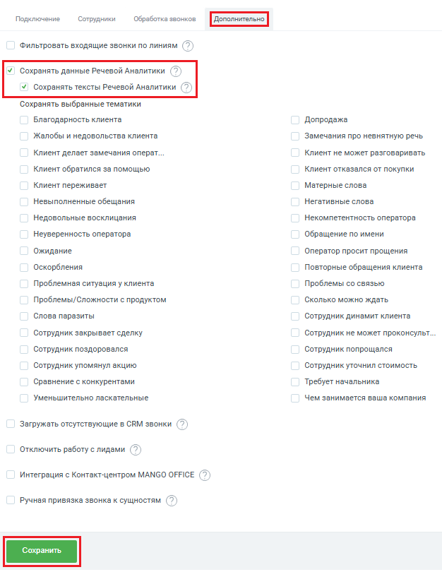

# Как настроить

> Трассировка: PDF §2.4 · сквозные стр. 41-42 · источники: ч.1 `kb/sources/integration-bpmsoft/Mango_office_integration_BPMSoft.pdf` с.41-42.

Чтобы включить функцию сохранения тематик Речевой аналитики, в окне “Основные настройки интеграции” следует: 1) открыть вкладку “Дополнительно”; 2) установить флаг “Сохранять тексты Речевой Аналитики”; 3) нажать на кнопку “Сохранить” внизу окна “Основные настройки интеграции”:

> **Описание иллюстрации INTBPM-§2.4-1** (к §2.4 «Как настроить», стр. 41; 626×810 px). Снимок экрана / схема.
> Относится к тексту руководства: «…ть вкладку “Дополнительно”; 2) установить флаг “Сохранять тексты Речевой Аналитики”; 3) нажать на кнопку “Сохранить” внизу окна “Основные настройки интеграции”:».
> Текст на изображении (OCR, требует сверки): Подключение; Сотрудники; Обработка звонков; Фильтровать входящие звонки по линиям [© ); У Сохранять данные Речевой Аналитики [© ); У Сохранять тексты Речевой Аналитики Q; Сохранять выбранные тематики; Благодарность клиента; Допродажа; Жалобы и недовольства клиента; Замечания про невнятную речь; Клиент делает замечания операт...; Клиент не может разговаривать; Клиент обратился за помощью; Клиент отказался от покупки; Клиент переживает; Матерные слова; Негативные слова; Невыполненные обещания; Недовольные восклицания; Некомпетентность оператора; Неуверенность оператора; Обращение по имени; Ожида…

Руководство по интеграции АТС MANGO OFFICE и BPMSoft | Версия от 22.06.2026
