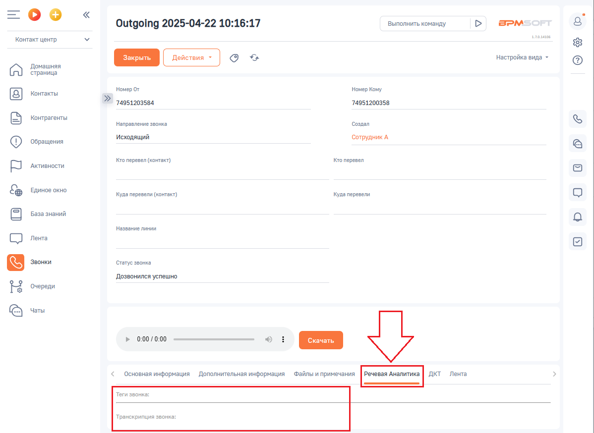
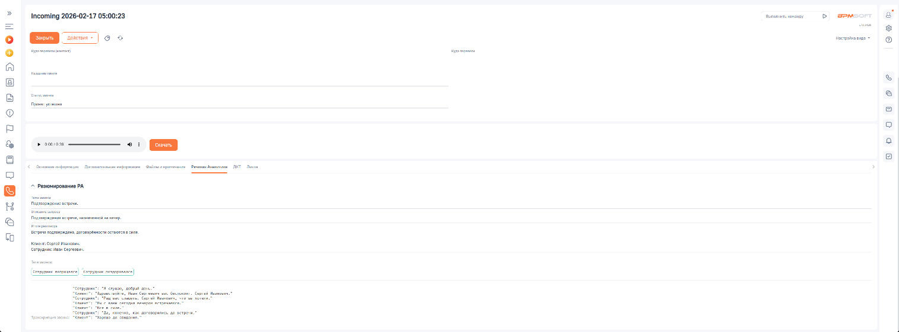

# Как посмотреть распознанный текст

> Трассировка: PDF §2.4 · сквозные стр. 42 · источники: ч.1 `kb/sources/integration-bpmsoft/Mango_office_integration_BPMSoft.pdf` с.42.

Чтобы посмотреть текст, распознанный в диалоге с клиентом, BPMSoft необходимо: 1) открыть в Контакт-Центр; 2) открыть раздел “Звонки”; 3) дважды нажать на строку с данными звонка; 4) открыть на вкладку “Речевая аналитика”. Вы увидите распознанный текст:

> **Описание иллюстрации INTBPM-§2.4-1** (к §2.4 «Как посмотреть распознанный текст», стр. 42; 1198×874 px). Снимок экрана / схема.
> Относится к тексту руководства: «…2) открыть раздел “Звонки”; 3) дважды нажать на строку с данными звонка; 4) открыть на вкладку “Речевая аналитика”. Вы увидите распознанный текст:».
> Текст на изображении (OCR, требует сверки): Outgoing 2025-04-22 10:16:17; Выполнить команду; BPM:; Контакт центр; as; oe; настройка вида -; Домашняя; страница; Номер Or; Номер Кому; Контакты; 74951203584; 74951200358; Контрагенты; Направление звонка.; Создал; исходящий; Сотрудник А; ‘Обращения; Активности.; ro перевел (контакт); Кто перевел; Единое окно; Куда перевели (контакт); Kya перевели; Название линии; СО ль; ‘Статус звонка; `Дозвонился успешно; Очереди; © vers; Основная информация; Дополнительная информация; Файлы и примечания; ДКТ Лента; Теги звонка:; Транскрипция звонка:

> **Описание иллюстрации INTBPM-§2.4-2** (к §2.4 «Как посмотреть распознанный текст», стр. 42; 1515×561 px). Снимок экрана / схема.
> Относится к тексту руководства: «…2) открыть раздел “Звонки”; 3) дважды нажать на строку с данными звонка; 4) открыть на вкладку “Речевая аналитика”. Вы увидите распознанный текст:».
> Текст на изображении (OCR, требует сверки): Incoming 2026-02-17 05:00:23; вм; sino; ооо; sos; ne; > Peoyponanne PA; орден три; ре; тети питон; So; лососем; арии cero; ‘sem ‘ern so; “rma; “os; stp; cers a6 erp

Резюме разговора
