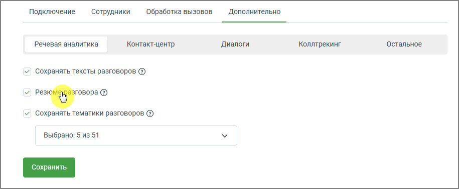
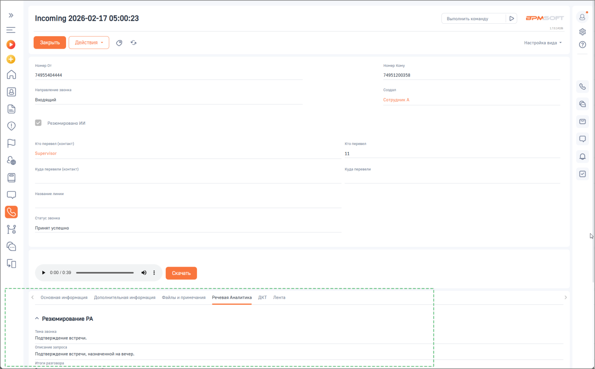

# Как включить сохранение резюме разговора

> Трассировка: PDF §2.4 · сквозные стр. 43-44 · источники: ч.1 `kb/sources/integration-bpmsoft/Mango_office_integration_BPMSoft.pdf` с.43-44.

Чтобы включить сохранение резюме разговоров в BPMSoft, в основных настройках интеграции необходимо: • открыть вкладку «Дополнительно»; • установить флаг «Резюме разговора»; • нажать кнопку «Сохранить».

> **Описание иллюстрации INTBPM-§2.4-1** (к §2.4 «Как включить сохранение резюме разговора», стр. 43; 915×378 px). Снимок экрана / схема.
> Относится к тексту руководства: «…• открыть вкладку «Дополнительно»; • установить флаг «Резюме разговора»; • нажать кнопку «Сохранить».».
> Текст на изображении (OCR, требует сверки): Подключение; ‘Сотрудники; Обработка вызовов; ‘Дополнительно; Речевая аналитика; Контакт-центр; Диалоги; Коллтрекинг; ‘Остальное; У) сохранять тексты разговоров ©; у перу ®; У сохранять тематики разговоров ®; выбрано: 5 из 51

После включения настройки резюме разговоров будет автоматически подгружаться в интерфейс BPMSoft для обработанных звонков. Руководство по интеграции АТС MANGO OFFICE и BPMSoft | Версия от 22.06.2026

> **Описание иллюстрации INTBPM-§2.4-2** (к §2.4 «Как включить сохранение резюме разговора», стр. 44; 1378×855 px). Снимок экрана / схема.
> Относится к тексту руководства: «…говора»; • нажать кнопку «Сохранить». После включения настройки резюме разговоров будет автоматически подгружаться в интерфейс BPMSoft для обработанных звонков.».
> Текст на изображении (OCR, требует сверки): Incoming 2026-02-17 05:00:23; Выполнить команду; PM; so; Настройка вида ~; номерот; Номер кому; 74955404444; 74951200858; ноировление звонка; oman; Входящий; СотрудникА.; fe); резюмировано ИИ; ro nepesen фота; ronepeaen; ‘Supervisor; уда перевал оонтькт); yaa перевели; название линии; Принят успешно.; > 000/039; aan n enn =n nee; Основная информация; Дополнительная информация; Файлы и примечания; речевая Аналитика ДЕТ Лента; ^ Резюмирование PA; “eva звонко; Подтверждение встречи.; eam запроса; Подтверждение встречи, назначенной на вечер.
