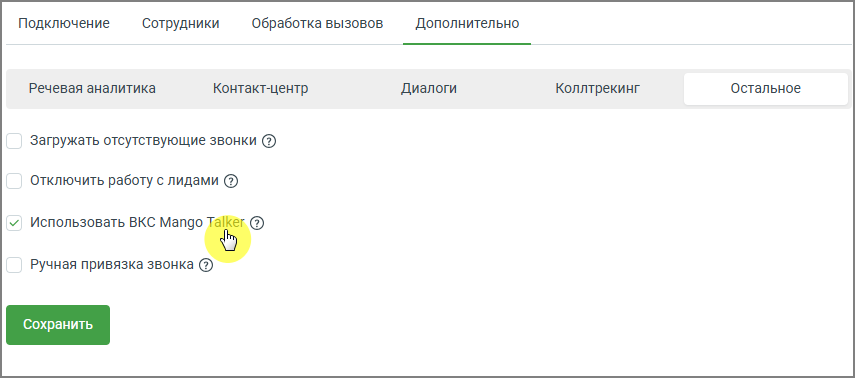
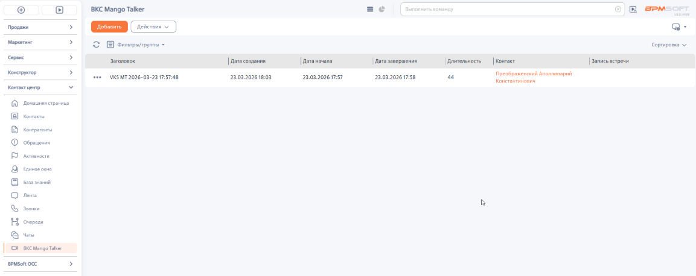

# Как включить использование ВКС

> Трассировка: PDF §2.4 · сквозные стр. 45-46 · источники: ч.1 `kb/sources/integration-bpmsoft/Mango_office_integration_BPMSoft.pdf` с.45-46.

Чтобы включить возможность работы с видеоконференцсвязью, в основных настройках интеграции необходимо: • открыть вкладку «Дополнительно»; • установить флаг «Использовать ВКС MANGO TALKER»; • нажать кнопку «Сохранить». Руководство по интеграции АТС MANGO OFFICE и BPMSoft | Версия от 22.06.2026

> **Описание иллюстрации INTBPM-§2.4-1** (к §2.4 «Как включить использование ВКС», стр. 46; 855×378 px). Снимок экрана / схема.
> Относится к тексту руководства: «…• открыть вкладку «Дополнительно»; • установить флаг «Использовать ВКС MANGO TALKER»; • нажать кнопку «Сохранить».».
> Текст на изображении (OCR, требует сверки): Подключение; Сотрудники; Обработка вызовов; Дополнительно; Речевая аналитика; Контакт-центр; Диалоги; Коллтрекинг; Остальное; Загружать отсутствующие звонки (5); Отключить работу с лидами (3); У! Использовать BKC Mango; 15°; Ручная привязка звонка (3)

После включения настройки в интерфейсе BPMSoft становится доступна работа с видеоконференциями. Для просмотра истории видеовстреч перейдите в рабочее место “Контакт- центр” и выберите раздел “ВКС Mango Talker”. В разделе отображается список проведенных видеовстреч.

> **Описание иллюстрации INTBPM-§2.4-2** (к §2.4 «Как включить использование ВКС», стр. 46; 1153×458 px). Снимок экрана / схема.
> Относится к тексту руководства: «…отра истории видеовстреч перейдите в рабочее место “Контакт- центр” и выберите раздел “ВКС Mango Talker”. В разделе отображается список проведенных видеовстреч.».
> Текст на изображении (OCR, требует сверки): ВКС Mango Talker; ве; sem; poner; Masser; SH oumpuipyeme +; сортире; cope; ‘aronoecn,; [see ana; | доиельсь; Koren; встр; ыы; ргобраенский Аполлинарий; = YKSMT 2026-09-29 1757348; 7302.20261803; 7302.20061757; 2202.2006 1758; тачек; Демон сре; Ope; nae oe; an ah; Но; Qu; sowsettoce
