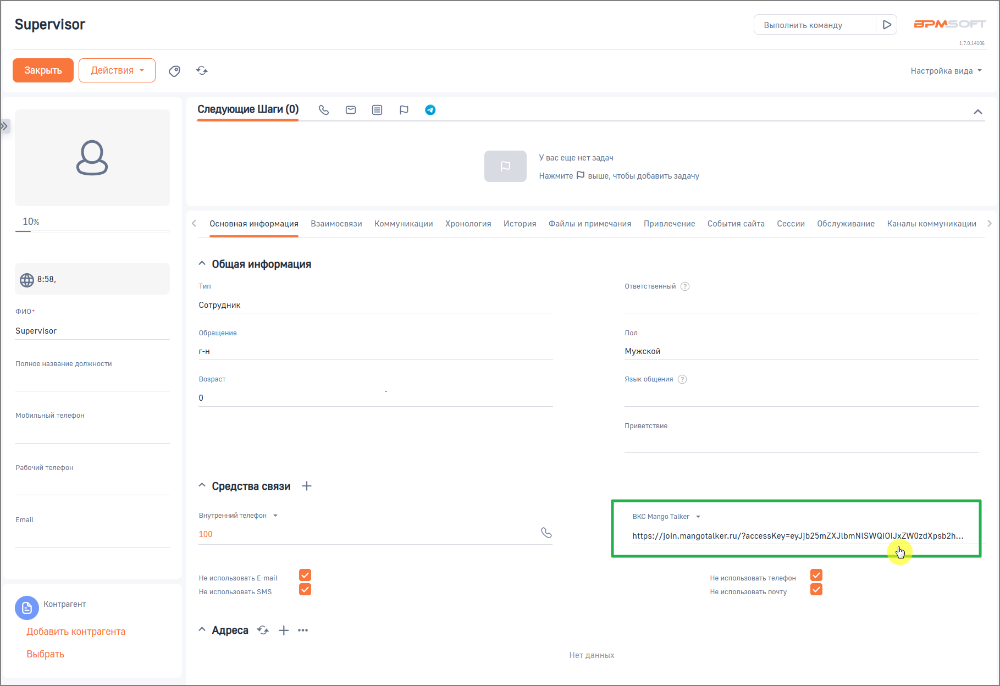

# Как работать с видеоконференцией в карточке контакта

> Трассировка: PDF §2.4 · сквозные стр. 46-47 · источники: ч.1 `kb/sources/integration-bpmsoft/Mango_office_integration_BPMSoft.pdf` с.46-47.

В разделе “Контакты” в карточке контакта доступна ссылка для подключения к видеоконференции MANGO TALKER. При первом обращении система запрашивает у сервиса MANGO TALKER уникальную ссылку на видеоконференцию и сохраняет её за данным контактом. Сформированная ссылка: • отображается в карточке контакта; • используется для подключения к видеоконференции; Руководство по интеграции АТС MANGO OFFICE и BPMSoft | Версия от 22.06.2026 • является постоянной и не изменяется при последующих обращениях.

> **Описание иллюстрации INTBPM-§2.4-1** (к §2.4 «Как работать с видеоконференцией в карточке контакта», стр. 47; 1819×1248 px). Снимок экрана / схема.
> Относится к тексту руководства: «…• является постоянной и не изменяется при последующих обращениях.».
> Текст на изображении (OCR, требует сверки): SPM; Supervisor; Выполнить команду; 70.4106; io}; Настройка вида ~; Следующие Шаги (0); ъ в; Y Bac еще нет задач; Нажмите Е} выше, чтобы добавить задачу; 10%; Основная информация; Взаимосвязи; Коммуникации; Хронология; История; Файлы и примечания; Привлечение; События сайта; Сессии; Обслуживание; Каналы коммуникации; ^ Общая информация; Tun; Ответственный; ovo; Сотрудник; ‘Supervisor; Пол; Обращение; г-н; Мужской; Полное название должности; Возраст; Язык общения; мобильный телефон; Приветствие; рабочий телефон; ^ Средства связи +; Внутренний телефон >; ВКС Mango Talker +; Email; 100; https://j…

При переходе по ссылке открывается вкладка браузера с предложением войти в видеоконференцию MANGO TALKER.
