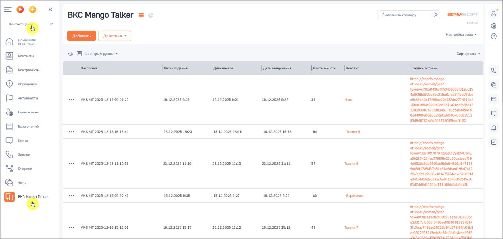
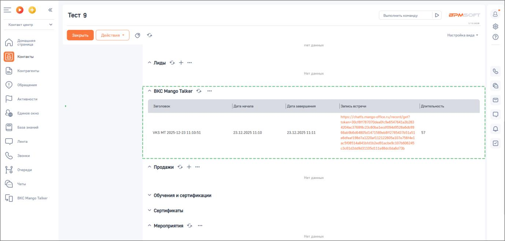

# Результаты видео-встречи

> Трассировка: PDF §2.4 · сквозные стр. 47-48 · источники: ч.1 `kb/sources/integration-bpmsoft/Mango_office_integration_BPMSoft.pdf` с.47-48.

После завершения видео-встречи информация о ней сохраняется в BPMSoft в разделе “ВКС Mango Talker”. Для каждой видеовстречи отображаются: • дата создания; • дата начала и завершения; • продолжительность встречи; • контакт, связанный со встречей; • запись встречи. Сохранённые данные позволяют анализировать историю взаимодействий с клиентом и использовать записи видео-встреч в дальнейшей работе. В разделе ВКС Mango Talker отображается вся история ВКС встреч. Руководство по интеграции АТС MANGO OFFICE и BPMSoft | Версия от 22.06.2026

> **Описание иллюстрации INTBPM-§2.4-1** (к §2.4 «Результаты видео-встречи», стр. 48; 1378×657 px). Снимок экрана / схема.
> Относится к тексту руководства: «…ровать историю взаимодействий с клиентом и использовать записи видео-встреч в дальнейшей работе. В разделе ВКС Mango Talker отображается вся история ВКС встреч.».
> Текст на изображении (OCR, требует сверки): =oo; Выполнить команду; вем=огт; BKC Mango Talker = —; free}; Настройка вида ~; Домашняя; ‘страница; ‚$ Е ownerpurrpynma =; "Сортировка =; Контакты; Контрагенты; ОЕ ЕЕ ЕЕ; isps://chatfs mango; обращении,; oie rurecord/gat?; tokenscf9hadtabcoISBAN6BBdtdtebc15; 49(63806875035e7 1BoBeIchste7d696bd; `Активности; \VKS MT 2025-12-19 09:2; 19.12.2025 9:28; 19,12.20259:21; 39.12.2025 9:22; 35; Mow; 5485eb25174960000878260277461882; 10fe018640992140sb9241a2bed006012; 22420808767 eab2deTTeBb5e8AA5et8; Единое ona; оочаовабааеэвачивизвнь746з512; заозотиовьбавва?вовЗьесН163; Basa зманий; \VKS MT 2025-12-18…

На скриншоте ниже показана история видеовстреч для отдельного контакта в блоке “ВКС Mango Talker”.

> **Описание иллюстрации INTBPM-§2.4-2** (к §2.4 «Результаты видео-встречи», стр. 48; 1378×660 px). Снимок экрана / схема.
> Относится к тексту руководства: «…На скриншоте ниже показана история видеовстреч для отдельного контакта в блоке “ВКС Mango Talker”.».
> Текст на изображении (OCR, требует сверки): =oo; Tect 9; Выполнить команду; > BPM; Контакт центр; "настройка вида =; Домашняя; страница; ‘нетданных; Контакты; Контрыленты; Обращения; аа,; АЕ; si en nin; арены; ^ BKC Mango Talker <>; Активмости; [ден; [дать завершения; | Запись встречи.; | ительность:; Единое окно; https://chatfs.mango-tfceru/record/get?; toker=20ctB4787070des0te9e6547641836209; база знаний; ‘зодвезтвиве?Зев0ьа1есв1044952вабаьз9; \VKS MT 2025-12-23 11:10:51,; 23.22.2025 11:10; 23.42.2005 11:11; (86089060 4805414715890b8112785437O51051,; tat 9807a1220st11212260581076755t4e1; Лента; зезовзлаавальальдевауасвеве10ТЬБОВ245; с…
