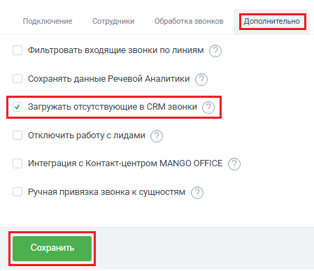

# Как включить

> Трассировка: PDF §2.4 · сквозные стр. 49 · источники: ч.1 `kb/sources/integration-bpmsoft/Mango_office_integration_BPMSoft.pdf` с.49.

Чтобы включить функцию загрузки отсутствующих в CRM звонков, в окне “Основные настройки интеграции” следует: 1) открыть вкладку “Дополнительно”; 2) установить флаг “Загрузка отсутствующих в CRM звонков”; 3) нажать на кнопку “Сохранить” внизу окна “Основные настройки интеграции”:

> **Описание иллюстрации INTBPM-§2.4-1** (к §2.4 «Как включить», стр. 49; 449×388 px). Снимок экрана / схема.
> Относится к тексту руководства: «… вкладку “Дополнительно”; 2) установить флаг “Загрузка отсутствующих в CRM звонков”; 3) нажать на кнопку “Сохранить” внизу окна “Основные настройки интеграции”:».
> Текст на изображении (OCR, требует сверки): Подключение; Сотрудники; Обработка звонков; Фильтровать входящие звонки по линиям (7; Сохранять данные Речевой Аналитики ( 2; Отключить работу с лидами (7; Интеграция с Контакт-центром MANGO OFFICE ( 2; Ручная привязка звонка к сущностям (7
