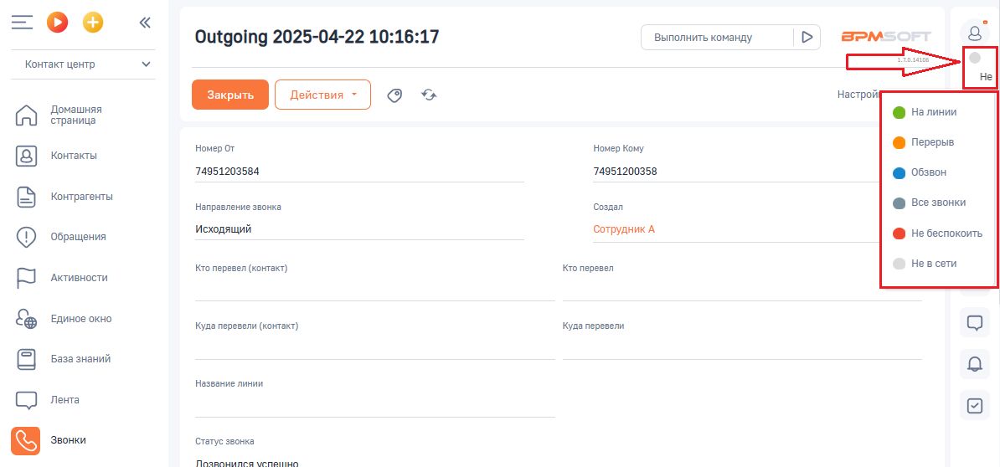

# Статусы Контакт-центра в интерфейсе BPMSoft

> Трассировка: PDF §2.4 · сквозные стр. 51 · источники: ч.1 `kb/sources/integration-bpmsoft/Mango_office_integration_BPMSoft.pdf` с.51.

Статус пользователя отображается в интерфейсе BPMSoft сразу после включения настроек, указных в требованиях и обновления страницы.

> **Описание иллюстрации INTBPM-§2.4-1** (к §2.4 «Статусы Контакт-центра в интерфейсе BPMSoft», стр. 51; 1194×558 px). Снимок экрана / схема.
> Относится к тексту руководства: «…т-центра в интерфейсе BPMSoft Статус пользователя отображается в интерфейсе BPMSoft сразу после включения настроек, указных в требованиях и обновления страницы.».
> Текст на изображении (OCR, требует сверки): оо; Выполнить команду; BPM:; Outgoing 2025-04-22 10:16:17; Контакт центр; oe; настрой; Домашняя; страница; © перерыв; Контакты; Номер Or; Номер Кому; 74951203584; 74951200358; @ обзеон; Контрагенты; @ Bee звонки; Направление звонка.; Создал; ‘Обращения; исходящий; Сотрудник А; @ не беспокоить; Не в сети; ro перевел (контакт); Кто перевел; Активности.; Единое окно; Куда перевели (контакт); Kya перевели; Название линии; СО ль; ‘Статус звонка; Doepauunee venere

Чтобы изменить статус пользователя, необходимо: 1) нажмите на статус пользователя. Будет открыто дополнительное меню; 2) выберите статус пользователя
