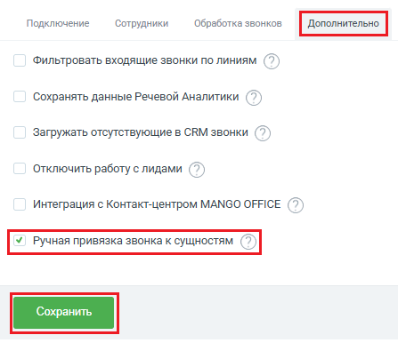

# Как включить

> Трассировка: PDF §2.4 · сквозные стр. 52-53 · источники: ч.1 `kb/sources/integration-bpmsoft/Mango_office_integration_BPMSoft.pdf` с.52-53.

Для этого, в вашей BPMSoft, в основных настройках интеграции необходимо: 1) открыть закладку “Дополнительно”; 2) активировать переключатель “Ручная привязка звонка к сущностям”; 3) нажать кнопку “Сохранить”: Руководство по интеграции АТС MANGO OFFICE и BPMSoft | Версия от 22.06.2026

> **Описание иллюстрации INTBPM-§2.4-1** (к §2.4 «Как включить», стр. 53; 447×386 px). Снимок экрана / схема.
> Относится к тексту руководства: «…1) открыть закладку “Дополнительно”; 2) активировать переключатель “Ручная привязка звонка к сущностям”; 3) нажать кнопку “Сохранить”:».
> Текст на изображении (OCR, требует сверки): Подключение; Сотрудники; Обработка звонков; Фильтровать входящие звонки по линиям (7); Сохранять данные Речевой Аналитики ( 2 ); Загружать отсутствующие в CRM звонки (7); Отключить работу с лидами (7); Интеграция с Контакт-центром MANGO OFFICE ( 2 )
