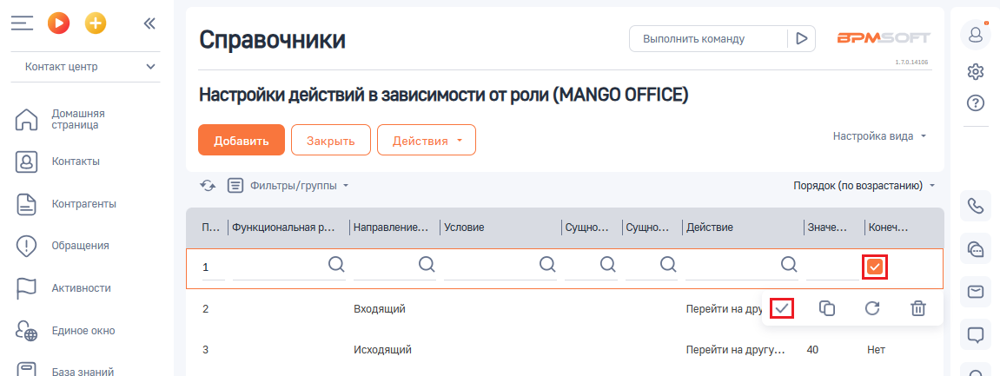
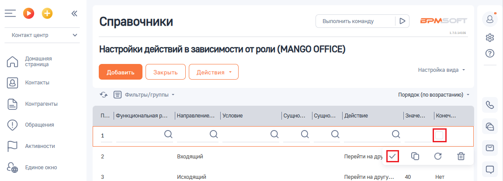

# Как активировать или деактивировать настройку

> Трассировка: PDF §2.5 · сквозные стр. 61-62 · источники: ч.1 `kb/sources/integration-bpmsoft/Mango_office_integration_BPMSoft.pdf` с.61-62.

Для этого, в вашей BPMSoft откройте настройку. Будет открыта страница ” Настройки действий в зависимости от роли (MANGO OFFICE)“. Чтобы АКТИВИРОВАТЬ настройку действий в зависимости от роли, нужно

> **Описание иллюстрации INTBPM-§2.5-1** (к §2.5 «Как активировать или деактивировать настройку», стр. 61; 27×27 px). Пиктограмма (значок элемента интерфейса).
> Относится к тексту руководства: «…настройку. Будет открыта страница ” Настройки действий в зависимости от роли (MANGO OFFICE)“. Чтобы АКТИВИРОВАТЬ настройку действий в зависимости от роли, нужно».
> Текста на изображении нет; назначение элемента — см. текст, к которому он относится.

нажать на первую строку таблицы, а затем СНЯТЬ ГАЛОЧКУ в поле

> **Описание иллюстрации INTBPM-§2.5-2** (к §2.5 «Как активировать или деактивировать настройку», стр. 61; 21×19 px). Пиктограмма (значок элемента интерфейса).
> Относится к тексту руководства: «…имости от роли (MANGO OFFICE)“. Чтобы АКТИВИРОВАТЬ настройку действий в зависимости от роли, нужно нажать на первую строку таблицы, а затем СНЯТЬ ГАЛОЧКУ в поле».
> Текста на изображении нет; назначение элемента — см. текст, к которому он относится.

“Конечное действие при срабатывании” и нажать на кнопку :

> **Описание иллюстрации INTBPM-§2.5-3** (к §2.5 «Как активировать или деактивировать настройку», стр. 61; 1151×433 px). Снимок экрана / схема.
> Относится к тексту руководства: «…ку действий в зависимости от роли, нужно нажать на первую строку таблицы, а затем СНЯТЬ ГАЛОЧКУ в поле “Конечное действие при срабатывании” и нажать на кнопку :».
> Текст на изображении (OCR, требует сверки): Выполнить команду; BPM:; Справочники; Контакт центр; Настройки действий в зависимости от роли (MANGO OFFICE); Домашняя; страница; настройка вида ~; Контакты; *> Е оильтры/группы -; Порядок (по возрастанию) -; Контрагенты; п... | Функциональная р. |Направление.. | Yenosne; ‘Обращения; Активности.; входящий; Перейти на дру; св; Единое окно; исходящий; Перейти на другу...; 40; Her; Basa знаний.

Руководство по интеграции АТС MANGO OFFICE и BPMSoft | Версия от 22.06.2026 Для того, чтобы ДЕАКТИВИРОВАТЬ настройку действий в зависимости от роли, нужно нажать на первую строку таблицы, а затем ПОСТАВИТЬ ГАЛОЧКУ

> **Описание иллюстрации INTBPM-§2.5-4** (к §2.5 «Как активировать или деактивировать настройку», стр. 62; 27×27 px). Пиктограмма (значок элемента интерфейса).
> Относится к тексту руководства: «…Для того, чтобы ДЕАКТИВИРОВАТЬ настройку действий в зависимости от роли, нужно нажать на первую строку таблицы, а затем ПОСТАВИТЬ ГАЛОЧКУ».
> Текста на изображении нет; назначение элемента — см. текст, к которому он относится.

> **Описание иллюстрации INTBPM-§2.5-5** (к §2.5 «Как активировать или деактивировать настройку», стр. 62; 21×19 px). Пиктограмма (значок элемента интерфейса).
> Относится к тексту руководства: «…Для того, чтобы ДЕАКТИВИРОВАТЬ настройку действий в зависимости от роли, нужно нажать на первую строку таблицы, а затем ПОСТАВИТЬ ГАЛОЧКУ».
> Текста на изображении нет; назначение элемента — см. текст, к которому он относится.

в поле “Конечное действие при срабатывании” и нажать на кнопку :

> **Описание иллюстрации INTBPM-§2.5-6** (к §2.5 «Как активировать или деактивировать настройку», стр. 62; 1151×416 px). Снимок экрана / схема.
> Относится к тексту руководства: «…ействий в зависимости от роли, нужно нажать на первую строку таблицы, а затем ПОСТАВИТЬ ГАЛОЧКУ в поле “Конечное действие при срабатывании” и нажать на кнопку :».
> Текст на изображении (OCR, требует сверки): Выполнить команду; BPM:; Справочники; Контакт центр; Настройки действий в зависимости от роли (MANGO OFFICE); Домашняя; страница; настройка вида ~; Контакты; *> Е оильтры/группы -; Порядок (по возрастанию) -; Контрагенты; п... | Функциональная р. |Направление.. | Yenosne; ‘Обращения; Активности.; входящий; Перейти на дру; Oo Cc tw; Единое окно; Исходящий; Перейти на другу.; Нет
