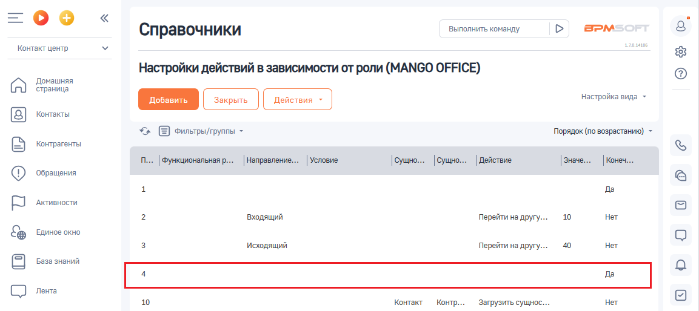
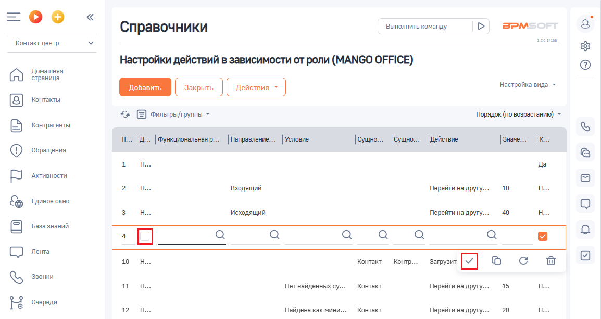
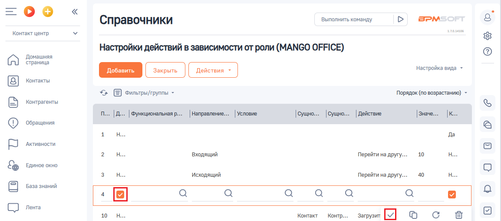

# Как включить или приостановить действие правила

> Трассировка: PDF §2.5 · сквозные стр. 62-64 · источники: ч.1 `kb/sources/integration-bpmsoft/Mango_office_integration_BPMSoft.pdf` с.62-64.

Для включения и отключения правила, используется специальная колонка “Деактивация” в таблице правил. По умолчанию, колонка “Деактивация” скрыта, чтобы ее добавить в таблицу, выполните эти действия. Если она у вас уже есть, то в настройке “Настройка действий в зависимости от роли” следует: 1) найдите строку данными нужного вам правила и нажмите на нее:

> **Описание иллюстрации INTBPM-§2.5-1** (к §2.5 «Как включить или приостановить действие правила», стр. 62; 1153×514 px). Снимок экрана / схема.
> Относится к тексту руководства: «…вия. Если она у вас уже есть, то в настройке “Настройка действий в зависимости от роли” следует: 1) найдите строку данными нужного вам правила и нажмите на нее:».
> Текст на изображении (OCR, требует сверки): Справочники; Выполнить команду; BPM:; Контакт центр; Настройки действий в зависимости от роли (MANGO OFFICE); страница; Домашняя; настройка вида ~; Контакты; <> Е onnerpsi/rpynnes -; Порядок (по возрастанию) -; контрагенты; п... | Функциональная р...; ' Направление...; Условие; | Действие; ‘Обращения; Активности.; 10; Her; входящий; Перейти на другу.; ЕДИНОЕ окно; исходящий; 40; База знаний; Лента; Контакт; контр.; Загрузить сущнос.

Руководство по интеграции АТС MANGO OFFICE и BPMSoft | Версия от 22.06.2026 2) чтобы ВЫКЛЮЧИТЬ правило, надо УСТАНОВИТЬ ГАЛОЧКУ в графе “Деактивация” (так, как показано на рисунке ниже) и нажать на кнопку

> **Описание иллюстрации INTBPM-§2.5-2** (к §2.5 «Как включить или приостановить действие правила», стр. 63; 21×19 px). Пиктограмма (значок элемента интерфейса).
> Относится к тексту руководства: «…2) чтобы ВЫКЛЮЧИТЬ правило, надо УСТАНОВИТЬ ГАЛОЧКУ в графе “Деактивация” (так, как показано на рисунке ниже) и нажать на кнопку».
> Текста на изображении нет; назначение элемента — см. текст, к которому он относится.

:

> **Описание иллюстрации INTBPM-§2.5-3** (к §2.5 «Как включить или приостановить действие правила», стр. 63; 1154×613 px). Снимок экрана / схема.
> Относится к тексту руководства: «…2) чтобы ВЫКЛЮЧИТЬ правило, надо УСТАНОВИТЬ ГАЛОЧКУ в графе “Деактивация” (так, как показано на рисунке ниже) и нажать на кнопку :».
> Текст на изображении (OCR, требует сверки): =oO°o; Справочники; Выполнить команду; BPM:; алан; Контакт центр; Настройки действий в зависимости от роли (MANGO OFFICE); Домашняя; страница; настройка вида ~; Контакты; ‘Фильтры/группы -; Порядок (по возрастанию); Контрагенты; .. | Функциональная р... | Направление... | Условие; |сущно... |Сущно... |Действие; ‘Обращения; да; Активности.; ‘Входящий; Перейти на другу...; 10; Единое окно; ‘Исходящий; 40; ©) sea nama; СО ль; Контакт; контр...; Загрузит; Oo Cc tw; Her найденных cy...; Перейти на apyry...; 15; Очереди; 12; Найдена как мини...; 20

> **Описание иллюстрации INTBPM-§2.5-4** (к §2.5 «Как включить или приостановить действие правила», стр. 63; 27×27 px). Пиктограмма (значок элемента интерфейса).
> Относится к тексту руководства: «…2) чтобы ВЫКЛЮЧИТЬ правило, надо УСТАНОВИТЬ ГАЛОЧКУ в графе “Деактивация” (так, как показано на рисунке ниже) и нажать на кнопку :».
> Текста на изображении нет; назначение элемента — см. текст, к которому он относится.

Если вам надо ВКЛЮЧИТЬ правило, надо СНЯТЬ ГАЛОЧКУ в графе

> **Описание иллюстрации INTBPM-§2.5-5** (к §2.5 «Как включить или приостановить действие правила», стр. 63; 1154×509 px). Снимок экрана / схема.
> Относится к тексту руководства: «…нке ниже) и нажать на кнопку : Если вам надо ВКЛЮЧИТЬ правило, надо СНЯТЬ ГАЛОЧКУ в графе “Деактивация” (так, как показано на рисунке ниже) и нажать на кнопку :».
> Текст на изображении (OCR, требует сверки): Выполнить команду; BPM:; Справочники; алан; Контакт центр; Настройки действий в зависимости от роли (MANGO OFFICE); Домашняя; страница; настройка вида ~; Контакты; *> Е оильтры/группы -; Порядок (по возрастанию) -; Контрагенты; ' Направление...; Условие.; .. | ункциональная р.; |сущно... |Сущно... |Действие; ‘Обращения; да; Активности.; ‘Входящий; Перейти на другу...; 10; Единое окно; ‘Исходящий; 40; База знаний; Лента; Контакт; Контр.; `Загрузит; Oo Cc ww

“Деактивация” (так, как показано на рисунке ниже) и нажать на кнопку :

<!-- изображение на стр. 63: байты не извлечены (PyMuPDF недоступен) -->

Руководство по интеграции АТС MANGO OFFICE и BPMSoft | Версия от 22.06.2026
