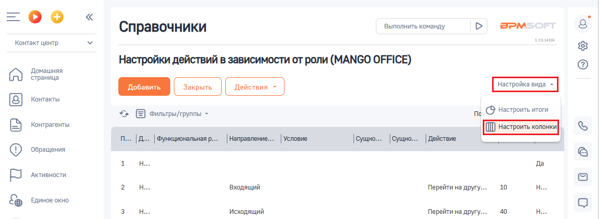
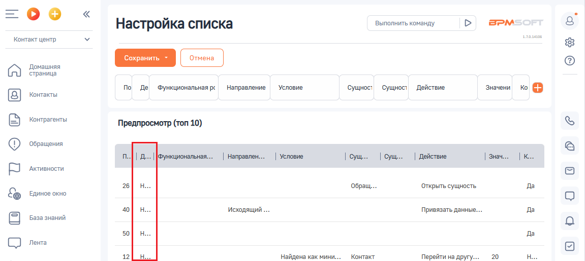

# Как настроить колонки в таблице

> Трассировка: PDF §2.5 · сквозные стр. 64-65 · источники: ч.1 `kb/sources/integration-bpmsoft/Mango_office_integration_BPMSoft.pdf` с.64-65.

Для этого, в настройке “Настройка действий в зависимости от роли” следует: 1) нажать на пункт “ВИД”. Будут открыты дополнительные поля; 2) нажать на пункт “Настроить колонки”:

> **Описание иллюстрации INTBPM-§2.5-1** (к §2.5 «Как настроить колонки в таблице», стр. 64; 1154×423 px). Снимок экрана / схема.
> Относится к тексту руководства: «…стройке “Настройка действий в зависимости от роли” следует: 1) нажать на пункт “ВИД”. Будут открыты дополнительные поля; 2) нажать на пункт “Настроить колонки”:».
> Текст на изображении (OCR, требует сверки): Выполнить команду; BPM:; Справочники; Контакт центр; Настройки действий в зависимости от роли (MANGO OFFICE); Домашняя; страница; Контакты; *> Е оильтры/группы -; ng © Настроить итоги; Контрагенты; Условие.; ' Направление...; |сущно... |Сущно... |Действие; ‘Обращения; Активности.; ‘Входящий; Перейти на другу...; 10; Единое окно; ‘Исходящий; 40

> **Описание иллюстрации INTBPM-§2.5-2** (к §2.5 «Как настроить колонки в таблице», стр. 64; 29×29 px). Пиктограмма (значок элемента интерфейса).
> Относится к тексту руководства: «…стройке “Настройка действий в зависимости от роли” следует: 1) нажать на пункт “ВИД”. Будут открыты дополнительные поля; 2) нажать на пункт “Настроить колонки”:».
> Текста на изображении нет; назначение элемента — см. текст, к которому он относится.

3) нажать на кнопку :

> **Описание иллюстрации INTBPM-§2.5-3** (к §2.5 «Как настроить колонки в таблице», стр. 64; 1156×404 px). Снимок экрана / схема.
> Относится к тексту руководства: «…нажать на пункт “ВИД”. Будут открыты дополнительные поля; 2) нажать на пункт “Настроить колонки”: 3) нажать на кнопку :».
> Текст на изображении (OCR, требует сверки): =oO°o; BPM:; Настройка списка; Выполнить команду; Контакт центр; Домашняя; страница; по; Значени; Ko; Контакты; Де Функциональная pc; Направление — Условие; Сущност; Сущност Действие; Контрагенты; Предпросмотр (топ 10); ‘Обращения; | Направлен...; | Условие; | Действие.; [ke; Активности.; 28 OH,; Обращ...; ‘Открыть сущность; Единое окно

4) ввести значение “Деактивирована” в выпадающем списке “Колонка”; 5) нажать на кнопку “ВЫБРАТЬ”:

> **Описание иллюстрации INTBPM-§2.5-4** (к §2.5 «Как настроить колонки в таблице», стр. 64; 515×400 px). Снимок экрана / схема.
> Относится к тексту руководства: «…3) нажать на кнопку : 4) ввести значение “Деактивирована” в выпадающем списке “Колонка”; 5) нажать на кнопку “ВЫБРАТЬ”:».
> Текст на изображении (OCR, требует сверки): обои; Выбор колонки; Настройка действия по звонку в зависимости от; роли (MANGO OFFICE); Колонка; | Деактивирована; Деактивирована

Руководство по интеграции АТС MANGO OFFICE и BPMSoft | Версия от 22.06.2026 6) будет добавлена колонка “Деактивирована” в таблицу правил:

> **Описание иллюстрации INTBPM-§2.5-5** (к §2.5 «Как настроить колонки в таблице», стр. 65; 1151×515 px). Снимок экрана / схема.
> Относится к тексту руководства: «…6) будет добавлена колонка “Деактивирована” в таблицу правил:».
> Текст на изображении (OCR, требует сверки): =oO°o; Выполнить команду; BPM:; Настройка списка; Контакт центр; Домашняя; страница; по; Контакты; Де Функциональная pc; Направление — Условие; Сущност; Сущност Действие; Знажни ko; Контрагенты; Предпросмотр (топ 10); ‘Обращения; Функциональная...; | Направлен...; | Условие; | Действие.; [ke; Активности.; Обращ...; ‘Открыть сущность; Единое окно; ‘Исходящий; Привязать данные.; База знаний; СО ле; 12; Найдена как мини...; Контакт; Перейти на другу.

7) при необходимости вы можете переместить колонку, наведя на нее курсор мыши, затем нажать и не отпускать левую кнопку мыши. Перетащите курсором колонку в то или иное место таблицы (не обязательно). Кроме того, вы можете расширить отображение колонки; 8) нажмите на кнопку “Сохранить”:

> **Описание иллюстрации INTBPM-§2.5-6** (к §2.5 «Как настроить колонки в таблице», стр. 65; 1151×515 px). Снимок экрана / схема.
> Относится к тексту руководства: «…Перетащите курсором колонку в то или иное место таблицы (не обязательно). Кроме того, вы можете расширить отображение колонки; 8) нажмите на кнопку “Сохранить”:».
> Текст на изображении (OCR, требует сверки): =oO°o; Выполнить команду; BPM:; Настройка списка; Контакт центр; Домашняя; страница; по; Условие; Контакты; Де Функциональная pc; Направление; Сущност; Сущност Действие; Знажни ko; Контрагенты; Предпросмотр (топ 10); ‘Обращения; | Направлен...; | Условие; | Действие.; [ke; Активности.; Обращ...; ‘Открыть сущность; Единое окно; ‘Исходящий; Привязать данные.; База знаний; СО ле; Найдена как мини...; Контакт; Перейти на другу.
