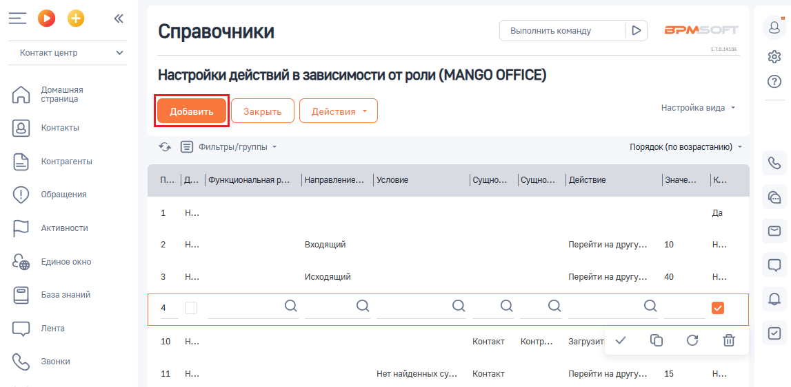
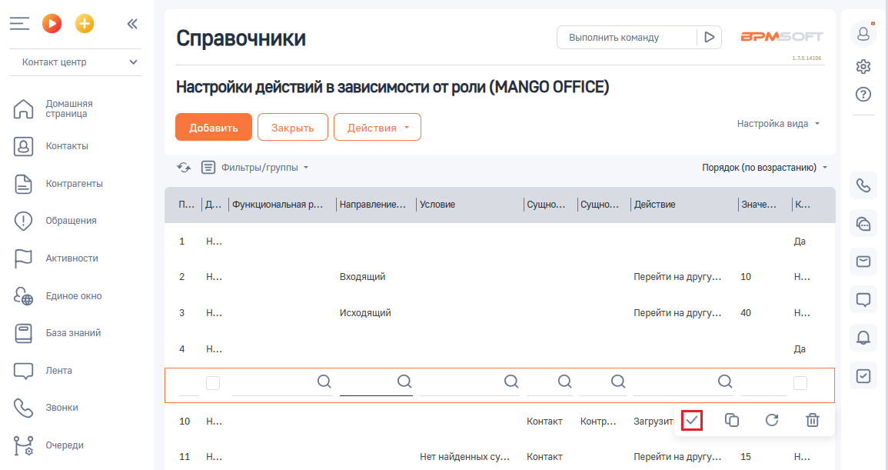

# Добавление

> Трассировка: PDF §2.5 · сквозные стр. 65-66 · источники: ч.1 `kb/sources/integration-bpmsoft/Mango_office_integration_BPMSoft.pdf` с.65-66.

Важно. В настройку действий в зависимости от роли можно добавить не более 40 правил обработки звонков (всего). Для этого, в настройке “Настройка действий в зависимости от роли” следует: 1) нажать на строку с данными того правила, после которого нужно добавить новое правило. Будут открыты дополнительные поля; 2) нажать на кнопку “Добавить”: Руководство по интеграции АТС MANGO OFFICE и BPMSoft | Версия от 22.06.2026

> **Описание иллюстрации INTBPM-§2.5-1** (к §2.5 «Добавление», стр. 66; 1147×563 px). Снимок экрана / схема.
> Относится к тексту руководства: «…ует: 1) нажать на строку с данными того правила, после которого нужно добавить новое правило. Будут открыты дополнительные поля; 2) нажать на кнопку “Добавить”:».
> Текст на изображении (OCR, требует сверки): Выполнить команду; BPM:; Справочники; Контакт центр; Настройки действий в зависимости от роли (MANGO OFFICE); Домашняя; страница; настройка вида ~; Контакты; ‘Фильтры/группы -; Порядок (по возрастанию); Контрагенты; д... | Функциональная р... | Направление... | Условие; |сущно... |Сущно... |Действие; ‘Обращения; да; Активности.; ‘Входящий; Перейти на другу...; 10; Единое окно; ‘Исходящий; 40; База знаний; Лента; Контакт; Загрузи" М; Oo Cc tw; Звонки; 15; Her найденных cy...

3) будет добавлена новая строка для ввода параметров правила. Введите параметры правила, руководствуясь их описанием (см. Как устроена таблица правил обработки звонков);

> **Описание иллюстрации INTBPM-§2.5-2** (к §2.5 «Добавление», стр. 66; 25×24 px). Пиктограмма (значок элемента интерфейса).
> Относится к тексту руководства: «…добавлена новая строка для ввода параметров правила. Введите параметры правила, руководствуясь их описанием (см. Как устроена таблица правил обработки звонков);».
> Текста на изображении нет; назначение элемента — см. текст, к которому он относится.

Примечание. Нажав на кнопку в том или ином поле, вы увидите список возможных значений данного поля.

> **Описание иллюстрации INTBPM-§2.5-3** (к §2.5 «Добавление», стр. 66; 21×19 px). Пиктограмма (значок элемента интерфейса).
> Относится к тексту руководства: «…исанием (см. Как устроена таблица правил обработки звонков); Примечание. Нажав на кнопку в том или ином поле, вы увидите список возможных значений данного поля.».
> Текста на изображении нет; назначение элемента — см. текст, к которому он относится.

4) нажмите кнопку , чтобы сохранить введенное правило:

> **Описание иллюстрации INTBPM-§2.5-4** (к §2.5 «Добавление», стр. 66; 1155×611 px). Снимок экрана / схема.
> Относится к тексту руководства: «…ков); Примечание. Нажав на кнопку в том или ином поле, вы увидите список возможных значений данного поля. 4) нажмите кнопку , чтобы сохранить введенное правило:».
> Текст на изображении (OCR, требует сверки): Выполнить команду; BPM:; Справочники; алан; Контакт центр; Настройки действий в зависимости от роли (MANGO OFFICE); Домашняя; страница; настройка вида ~; Контакты; =) Фильрытруты -; Порядок (по возрастанию); Контрагенты; .. | Функциональная р... | Направление... | Условие; |сущно... |Сущно... |Действие; ‘Обращения; да; Активности.; ‘Входящий; Перейти на другу...; 10; Единое окно; ‘Исходящий; 40; База знаний; Лента; Звонки; Контакт; Контр.; `Загрузит; Oo Cc tw; Очереди; Her найденных cy...; Перейти на apyry..; 15
