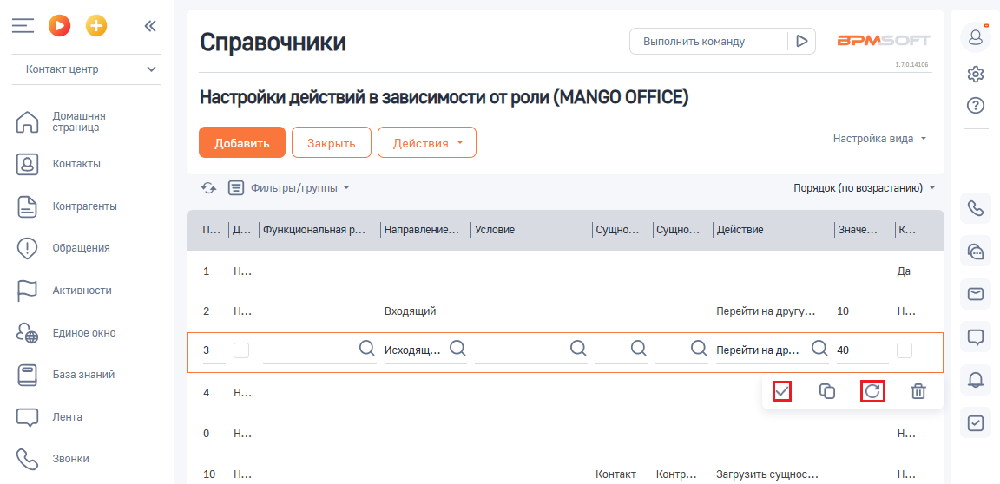
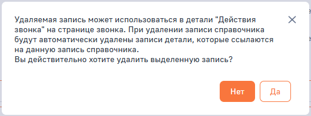

# Редактирование или удаление правила

> Трассировка: PDF §2.5 · сквозные стр. 66-68 · источники: ч.1 `kb/sources/integration-bpmsoft/Mango_office_integration_BPMSoft.pdf` с.66-68.

Важно. 1) Если вы изменили тот или иной параметр правила и сохранили изменения, то уже не сможете их вернуть, то есть нельзя отменить изменение значения параметра; 2) Удаляемая запись может быть в записи “Действия звонка” на странице звонка. При удалении записи справочника автоматически удаляются детали записи, которые ссылаются на описание записи справочника. Не пренебрегайте дополнительной проверкой. Руководство по интеграции АТС MANGO OFFICE и BPMSoft | Версия от 22.06.2026 Для этого, в настройке “Настройка действий в зависимости от роли” следует: 1) нажмите на строку с данными нужного правила; 2) чтобы редактировать правило, измените значение в том или ином параметре; Важно. Пока вы не сохранили правило, внесенные изменения можно

> **Описание иллюстрации INTBPM-§2.5-1** (к §2.5 «Редактирование или удаление правила», стр. 67; 23×23 px). Пиктограмма (значок элемента интерфейса).
> Относится к тексту руководства: «…ными нужного правила; 2) чтобы редактировать правило, измените значение в том или ином параметре; Важно. Пока вы не сохранили правило, внесенные изменения можно».
> Текста на изображении нет; назначение элемента — см. текст, к которому он относится.

отменить, нажав на кнопку . 3) после того как вы внесли все необходимые правки, сохраните правило,

> **Описание иллюстрации INTBPM-§2.5-2** (к §2.5 «Редактирование или удаление правила», стр. 67; 21×19 px). Пиктограмма (значок элемента интерфейса).
> Относится к тексту руководства: «…ажно. Пока вы не сохранили правило, внесенные изменения можно отменить, нажав на кнопку . 3) после того как вы внесли все необходимые правки, сохраните правило,».
> Текста на изображении нет; назначение элемента — см. текст, к которому он относится.

нажав . Важно. После сохранения правила, внесенные изменения нельзя отменить (только путем повторного редактирования).

> **Описание иллюстрации INTBPM-§2.5-3** (к §2.5 «Редактирование или удаление правила», стр. 67; 1152×558 px). Снимок экрана / схема.
> Относится к тексту руководства: «…се необходимые правки, сохраните правило, нажав . Важно. После сохранения правила, внесенные изменения нельзя отменить (только путем повторного редактирования).».
> Текст на изображении (OCR, требует сверки): Выполнить команду; BPM:; Справочники; алан; Контакт центр; Настройки действий в зависимости от роли (MANGO OFFICE); Домашняя; страница; настройка вида ~; Контакты; *> Е оильтры/группы -; Порядок (по возрастанию) -; Контрагенты; .. | Функциональная р... | Направление... | Условие; |сущно... |Сущно... |Действие; ‘Обращения; да; Активности.; 10; ‘Входящий; Перейти на другу...; Единое окно; Q исодящ.. Q; Q перейти на др... Ql 40; База знаний; Лента; Звонки; Контакт

> **Описание иллюстрации INTBPM-§2.5-4** (к §2.5 «Редактирование или удаление правила», стр. 67; 26×30 px). Пиктограмма (значок элемента интерфейса).
> Относится к тексту руководства: «…се необходимые правки, сохраните правило, нажав . Важно. После сохранения правила, внесенные изменения нельзя отменить (только путем повторного редактирования).».
> Текста на изображении нет; назначение элемента — см. текст, к которому он относится.

Чтобы удалить правило, нажмите на кнопку . Будет открыто окно с предупреждением о том, что вместе с правилом будет удалена запись о его применении в истории действий всех звонков:

> **Описание иллюстрации INTBPM-§2.5-5** (к §2.5 «Редактирование или удаление правила», стр. 67; 528×198 px). Снимок экрана / схема.
> Относится к тексту руководства: «…ло, нажмите на кнопку . Будет открыто окно с предупреждением о том, что вместе с правилом будет удалена запись о его применении в истории действий всех звонков:».
> Текст на изображении (OCR, требует сверки): Удаляемая запись может использоваться в детали "Действия; звонка" на странице звонка. При удалении записи справочника; будут автоматически удалены записи детали, которые ссылаются; на данную запись справочника.; Вы действительно хотите удалить выделенную запись?

Руководство по интеграции АТС MANGO OFFICE и BPMSoft | Версия от 22.06.2026
