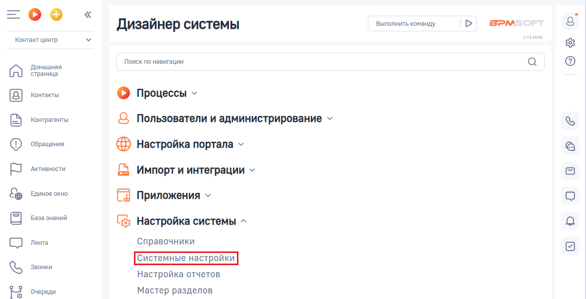
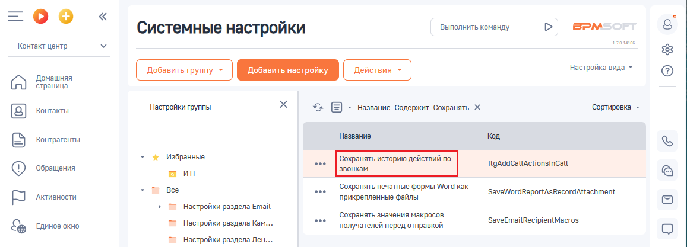
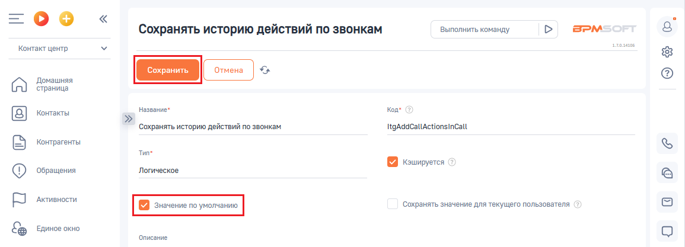

# Как включить или выключить настройку

> Трассировка: PDF §2.6 · сквозные стр. 68-69 · источники: ч.1 `kb/sources/integration-bpmsoft/Mango_office_integration_BPMSoft.pdf` с.68-69.

Для этого, в вашем BPMSoft выполните следующие действия:

> **Описание иллюстрации INTBPM-§2.6-1** (к §2.6 «Как включить или выключить настройку», стр. 68; 38×38 px). Пиктограмма (значок элемента интерфейса).
> Относится к тексту руководства: «…по звонкам, однако вы не увидите эту информацию в карточке звонка. Как включить или выключить настройку Для этого, в вашем BPMSoft выполните следующие действия:».
> Текста на изображении нет; назначение элемента — см. текст, к которому он относится.

1) нажмите на кнопку и выберите пункт “Открыть дизайнер системы”:

> **Описание иллюстрации INTBPM-§2.6-2** (к §2.6 «Как включить или выключить настройку», стр. 68; 365×331 px). Снимок экрана / схема.
> Относится к тексту руководства: «… Как включить или выключить настройку Для этого, в вашем BPMSoft выполните следующие действия: 1) нажмите на кнопку и выберите пункт “Открыть дизайнер системы”:».
> Текст на изображении (OCR, требует сверки): нить все; Настроить страницу; Открыть дизайнер системы

2) нажмите на ссылку “Системные настройки” в блоке “Настройка системы”:

> **Описание иллюстрации INTBPM-§2.6-3** (к §2.6 «Как включить или выключить настройку», стр. 68; 1155×591 px). Снимок экрана / схема.
> Относится к тексту руководства: «…те следующие действия: 1) нажмите на кнопку и выберите пункт “Открыть дизайнер системы”: 2) нажмите на ссылку “Системные настройки” в блоке “Настройка системы”:».
> Текст на изображении (OCR, требует сверки): Дизайнер системы; Выполнить команду; BPM:; Контакт центр; Поиск по навигации; Домашняя; страница; Контакты; © Процессы у; Контрагенты; Q Пользователи и администрирование ~; ‘Обращения; @ настройка портала ~; Активности.; Импорт и интеграции ~; Единое окно; Fa Приложения ~; База знаний; (gs Настройка системы ^; Лента; Справочники; Звонки; Настройка отчетов; Очереди; Мастер разделов

Руководство по интеграции АТС MANGO OFFICE и BPMSoft | Версия от 22.06.2026 3) дважды нажмите на строку “Сохранять историю действий по звонкам”. Будут открыты дополнительные поля:

> **Описание иллюстрации INTBPM-§2.6-4** (к §2.6 «Как включить или выключить настройку», стр. 69; 1157×417 px). Снимок экрана / схема.
> Относится к тексту руководства: «…3) дважды нажмите на строку “Сохранять историю действий по звонкам”. Будут открыты дополнительные поля:».
> Текст на изображении (OCR, требует сверки): Выполнить команду; BPM:; Системные настройки; Контакт центр; настройка вида ~; Домашняя; страница; настройки группы; уг; ~ Название Содержит Сохранять Х; 'Сортировка -; Контакты; Название,; контрагенты; | koa; Избранные; ий по; ae; ‘Сохранять историю де; ItgAddCallActionsincall; ‘Обращения; | звонкам; м иг; все; ‘Сохранять печатные формы Word Kak; ‘SaveWordReportAsRecordAttachment; Активности.; прикрепленные файлы; 7 Настройки раздела Email; ‘Сохранять значения макросов; ‘SaveEmailRecipientMacros; ЕДИНОЕ окно; 2 Настройки раздела Кам...; получателей перед отправкой; = Настройки раздела Лен...

4. чтобы включить историю сохранений действий по звонкам, нужно активировать переключать “Значение по умолчанию”. А чтобы выключить настройку - деактивируйте переключатель “Значение по умолчанию”; 5. нажмите кнопку “Сохранить”, чтобы сохранить настройки.

> **Описание иллюстрации INTBPM-§2.6-5** (к §2.6 «Как включить или выключить настройку», стр. 69; 1155×417 px). Снимок экрана / схема.
> Относится к тексту руководства: «…А чтобы выключить настройку - деактивируйте переключатель “Значение по умолчанию”; 5. нажмите кнопку “Сохранить”, чтобы сохранить настройки.».
> Текст на изображении (OCR, требует сверки): =oO°o; Сохранять историю действий по звонкам; Выполнить команду; BPM:; ease; Контакт центр; Домашняя; страница; Контакты; название"; Kon; ‘Сохранять историю действий по звонкам; ItgAdacaltActionsincalt; Контрагенты; Tune; Keumpyeren; ‘Обращения; Логическое; Активности.; ‘Сохранять значение для текущего пользователя; Единое окно; ‘Описание
