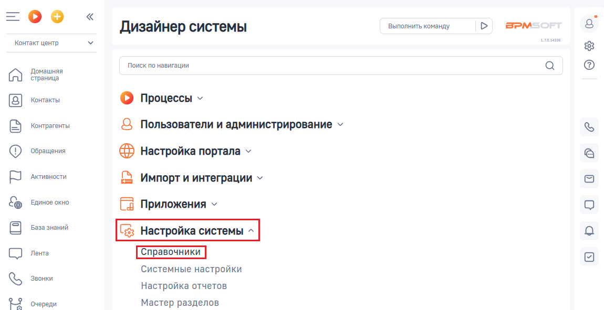
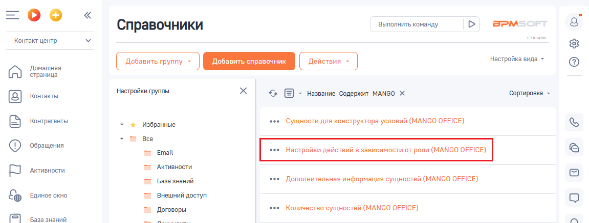
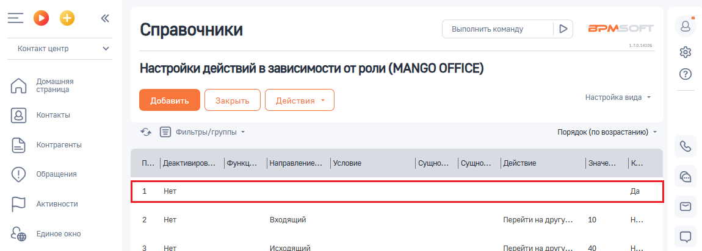

# Как проверить, включена ли настройка ”Настройки действий в зависимости от роли”

> Трассировка: PDF §2.6 · сквозные стр. 70-71 · источники: ч.1 `kb/sources/integration-bpmsoft/Mango_office_integration_BPMSoft.pdf` с.70-71.

от роли” Для этого, в вашей BPMSoft следует:

> **Описание иллюстрации INTBPM-§2.6-1** (к §2.6 «Как проверить, включена ли настройка ”Настройки действий в зависимости от роли”», стр. 70; 38×38 px). Пиктограмма (значок элемента интерфейса).
> Относится к тексту руководства: «…Как проверить, включена ли настройка ”Настройки действий в зависимости от роли” Для этого, в вашей BPMSoft следует:».
> Текста на изображении нет; назначение элемента — см. текст, к которому он относится.

1) нажмите на кнопку и выберите пункт “Открыть дизайнер системы”:

> **Описание иллюстрации INTBPM-§2.6-2** (к §2.6 «Как проверить, включена ли настройка ”Настройки действий в зависимости от роли”», стр. 70; 365×331 px). Снимок экрана / схема.
> Относится к тексту руководства: «…на ли настройка ”Настройки действий в зависимости от роли” Для этого, в вашей BPMSoft следует: 1) нажмите на кнопку и выберите пункт “Открыть дизайнер системы”:».
> Текст на изображении (OCR, требует сверки): нить все; Настроить страницу; Открыть дизайнер системы

2) нажмите на ссылку “Справочники” в блоке “Настройка системы”:

> **Описание иллюстрации INTBPM-§2.6-3** (к §2.6 «Как проверить, включена ли настройка ”Настройки действий в зависимости от роли”», стр. 70; 1150×591 px). Снимок экрана / схема.
> Относится к тексту руководства: «…того, в вашей BPMSoft следует: 1) нажмите на кнопку и выберите пункт “Открыть дизайнер системы”: 2) нажмите на ссылку “Справочники” в блоке “Настройка системы”:».
> Текст на изображении (OCR, требует сверки): Выполнить команду; BPM:; Дизайнер системы; Контакт центр; Поиск по навигации; Домашняя; страница; Контакты; © Процессы у; Контрагенты; Q Пользователи и администрирование ~; ‘Обращения; Настройка портала v; Активности.; Импорт и интеграции ~; Единое окно; Fa Приложения ~; База знаний; (gs Настройка системы; Лента; Системные настройки; Звонки; Настройка отчетов; Rw; 'Очереди; Мастер разделов

3) нажмите на строку ” Настройки действий в зависимости от роли (MANGO OFFICE)“. Будут открыты дополнительные поля:

> **Описание иллюстрации INTBPM-§2.6-4** (к §2.6 «Как проверить, включена ли настройка ”Настройки действий в зависимости от роли”», стр. 70; 1151×438 px). Снимок экрана / схема.
> Относится к тексту руководства: «…у “Справочники” в блоке “Настройка системы”: 3) нажмите на строку ” Настройки действий в зависимости от роли (MANGO OFFICE)“. Будут открыты дополнительные поля:».
> Текст на изображении (OCR, требует сверки): Выполнить команду; BPM:; Справочники; Контакт центр; алан; настройка вида -; Домашняя; страница; "настройки группы; уг; > Название Содержит MANGO Х; 'Сортировка -; Контакты; контрагенты; Избранные; ‘see Сущности для конструктора условий (MANGO OFFICE); все; ‘Обращения; Email; AxtwaHocTH; Активности.; База знаний; s+ Дополнительная информация сущностей (MANGO OFFICE); ЕДИНОЕ окно; Внешний доступ; Договоры; +++ Количество сущностей (MANGO OFFICE); ОВ

Руководство по интеграции АТС MANGO OFFICE и BPMSoft | Версия от 22.06.2026 4. посмотрите, указано ли значение “Нет” в первой строке таблицы (столбец “Конечное действие при срабатывании”). Настройка “Настройки действий в зависимости от роли (MANGO OFFICE)” включена, если в первой строке таблицы, в столбце “Конечное действие при срабатывании” указано значение “Нет”. Примечание. Если настройка отключена, то правила обработки звонков будут применяться не полностью.

> **Описание иллюстрации INTBPM-§2.6-5** (к §2.6 «Как проверить, включена ли настройка ”Настройки действий в зависимости от роли”», стр. 71; 1150×412 px). Снимок экрана / схема.
> Относится к тексту руководства: «… “Конечное действие при срабатывании” указано значение “Нет”. Примечание. Если настройка отключена, то правила обработки звонков будут применяться не полностью.».
> Текст на изображении (OCR, требует сверки): оо; Справочники; Выполнить команду; в>м; Контакт центр; Настройки действий в зависимости от роли (MANGO OFFICE); Домашняя; страница; настройка вида ~; Контакты; > Е хильры/труппы ~; Порядок (по возрастанию) -; контрагенты; Условие:; [Действие; [Ke; ‘Обращения; Активности.; Her; ‘Входящий; 10; Перейти на друг.; ЕДИНОЕ окно; Vcxonalnit; Перейти на novrv.
