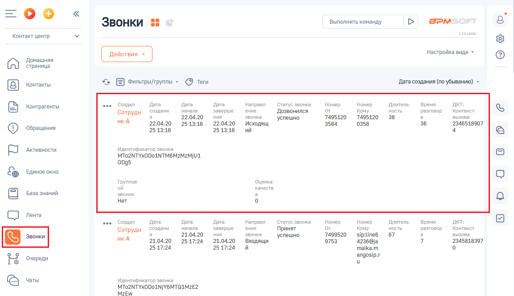
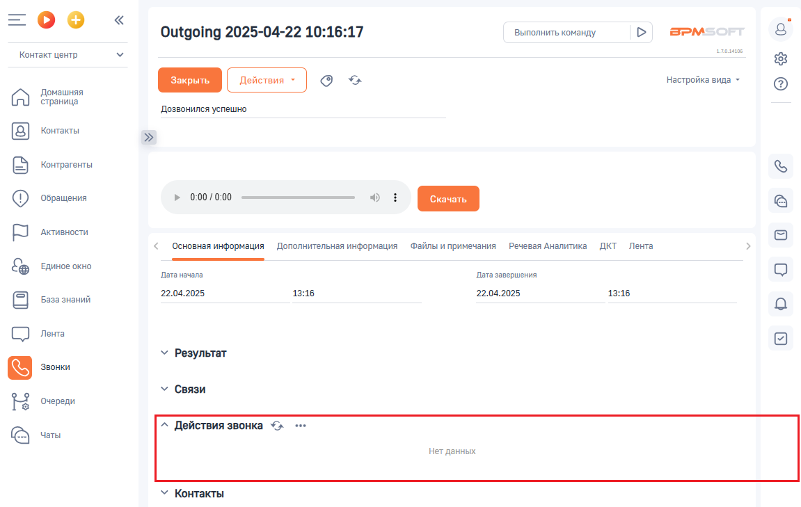

# Как открыть отчет

> Трассировка: PDF §2.7 · сквозные стр. 72-73 · источники: ч.1 `kb/sources/integration-bpmsoft/Mango_office_integration_BPMSoft.pdf` с.72-73.

Чтобы открыть отчет “Действия звонка”, выполните следующие действия в BPMSoft: 1) перейдите в раздел “Звонки”; 2) дважды нажмите на строку с данными звонка. Будут открыты общие сведения о звонке:

> **Описание иллюстрации INTBPM-§2.7-1** (к §2.7 «Как открыть отчет», стр. 72; 1153×663 px). Снимок экрана / схема.
> Относится к тексту руководства: «…BPMSoft: 1) перейдите в раздел “Звонки”; 2) дважды нажмите на строку с данными звонка. Будут открыты общие сведения о звонке:».
> Текст на изображении (OCR, требует сверки): =oO°o; Звонки 55; Выполнить команду; BPM:; Контакт центр; алая; настройка вида -; Домашняя; страница; Контакты; ‘unetpei/rpynnet ~ (9 Теги; „Дата создания (по убыванию) ~; oe; Создал; Дата; Направл; Статус звонка; Номер; Длитель; Время; xt; Контрагенты; начала; заверше; ние; `Дозвонился; or; Кому; ность; разговор; Контекст; Сотрудн; создани; 22.04.20; ния; звонка; 7495120; 38; вызова; икА; ‘успешно; 2513:16; исходящ; 3584; 0358; 36; 2346518907; ‘Обращения; 25 13:16; Активности.; Идентификатор звонка; (MTo2NTYxODoANTM6MzMzMjUL; 0095; Единое окно; Группов; Оценка; ой; качеств,; База знаний; звон…

3. откройте вкладку “Основная информация”; 4. в блоке “Действия звонка” будут показаны данные отчета:

> **Описание иллюстрации INTBPM-§2.7-2** (к §2.7 «Как открыть отчет», стр. 72; 1151×729 px). Снимок экрана / схема.
> Относится к тексту руководства: «…у с данными звонка. Будут открыты общие сведения о звонке: 3. откройте вкладку “Основная информация”; 4. в блоке “Действия звонка” будут показаны данные отчета:».
> Текст на изображении (OCR, требует сверки): Выполнить команду; BPM:; Outgoing 2025-04-22 10:16:17; Контакт центр; oe; настройка вида -; Домашняя; страница; `Дозвонился успешно; Контакты; контрагенты; ‘Обращения; Активности.; Основная информация; Дополнительная информация; Файлы и примечания; речевая Аналитика ДКТ Лента; ЕДИНОЕ окно; Дата начала; Дата завершения; База знаний; 22.04.2025; 13:16; Лента; У Результат; У Связи; Очереди; ^ Действия звонка <»; Her данных; У Контакты

Руководство по интеграции АТС MANGO OFFICE и BPMSoft | Версия от 22.06.2026
