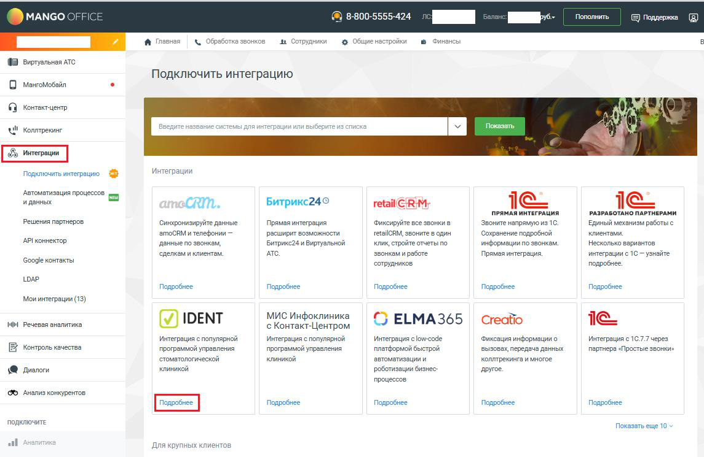
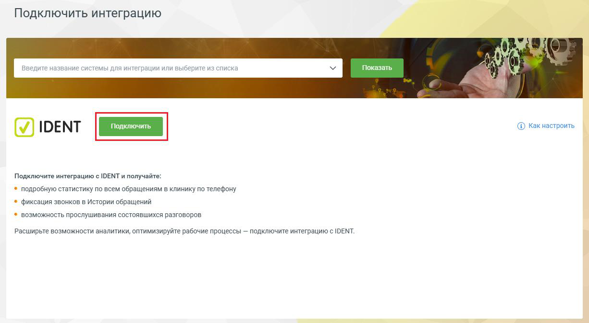
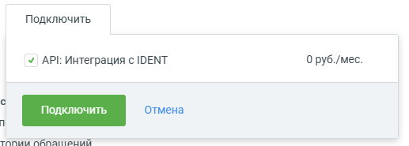
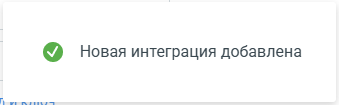

## Шаг 3. Подключение виджета в Личном кабинете Виртуальной АТС

> Трассировка: PDF §— · сквозные стр. 6-7 · источники: ч.1 `kb/sources/integration-ident/Mango_office_integration_IDENT.pdf` с.6-7.

Для подключения интеграции с IDENT вам необходимо:

1) войти в Личный кабинет Виртуальной АТС; 2) перейти в раздел «Интеграции»; 3) в блоке «Интеграции» найти блок «IDENT», в котором нажать «Подробнее»; Примечание. Если в списке «Интеграции» вы не видите блок «IDENT», нужно ввести слово ident в поле поиска, расположенное над списком «Интеграции», и нажать кнопку «Показать».

> **Описание иллюстрации INTIDENT-§—-1** (к §— «Шаг 3. Подключение виджета в Личном кабинете Виртуальной АТС», стр. 6; 1145×745 px). Снимок экрана / схема.
> Относится к тексту руководства: «…сли в списке «Интеграции» вы не видите блок «IDENT», нужно ввести слово ident в поле поиска, расположенное над списком «Интеграции», и нажать кнопку «Показать».».
> Текст на изображении (OCR, требует сверки): Пополнить; MANGO ©; 8-800-5555-424; Поддержка; в сотрудники; в Финансы; \@ Главная; &. Обреботка звонков; & Общие настройки; Виртуальная ATC; Подключить интеграцию; О Marrottosain; © копает; нм ANA we; ниили выбери; 19; Показать; ‘Gj; Ul Konmpeome; Подключить wsrerpauno @; Интеграции; иденных; Автоматизация прессов т; retail RiM>; CRM.; Битрикс24©; ПРЯМАЯ ИНТЕГРАЦИЯ; РАЗРАБОТАНО ПАРТНЕРАМИ; Решения партнеров; Синхронизируйте данные; Фиксируйте все звонкие:; Звоните напрямуюиз 10.; Единый механизм работы с; атосВМ и телефонии —; расширит возможности; retsilCRM, звоните в один; ‘сокранение подро…

4) нажать кнопку «Подключить»:

> **Описание иллюстрации INTIDENT-§—-2** (к §— «Шаг 3. Подключение виджета в Личном кабинете Виртуальной АТС», стр. 7; 1226×674 px). Снимок экрана / схема.
> Относится к тексту руководства: «…4) нажать кнопку «Подключить»:».
> Текст на изображении (OCR, требует сверки): Подключить интеграцию; Показать; ay; ye; ® какнастроить; IDENT; Подключите интеграцию с IDENT и получайте:; * подробную статистику по всем обращениям в клинику по телефону; © фиксация звонков в Истории обращений; © возможность прослушивания состоявшихся разговоров:; Расширьте возможности аналитики, оптимизируйте рабочие процессы — подключите интеграцию с IDENT.

5) в открывшейся форме проверьте, что включен пункт «API: Интеграция с IDENT», затем нажмите кнопку «Подключить»:

> **Описание иллюстрации INTIDENT-§—-3** (к §— «Шаг 3. Подключение виджета в Личном кабинете Виртуальной АТС», стр. 7; 517×185 px). Снимок экрана / схема.
> Относится к тексту руководства: «…5) в открывшейся форме проверьте, что включен пункт «API: Интеграция с IDENT», затем нажмите кнопку «Подключить»:».
> Текст на изображении (OCR, требует сверки): Подключить; v API: Интеграция c IDENT; 0 руб./мес.; отмена; топии окранений

6) будут выполнены следующие действия: – подключена интеграция с IDENT; – показано информационное сообщение «Новая интеграция добавлена!»:

> **Описание иллюстрации INTIDENT-§—-4** (к §— «Шаг 3. Подключение виджета в Личном кабинете Виртуальной АТС», стр. 7; 339×105 px). Снимок экрана / схема.
> Относится к тексту руководства: «…6) будут выполнены следующие действия: – подключена интеграция с IDENT; – показано информационное сообщение «Новая интеграция добавлена!»:».
> Текст на изображении (OCR, требует сверки): @® Новая интеграция добавлена; ини

Интеграция Виртуальной АТС и IDENT будет выполнена! Когда клиент позвонит вам по номеру Виртуальной АТС, информацию об этом звонке вы увидите в вашем IDENT.
