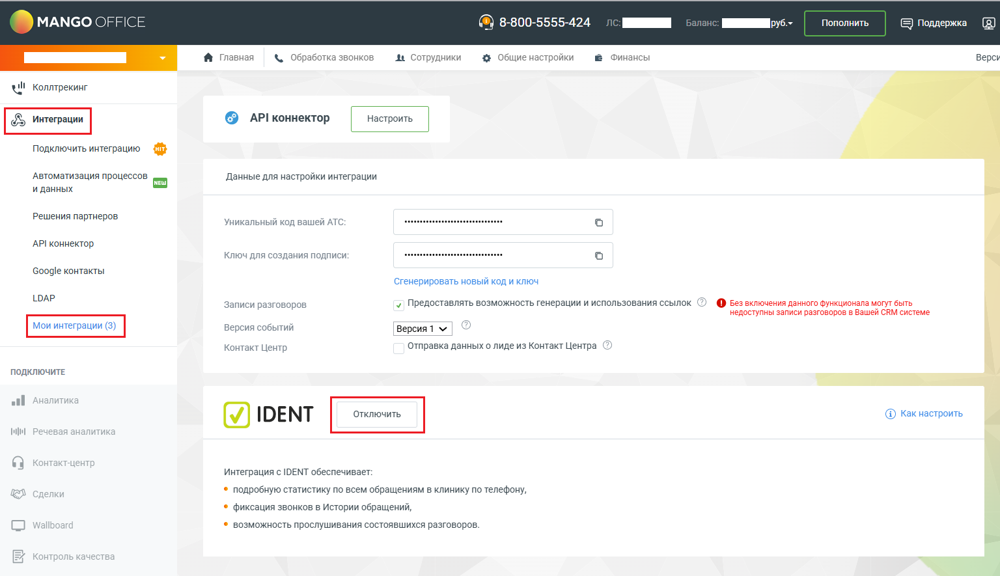
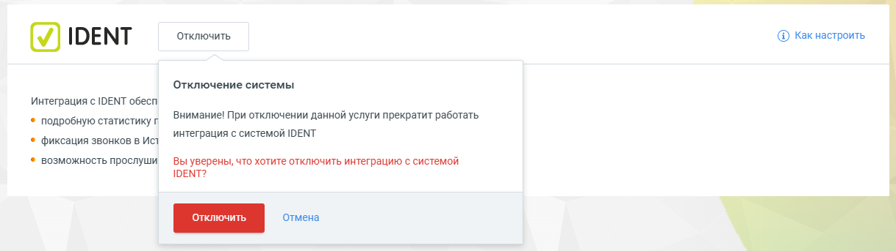
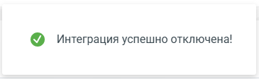

# 3. Как отключить виджет интеграции

> Трассировка: PDF §3 · сквозные стр. 8-9 · источники: ч.1 `kb/sources/integration-ident/Mango_office_integration_IDENT.pdf` с.8-9.

Для отключения интеграции с IDENT вам необходимо:

1) войти в Личный кабинет Виртуальной АТС MANGO OFFICE; 2) перейти в раздел «Интеграции»; 3) перейти в раздел «Мои интеграции»; 4) в блоке «IDENT» нажать кнопку «Отключить»:

> **Описание иллюстрации INTIDENT-§3-1** (к §3 «Как отключить виджет интеграции», стр. 8; 1536×885 px). Снимок экрана / схема.
> Относится к тексту руководства: «…чный кабинет Виртуальной АТС MANGO OFFICE; 2) перейти в раздел «Интеграции»; 3) перейти в раздел «Мои интеграции»; 4) в блоке «IDENT» нажать кнопку «Отключить»:».
> Текст на изображении (OCR, требует сверки): MANGO OFFICE; 8-800-5555-424; a МИ ус; Пополнить,; & поддержка; Финансы; ОИ; № Главная; & Обработка звон; д сотрудники; @ Общие настройки; Bepcy; wll Коллтрекинг; © АР!коннектор; Подключить интеграцию; Автоматизация процессов; Данные для настройки интеграции; и данных; Решения партнеров; Уникальный код вашей; АР! коннектор; Ключ для создания подписи:; Google контакты; Сгенерировать новый код и ключ; LOAP; Записи разговоров; | Предоставлять возможность генерации и использования ссылок; © вез включения данного функционала могут быть; недоступны записи разговоров в Вашей CRM системе; Be; бытий; В…

5) показано всплывающее окно «Отключение системы», в котором надо нажать кнопку «Отключить»:

> **Описание иллюстрации INTIDENT-§3-2** (к §3 «Как отключить виджет интеграции», стр. 9; 1219×343 px). Снимок экрана / схема.
> Относится к тексту руководства: «…5) показано всплывающее окно «Отключение системы», в котором надо нажать кнопку «Отключить»:».
> Текст на изображении (OCR, требует сверки): ‘Отключить; ® какнастроить; IDENT; Отключение системы; Интеграция c IDENT обесп; Внимание! При отключении данной услуги прекратит работать; © подробную статистику г; © фиксация звонков в Ист; интеграция с системой IDENT; © возможность прослуши,; вы уверены, что хотите отключить интеграцию с системой; IDENT?

6) будут выполнены следующие действия: – отключена интеграция с IDENT; – показано информационное сообщение «Интеграция успешно отключена!»:

> **Описание иллюстрации INTIDENT-§3-3** (к §3 «Как отключить виджет интеграции», стр. 9; 365×112 px). Снимок экрана / схема.
> Относится к тексту руководства: «…6) будут выполнены следующие действия: – отключена интеграция с IDENT; – показано информационное сообщение «Интеграция успешно отключена!»:».
> Текст на изображении (OCR, требует сверки): @ Интеграция успешно отключена!
