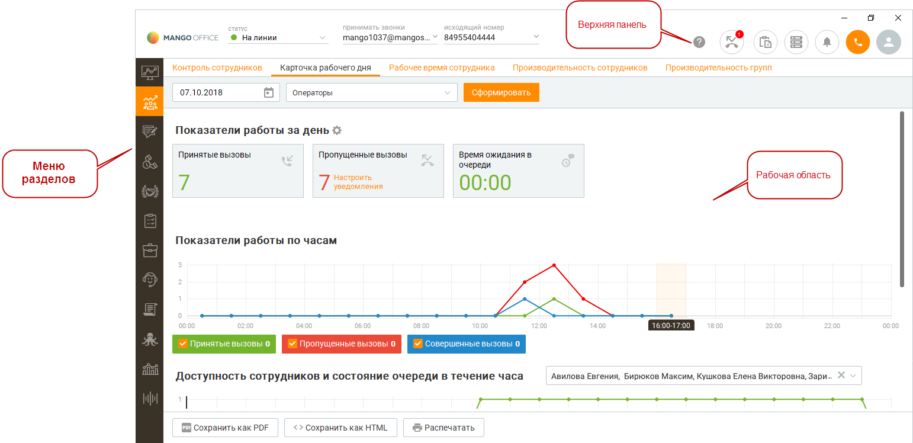
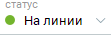
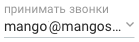
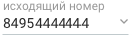

# 2. Главное окно программы

> Трассировка: PDF §2 · сквозные стр. 21-22 · источники: ч.1 `kb/sources/mango-cc-manual/CC_manual_1.26.42-1-295.pdf` с.21-22.

После входа пользователя в систему на экране отображается главное окно программы. В этом разделе мы рассмотрим основные элементы пользовательского интерфейса, отображаемые в главном окне, и их функциональное предназначение.

> **Иллюстрация CC-04-1** · стр. 21 · раздел «2. Главное окно программы» · снимок экрана интерфейса, 1542×748 px.
> Иллюстрирует текст руководства: «После входа пользователя в систему на экране отображается главное окно программы. В этом разделе мы рассмотрим основные элементы пользовательского интерфейса, отображаемые в главном окне, и их функциональное предназначение.»
> Следующий за иллюстрацией текст: «Верхняя панель содержит инструменты:»

Верхняя панель содержит инструменты:

> **Иллюстрация CC-04-2** · стр. 21 · раздел «2. Главное окно программы» · фрагмент интерфейса (кнопка, поле, меню), 111×42 px.
> Поясняющий текст руководства (рядом с элементом): «Окно управления статусом;»
> Предшествующий контекст: «Верхняя панель содержит инструменты:»

Окно управления статусом;

> **Иллюстрация CC-04-3** · стр. 21 · раздел «2. Главное окно программы» · фрагмент интерфейса (кнопка, поле, меню), 139×42 px.
> Поясняющий текст руководства (рядом с элементом): «Выбор активной линии для совершения вызовов»
> Предшествующий контекст: «Окно управления статусом;»

Выбор активной линии для совершения вызовов

> **Иллюстрация CC-04-4** · стр. 21 · раздел «2. Главное окно программы» · фрагмент интерфейса (кнопка, поле, меню), 133×39 px.
> Поясняющий текст руководства (рядом с элементом): «Выбор линии в качестве исходящего номера, с пояснительным комментарием к номеру»
> Предшествующий контекст: «Выбор активной линии для совершения вызовов»

Выбор линии в качестве исходящего номера, с пояснительным комментарием к номеру

> **Иллюстрация CC-04-5** · стр. 21 · раздел «2. Главное окно программы» · значок (элемент интерфейса), встроенный в текст, 43×44 px.
> Поясняющий текст руководства (рядом с элементом): «Кнопка вызова справки. Открывает меню справочной системы Контакт-центра.»
> Предшествующий контекст: «Выбор линии в качестве исходящего номера, с пояснительным комментарием к номеру»

Кнопка вызова справки. Открывает меню справочной системы Контакт-центра.

> **Иллюстрация CC-04-6** · стр. 21 · раздел «2. Главное окно программы» · значок (элемент интерфейса), встроенный в текст, 42×42 px.
> Поясняющий текст руководства (рядом с элементом): «Список пропущенных вызовов»
> Предшествующий контекст: «Кнопка вызова справки. Открывает меню справочной системы Контакт-центра.»

Список пропущенных вызовов

> **Иллюстрация CC-04-7** · стр. 21 · раздел «2. Главное окно программы» · значок (элемент интерфейса), встроенный в текст, 42×42 px.
> Поясняющий текст руководства (рядом с элементом): «Вызов панели задач»
> Предшествующий контекст: «Список пропущенных вызовов»

Вызов панели задач

> **Иллюстрация CC-04-8** · стр. 21 · раздел «2. Главное окно программы» · значок (элемент интерфейса), встроенный в текст, 48×41 px.
> Поясняющий текст руководства (рядом с элементом): «Вызов панели графика работы»
> Предшествующий контекст: «Вызов панели задач»

Вызов панели графика работы

> **Иллюстрация CC-04-9** · стр. 22 · раздел «2. Главное окно программы» · фрагмент интерфейса (кнопка, поле, меню), 111×42 px.
> Поясняющий текст руководства (рядом с элементом): «Окно управления статусом;»
> Предшествующий контекст: «Вызов панели графика работы»

Окно управления статусом;

> **Иллюстрация CC-04-10** · стр. 22 · раздел «2. Главное окно программы» · значок (элемент интерфейса), встроенный в текст, 42×42 px.
> Поясняющий текст руководства (рядом с элементом): «Вызов панели очереди обращений»
> Предшествующий контекст: «Окно управления статусом;»

Вызов панели очереди обращений

> **Иллюстрация CC-04-11** · стр. 22 · раздел «2. Главное окно программы» · значок (элемент интерфейса), встроенный в текст, 42×42 px.
> Поясняющий текст руководства (рядом с элементом): «Вызов панели показателей»
> Предшествующий контекст: «Вызов панели очереди обращений»

Вызов панели показателей

> **Иллюстрация CC-04-12** · стр. 22 · раздел «2. Главное окно программы» · значок (элемент интерфейса), встроенный в текст, 42×42 px.
> Поясняющий текст руководства (рядом с элементом): «Вызов панели управления телефонией»
> Предшествующий контекст: «Вызов панели показателей»

Вызов панели управления телефонией

> **Иллюстрация CC-04-13** · стр. 22 · раздел «2. Главное окно программы» · значок (элемент интерфейса), встроенный в текст, 42×42 px.
> Поясняющий текст руководства (рядом с элементом): «Аватар пользователя, Меню программы»
> Предшествующий контекст: «Вызов панели управления телефонией»

Аватар пользователя, Меню программы

> **Иллюстрация CC-04-14** · стр. 22 · раздел «2. Главное окно программы» · значок (элемент интерфейса), встроенный в текст, 44×44 px.
> Поясняющий текст руководства (рядом с элементом): «Панель показателей – значок панели имеет два цвета и»
> Предшествующий контекст: «Аватар пользователя, Меню программы»

> **Иллюстрация CC-04-15** · стр. 22 · раздел «2. Главное окно программы» · значок (элемент интерфейса), встроенный в текст, 44×42 px.
> Поясняющий текст руководства (рядом с элементом): «Панель показателей – значок панели имеет два цвета и»
> Предшествующий контекст: «Аватар пользователя, Меню программы»

Панель показателей – значок панели имеет два цвета и

, в зависимости от состояния предельного значения какого-либо из показателей.

> **Иллюстрация CC-04-16** · стр. 22 · раздел «2. Главное окно программы» · значок (элемент интерфейса), встроенный в текст, 48×42 px.
> Поясняющий текст руководства (рядом с элементом): «Аватар пользователя – на аватаре пользователя отображается иконка "new" , если:  у пользователя есть не пройденный квест;  имеются новые скрипты. Меню разделов находится в левой части основного окна и позволяет переключаться между разделами, отображаемыми в рабочей области основного окна. …»
> Предшествующий контекст: «, в зависимости от состояния предельного значения какого-либо из показателей.»

Аватар пользователя – на аватаре пользователя отображается иконка "new" , если:  у пользователя есть не пройденный квест;  имеются новые скрипты. Меню разделов находится в левой части основного окна и позволяет переключаться между разделами, отображаемыми в рабочей области основного окна. Выбранный раздел выделяется цветом. Рабочая область находится непосредственно под главным меню и отображает выбранную панель.
