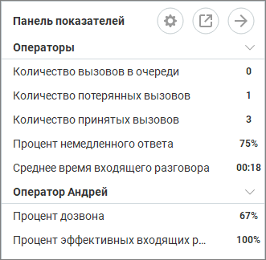
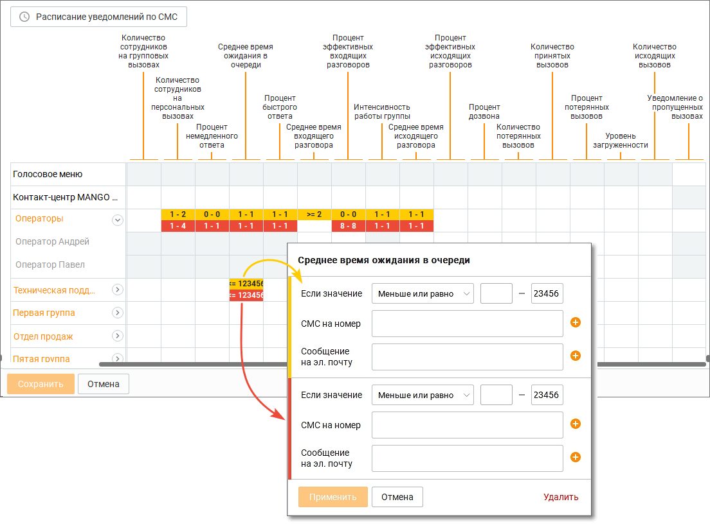
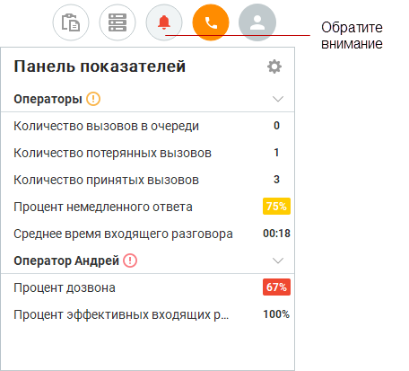
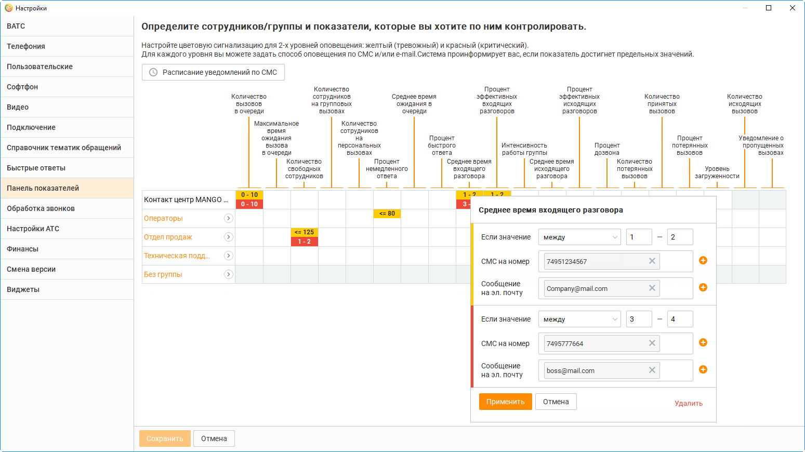
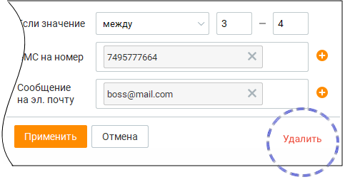
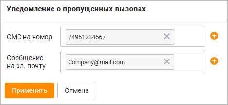
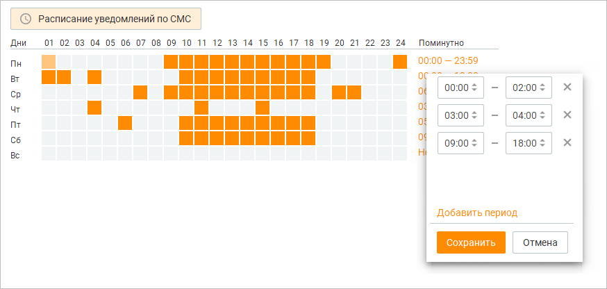

# 2.4. Панель показателей

> Трассировка: PDF §2.4 · сквозные стр. 32-46 · источники: ч.1 `kb/sources/mango-cc-manual/CC_manual_1.26.42-1-295.pdf` с.32-46.

Контакт-центр MANGO OFFICE позволяет отслеживать в реальном времени эффективность работы сотрудников. Для этого используется набор так называемых показателей производительности, представляющих собой параметры, характеризующие эффективность работы Контакт-центра MANGO OFFICE как системы массового обслуживания. Все показатели производительности рассчитываются за определенный промежуток времени с заданной частотой опроса. Более подробная информация о показателях производительности приведена в разделе Общее описание показателей производительности. Информация о настройке пороговых значений показателей производительности находится в одноименном разделе. Для визуализации отслеживаемых в реальном времени значений показателей производительности для различных логических объектов (Контакт-центр MANGO OFFICE в целом, группа сотрудников или сотрудник) используется панель показателей. Для вызова

> **Иллюстрация CC-08-1** · стр. 32 · раздел «2.4. Панель показателей» · значок (элемент интерфейса), встроенный в текст, 42×42 px.
> Поясняющий текст руководства (рядом с элементом): «панели нажмите в верхней панели.»
> Предшествующий контекст: «Контакт-центр MANGO OFFICE позволяет отслеживать в реальном времени эффективность работы сотрудников. Для этого используется набор так называемых показателей производительности, представляющих собой …»

панели нажмите в верхней панели.

> **Иллюстрация CC-08-2** · стр. 33 · раздел «2.4. Панель показателей» · снимок экрана интерфейса, 331×324 px.
> Иллюстрирует текст руководства: «панели нажмите в верхней панели.»
> Следующий за иллюстрацией текст: «Кнопки для открепления и закрепления блока панели показателей. Окно с открепленным блоком может быть расположено в любом месте рабочего стола, и отображается поверх всех окон.»

> **Иллюстрация CC-08-3** · стр. 33 · раздел «2.4. Панель показателей» · значок (элемент интерфейса), встроенный в текст, 35×35 px.
> Поясняющий текст руководства (рядом с элементом): «Кнопки для открепления и закрепления блока панели показателей. Окно с открепленным блоком может быть расположено в любом месте рабочего стола, и отображается поверх всех окон.»
> Предшествующий контекст: «панели нажмите в верхней панели.»

> **Иллюстрация CC-08-4** · стр. 33 · раздел «2.4. Панель показателей» · значок (элемент интерфейса), встроенный в текст, 35×35 px.
> Поясняющий текст руководства (рядом с элементом): «Кнопки для открепления и закрепления блока панели показателей. Окно с открепленным блоком может быть расположено в любом месте рабочего стола, и отображается поверх всех окон.»
> Предшествующий контекст: «панели нажмите в верхней панели.»

Кнопки для открепления и закрепления блока панели показателей. Окно с открепленным блоком может быть расположено в любом месте рабочего стола, и отображается поверх всех окон.

> **Иллюстрация CC-08-5** · стр. 33 · раздел «2.4. Панель показателей» · значок (элемент интерфейса), встроенный в текст, 34×34 px.
> Поясняющий текст руководства (рядом с элементом): «Клик по кнопке»
> Предшествующий контекст: «Кнопки для открепления и закрепления блока панели показателей. Окно с открепленным блоком может быть расположено в любом месте рабочего стола, и отображается поверх всех окон.»

Клик по кнопке

приводит к скрытию блока.

Доступность панели показателей зависит от роли текущего пользователя Контакт-центра MANGO OFFICE и наличия подключенной услуги для соответствующего продукта Контакт- центра MANGO OFFICE.

> **Иллюстрация CC-08-6** · стр. 33 · раздел «2.4. Панель показателей» · значок (элемент интерфейса), встроенный в текст, 16×16 px.
> Поясняющий текст руководства (рядом с элементом): «Для настройки панели показателей нажмите на панели.»
> Предшествующий контекст: «Доступность панели показателей зависит от роли текущего пользователя Контакт-центра MANGO OFFICE и наличия подключенной услуги для соответствующего продукта Контакт- центра MANGO OFFICE.»

Для настройки панели показателей нажмите на панели.

> **Иллюстрация CC-08-7** · стр. 34 · раздел «2.4. Панель показателей» · снимок экрана интерфейса, 1104×824 px.
> Иллюстрирует текст руководства: «Для настройки панели показателей нажмите на панели.»
> Следующий за иллюстрацией текст: «Изначально окно настройки содержит список групп в свернутом состоянии. После развертывания группы панель показателей принимает вид, как указано на рисунке выше. Чтобы выбрать контролируемый объект …»

Изначально окно настройки содержит список групп в свернутом состоянии. После развертывания группы панель показателей принимает вид, как указано на рисунке выше. Чтобы выбрать контролируемый объект (Контакт-центр MANGO OFFICE в целом, группу сотрудников или сотрудника), для которого будет осуществляться мониторинг показателя производительности, кликните ячейку на пересечении столбца с нужным показателем производительности и строки с нужным объектом. Если вы хотите развернуть или свернуть нужный вам объект, щелкните по значку со стрелкой справа от его названия.

Пользователи, не входящие ни в одну из групп, объединены в псевдогруппу "Без группы". Для таких пользователей показатели производительности настраиваются в индивидуальном порядке — выбор показателей для объекта "Без группы" осуществить нельзя. Пользовательские настройки панели показателей хранятся отдельно для каждого пользователя Контакт-центра MANGO OFFICE и сохраняются при входе в систему под логином этого пользователя с любого компьютера.

После выхода из окна настроек в панели показателей отображаются значения выбранных показателей производительности для указанных логических объектов. Все отображаемые показатели группируются по объектам с алфавитной сортировкой по краткому наименованию. Используйте значок со стрелкой, чтобы свернуть или развернуть список показателей по выбранному объекту. Объекты в панели показателей отображаются иерархически. Верхние уровни иерархии — Голосовое меню и Контакт-центр MANGO OFFICE в целом. Эти объекты всегда являются верхним. Затем идут группы сотрудников с внутренней сортировкой по алфавиту, затем отдельные сотрудники (пользователи) с сортировкой по алфавиту.

Чтобы изменить порядок отображения групп и сотрудников, выберите нужный объект и, удерживая левую клавишу мыши, перетащите его вверх или вниз. При перетаскивании объектов также переносятся все связанные с ними показатели. Аналогичным образом изменяется и порядок отображения показателей внутри отдельного объекта.

Пользовательские настройки порядка отображения хранятся локально на конкретном компьютере. При входе в систему с другого компьютера они не сохраняются.

При отображении показателей производительности в рабочей области панели имеют место следующие особенности. Если сотрудник является оператором в нескольких группах, то при выборе показателей производительности в одной из групп они автоматически выбираются и во всех остальных группах. При этом выбранные показатели рассчитываются в целом по Контакт-центру MANGO OFFICE — то есть, для всех групп, в которые входит пользователь, а не в рамках отдельной группы. Если значение показателя превышает указанные пороговые значения (красные или желтые), строка показателя подкрашивается соответствующим цветом.

> **Иллюстрация CC-08-8** · стр. 35 · раздел «2.4. Панель показателей» · снимок экрана интерфейса, 456×413 px.
> Иллюстрирует текст руководства: «При отображении показателей производительности в рабочей области панели имеют место следующие особенности. Если сотрудник является оператором в нескольких группах, то при выборе показателей производительности в одной из групп они автоматически выбираются и во всех остальных группах. При этом …»
> Следующий за иллюстрацией текст: «Если отдельный показатель у объекта превышает указанные пороговые значения, то вся строка объекта подкрашивается желтым или красным цветом. При этом:  если по объекту хоть один показатель превышает …»

Если отдельный показатель у объекта превышает указанные пороговые значения, то вся строка объекта подкрашивается желтым или красным цветом. При этом:  если по объекту хоть один показатель превышает красное пороговое значение, объект подкрашивается красным;  если по объекту хоть один показатель превышает желтое пороговое значение, и нет показателей, превышающих красное значение, объект подкрашивается желтым.

### 2.4.1. Общее описание показателей производительности

Полное Краткое

Единица № Описание Тип наименование наименование измерения 1 Нераспределенный Количество Показатель

Количество Штука вызовов в очереди вызов в очереди – производительности потенциально Текущее количество потерянный клиент вызовов в очереди для вашей (CNCQ) указывает компании. на текущее Настройте количество ACD- уведомление о вызовов, появлении вызовов находящихся в в очереди. очереди:

- во всех ACD- группах Контакт- центра MANGO OFFICE;

- в выбранной ACD- группе; 2 Время Секунда Ожидание ответа Максимальное Показатель более нескольких время ожидания производительности вызова в очереди минут – причина, Максимальная по которой клиент задержка ответа может выбрать (MDA) указывает на другую компанию. максимальное Контролируя время время за расчетный ожидания в период, в течение реальном времени, которого вызовы ожидали ответа: вы предотвратите потерю клиента.

- во всех ACD- группах Контакт- центра MANGO OFFICE;

- в выбранной ACD- группе. В показателе учитывается время с момента распределения вызова на группу и до поднятия трубки каким-либо оператором группы, включая время попыток дозвона до операторов группы.

Полное Краткое

Единица № Описание Тип наименование наименование измерения 3 Количество Штука Отсутствие Количество Количество свободных свободных операторов в сотрудников на

сотрудников состоянии "На линии – это сигнал линии" не занятых проверить,

разговорами: достаточно ли у вас

- во всех ACD- сотрудников для группах Контакт- обслуживания центра MANGO OFFICE; клиентов и чем они сейчас заняты.

- в выбранной ACD- группе. Иначе велик риск потерять клиентов. 4 Показатель Кол-во Текущее количество

Количество Штука информирует, сотрудников на операторов, групп. вызовах сколько обслуживающих сотрудников сейчас ACD-вызовы общается с (вызовы, позвонившими вам распределенные клиентами. Вы алгоритмом сможете отследить, автоматического в какое время вам распределения наиболее часто

вызовов): звонят клиенты,

- во всех ACD- чтобы правильно группах Контакт- спланировать центра MANGO OFFICE; рабочий день сотрудников.

- в выбранной ACD- группе. 5 Количество Штука Персональные Кол-во Количество вызовы сотрудников на операторов, персон. вызовах сотрудников могут которые носить частный разговаривают на характер. Вы всегда текущий момент по видите, сколько входящим вызовам, ваших сотрудников которые не были на занято них распределены персональными из групп, в которых вызовами. они состоят (Входящие вызовы напрямую на номер оператора, Входящие вызовы, переведенные на операторов):

- во всех ACD- группах Контакт- центра MANGO OFFICE;

- в выбранной ACD- группе.

Полное Краткое

Единица № Описание Тип наименование наименование измерения 6 Процент Процент Процент клиентов Процент Показатель за последний час, немедленного производительности которые не ждали в

ответа Процент очереди, а сразу немедленного начали разговор с ответа (PIHC) сотрудником. Чем указывает на выше этот процент показатель, тем обслуженных больше у вас вызовов за лояльных клиентов. расчетный период, которые были распределены на операторов без постановки в очередь, по отношению к общему количеству вызовов (как обслуженных, так и потерянных):

- во всех ACD- группах Контакт- центра MANGO OFFICE;

- в выбранной ACD- группе; 7 Ожидание ответа Среднее время Показатель

Время Секунда более нескольких ожидания в производительности минут – причина,

очереди "Среднее время по которой клиент ожидания в может выбрать очереди" указывает другую компанию. на среднее время Контролируя время ожидания клиентов ожидания в в очереди за реальном времени, расчетный период, в вы предотвратите течение которого потерю клиента. входящие вызовы (исключая вызовы, которые получили немедленный ответ) находятся в очереди.

- во всех группах Контакт-центра MANGO OFFICE;

- в выбранной группе. В показателе учитывается время с момента распределения вызова на группу и до поднятия трубки каким-либо оператором группы, включая время попыток дозвона до операторов группы.

Полное Краткое

Единица № Описание Тип наименование наименование измерения 8 Процент Процент Контролируя Уровень Показатель уровень обслуживания SL производительности обслуживания, вы

20 секунд "Уровень сможете узнавать о обслуживания SL потенциально 20 секунд" возможных указывает на проблемах процент внешних (пропущенных вызовов, вызовах, появление поступивших на очереди звонков) группу и задолго до их получивших там возникновения. обслуживание, время ожидания в очереди которых меньше заданного значения (20 секунд) за расчетный период.

- во всех группах Контакт-центра MANGO OFFICE;

- в выбранной группе; В показателе учитывается время с момента распределения вызова на группу и до поднятия трубки каким-либо оператором группы, включая время попыток дозвона до операторов группы. 9 Количество Штука Каждый Количество Количество пропущенный потерянных входящих вызовов вызовов вызов – это за расчетный потенциально период пришедших потерянный клиент. на группу, по Вы мгновенно которым не состоялся разговор: получите информацию о

- во всех ACD- каждом факте группах Контакт- потери вызова и центра MANGO сможете OFFICE; перезвонить. Суммарный показатель, вычисляется как сумма пропущенных вызовов во всех группах.

- в выбранной ACD- группе;

Полное Краткое

Единица № Описание Тип наименование наименование измерения

- для выбранного оператора ACD- группы Вызовы пришедшие с группы на сотрудника, разговор по которым у него с абонентом не состоялся. Один вызов от клиента учитывается один раз. Если вызов завершается во время проигрывания служебных сообщений (приветствия и т.д.), он считается пропущенным. 10 Количество Штука Сравните Количество Показатель принятых вызовов эффективность производительности работы ваших Количество сотрудников или принятых вызовов групп сотрудников за расчетный период(NHC): за последний час. Количество

- во всех ACD- принятых вызовов – группах Контакт- наиболее центра MANGO OFFICE; объективный показатель для

- в выбранной ACD- этого. группе;

- для выбранного оператора ACD- группы. 11 Процент Процент Если процент Процент Показатель потерянных потерянных производительности вызовов вызовов по Процент сотруднику потерянных стремительно вызовов (PAC) растет, необходимо указывает на проверить, что он процент находится на потерянных рабочем месте, вызовов за готов принимать расчетный период звонки и правильно по отношению к пользуется общему количеству телефонией. вызовов (как принятых, так и потерянных):

- во всех ACD- группах Контакт- центра MANGO OFFICE;

- в выбранной ACD- группе;

- для выбранного оператора ACD- группы.

Полное Краткое

Единица № Описание Тип наименование наименование измерения 12 Процент Процент Процент рабочего Уровень Показатель загруженности времени, который производительности сотрудник тратит Уровень непосредственно на загруженности общение с оператора (AO) клиентами. указывает на Показатель процент времени за информирует, расчетный период, какую часть потраченного оплачиваемого непосредственно на времени сотрудник обслуживание тратит на работу, внешних вызовов которая приносит (входящих и компании прибыль. исходящих):

- во всех ACD- группах Контакт- центра MANGO OFFICE;

- в выбранной ACD- группе;

- для выбранного оператора ACD- группы. 13 Количество Штука Большое Количество Показатель количество исходящих производительности вызовов Исходящих вызовов "Кол-во исходящих

– эффективный вызовов" указывает инструмент продаж, на количество но “любимый” успешно далеко не всеми совершенных сотрудниками. исходящих вызовов Определите такой (без учета KPI для неудачных сотрудников и попыток) за расчетный период. контролируйте его выполнение в

- во всех группах режиме on-line. Контакт-центра MANGO OFFICE;

- в выбранной группе;

- для выбранного оператора группы. 14 Количество Штука Вы можете Интенсивность Показатель контролировать

работы группы производительности общее количество "Интенсивность совершенных труда" указывает на вызовов среднее количество сотрудниками внешних группы. Но гораздо исходящих вызовов, эффективней которые совершил измерять среднее сотрудник группы количество за расчетный вызовов,

период. совершенных

- для выбранного сотрудниками

оператора группы. группы.

Полное Краткое

Единица № Описание Тип наименование наименование измерения 15 Время Секунда Если несколько Среднее время Показатель сотрудников в исходящих производительности рамках исходящего

разговоров "Среднее время обзвона совершают разговора одинаковое исходящих звонков" количество звонков, указывает на но с разной среднее "чистое" эффективностью. время исходящих Проверьте их звонков (исключая продолжительность, время а при поствызывной необходимости и обработки, прослушайте их нахождения вызова разговоры. в очереди и / или на удержании) за расчетный период.

- во всех группах Контакт-центра MANGO OFFICE;

- в выбранной группе;

- для выбранного оператора группы. 16 Время Секунда Помимо количества Среднее время Показатель принятых вызовов входящих производительности разговоров сотрудником, важно "Среднее время контролировать их разговора входящих продолжительность. звонков" указывает Ведь от их на среднее "чистое" длительности время входящих зависит звонков (исключая эффективность время обслуживания поствызывной клиентов. обработки, нахождения вызова в очереди и / или на удержании) за расчетный период.

- во всех группах Контакт-центра MANGO OFFICE;

- в выбранной группе;

- для выбранного оператора группы.

Полное Краткое

Единица № Описание Тип наименование наименование измерения 17 Процент Процент При совершении Процент Показатель холодных звонков успешных производительности важно понимать, исходящих "Глубина разговоров сколько клиентов исходящих заинтересовались разговоров" предложением и указывает на продолжили процент исходящих разговор, а сколько вызовов с сразу бросили длительностью трубку. Вы можете больше заданного порога: задать среднюю длительность

- для выбранного оператора группы. разговора, чтобы контролировать процент вызовов меньше заданного значения (30 секунд). 18 Процент Процент При приёме Процент Показатель входящих вызовов успешных производительности важно, чтобы входящих "Глубина входящих сотрудники

разговоров разговоров" соблюдали скрипт указывает на разговора, а не процент входящих просто отвечали на вызовов с вопросы клиента и длительностью заканчивали больше заданного порога: разговор. Вы можете задать

- для выбранного оператора группы. среднюю длительность разговора, чтобы контролировать процент вызовов меньше заданного значения (30 секунд). 19 Процент дозвона Процент Процент Если ваши Показатель сотрудники производительности участвуют в "Процент дозвона" исходящем обзвоне указывает на по внешней базе, процент общего рекомендуем кол-ва исходящих контролировать ее вызовов по качество с отношению к помощью успешным показателя Процент исходящим дозвона. вызовам:

- во всех группах Контакт-центра MANGO OFFICE;

- в выбранной группе;

- для выбранного оператора группы.

### 2.4.2. Настройка пороговых значений показателей производительности

Пороговыми значениями показателей производительности считаются значения или диапазоны значений, при превышении которых (или при попадании в диапазоны) возникает критичная ситуация, о которой необходимо предупредить пользователя. Предусмотрено два типа ситуаций: желтые («внимание») и красные («предупреждение»). Пороговые значения показателей являются общими для всех пользователей данного продукта Контакт-центра MANGO OFFICE. Чтобы настроить пороговые значения показателей производительности, перейдите на вкладку "Панель показателей" в настройках программы. Щелкните на пересечении столбца с нужным показателем производительности и строки с нужным объектом (Контакт-центр MANGO OFFICE в целом, группой сотрудников, сотрудником (оператором). После этого на экране отображается форма ввода пороговых значений.

> **Иллюстрация CC-08-9** · стр. 44 · раздел «2.4.2. Настройка пороговых значений показателей производительности» · снимок экрана интерфейса, 1549×870 px.
> Иллюстрирует текст руководства: «Пороговыми значениями показателей производительности считаются значения или диапазоны значений, при превышении которых (или при попадании в диапазоны) возникает критичная ситуация, о которой необходимо предупредить пользователя. Предусмотрено два типа ситуаций: желтые («внимание») и красные …»
> Следующий за иллюстрацией текст: «Используя эту форму, вы можете указать красное и желтое пороговые значения (диапазоны значений), используя поля ввода с соответствующим фоновым цветом. Выберите из списка нужный ограничитель (меньше …»

Используя эту форму, вы можете указать красное и желтое пороговые значения (диапазоны значений), используя поля ввода с соответствующим фоновым цветом. Выберите из списка нужный ограничитель (меньше или равно, между, больше или равно) из списка и введите нужное пороговое значение (значения) в соответствующие поля. После завершения ввода щелкните вне формы для ее закрытия. Напомним, что если показатель у объекта превышает указанные пороговые значения, то вся строка объекта подкрашивается желтым или красным цветом. При этом:  если по объекту хоть один показатель превышает красное пороговое значение, объект подкрашивается красным;  если по объекту хоть один показатель превышает желтое пороговое значение, и нет показателей, превышающих красное значение, объект подкрашивается желтым.

Если сотрудник (оператор) входит в несколько групп и пороговые значения показателей для этих групп настроены индивидуально, то проверка идет по пороговым значениям всех таких групп. Если вы выбрали ограничитель между и ввели только нижнюю границу диапазона значений, условие порогового значения работает по правилу больше или равно (>=). Если вы выбрали ограничитель между и ввели только верхнюю границу диапазона значений, условие порогового значения работает по правилу меньше или равно (<=).

Для удаления пороговых значений показателей щелкните по ссылке Удалить и подтвердите свое действие во всплывающем окне уведомления.

> **Иллюстрация CC-08-10** · стр. 45 · раздел «2.4.2. Настройка пороговых значений показателей производительности» · снимок экрана интерфейса, 483×256 px.
> Иллюстрирует текст руководства: «Для удаления пороговых значений показателей щелкните по ссылке Удалить и подтвердите свое действие во всплывающем окне уведомления.»
> Следующий за иллюстрацией текст: «Расписание уведомлений по СМС Для того, чтобы оперативно узнать о превышении предельных (красных и/или желтых) значений показателей, используйте отправку СМС-уведомлений и/или уведомлений на …»

Расписание уведомлений по СМС Для того, чтобы оперативно узнать о превышении предельных (красных и/или желтых) значений показателей, используйте отправку СМС-уведомлений и/или уведомлений на электронную почту. Вы можете указать 10 телефонных номеров и 10 электронных адресов для каждого уровня. В случае, когда значение показателя попадет в обозначенный диапазон, на указанный телефонный номер и/или электронный почтовый ящик будет автоматически отправлено сообщение вида: Текущее значение показателя "Процент потерянных вызовов" по сотруднику "Оператор Павел" достигло 50 и находится в диапазоне предельных значений. Чтобы настроить отправку уведомлений о пропущенных групповых вызовах, щелкните по перекрестию строки с названием группы и столбцом "Уведомление о пропущенных вызовах". По умолчанию в качестве электронного адреса, на который будет отправлено уведомление, указывается e-mail текущего пользователя из карточки сотрудника Личного кабинета

> **Иллюстрация CC-08-11** · стр. 45 · раздел «2.4.2. Настройка пороговых значений показателей производительности» · снимок экрана интерфейса, 469×217 px.
> Иллюстрирует текст руководства: «Расписание уведомлений по СМС Для того, чтобы оперативно узнать о превышении предельных (красных и/или желтых) значений показателей, используйте отправку СМС-уведомлений и/или уведомлений на электронную почту. Вы можете указать 10 телефонных номеров и 10 электронных адресов для каждого уровня. В …»
> Следующий за иллюстрацией текст: «Для указания более одного номера телефона и/или электронного адреса, щелкните по кнопке»

Для указания более одного номера телефона и/или электронного адреса, щелкните по кнопке

> **Иллюстрация CC-08-12** · стр. 45 · раздел «2.4.2. Настройка пороговых значений показателей производительности» · значок (элемент интерфейса), встроенный в текст, 16×16 px.
> Поясняющий текст руководства (рядом с элементом): «. Максимальное количество -10. В результате напротив названия группы, для которой настроена отправка уведомлений, будет»
> Предшествующий контекст: «Для указания более одного номера телефона и/или электронного адреса, щелкните по кнопке»

. Максимальное количество -10. В результате напротив названия группы, для которой настроена отправка уведомлений, будет

> **Иллюстрация CC-08-13** · стр. 45 · раздел «2.4.2. Настройка пороговых значений показателей производительности» · значок (элемент интерфейса), встроенный в текст, 15×17 px.
> Поясняющий текст руководства (рядом с элементом): «отображаться пиктограмма . На указанные номера и адреса будет отправлено сообщение вида:»
> Предшествующий контекст: «. Максимальное количество -10. В результате напротив названия группы, для которой настроена отправка уведомлений, будет»

отображаться пиктограмма . На указанные номера и адреса будет отправлено сообщение вида:

Пропущен звонок с номера +79265786677. Группа Отдел Продаж Новосибирск. Если номер клиента на пропущенных вызовах совпадает, то отправка сообщений осуществляется не чаще, чем один раз в 5 минут. Отправка СМС-уведомлений осуществляется согласно расписанию. Для его настройки щелкните по ссылке "Расписание уведомлений по СМС" в поясняющем сообщении в верхней части окна.

> **Иллюстрация CC-08-14** · стр. 46 · раздел «2.4.2. Настройка пороговых значений показателей производительности» · снимок экрана интерфейса, 874×416 px.
> Иллюстрирует текст руководства: «Пропущен звонок с номера +79265786677. Группа Отдел Продаж Новосибирск. Если номер клиента на пропущенных вызовах совпадает, то отправка сообщений осуществляется не чаще, чем один раз в 5 минут. Отправка СМС-уведомлений осуществляется согласно расписанию. Для его настройки щелкните по ссылке …»
> Следующий за иллюстрацией текст: «Для изменения расписания предусмотрено два способа:»

Для изменения расписания предусмотрено два способа:

1. Щелчком левой кнопки мыши по определенному прямоугольнику. Каждый прямоугольник обозначает один час. Первый щелчок выделяет один час, второй щелчок снимает выделение;

2. Щелчком левой кнопки мыши по значению в поле "Период времени". Значения вводятся во всплывающем окне, здесь же предусмотрена возможность указания нескольких временных периодов. Сообщение о превышении значения показателя по одному условию (т. е. при достижении желтого или красного уровня) отправляется не чаще, чем один раз в пять минут. Для СМС- уведомлений – согласно расписанию.
