# 2.5. Панель управления телефонией

> Трассировка: PDF §2.5 · сквозные стр. 46-116 · источники: ч.1 `kb/sources/mango-cc-manual/CC_manual_1.26.42-1-295.pdf` с.46-116.

Помимо базовых возможностей телефонии (прием входящих вызовов, совершение исходящих вызовов, постановка вызовов на удержание), Контакт-центр MANGO OFFICE предоставляет дополнительные возможности управления вызовами.

На данный раздел распространяется возможность скрытия номера клиента. Узнать больше здесь.

Более подробно эти функциональные возможности рассмотрены в последующих подразделах.  Совершение исходящих вызовов;  Прием и классификация входящих вызовов;  Перевод вызовов;

 Постановка вызовов на удержание;  Организация конференций;  Отправка СМС;  Настройка гарнитуры во время разговора;  Оперативное создание и редактирование контактов;  Запись разговоров;  Использование DTMF-команд;

> **Иллюстрация CC-09-1** · стр. 47 · раздел «2.5. Панель управления телефонией» · значок (элемент интерфейса), встроенный в текст, 42×42 px.
> Поясняющий текст руководства (рядом с элементом): «Для того, чтобы развернуть панель телефонии, нажмите на верхней панели. На рисунке ниже приведен пример развернутой панели управления телефонией в состоянии разговора.»
> Предшествующий контекст: « Постановка вызовов на удержание;  Организация конференций;  Отправка СМС;  Настройка гарнитуры во время разговора;  Оперативное создание и редактирование контактов;  Запись разговоров;  …»

Для того, чтобы развернуть панель телефонии, нажмите на верхней панели. На рисунке ниже приведен пример развернутой панели управления телефонией в состоянии разговора.

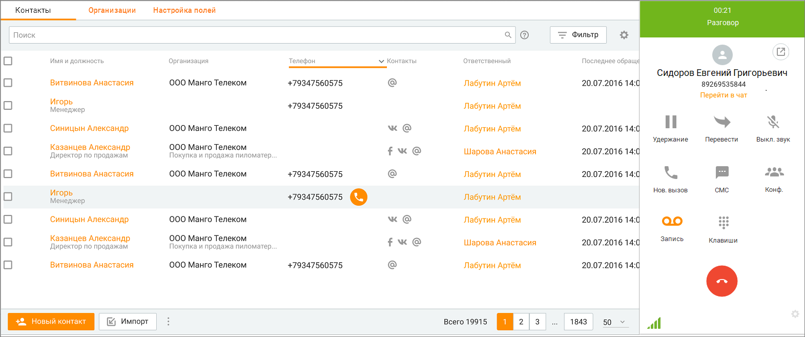

> **Иллюстрация CC-09-2** · стр. 47 · раздел «2.5. Панель управления телефонией» · снимок экрана интерфейса, 1571×657 px.
> Иллюстрирует текст руководства: «Для того, чтобы развернуть панель телефонии, нажмите на верхней панели. На рисунке ниже приведен пример развернутой панели управления телефонией в состоянии разговора.»
> Следующий за иллюстрацией текст: «На панели отображается информация о номере, с которого поступил вызов. В случае, когда номер принадлежит клиенту адресной книги, то вместо номера отображается имя клиента. При щелчке по имени …»

На панели отображается информация о номере, с которого поступил вызов. В случае, когда номер принадлежит клиенту адресной книги, то вместо номера отображается имя клиента. При щелчке по имени выполняется переход к карточке клиента. На нижней границе панели софтфона располагается блок с информацией о звонке: номер сотрудника, название компании Исходящего обзвона, DID номер и т. д. При этом если в разделе ЛК ВАТС/Номера, подключенные к АТС поле "Комментарий" к номеру телефона или SIP-Trunk, на который пришел вызов, заполнено, то в карточке входящего вызова комментарий отображается вместо номера. Все данные собеседника, отображаемые на панели софтфона, можно скопировать: номер телефона, имя контакта, организация, должность.

В рамках компаний исходящего обзвона предусмотрена возможность скрытия номеров клиентов от сотрудников. Данная возможность является опциональной и подключается только через персонального менеджера.

> **Иллюстрация CC-09-3** · стр. 47 · раздел «2.5. Панель управления телефонией» · значок (элемент интерфейса), встроенный в текст, 19×25 px.
> Поясняющий текст руководства (рядом с элементом): «Для отображения клавиатурного блока на панели в ходе разговора нажмите кнопку Клавиши , чтобы ввести в тоновом режиме необходимую команду: донабор номера, перевод вызова, организация конференций. Чтобы скрыть клавиатурный блок, нажмите кнопку еще раз.»
> Предшествующий контекст: «В рамках компаний исходящего обзвона предусмотрена возможность скрытия номеров клиентов от сотрудников. Данная возможность является опциональной и подключается только через персонального менеджера.»

Для отображения клавиатурного блока на панели в ходе разговора нажмите кнопку Клавиши , чтобы ввести в тоновом режиме необходимую команду: донабор номера, перевод вызова, организация конференций. Чтобы скрыть клавиатурный блок, нажмите кнопку еще раз.

> **Иллюстрация CC-09-4** · стр. 47 · раздел «2.5. Панель управления телефонией» · значок (элемент интерфейса), встроенный в текст, 35×35 px.
> Поясняющий текст руководства (рядом с элементом): «Кнопки для открепления и закрепления клавиатурного блока. Окно с открепленным блоком может быть расположено в любом месте рабочего стола, и отображается поверх всех окон.»
> Предшествующий контекст: «Для отображения клавиатурного блока на панели в ходе разговора нажмите кнопку Клавиши , чтобы ввести в тоновом режиме необходимую команду: донабор номера, перевод вызова, организация конференций. …»

> **Иллюстрация CC-09-5** · стр. 47 · раздел «2.5. Панель управления телефонией» · значок (элемент интерфейса), встроенный в текст, 35×35 px.
> Поясняющий текст руководства (рядом с элементом): «Кнопки для открепления и закрепления клавиатурного блока. Окно с открепленным блоком может быть расположено в любом месте рабочего стола, и отображается поверх всех окон.»
> Предшествующий контекст: «Для отображения клавиатурного блока на панели в ходе разговора нажмите кнопку Клавиши , чтобы ввести в тоновом режиме необходимую команду: донабор номера, перевод вызова, организация конференций. …»

Кнопки для открепления и закрепления клавиатурного блока. Окно с открепленным блоком может быть расположено в любом месте рабочего стола, и отображается поверх всех окон.

> **Иллюстрация CC-09-6** · стр. 48 · раздел «2.5. Панель управления телефонией» · значок (элемент интерфейса), встроенный в текст, 34×34 px.
> Поясняющий текст руководства (рядом с элементом): «приводит к скрытию блока. Клик по кнопке»
> Предшествующий контекст: «Кнопки для открепления и закрепления клавиатурного блока. Окно с открепленным блоком может быть расположено в любом месте рабочего стола, и отображается поверх всех окон.»

приводит к скрытию блока. Клик по кнопке

> **Иллюстрация CC-09-7** · стр. 48 · раздел «2.5. Панель управления телефонией» · значок (элемент интерфейса), встроенный в текст, 24×25 px.
> Поясняющий текст руководства (рядом с элементом): «Описание действия кнопок и приведено в подразделе Настройка гарнитуры во время разговора.»
> Предшествующий контекст: «приводит к скрытию блока. Клик по кнопке»

> **Иллюстрация CC-09-8** · стр. 48 · раздел «2.5. Панель управления телефонией» · значок (элемент интерфейса), встроенный в текст, 17×16 px.
> Поясняющий текст руководства (рядом с элементом): «Описание действия кнопок и приведено в подразделе Настройка гарнитуры во время разговора.»
> Предшествующий контекст: «приводит к скрытию блока. Клик по кнопке»

Описание действия кнопок и приведено в подразделе Настройка гарнитуры во время разговора.

Более подробная информация о командах для ввода с клавиатуры приведена в подразделе Использование DTMF-команд.

Во время разговора в нижней части панели отображается пиктограмма анализатора,

> **Иллюстрация CC-09-9** · стр. 48 · раздел «2.5. Панель управления телефонией» · значок (элемент интерфейса), встроенный в текст, 30×25 px.
> Поясняющий текст руководства (рядом с элементом): «указывающая на уровень качества связи. При наведении курсора на пиктограмму отображается подсказка.»
> Предшествующий контекст: «Во время разговора в нижней части панели отображается пиктограмма анализатора,»

указывающая на уровень качества связи. При наведении курсора на пиктограмму отображается подсказка.

### 2.5.1. Меню программы

Меню программы (открывается кликом на аватар пользователя) содержит следующие пункты:  Мой профиль – контактные данные текущего пользователя;  Доступные скрипты – предварительный просмотр шаблонов скриптов;  Все настройки – настройки программы;  Квесты – обучение работе с Контакт-центром в форме квеста;  Настройки звука – переход к настройкам софтфона;  Выйти – выход из Контакт-центра.

> **Иллюстрация CC-09-10** · стр. 49 · раздел «2.5.1. Меню программы» · значок (элемент интерфейса), встроенный в текст, 43×44 px.
> Поясняющий текст руководства (рядом с элементом): «Меню справочной системы открывается кликом по пиктограмме и содержит  Справка по продукту – вызов справки;  Часто задаваемые вопросы – страница браузера с ответами на наиболее распространенные вопросы пользователей;  Что нового – страница браузера с информацией о новых возможностях программы;  …»
> Предшествующий контекст: «Меню программы (открывается кликом на аватар пользователя) содержит следующие пункты:  Мой профиль – контактные данные текущего пользователя;  Доступные скрипты – предварительный просмотр шаблонов …»

Меню справочной системы открывается кликом по пиктограмме и содержит  Справка по продукту – вызов справки;  Часто задаваемые вопросы – страница браузера с ответами на наиболее распространенные вопросы пользователей;  Что нового – страница браузера с информацией о новых возможностях программы;  Проверка обновлений – после клика по строке меню система проверит наличие обновлений, и, если обновление имеется, предложит его установить. Операция проверки может занять несколько секунд;  О программе – информация о текущей версии Контакт-центра;  Написать в техподдержку – открывает всплывающее окно создания обращения.  Удаленный доступ – в браузере открывается ссылка на скачивание программы удаленного доступа Teamviewer.  Мониторинг доступности – в браузере открывается ссылка на информационную страницу «Статусы доступности сервисов MANGO OFFICE».  Очистка локальных данных – клик по строке меню открывает окно для подтверждения очистки данных. После нажатия "ДА" запускается функция очистки. Функционал очищает только локальные данные, с сохранением файла пользовательских данных для авторизации в Контакт-центре без повторного ввода логина и пароля.

2.5.1.1. Профиль

Для перехода к просмотру профиля текущего сотрудника следует нажать на аватар сотрудника, расположенный в правом верхнем углу приложения, и выбрать пункт меню Профиль. В результате на экране отобразится карточка сотрудника.

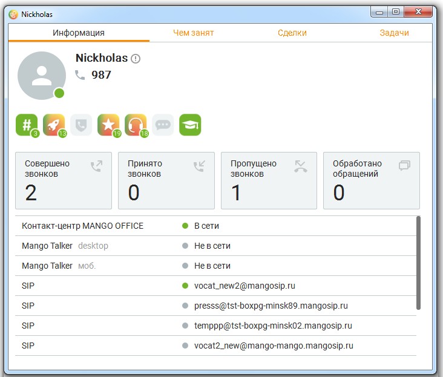

> **Иллюстрация CC-09-11** · стр. 50 · раздел «2.5.1. Меню программы» · снимок экрана интерфейса, 732×623 px.
> Иллюстрирует текст руководства: «Для перехода к просмотру профиля текущего сотрудника следует нажать на аватар сотрудника, расположенный в правом верхнем углу приложения, и выбрать пункт меню Профиль. В результате на экране отобразится карточка сотрудника.»
> Следующий за иллюстрацией текст: «Карточка сотрудника содержит следующую информацию:  Фотографию сотрудника (аватар);  Должность и отдел;  Внутренний номер (при его наличии);  Достижения сотрудника;  Список средств связи;  …»

Карточка сотрудника содержит следующую информацию:  Фотографию сотрудника (аватар);  Должность и отдел;  Внутренний номер (при его наличии);  Достижения сотрудника;  Список средств связи;  Исходящий номер;  Автосекретарь;  Регион сотрудника. При изменении исходящего номера в Личном кабинете ВАТС или профиле сотрудника, исходящий номер также изменяется в карточке сотрудника и в верхней панели основного окна Контакт-центра. Для выбора аватара следует нажать на него и выбрать нужное изображение. Для удаления аватара следует навести курсор на аватар и щелкнуть по пиктограмме .

> **Иллюстрация CC-09-12** · стр. 50 · раздел «2.5.1. Меню программы» · значок (элемент интерфейса), встроенный в текст, 12×12 px.
> Поясняющий текст руководства (рядом с элементом): «По клику на пиктограмме откроется окно, содержащее информацию о группах, в которых состоит сотрудник, статусе сотрудника в данной группе и других сотрудниках группы с аналогичным статусом.»
> Предшествующий контекст: «Карточка сотрудника содержит следующую информацию:  Фотографию сотрудника (аватар);  Должность и отдел;  Внутренний номер (при его наличии);  Достижения сотрудника;  Список средств связи;  …»

> **Иллюстрация CC-09-13** · стр. 50 · раздел «2.5.1. Меню программы» · значок (элемент интерфейса), встроенный в текст, 22×20 px.
> Поясняющий текст руководства (рядом с элементом): «По клику на пиктограмме откроется окно, содержащее информацию о группах, в которых состоит сотрудник, статусе сотрудника в данной группе и других сотрудниках группы с аналогичным статусом.»
> Предшествующий контекст: «Карточка сотрудника содержит следующую информацию:  Фотографию сотрудника (аватар);  Должность и отдел;  Внутренний номер (при его наличии);  Достижения сотрудника;  Список средств связи;  …»

По клику на пиктограмме откроется окно, содержащее информацию о группах, в которых состоит сотрудник, статусе сотрудника в данной группе и других сотрудниках группы с аналогичным статусом.

> **Иллюстрация CC-09-14** · стр. 50 · раздел «2.5.1. Меню программы» · значок (элемент интерфейса), встроенный в текст, 19×15 px.
> Поясняющий текст руководства (рядом с элементом): «По клику на пиктограмме открываются окна редактирования соответствующих данных. Больше о карточке сотрудника узнайте здесь.»
> Предшествующий контекст: «По клику на пиктограмме откроется окно, содержащее информацию о группах, в которых состоит сотрудник, статусе сотрудника в данной группе и других сотрудниках группы с аналогичным статусом.»

По клику на пиктограмме открываются окна редактирования соответствующих данных. Больше о карточке сотрудника узнайте здесь.

2.5.1.2. Доступные скрипты

Во время редактирования скрипта доступна функция предварительного просмотра созданного шаблона, чтобы увидеть его так, как он будет представлен назначенному сотруднику во время вызова. Для этого щелкните на фото в профиле и выберите пункт Доступные скрипты.

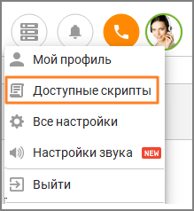

> **Иллюстрация CC-09-15** · стр. 52 · раздел «2.5.1. Меню программы» · снимок экрана интерфейса, 219×238 px.
> Иллюстрирует текст руководства: «Во время редактирования скрипта доступна функция предварительного просмотра созданного шаблона, чтобы увидеть его так, как он будет представлен назначенному сотруднику во время вызова. Для этого щелкните на фото в профиле и выберите пункт Доступные скрипты.»
> Следующий за иллюстрацией текст: «В результате на экране будет отображен скрипт в том составе, в котором он был на момент щелчка по ссылке, а не в сохраненном состоянии. Данная форма предназначена для того, чтобы сотрудник мог …»

В результате на экране будет отображен скрипт в том составе, в котором он был на момент щелчка по ссылке, а не в сохраненном состоянии. Данная форма предназначена для того, чтобы сотрудник мог заранее ознакомиться со своими репликами и возможными ответами клиента. После того, как был просмотрен хотя бы один ответ клиента, данная версия скрипта перестает быть новой для текущего сотрудника.

2.5.1.3. Настройки

Окно Настройки позволяет создавать новые учетные записи и осуществлять настройку Контакт-центра MANGO OFFICE в соответствии с ролью пользователя и кругом его обязанностей.

Настройки, хранящиеся локально на компьютере пользователя, хранятся отдельно для каждой учетной записи. Если под учетной записью вход с компьютера осуществляется впервые, то значения настроек устанавливаются по умолчанию, а при их изменении – сохраняются на компьютере пользователя для соответствующей учетной записи.

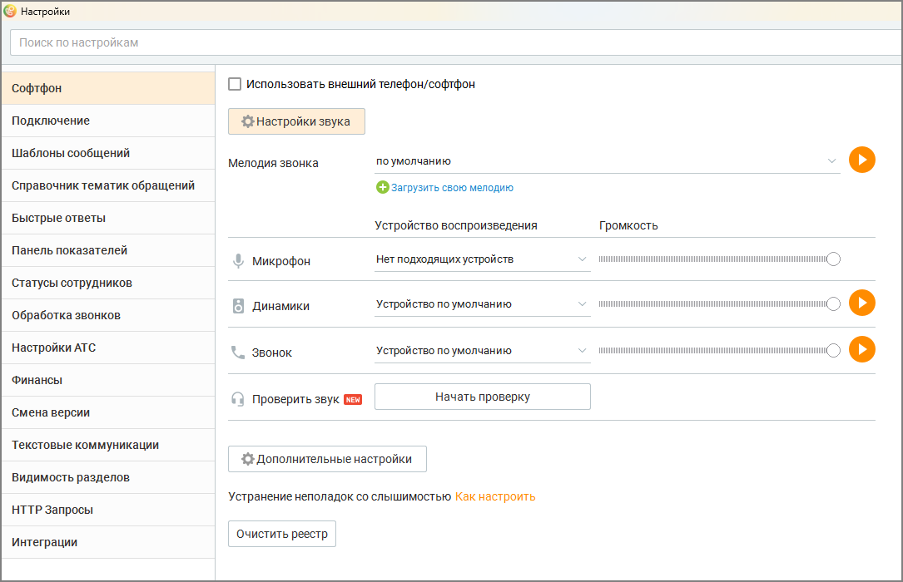

> **Иллюстрация CC-09-16** · стр. 53 · раздел «2.5.1. Меню программы» · снимок экрана интерфейса, 1085×700 px.
> Иллюстрирует текст руководства: «Настройки, хранящиеся локально на компьютере пользователя, хранятся отдельно для каждой учетной записи. Если под учетной записью вход с компьютера осуществляется впервые, то значения настроек устанавливаются по умолчанию, а при их изменении – сохраняются на компьютере пользователя для …»
> Следующий за иллюстрацией текст: «Окно содержит вкладки, позволяющие выбрать нужную группу настроек:  ВАТС — информация о настройках, управление Виртуальной АТС, с которой используется Контакт-центр MANGO OFFICE;  Телефония e-mail …»

Окно содержит вкладки, позволяющие выбрать нужную группу настроек:  ВАТС — информация о настройках, управление Виртуальной АТС, с которой используется Контакт-центр MANGO OFFICE;  Телефония e-mail — выбор линии АТС для исходящих звонков;  Исходящие обращения – настройка аккаунтов, через которые оператор обращается к клиенту при инициации исходящего текстового обращения;  Автосекретарь – настройка правил Автосекретаря;  Пользовательские — пользовательские настройки программы;  Справочник тематик обращений — редактирование списка тематик обращений, применяемых при обработке вызова;  Быстрые ответы — редактирование списка быстрых ответов, применяемых при обработке обращений;  Панель показателей — настройка показателей производительности;  Софтфон — выбор устройств, использующихся в качестве микрофона и динамиков (гарнитуры) для осуществления разговоров, прослушивания записей разговоров и т. д;  Шаблоны сообщений — настройка сообщений, отправляемых пользователям по каналам СМС и WhatsApp;  Статусы сотрудников — добавление пользовательских статусов;  Подключение — настройки подключения программы;  Обработка звонков — настройки телефонных номеров;  Настройки АТС — настройки АТС;  Финансы — настройки и инструменты для работы с текущим Лицевым счетом;  Смена версии — смена версии и тарифа текущего продукта;

 Текстовые коммуникации — многоканальные виджеты;  Видимость разделов – отображение разделов Контакт-центра MANGO OFFICE.  HTTP-запросы — работа с внешними базами данных;  Интеграции — настройка интеграций с внешними сервисами. Строка полнотекстового поиска обеспечивает поиск по наименованию вкладок и их содержимому.

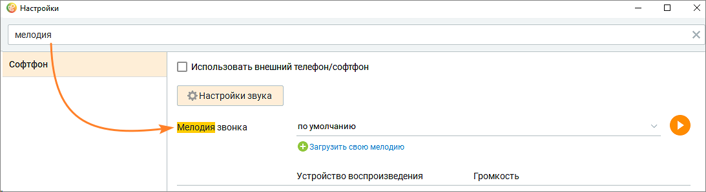

> **Иллюстрация CC-09-17** · стр. 54 · раздел «2.5.1. Меню программы» · снимок экрана интерфейса, 1093×299 px.
> Иллюстрирует текст руководства: « Текстовые коммуникации — многоканальные виджеты;  Видимость разделов – отображение разделов Контакт-центра MANGO OFFICE.  HTTP-запросы — работа с внешними базами данных;  Интеграции — настройка интеграций с внешними сервисами. Строка полнотекстового поиска обеспечивает поиск по наименованию …»
> Следующий за иллюстрацией текст: «Также настройки Контакт-центра MANGO OFFICE можно открыть, щелкнув правой кнопкой мыши по иконке приложения в области системных значков уведомлений (трее).»

Также настройки Контакт-центра MANGO OFFICE можно открыть, щелкнув правой кнопкой мыши по иконке приложения в области системных значков уведомлений (трее).

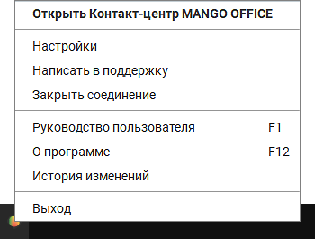

> **Иллюстрация CC-09-18** · стр. 54 · раздел «2.5.1. Меню программы» · снимок экрана интерфейса, 350×265 px.
> Иллюстрирует текст руководства: «Также настройки Контакт-центра MANGO OFFICE можно открыть, щелкнув правой кнопкой мыши по иконке приложения в области системных значков уведомлений (трее).»
> Следующий за иллюстрацией текст: «Изменения, выполненные на одной вкладке, сохраняются при переходе на другую. Для сохранения изменений нажмите Сохранить в нижней части окна настроек. В случае закрытия окна при наличии несохраненных …»

Изменения, выполненные на одной вкладке, сохраняются при переходе на другую. Для сохранения изменений нажмите Сохранить в нижней части окна настроек. В случае закрытия окна при наличии несохраненных настроек на экране отобразится предупреждающее сообщение вида:

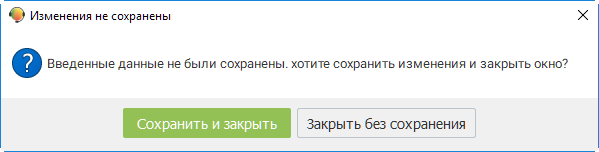

> **Иллюстрация CC-09-19** · стр. 54 · раздел «2.5.1. Меню программы» · снимок экрана интерфейса, 599×152 px.
> Иллюстрирует текст руководства: «Изменения, выполненные на одной вкладке, сохраняются при переходе на другую. Для сохранения изменений нажмите Сохранить в нижней части окна настроек. В случае закрытия окна при наличии несохраненных настроек на экране отобразится предупреждающее сообщение вида:»
> Следующий за иллюстрацией текст: «2.5.1.3.1. ВАТС»

2.5.1.3.1. ВАТС

Данная вкладка предназначена для получения информации о настройках Виртуальной АТС, с которой используется Контакт-центр MANGO OFFICE.

Вкладка доступна пользователям с ролью Администратор.

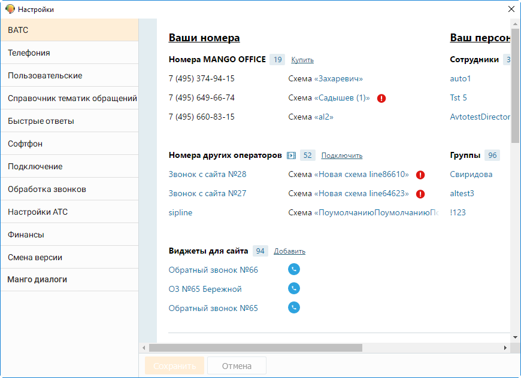

> **Иллюстрация CC-09-20** · стр. 55 · раздел «2.5.1. Меню программы» · снимок экрана интерфейса, 870×632 px.
> Иллюстрирует текст руководства: «Вкладка доступна пользователям с ролью Администратор.»
> Следующий за иллюстрацией текст: «Подробное описание работы с настройками и инструментами ВАТС приведено в документе "Справочник ВАТС", который можно скачать с официального сайта компании Манго-Телеком. В документе см. раздел …»

Подробное описание работы с настройками и инструментами ВАТС приведено в документе "Справочник ВАТС", который можно скачать с официального сайта компании Манго-Телеком. В документе см. раздел "Продукт "Виртуальная АТС" и его подразделы.

2.5.1.3.2. Телефония и E-mail

Данная вкладка предназначена для выбора исходящей линии АТС и адреса электронной почты сотрудника.

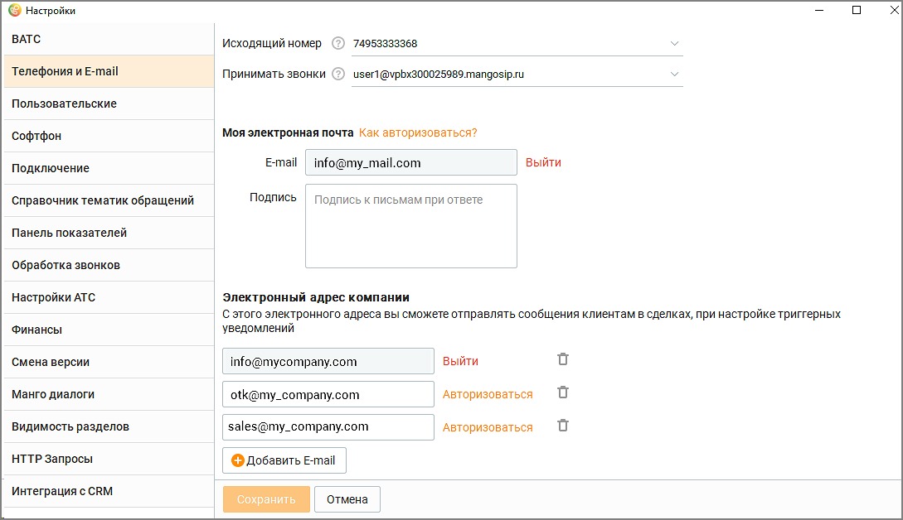

> **Иллюстрация CC-09-21** · стр. 56 · раздел «2.5.1. Меню программы» · снимок экрана интерфейса, 1089×628 px.
> Иллюстрирует текст руководства: «Данная вкладка предназначена для выбора исходящей линии АТС и адреса электронной почты сотрудника.»
> Следующий за иллюстрацией текст: «Исходящий номер телефона Выбранный номер будет отображаться на определителе номера у человека, которому звонит сотрудник. Также номер служит для определения региона звонка для расчета стоимости …»

Исходящий номер телефона Выбранный номер будет отображаться на определителе номера у человека, которому звонит сотрудник. Также номер служит для определения региона звонка для расчета стоимости связи. Напротив каждого номера отображается комментарий (при его наличии), указанный в Личном кабинете на странице настроек "Номера, подключенные к АТС". Принимать звонки Номера сотрудника (номера телефонов и SIP), на которые он может принимать входящие вызовы. Задаются в карточке сотрудника в Личном кабинете пользователя ВАТС. (См. Справочник ВАТС, Вкладка «Телефония»). В списке отображаются только номера, отмеченные как "активные". Настройка доступна пользователям с правом: Изменять порядок, активность и расписание средств приема звонков, а также изменять алгоритм приема звонков по внутреннему номеру. Моя электронная почта Адрес электронной почты может находиться в одном из трех состояний: 1) отсутствует – адрес электронной почты сотрудника не указан ни в настройке "Телефония и E-mail" в Контакт-центре, ни в Карточке сотрудника в ВАТС (раздел Ваш персонал/Сотрудники); 2) добавлен, но не авторизован – действительный адрес электронной почты сотрудника внесен в поле "Моя электронная почта" и сохранен нажатием кнопки "Сохранить". В этом случае E-

> **Иллюстрация CC-09-22** · стр. 56 · раздел «2.5.1. Меню программы» · фрагмент интерфейса (кнопка, поле, меню), 86×21 px.
> Поясняющий текст руководства (рядом с элементом): «mail добавляется в Карточке сотрудника в Контакт-центре с пометкой и в Карточку сотрудника в Личном кабинете ВАТС (если в Карточке сотрудника в Личном кабинете ВАТС уже был добавлен E-mail, то он заменится на новый);»
> Предшествующий контекст: «Исходящий номер телефона Выбранный номер будет отображаться на определителе номера у человека, которому звонит сотрудник. Также номер служит для определения региона звонка для расчета стоимости …»

mail добавляется в Карточке сотрудника в Контакт-центре с пометкой и в Карточку сотрудника в Личном кабинете ВАТС (если в Карточке сотрудника в Личном кабинете ВАТС уже был добавлен E-mail, то он заменится на новый);

При изменении или добавлении нового E-mail в Карточке сотрудника в Личном кабинете ВАТС, новый E-mail так же отобразится в Карточке сотрудника и в настройке "Телефония и E-mail" в Контакт-центре.

3) авторизован – если пройдена процедура авторизации адреса электронной почты в Контакт- центре.

Если после авторизации почты сотрудника в Контакт-центре E-mail будет изменен в Карточке-сотрудника в Личном кабинет ВАТС, то в Контакт-центре E-mail так же изменится, и процедуру авторизации будет необходимо пройти заново.

Если сотрудник назначен на обработку обращений по каналу e-mail, он получает системное уведомление о необходимости авторизации. Для авторизации e-mail заполните поле Моя электронная почта и щелкните по ссылке Авторизоваться. В окне авторизации заполните поля:  E-mail – адрес электронной почты;  Пароль – пароль к электронной почте;  SMTP host - сервер исходящей почты для вашего домена;  SMTP port – протокол шифрования для вашего домена; Параметры SMTP host и SMTP port можно узнать в разделе "Настройки" на сайте вашего почтового клиента. Если вы используете один из следующих почтовых сервисов, то для обработки исходящих писем заполните поля SMTP-host и SMTP-port следующими данными:

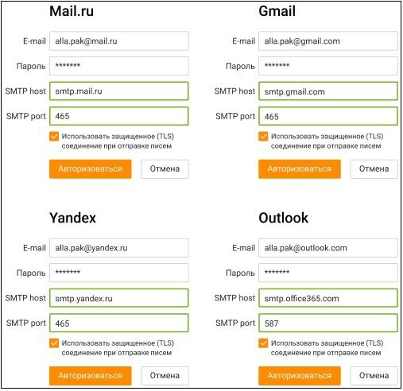

> **Иллюстрация CC-09-23** · стр. 58 · раздел «2.5.1. Меню программы» · снимок экрана интерфейса, 507×492 px.
> Иллюстрирует текст руководства: «Если сотрудник назначен на обработку обращений по каналу e-mail, он получает системное уведомление о необходимости авторизации. Для авторизации e-mail заполните поле Моя электронная почта и щелкните по ссылке Авторизоваться. В окне авторизации заполните поля:  E-mail – адрес электронной почты;  …»
> Следующий за иллюстрацией текст: «При авторизации не рекомендуется удалять галочку из чекбокса "Использовать защищенное соединение (TLS) при отправке писем"»

При авторизации не рекомендуется удалять галочку из чекбокса "Использовать защищенное соединение (TLS) при отправке писем"

E-mail сотрудника может использоваться в качестве адреса отправителя в письмах, отправляемых сотрудником из Контакт-центра (в ответах на входящие обращения или в новых исходящих обращениях к клиенту). Для этого должны быть выполнены условия:  E-mail сотрудника должен быть авторизован в Контакт-центре;  В настройках виджета в канале коммуникации E-mail указано:

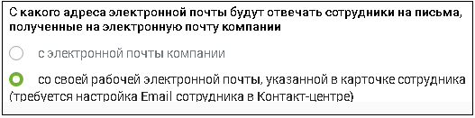

> **Иллюстрация CC-09-24** · стр. 58 · раздел «2.5.1. Меню программы» · снимок экрана интерфейса, 527×131 px.
> Иллюстрирует текст руководства: «E-mail сотрудника может использоваться в качестве адреса отправителя в письмах, отправляемых сотрудником из Контакт-центра (в ответах на входящие обращения или в новых исходящих обращениях к клиенту). Для этого должны быть выполнены условия:  E-mail сотрудника должен быть авторизован в …»
> Следующий за иллюстрацией текст: «Если e-mail сотрудника не авторизован в Контакт-центре, или в настройках виджета в Личном кабинете установлено "Отвечать с электронной почты компании", то письма из Контакт-центра будут отправляться …»

Если e-mail сотрудника не авторизован в Контакт-центре, или в настройках виджета в Личном кабинете установлено "Отвечать с электронной почты компании", то письма из Контакт-центра будут отправляться с e-mail компании, указанного в настройках виджета.

Подпись при ответе с этой электронной почты в Контакт-центре Данная настройка появляется после авторизации e-mail сотрудника. Если Вы хотите добавлять при каждом ответе во встроенном редакторе писем подпись к письму, то заполните поле необходимой информацией и нажмите кнопку "Сохранить".

В этом поле указывается подпись к письму при ответе в Контакт-центре с почты сотрудника. Подпись к письму, подставляемая при ответе с почты компании, указывается в настройках канала коммуникации E-mail в виджете в Личном кабинете.

Узнайте больше о переписке с клиентом по е-mail здесь.

Электронный адрес компании Поле Адрес компании и остальные элементы настройки нескольких электронных адресов компании используются для отправки триггерных уведомлений. Клик по кнопке Добавить E-mail открывает новое поле добавления электронной почты. Клик

> **Иллюстрация CC-09-25** · стр. 59 · раздел «2.5.1. Меню программы» · значок (элемент интерфейса), встроенный в текст, 16×19 px.
> Поясняющий текст руководства (рядом с элементом): «по пиктограмме удаляет добавленный ранее адрес электронной почты. Порядок авторизации аналогичен описанному выше в блоке "Моя электронная почта". 2.5.1.3.3. База знаний»
> Предшествующий контекст: «Электронный адрес компании Поле Адрес компании и остальные элементы настройки нескольких электронных адресов компании используются для отправки триггерных уведомлений. Клик по кнопке Добавить E-mail …»

по пиктограмме удаляет добавленный ранее адрес электронной почты. Порядок авторизации аналогичен описанному выше в блоке "Моя электронная почта". 2.5.1.3.3. База знаний

В этом поле можно добавить ссылку на базу знаний вашей компании. При наличии ссылки в окне обращения оператора отобразится сообщение "Открыть базу знаний". Клик на сообщение откроет базу знаний.

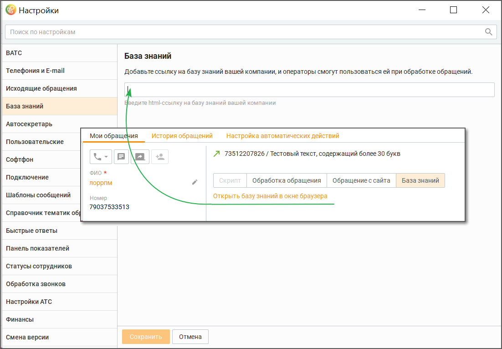

> **Иллюстрация CC-09-26** · стр. 59 · раздел «2.5.1. Меню программы» · снимок экрана интерфейса, 1102×766 px.
> Иллюстрирует текст руководства: «В этом поле можно добавить ссылку на базу знаний вашей компании. При наличии ссылки в окне обращения оператора отобразится сообщение "Открыть базу знаний". Клик на сообщение откроет базу знаний.»
> Следующий за иллюстрацией текст: «2.5.1.3.4. Исходящие обращения»

2.5.1.3.4. Исходящие обращения

Вкладка Исходящие обращения предназначена для настройки аккаунтов, через которые оператор обращается к клиенту при инициации исходящего текстового обращения.

Вкладка отображается в случае, если в ЛК ВАТС подключен хотя бы один канал из следующих возможных: E-mail, VK, Telegram, WhatsApp, Max. В списке отображаются все аккаунты, подключенные по соответствующему каналу. Если для канала не настроен аккаунт, то канал не отображается На вкладке можно выбрать любой из активных каналов, подключенных и настроенных в Личном кабинете ВАТС. Сотрудник не может осуществить отправку исходящего текстового обращения клиенту по каналу, который не подключен, или если по каналу не настроено ни одного аккаунта.

Настройки на вкладке требуют сохранения для применения (перезапуск приложения не требуется). Настройка аккаунтов хранится на сервере для каждой учетной записи пользователя (для обеспечения доступа к настройке с других устройств).

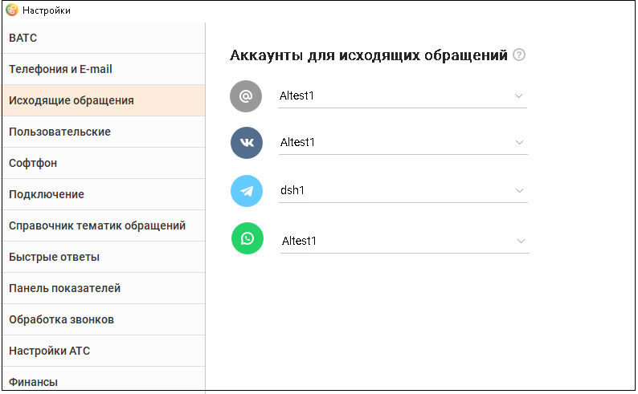

> **Иллюстрация CC-09-27** · стр. 60 · раздел «2.5.1. Меню программы» · снимок экрана интерфейса, 794×491 px.
> Иллюстрирует текст руководства: «Настройки на вкладке требуют сохранения для применения (перезапуск приложения не требуется). Настройка аккаунтов хранится на сервере для каждой учетной записи пользователя (для обеспечения доступа к настройке с других устройств).»
> Следующий за иллюстрацией текст: «2.5.1.3.5. Автосекретарь»

2.5.1.3.5. Автосекретарь

Вкладка предназначена для настройки правил Автосекретаря.

Вкладка доступна, если в Личном кабинете подключена услуга "Автосекретарь".

Редактировать настройки могут пользователи с правом "Настраивать индивидуальные правила обработки звонков (Автосекретарь)". Пользователь может просмотреть настроенные правила даже в том случае, если у него нет прав на редактирование автосекретаря.

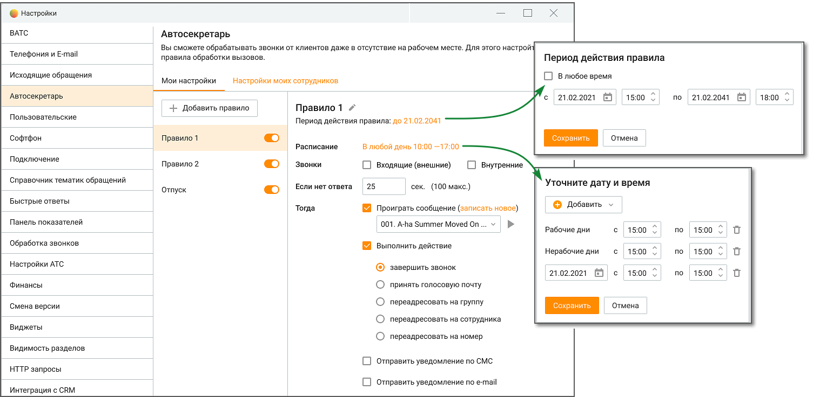

> **Иллюстрация CC-09-28** · стр. 61 · раздел «2.5.1. Меню программы» · снимок экрана интерфейса, 1505×737 px.
> Иллюстрирует текст руководства: «Редактировать настройки могут пользователи с правом "Настраивать индивидуальные правила обработки звонков (Автосекретарь)". Пользователь может просмотреть настроенные правила даже в том случае, если у него нет прав на редактирование автосекретаря.»
> Следующий за иллюстрацией текст: «На вкладке пользователю доступны следующие настройки: Переключатель «Правила переадресации» – в положении «включен» определяет Правило, как действующее. Кнопка «Добавить правило» – максимальное …»

На вкладке пользователю доступны следующие настройки: Переключатель «Правила переадресации» – в положении «включен» определяет Правило, как действующее. Кнопка «Добавить правило» – максимальное количество правил для одного сотрудника – 5. Если для сотрудника создано несколько правил, у которых пересекаются условия, то срабатывает первое правило из списка. Для каждого правила можно задать следующие параметры:

1. Период действия правила – настройка периода поступления звонка;

2. Расписание – настройка времени поступления звонка с разделением на рабочие и нерабочие дни;

3. Направление звонка (входящий внешний и/или внутренний) – настройка условия направления звонка для обработки;

4. Если нет ответа __ сек – время в секундах, в течение которого ожидается ответ сотрудника. Максимальное время ожидания – 100 секунд. По истечении установленного времени срабатывают настройки:

5. Проиграть голосовое сообщение – выберите из выпадающего списка голосовое сообщение, которое будет проигрываться, если в течение установленного в п.3 времени ответа от сотрудника не поступило. Выбранное голосовое сообщение можно прослушать при

> **Иллюстрация CC-09-29** · стр. 61 · раздел «2.5.1. Меню программы» · значок (элемент интерфейса), встроенный в текст, 12×16 px.
> Поясняющий текст руководства (рядом с элементом): «помощи встроенного плеера, кликнув по пиктограмме . Там же можно загрузить новое голосовое сообщение, если пользователь обладает правом "Добавлять, просматривать и удалять аудиофайлы".»
> Предшествующий контекст: «5. Проиграть голосовое сообщение – выберите из выпадающего списка голосовое сообщение, которое будет проигрываться, если в течение установленного в п.3 времени ответа от сотрудника не поступило. …»

помощи встроенного плеера, кликнув по пиктограмме . Там же можно загрузить новое голосовое сообщение, если пользователь обладает правом "Добавлять, просматривать и удалять аудиофайлы".

6. Выполнить действие – после воспроизведения голосового сообщения Автосекретарь выполнит одно из указанных в настройках действий:  завершить звонок.  принять голосовую почту – абонент сможет записать и отправить голосовое сообщение на e-mail сотрудника, после чего звонок завершается.  переадресовать на группу – звонок будет переадресован на указанную группу. Далее звонок обрабатывается по правилам, настроенным в Личном кабинете для обработки звонков группой. Если в рамках алгоритма распределения для группы вызов должен быть переадресован на данного сотрудника, то автосекретарь не обрабатывает звонок повторно.

 Переадресовать на сотрудника – звонок будет переадресован на указанного сотрудника. При переадресации на сотрудника используются параметры дозвона, указанные в карточке данного сотрудника в Личном кабинете. Если в процессе прохождения звонка, звонок поступил на сотрудника, для которого уже сработали индивидуальные правила переадресации, то автосекретарь не обрабатывает звонок повторно.  Переадресовать на номер телефона – звонок будет переадресован на указанный номер. При переадресации используется время ожидания ответа, указанное в поле рядом. Таким образом, в рамках одного вызова для одного сотрудника правило автосекретаря может сработать только один раз.

Автосекретарь не работает для групповых вызовов с последующим распределением на сотрудника.

7. Отправить сообщение о пропущенном звонке  Отправить уведомление по СМС – чекбокс открывает поле для ввода мобильного телефона в формате "+79", "79" или "89".  Отправить уведомление по e-mail – чекбокс открывает поле для ввода адреса электронной почты. По умолчанию заполняется e-mail из карточки сотрудника.

Пример 1: Если включен чек-бокс «Отправить уведомление по СМС», то на указанный номер приходит СМС со следующим текстом: "<текущая дата> в <текущее время> сотрудником <ФИО сотрудника, для которого сработало правило> пропущен звонок с номера <номер, с которого поступил звонок>".

Пример 2: Если включен чек-бокс «Отправить уведомление по e-mail», то на указанный адрес электронной почты приходит сообщение со следующим текстом: "<текущая дата> в <текущее время> сотрудником <ФИО сотрудника, для которого сработало правило> пропущен звонок с номера <номер, с которого поступил звонок>". Тема письма "Пропущенный звонок от <текущая дата> в <текущее время>".

При включенных чекбоксах поля являются обязательными для заполнения. Сохраните настройки кнопкой Сохранить. Клик по кнопке Отмена отменяет изменения и возвращает настройки обработки звонков к последнему сохраненному значению.

> **Иллюстрация CC-09-30** · стр. 62 · раздел «2.5.1. Меню программы» · значок (элемент интерфейса), встроенный в текст, 16×19 px.
> Поясняющий текст руководства (рядом с элементом): «Клик по пиктограмме "корзина" приводит к удалению правила Автосекретаря. 2.5.1.3.6. Пользовательские»
> Предшествующий контекст: «При включенных чекбоксах поля являются обязательными для заполнения. Сохраните настройки кнопкой Сохранить. Клик по кнопке Отмена отменяет изменения и возвращает настройки обработки звонков к …»

Клик по пиктограмме "корзина" приводит к удалению правила Автосекретаря. 2.5.1.3.6. Пользовательские

Данная вкладка предназначена для редактирования настроек непосредственно программы.

Вкладка доступна всем пользователям.

Основные Предупреждать при попытке выхода из приложения При включенной настройке при попытке выхода из Контакт-центра MANGO OFFICE с помощью:  кнопки закрытия  комбинации клавиш Alt+F4

 пункта Выход контекстного меню, отображаемого при щелчке правой кнопкой мыши по значку в трее (если установлен флажок Не оставлять Контакт-центр MANGO OFFICE в Панели задач Windows (сворачивать в трей) на экране отображается окно подтверждения запроса на закрытие программы:

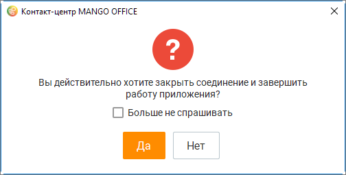

> **Иллюстрация CC-09-31** · стр. 63 · раздел «2.5.1. Меню программы» · снимок экрана интерфейса, 504×255 px.
> Иллюстрирует текст руководства: « пункта Выход контекстного меню, отображаемого при щелчке правой кнопкой мыши по значку в трее (если установлен флажок Не оставлять Контакт-центр MANGO OFFICE в Панели задач Windows (сворачивать в трей) на экране отображается окно подтверждения запроса на закрытие программы:»
> Следующий за иллюстрацией текст: «При выключенной настройке Контакт-центр MANGO OFFICE закроется без дополнительного подтверждения. Предупреждать при попытке звонка из браузера При включенной настройке при попытке совершения …»

При выключенной настройке Контакт-центр MANGO OFFICE закроется без дополнительного подтверждения. Предупреждать при попытке звонка из браузера При включенной настройке при попытке совершения исходящего вызова из браузера на экране отображается окно с предупреждающим сообщением. Не оставлять Контакт центр MANGO OFFICE в Панели задач Windows (сворачивать в трей) При включенной настройке после нажатия кнопки Свернуть окно Контакт-центр MANGO OFFICE сворачивается в трей (область системных значков и уведомлений). При выключенной настройке Контакт-центр MANGO OFFICE сворачивается на панель задач. Разворачивать окно приложения, панель софтфона и звонковое обращение при принятии входящего вызова При включенной настройке в случае, когда окно программы свернуто, при принятии нового входящего вызова в момент поднятия трубки окно программы разворачивается и осуществляется переход к обработке звонкового обращения. Запускать Контакт центр MANGO OFFICE при входе в систему Автоматический запуск Контакт центр MANGO OFFICE при старте операционной системы. Переход в статус "Перерыв" в периоде бездействия При включенной настройке и бездействии пользователя статусы На линии и Обзвон автоматически меняются на Перерыв при следующих условиях:  компьютер заблокирован пользователем (Win+L);  компьютер перешёл в спящий режим (без гибернации);  при запуске экранной заставки, спустя 5 секунд (допускается небольшая задержка);  компьютер перешёл в режим энергосбережения (функция отключения дисплея). Возобновление работы после периода бездействия происходит во всех случаях, когда ни одно из условий блокировки не выполняется. Не показывать уведомления "Назначена новая задача" При включенной настройке пользователь не будет получать системные уведомления, если на него назначена новая задача.

Звуковые уведомления

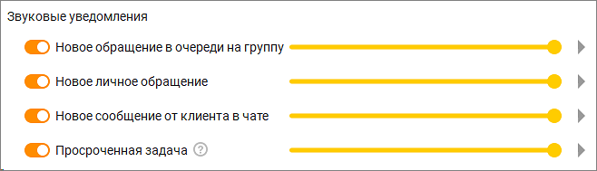

> **Иллюстрация CC-09-32** · стр. 64 · раздел «2.5.1. Меню программы» · снимок экрана интерфейса, 658×189 px.
> Иллюстрирует текст руководства: «Звуковые уведомления»
> Следующий за иллюстрацией текст: «Для настройки звукового уведомления следует установить соответствующий переключатель в положение "включено".»

Для настройки звукового уведомления следует установить соответствующий переключатель в положение "включено".

Обработка текстовых обращений Чекбокс Автоматически переключать на новое обращение регулирует автоматическое переключение оператора на новое поступившее текстовое обращение. При активации данной опции оператор автоматически переходит к новому обращению сразу после его поступления, что позволяет оперативно реагировать на новые запросы.  Если опция включена, система автоматически переключает фокус оператора с текущего обращения на новое. Это позволяет быстро обработать поступившее обращение без необходимости ручного выбора.  Если опция отключена, оператор продолжает работать с текущим обращением без автоматического переключения на новое. Это позволяет завершить начатое обращение, не отвлекаясь на вновь поступившие. Данная настройка сохраняется локально для каждого оператора, что позволяет персонализировать поведение системы в зависимости от предпочтений пользователя.

Запланированный звонок

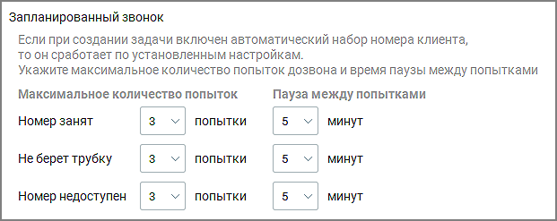

> **Иллюстрация CC-09-33** · стр. 64 · раздел «2.5.1. Меню программы» · снимок экрана интерфейса, 621×247 px.
> Иллюстрирует текст руководства: «Запланированный звонок»
> Следующий за иллюстрацией текст: «В поле задается максимальное количество попыток дозвона (по умолчанию – 3 попытки), а также время паузы между попытками (по умолчанию 5 мин.).  Номер занят – количество попыток дозвона и интервал …»

В поле задается максимальное количество попыток дозвона (по умолчанию – 3 попытки), а также время паузы между попытками (по умолчанию 5 мин.).  Номер занят – количество попыток дозвона и интервал времени между повторной попыткой в случае, если номер сотрудника занят;  Не берут трубку – количество попыток дозвона и интервал времени между повторной попыткой в случае, если сотрудник не берет трубку;  Номер недоступен – количество попыток дозвона и интервал времени между повторной попыткой в случае, если сотрудник недоступен.

История вызовов Количество выводимых вызовов

Это поле с регулятором позволяет указать общее количество выводимых в истории вызовов. Значение по умолчанию — 1000 записей; максимальное значение — 10 000 записей.

При установке чрезмерно большого значения данного параметра возможно существенное замедление работы программы! При использовании устройства с небольшой диагональю экрана рекомендуем уменьшить установленное по умолчанию значение (200 записей), чтобы повысить удобство работы с историей вызовов.

Обработка звонков Автоматически поднимать трубку при звонке Если указанная настройка выбрана, при поступлении звонка пользователю происходит автоматическое поднятие трубки (авто соединение с абонентом). Эта настройка устанавливается в Личном кабинете ВАТС по следующему пути: «Общие настройки» → «Безопасность и ограничения» → «Настройка доступа». Настройка роли, раздел "Инструменты" → блок "Управление звонками". Установить или удалить настройку может только пользователь с соответствующими правами доступа. Отклонять входящий вызов, если вы уже разговариваете по телефону При включенной настройке если пользователю во время разговора поступает второй звонок (например, распределенный на пользователя входящий звонок, обзвон по пропущенным в рамках кампании Исходящего обзвона, задача на автоматический перезвон т. д.), второй и последующие вызовы автоматически отклоняются (как если бы пользователь нажал кнопку "Отклонить" на карточке соответствующего входящего вызова). При выключенной настройке (по умолчанию) вызовы не будут отклоняться, и карточки входящего вызова будут отображаться вне зависимости от того, сколько вызовов уже распределено на пользователя через Контакт-центр MANGO OFFICE. Скрывать окно вызова при работе в других программах При включенной настройке плавающие виджеты всех вызовов (кроме виджетов входящего и исходящего вызовов) не отображаются в случае, когда окно приложения не является активным

Внутреннее общение Показывать в списке всех сотрудников, заведенных на ВАТС При включенной настройке в панели Сотрудники также отображаются сотрудники, не имеющие логина и пароля для входа в Личный кабинет и Контакт-центр MANGO OFFICE.

2.5.1.3.7. Софтфон

Данная вкладка предназначена для выбора устройств, которые вы будете использовать в качестве микрофона и динамиков (наушников гарнитуры) для осуществления разговоров, прослушивания записей разговоров и т. д. с использованием Контакт-центра MANGO OFFICE.

Контакт-центр использует выбранные устройства в монопольном режиме. Это означает, что во время работы Контакт-центра MANGO OFFICE вы не сможете использовать эти же устройства для голосовой связи в других программах.

Настройки звука При включенной настройке Использовать внешний телефон / софтфон вы можете использовать внешний аппаратный или программный телефон для осуществления разговоров с помощью Контакт-центра MANGO OFFICE.

При использовании внешнего телефона / софтфона вместе с Контакт-центром MANGO OFFICE становятся недоступными элементы интерфейса, предназначенные для настройки гарнитуры во время разговора (см. раздел Настройка гарнитуры во время разговора).

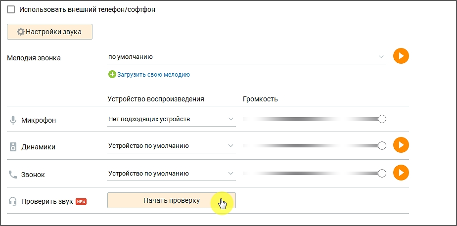

> **Иллюстрация CC-09-34** · стр. 66 · раздел «2.5.1. Меню программы» · снимок экрана интерфейса, 924×457 px.
> Иллюстрирует текст руководства: «При использовании внешнего телефона / софтфона вместе с Контакт-центром MANGO OFFICE становятся недоступными элементы интерфейса, предназначенные для настройки гарнитуры во время разговора (см. раздел Настройка гарнитуры во время разговора).»
> Следующий за иллюстрацией текст: «При щелчке по кнопке Настройки звука отображается список звуковых настроек софтфона: Мелодия звонка. Чтобы загрузить свою мелодию звонка, следует щелкнуть по ссылке "Загрузить свою мелодию" и при …»

При щелчке по кнопке Настройки звука отображается список звуковых настроек софтфона: Мелодия звонка. Чтобы загрузить свою мелодию звонка, следует щелкнуть по ссылке "Загрузить свою мелодию" и при помощи стандартного диалогового окна операционной системы указать путь к файлу. Микрофон, динамики, звонок. Укажите тип устройства, либо оставьте устройства по умолчанию (рекомендуется). Проверить звук. Кликнув по кнопке "Начать проверку" пользователь сможет сделать запись голоса с помощью службы тестирования звука и услышать себя. Дополнительные настройки

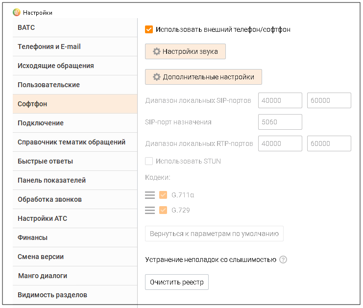

> **Иллюстрация CC-09-35** · стр. 67 · раздел «2.5.1. Меню программы» · снимок экрана интерфейса, 741×629 px.
> Иллюстрирует текст руководства: «При щелчке по кнопке Настройки звука отображается список звуковых настроек софтфона: Мелодия звонка. Чтобы загрузить свою мелодию звонка, следует щелкнуть по ссылке "Загрузить свою мелодию" и при помощи стандартного диалогового окна операционной системы указать путь к файлу. Микрофон, динамики, …»
> Следующий за иллюстрацией текст: «При щелчке по кнопке Дополнительные настройки отображается список дополнительных настроек софтфона:  Диапазон локальных SIP-портов;  SIP-порт назначения;  Диапазон локальных RTP-портов;  …»

При щелчке по кнопке Дополнительные настройки отображается список дополнительных настроек софтфона:  Диапазон локальных SIP-портов;  SIP-порт назначения;  Диапазон локальных RTP-портов;  Использование технологии STUN;  Выбор и приоритет использования кодеков. Кнопка Очистить реестр позволяет устранить неполадки слышимости путем полной очистки реестра Windows. Если во время работы возникли проблемы слышимости, воспользуйтесь инструкцией по устранению неполадок.

Информацию о настройках подключения вы можете получить у вашего системного администратора.

Для того, чтобы новые настройки вступили в силу, необходимо перезапустить приложение. 2.5.1.3.8. Подключение

Данная вкладка предназначена для настройки подключения программы для доступа в Web.

Вкладка доступна всем пользователям.

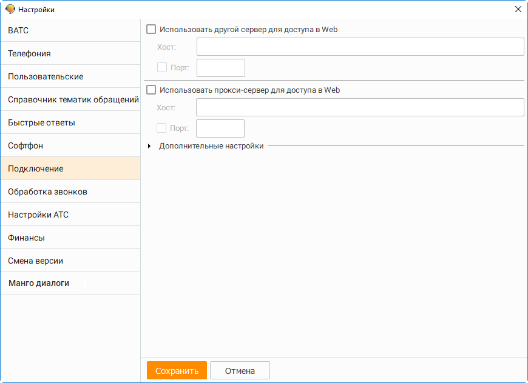

> **Иллюстрация CC-09-36** · стр. 68 · раздел «2.5.1. Меню программы» · снимок экрана интерфейса, 870×632 px.
> Иллюстрирует текст руководства: «Вкладка доступна всем пользователям.»
> Следующий за иллюстрацией текст: «При необходимости использовать настройки другого сервера для доступа в Web установите одноименный флажок. В полях Хост и Порт следует указать URL-адрес хоста и (при необходимости) номер порта сервера …»

При необходимости использовать настройки другого сервера для доступа в Web установите одноименный флажок. В полях Хост и Порт следует указать URL-адрес хоста и (при необходимости) номер порта сервера Контакт-центра MANGO OFFICE. Чтобы указать порт, установите соответствующий флажок.

Настройки сервера следует изменять только по рекомендации сотрудников компании MANGO OFFICE. Самостоятельное изменение настроек сервера может привести к потере работоспособности программы.

В случае, когда флаг Использовать другой сервер для доступа в Web установлен, но поля Хост и Порт не заполнены, на экране отображается соответствующее предупреждение. Также если при запуске Контакт-центра MANGO OFFICE система обнаружит установленный флаг, но отсутствие заполненных полей Хост и Порт, то будут использованы настройки по умолчанию. Флажок Использовать прокси-сервер для доступа в Web устанавливается в случае, если в вашей организации для доступа к интернету используется прокси-сервер. Информацию о прокси-сервере вы можете получить у вашего системного администратора. После установки флажка становятся активными дополнительные поля Хост и Порт. В них следует указать URL-адрес или IP-адрес хоста, а также номер порта прокси-сервера, используемого для доступа к интернету.

После изменения настроек необходимо выполнить перезагрузку приложения.

Для того, чтобы вернуть значения настроек к изначальным, откройте Дополнительные настройки и нажмите кнопку Вернуться в параметрам по умолчанию. В этом случае будут установлены следующие настройки:  По умолчанию используется хостинг https://api.mangotele.com/v2/ (порт – не указан).  Использовать другой сервер для доступа в Web: Не выбран.  Хост: Не задан.  Порт: Не задан.  Использовать Прокси-сервер для доступа к Web: Не выбран.  Хост: Не задан.  Порт: Не задан. Сохранение настроек выполняется автоматически, если сменился фокус (курсор установлен в другое поле) или по истечении 4 секунд с момента обновления поля. Дополнительные настройки включают:  Период пинга/проверки соединения (с) – Период в секундах, с которым отправляются контрольные пакеты для проверки работоспособности соединения на стороне сервера в случае отсутствия активности соединения. Для медленного (3G) интернета рекомендуется установить значение "5".  Максимальное время ожидания синхронизации данных (с) – максимально допустимое время в секундах для синхронизации данных по пользователям и вызовам на момент установки соединения. Для высоконагруженных Контакт-центров MANGO OFFICE рекомендуется не уменьшать значение этого показателя.  Задержка начала запуска процедуры восстановления соединения (с) – период в секундах между очередными попытками восстановления соединения. Уменьшение значения показателя для быстрых сетей не рекомендуется.  Максимальное время ожидания восстановления соединения (с) – максимально допустимое время в секундах ожидания восстановления соединения в случае разрыва. Допускается увеличение значения показателя для медленных соединений.  Вернуться к параметрам по умолчанию – возврат первоначальных настроек. 2.5.1.3.9. Справочник тематик обращений

На данной вкладке осуществляется редактирование списка папок и тематик обращений, применяемых при обработке вызова, при редактировании информации об уже совершенных вызовах, при создании кампании исходящего обзвона, а также для виджетов обратных звонков и т. д.

Права доступа к вкладке настраиваются в разделе Безопасность и ограничения → [выбрать роль] → Инструменты → Обращения. Для стандартных ролей:

Сотрудник, Бухгалтер, Оператор – доступ закрыт;

Супервизор – редактирование тематик всех групп, в которых пользователь является супервизором;

Администратор – редактирование тематик всех групп.

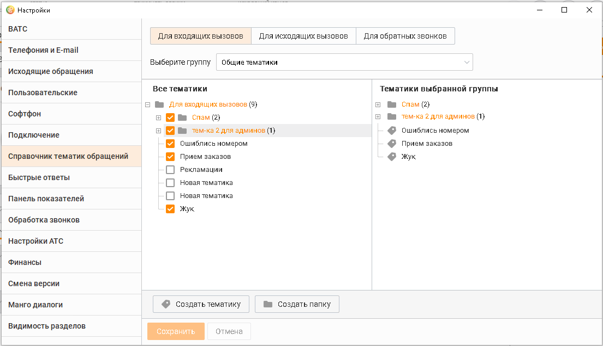

> **Иллюстрация CC-09-37** · стр. 70 · раздел «2.5.1. Меню программы» · снимок экрана интерфейса, 1105×636 px.
> Иллюстрирует текст руководства: «Администратор – редактирование тематик всех групп.»
> Следующий за иллюстрацией текст: «Максимально допустимое количество папок -100, может быть увличено до 500. Для тематик предусмотрен лимит в 500 единиц, который может быть расширен до 1500. Для расширения лимитов обратитесь к …»

Максимально допустимое количество папок -100, может быть увличено до 500. Для тематик предусмотрен лимит в 500 единиц, который может быть расширен до 1500. Для расширения лимитов обратитесь к персональному менеджеру для подключения соответствующей услуги. Длина названий папок и тематик ограничена 100 символами. Максимальная глубина вложенности структуры не может превышать 5 уровней. Тематики для определенного типа вызова создаются для каждой группы сотрудников. Таким образом, при вызове определенного типа сотруднику будут доступны тематики только одного соответствующего списка. Для обратных звонков тематики создаются для выбранного виджета "Обратный звонок".

Доступ к вкладке Для обратных звонков возможен только при наличии хотя бы одного виджета "Обратный звонок".

Список в левой части окна содержит все созданные тематики. В правой части окна отображается список тематик, выбранных для текущей группы сотрудников либо виджета "Обратный звонок". Выбор тематик осуществляется при установке флага напротив нужной папки либо тематики. Сохранение изменений выполняется автоматически. Папка или тематика создаются в иерархическом дереве последним элементом текущего элемента – папки либо тематики. Чтобы добавить тематику, нажмите ссылку Создать тематику. Введите название тематики и нажмите клавишу Enter. При этом порядок расположения ранее добавленных тематик и папок сохраняется. Чтобы изменить тематику, выберите ее. Выбранная тематика подсвечивается цветом (см.

> **Иллюстрация CC-09-38** · стр. 70 · раздел «2.5.1. Меню программы» · значок (элемент интерфейса), встроенный в текст, 20×20 px.
> Поясняющий текст руководства (рядом с элементом): «пример на рисунке выше). Затем нажмите кнопку либо дважды щелкните левой кнопкой мыши. Измените название тематики и нажмите клавишу Enter.»
> Предшествующий контекст: «Список в левой части окна содержит все созданные тематики. В правой части окна отображается список тематик, выбранных для текущей группы сотрудников либо виджета "Обратный звонок". Выбор тематик …»

пример на рисунке выше). Затем нажмите кнопку либо дважды щелкните левой кнопкой мыши. Измените название тематики и нажмите клавишу Enter.

Чтобы удалить тематику, выберите ее и нажмите кнопку

> **Иллюстрация CC-09-39** · стр. 71 · раздел «2.5.1. Меню программы» · значок (элемент интерфейса), встроенный в текст, 16×16 px.
> Поясняющий текст руководства (рядом с элементом): «. Если тематика была задана в рамках одного или нескольких разговоров, то на экране отображается соответствующее сообщение вида:»
> Предшествующий контекст: «Чтобы удалить тематику, выберите ее и нажмите кнопку»

. Если тематика была задана в рамках одного или нескольких разговоров, то на экране отображается соответствующее сообщение вида:

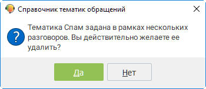

> **Иллюстрация CC-09-40** · стр. 71 · раздел «2.5.1. Меню программы» · снимок экрана интерфейса, 350×152 px.
> Иллюстрирует текст руководства: «. Если тематика была задана в рамках одного или нескольких разговоров, то на экране отображается соответствующее сообщение вида:»
> Следующий за иллюстрацией текст: «Справочник тематик является единым. Проявляйте повышенную внимательность при изменении или удалении тематик. При переносе папки вместе с ней переносятся все ее элементы. При удалении папки удаляются …»

Справочник тематик является единым. Проявляйте повышенную внимательность при изменении или удалении тематик. При переносе папки вместе с ней переносятся все ее элементы. При удалении папки удаляются все ее элементы.

> **Иллюстрация CC-09-41** · стр. 71 · раздел «2.5.1. Меню программы» · значок (элемент интерфейса), встроенный в текст, 20×20 px.
> Поясняющий текст руководства (рядом с элементом): «Чтобы изменить положение тематики, используйте кнопки и . В результате положение тематики изменится в рамках одного уровня. Также вы можете воспользоваться механизмом "перетаскивания" тематик, который позволяет создать иерархическое дерево, меняя уровни. Для этого "захватите" тематику и переместите …»
> Предшествующий контекст: «Справочник тематик является единым. Проявляйте повышенную внимательность при изменении или удалении тематик. При переносе папки вместе с ней переносятся все ее элементы. При удалении папки удаляются …»

> **Иллюстрация CC-09-42** · стр. 71 · раздел «2.5.1. Меню программы» · значок (элемент интерфейса), встроенный в текст, 20×20 px.
> Поясняющий текст руководства (рядом с элементом): «Чтобы изменить положение тематики, используйте кнопки и . В результате положение тематики изменится в рамках одного уровня. Также вы можете воспользоваться механизмом "перетаскивания" тематик, который позволяет создать иерархическое дерево, меняя уровни. Для этого "захватите" тематику и переместите …»
> Предшествующий контекст: «Справочник тематик является единым. Проявляйте повышенную внимательность при изменении или удалении тематик. При переносе папки вместе с ней переносятся все ее элементы. При удалении папки удаляются …»

Чтобы изменить положение тематики, используйте кнопки и . В результате положение тематики изменится в рамках одного уровня. Также вы можете воспользоваться механизмом "перетаскивания" тематик, который позволяет создать иерархическое дерево, меняя уровни. Для этого "захватите" тематику и переместите ее на ту тематику, которая станет родительской.

Изменения, внесенные в список тематик, сохраняются автоматически.

2.5.1.3.10. Быстрые ответы

На данной вкладке осуществляется редактирование списка быстрых ответов, применяемых при обработке обращений.

Доступ к вкладке и возможности по редактированию зависят от роли пользователя: Сотрудник, Бухгалтер, Оператор – доступ закрыт; Супервизор – редактирование быстрых ответов всех групп, в которых пользователь является супервизором; Администратор – редактирование быстрых ответов всех групп.

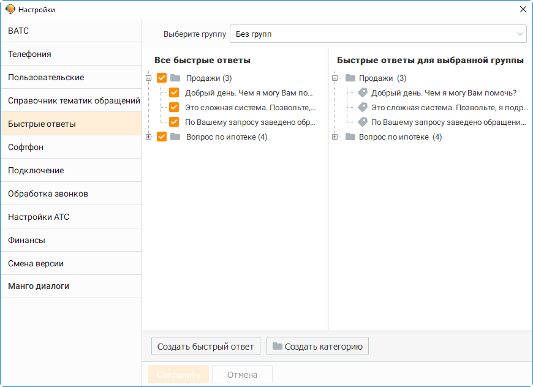

> **Иллюстрация CC-09-43** · стр. 72 · раздел «2.5.1. Меню программы» · снимок экрана интерфейса, 870×632 px.
> Иллюстрирует текст руководства: «Доступ к вкладке и возможности по редактированию зависят от роли пользователя: Сотрудник, Бухгалтер, Оператор – доступ закрыт; Супервизор – редактирование быстрых ответов всех групп, в которых пользователь является супервизором; Администратор – редактирование быстрых ответов всех групп.»
> Следующий за иллюстрацией текст: «Список в левой части окна содержит все созданные быстрые ответы. В правой части окна отображается список быстрых ответов, выбранных для текущей группы сотрудников. Выбор быстрых ответов …»

Список в левой части окна содержит все созданные быстрые ответы. В правой части окна отображается список быстрых ответов, выбранных для текущей группы сотрудников. Выбор быстрых ответов осуществляется при установке флага напротив нужной категории либо быстрого ответа. Сохранение изменений выполняется автоматически.

Категории и быстрые ответы группы "Без группы" будут доступны всем пользователям

Категория или быстрый ответ создаются в иерархическом дереве последним элементом текущего элемента. Быстрые ответы без категории отображаются в форме "быстрых ответов" после всех прочих категорий. Чтобы добавить быстрый ответ, нажмите кнопку Создать быстрый ответ. Введите название быстрого ответа и нажмите клавишу Enter. Чтобы добавить категорию, нажмите кнопку Создать категорию. Введите название категории и нажмите клавишу Enter. Чтобы добавить быстрый ответ в определенную категорию, установите курсор на наименование категории и нажмите кнопку Создать быстрый ответ. Созданный ответ будет автоматически добавлен в указанную категорию. Два одинаковых быстрых ответа нельзя добавить в одну категорию, но можно добавить в разные категории. Чтобы изменить быстрый ответ, выберите его. Выбранный быстрый ответ подсвечивается

> **Иллюстрация CC-09-44** · стр. 72 · раздел «2.5.1. Меню программы» · значок (элемент интерфейса), встроенный в текст, 20×20 px.
> Поясняющий текст руководства (рядом с элементом): «цветом. Затем нажмите кнопку либо дважды щелкните левой кнопкой мыши. Измените название и нажмите клавишу Enter. Аналогичным образом допускается изменение категории.»
> Предшествующий контекст: «Категория или быстрый ответ создаются в иерархическом дереве последним элементом текущего элемента. Быстрые ответы без категории отображаются в форме "быстрых ответов" после всех прочих категорий. …»

цветом. Затем нажмите кнопку либо дважды щелкните левой кнопкой мыши. Измените название и нажмите клавишу Enter. Аналогичным образом допускается изменение категории.

> **Иллюстрация CC-09-45** · стр. 72 · раздел «2.5.1. Меню программы» · значок (элемент интерфейса), встроенный в текст, 20×20 px.
> Поясняющий текст руководства (рядом с элементом): «Чтобы изменить положение категории либо быстрого ответа, используйте кнопки и . В результате положение быстрого ответа изменится в рамках одного уровня.»
> Предшествующий контекст: «цветом. Затем нажмите кнопку либо дважды щелкните левой кнопкой мыши. Измените название и нажмите клавишу Enter. Аналогичным образом допускается изменение категории.»

> **Иллюстрация CC-09-46** · стр. 72 · раздел «2.5.1. Меню программы» · значок (элемент интерфейса), встроенный в текст, 20×20 px.
> Поясняющий текст руководства (рядом с элементом): «Чтобы изменить положение категории либо быстрого ответа, используйте кнопки и . В результате положение быстрого ответа изменится в рамках одного уровня.»
> Предшествующий контекст: «цветом. Затем нажмите кнопку либо дважды щелкните левой кнопкой мыши. Измените название и нажмите клавишу Enter. Аналогичным образом допускается изменение категории.»

Чтобы изменить положение категории либо быстрого ответа, используйте кнопки и . В результате положение быстрого ответа изменится в рамках одного уровня.

Чтобы удалить быстрый ответ, выберите его и нажмите кнопку

> **Иллюстрация CC-09-47** · стр. 73 · раздел «2.5.1. Меню программы» · значок (элемент интерфейса), встроенный в текст, 16×16 px.
> Поясняющий текст руководства (рядом с элементом): «.»
> Предшествующий контекст: «Чтобы удалить быстрый ответ, выберите его и нажмите кнопку»

.

> **Иллюстрация CC-09-48** · стр. 73 · раздел «2.5.1. Меню программы» · значок (элемент интерфейса), встроенный в текст, 16×16 px.
> Поясняющий текст руководства (рядом с элементом): «Чтобы удалить категорию, выберите ее и нажмите кнопку . При этом будут удалены все быстрые ответы данной категории.»
> Предшествующий контекст: «.»

Чтобы удалить категорию, выберите ее и нажмите кнопку . При этом будут удалены все быстрые ответы данной категории.

Изменения, внесенные в список быстрых ответов, сохраняются автоматически.

2.5.1.3.11. Шаблоны сообщений

Вкладка предназначена для настройки сообщений, отправляемых пользователям по каналам СМС и WhatsApp. Шаблоны СМС Создавать, редактировать и удалять шаблоны могут пользователи, у которых имеется хотя бы одна подконтрольная группа. Шаблонами могут пользоваться любые сотрудники ВАТС. На вкладке можно создавать шаблоны как для единичных сообщений, так и для текстовых рассылок.

Если услуга текстовых рассылок не подключена, подвкладка "Текстовые рассылки" не отображается.

Максимальное количество возможных шаблонов – 100. Для расширения лимита необходимо обратиться с запросом к персональному менеджеру.

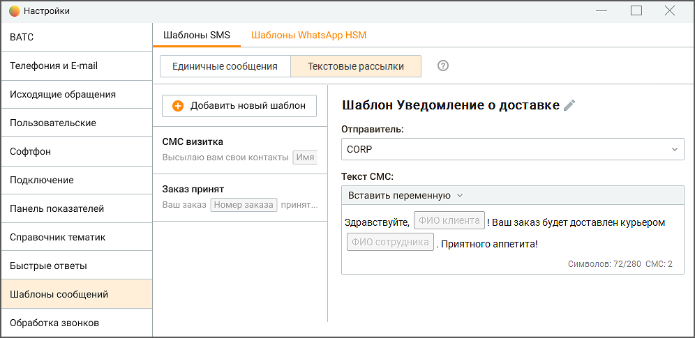

> **Иллюстрация CC-09-49** · стр. 73 · раздел «2.5.1. Меню программы» · снимок экрана интерфейса, 996×485 px.
> Иллюстрирует текст руководства: «Максимальное количество возможных шаблонов – 100. Для расширения лимита необходимо обратиться с запросом к персональному менеджеру.»
> Следующий за иллюстрацией текст: «Добавить новый шаблон – добавление шаблона СМС-сообщения; Наименование шаблона – поле может быть не уникально, максимум 255 символов; Имя отправителя – возможные значения поля устанавливаются в …»

Добавить новый шаблон – добавление шаблона СМС-сообщения; Наименование шаблона – поле может быть не уникально, максимум 255 символов; Имя отправителя – возможные значения поля устанавливаются в Личном кабинете ВАТС. Значение поля получатель смс-сообщения видит, как имя отправителя. Если отправитель недоступен, сообщение будет отправлено от отправителя, настроенного в ЛК ВАТС по умолчанию. Имена в списке сгруппированы по категориям: "Стандартное имя", "Отраслевое имя", "Индивидуальное имя".

ПРИМЕР: Пользователь в ЛК ВАТС подключил услугу "Отраслевое имя" и настроил в шаблоне СМС-сообщения отраслевое имя в качестве отправителя. Позже пользователь отключил услугу "Отраслевое имя", но продолжает отправлять СМС на основе этого шаблона. Результат: СМС-сообщения отправляются от отправителя, настроенного в ЛК по умолчанию.

Текст сообщения - максимальное количество символов в поле – 280; Символов:_/280 СМС:_ – данные в правом нижнем углу окна формы содержат информацию:  символов_/280 – количество использованных символов из 280-ти возможных;  СМС:_ – количество СМС-сообщений, на которые будет разбит текст;

Одно СМС-сообщение содержит (символов, включая пробелы):  140 – для латинских символов  70 – для кириллических символов. Вставить переменную - в качестве переменных можно использовать  все поля адресной книги;  поля ФИО и e-mail из карточки сотрудника, который отправляет сообщение;  два поля из карточки сделки: клиент и ссылка на оплату. Поля из карточки сделки передаются в шаблон только при условии запуска шаблона отправки СМС из сделки. Такой шаблон не требует предварительного создания пользователем, так как создается системой автоматически. Значения переменных будут подставлены при выборе адресата и при отправке сообщения. Одна переменная может быть использована в шаблоне более одного раза. Удалить шаблон – клик по кнопке Удалить приводит к скрытию шаблона из списка шаблонов. Шаблон будет удален без возможности восстановления только после клика по кнопке Сохранить. Нажатие кнопки Отмена отменяет команду удаления шаблона. При сохранении настроек кнопкой Сохранить изменения становятся доступными всем пользователям продукта. Изменения в настройку можно вносить в любой момент. Шаблоны WhatsApp

Для создания HSM-шаблона WhatsApp ознакомьтесь с инструкцией.

На вкладке отображаются шаблоны как для единичных сообщений, так и для текстовых рассылок. Вкладка отображается, если у пользователя:  имеется хотя бы одна подконтрольная группа;  в ЛК ВАТС имеется хотя бы один созданный и активный шаблон WhatsApp. Создавать, редактировать и удалять шаблон в Контакт-центре невозможно.

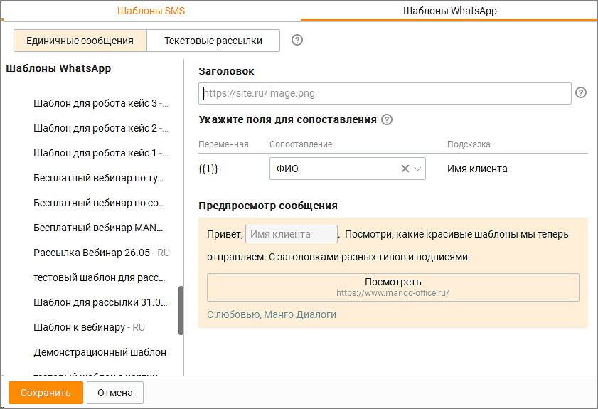

> **Иллюстрация CC-09-50** · стр. 75 · раздел «2.5.1. Меню программы» · снимок экрана интерфейса, 841×575 px.
> Иллюстрирует текст руководства: «На вкладке отображаются шаблоны как для единичных сообщений, так и для текстовых рассылок. Вкладка отображается, если у пользователя:  имеется хотя бы одна подконтрольная группа;  в ЛК ВАТС имеется хотя бы один созданный и активный шаблон WhatsApp. Создавать, редактировать и удалять шаблон в …»
> Следующий за иллюстрацией текст: «1. Шаблоны WhatsApp – в блоке отображаются наименования категорий и активных шаблонов, созданных в ЛК ВАТС, в "Шаблонах WhatsApp". В Контакт-центре эти данные не редактируются.»

1. Шаблоны WhatsApp – в блоке отображаются наименования категорий и активных шаблонов, созданных в ЛК ВАТС, в "Шаблонах WhatsApp". В Контакт-центре эти данные не редактируются.

2. Заголовок - заголовок, описывающий тип шаблона и указанный при создании шаблона. В поле "Заголовок" Контакт-центра размещается подсказка о типе заголовка: изображение, текст, документ видео. Тип заголовка не подлежит изменению. В поле необходимо вставить прямую ссылку на файл – видео, изображение или документ.

Как получить прямую ссылку на изображение Для размещения изображения при создании сообщения на основе шаблона в сообщение необходимо вставить прямую ссылку на файл. Это ссылка, на конце которой указано расширение файла – .jpg, .jpeg, .png Например https://ltdfoto.ru/images/2024/08/20/cat548ba3aa37a77c1a.jpg Для получения прямой ссылки на изображение можно использовать бесплатные облачные файловые хранилища:  imgur.com – для изображений и видео  ltdfoto.ru – для изображений  telegra.ph – для изображений

Ссылки на файл на Яндекс-диске не подходят, так как они не являются прямыми ссылками. Пример размещения прямой ссылки на ltdfoto.ru:

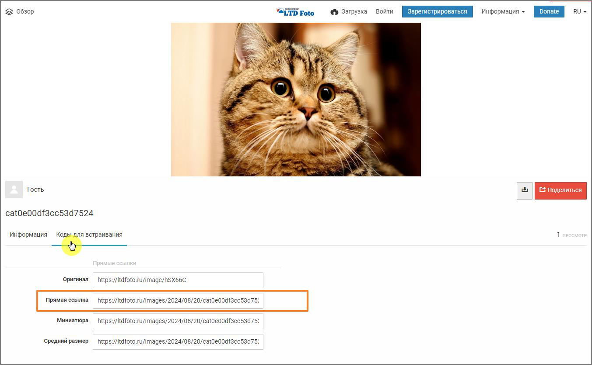

> **Иллюстрация CC-09-51** · стр. 76 · раздел «2.5.1. Меню программы» · снимок экрана интерфейса, 1353×836 px.
> Иллюстрирует текст руководства: «Ссылки на файл на Яндекс-диске не подходят, так как они не являются прямыми ссылками. Пример размещения прямой ссылки на ltdfoto.ru:»
> Следующий за иллюстрацией текст: «Как получить прямую ссылку на видео Для размещения видео при создании сообщения на основе шаблона в сообщение необходимо вставить прямую ссылку на файл. Это ссылка, на конце которой указано …»

Как получить прямую ссылку на видео Для размещения видео при создании сообщения на основе шаблона в сообщение необходимо вставить прямую ссылку на файл. Это ссылка, на конце которой указано расширение файла mp4 для видео. Для получения прямой ссылки на изображение или видео можно использовать бесплатные облачные файловые хранилища:  imgur.com – для изображений и видео

Ссылки на файл на Yandex-диске не подходят, так как они не являются прямыми ссылками. Пример размещения прямой ссылки на imgur.com: 1) Откройте окно добавления видео кликом по кнопке "New post", и добавьте файл. 2) Установите курсор на видео, в правом верхнем углу отобразится пиктограмма "...". Нажмите на нее и в выпадающем списке выберите строку меню "Get share link". 3) В строке "BBCode" скопируйте свою ссылку, удалив теги [] в начале и конце ссылки.

3. Переменная – количество переменных, заданное при создании шаблона. Максимальное количество – 40 переменных. Если в шаблоне нет ни одной переменной, то отображается только текст шаблона.

4. Сопоставление – выпадающий список для сопоставления переменных с контактными данных клиентов и сотрудников Контакт-центра. Переменную можно сопоставить с одним полем в адресной книге (стандартным и пользовательским), с одним полем из карточки сотрудника (ФИО или e-mail) либо полями из карточки сделки (клиент или ссылка на оплату).

ПРИМЕР При ответе клиенту с использованием данного шаблона вместо переменной {{1}} будет подставляться значение поля ФИО клиента из Контактов адресной книги.

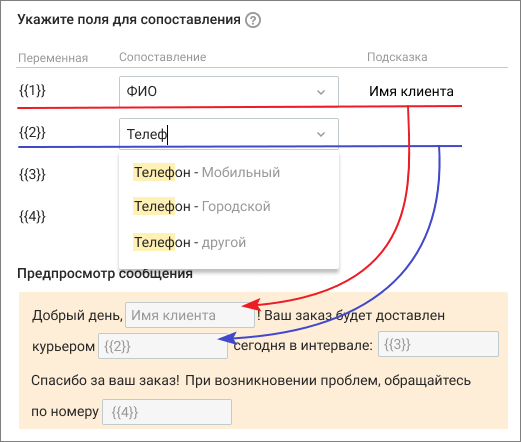

> **Иллюстрация CC-09-52** · стр. 77 · раздел «2.5.1. Меню программы» · снимок экрана интерфейса, 521×442 px.
> Иллюстрирует текст руководства: «ПРИМЕР При ответе клиенту с использованием данного шаблона вместо переменной {{1}} будет подставляться значение поля ФИО клиента из Контактов адресной книги.»
> Следующий за иллюстрацией текст: «5. Подсказка – при наведении курсора на строку с переменной отображается пиктограмма»

5. Подсказка – при наведении курсора на строку с переменной отображается пиктограмма

> **Иллюстрация CC-09-53** · стр. 77 · раздел «2.5.1. Меню программы» · значок (элемент интерфейса), встроенный в текст, 15×15 px.
> Поясняющий текст руководства (рядом с элементом): «для добавления или редактирования комментария.»
> Предшествующий контекст: «5. Подсказка – при наведении курсора на строку с переменной отображается пиктограмма»

для добавления или редактирования комментария.

6. Предпросмотр сообщения - текст созданного в ЛК ВАТС шаблона, максимальное количество символов -4096. В Контакт-центре сам текст отредактировать невозможно. Возможно только изменить присвоенные переменным значения.

7. Кнопка-ссылка, Кнопка-звонок – текст кнопок, номер телефона и URL ссылки указываются в ЛК ВАТС при создании шаблона с кнопками. В Контакт-центре изменить их невозможно. Клик пользователя, получившего такое сообщение, по кнопке приводит к выполнению соответствующего действия.

2.5.1.3.12. Статусы сотрудников

Добавление пользовательских статусов возможно, если подключена услуга "Настройка статусов сотрудника". Подключение услуги возможно из приложения Контакт-центр MANGO OFFICE при первом заходе на вкладку.

Вкладка доступна всем пользователям, у которых есть хотя бы одна подконтрольная группа.

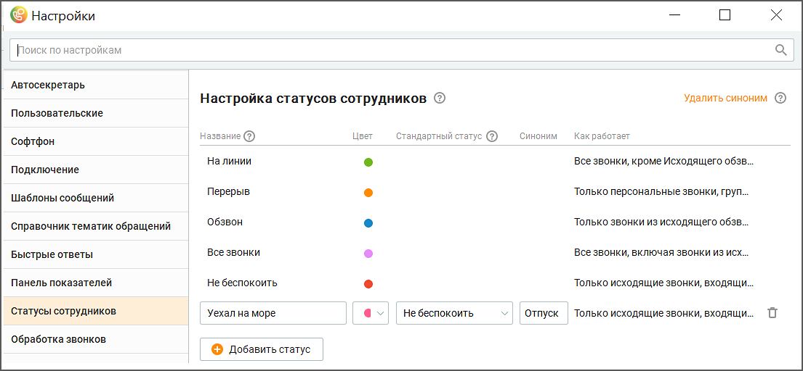

> **Иллюстрация CC-09-54** · стр. 78 · раздел «2.5.1. Меню программы» · снимок экрана интерфейса, 1105×512 px.
> Иллюстрирует текст руководства: «Вкладка доступна всем пользователям, у которых есть хотя бы одна подконтрольная группа.»
> Следующий за иллюстрацией текст: «Для создания нового статуса сотрудника заполните поля:  Название – название статуса будет отображаться в аналитике, а также на верхней панели Контакт-центра для выбора текущего статуса …»

Для создания нового статуса сотрудника заполните поля:  Название – название статуса будет отображаться в аналитике, а также на верхней панели Контакт-центра для выбора текущего статуса пользователем;  Цвет – палитра из 9-ти вариантов цвета;  Стандартный статус

– настройка поля определяет возможности телефонии пользовательского статуса;  Синоним – не более 20 символов. Должен быть уникальным в рамках одного Контакт- центра. Как может быть использован синоним:

Пример 1: У пользователя два Контакт-центра. Оба продукта связаны с одной внешней системой. В систему из обоих продуктов нужно передавать статус с единым реквизитом. Наличие синонима позволяет привязываться к синониму статуса, который пользователь может задать одинаковым на своих нескольких Контакт-центрах. Пример 2: Требуется вернуть удаленный статус. При создании статуса заново Контакт-центр сгенерирует новый id. Что не всегда удобно, особенно если во внешней системе используется id старого статуса. Наличие синонима позволяет при удалении статуса, создать новый статус, и ввести тот же синоним что был у удаленного статуса. Соответственно, если есть привязка к синониму, во внешней системе ничего изменять не потребуется.

Кнопка Удалить синоним/Использовать синоним удаляет или добавляет столбец синонимов. Сохраните внесенные изменения кликом по кнопке Сохранить. Новый статус сотрудника будет активен сразу после сохранения. Созданные пользовательские статусы сотрудников можно отредактировать или удалить. Помимо пяти стандартных, в Контакт-центре могут быть созданы до 30 пользовательских статусов. Все пользовательские статусы учитываются во вкладках Контакт-центра – графиках, таблицах, отчетах, показателях, файлах экспорта и др. – наряду со стандартными. При входе в систему (до авторизации) пользовательский статус не может быть выбран. Доступны только стандартные статусы сотрудников. 2.5.1.3.13. Обработка звонков

Данная вкладка содержит блоки настроек телефонных номеров.

Вкладка отображается, если пользователь имеет хотя бы одну подконтрольную группу или роль Администратор.

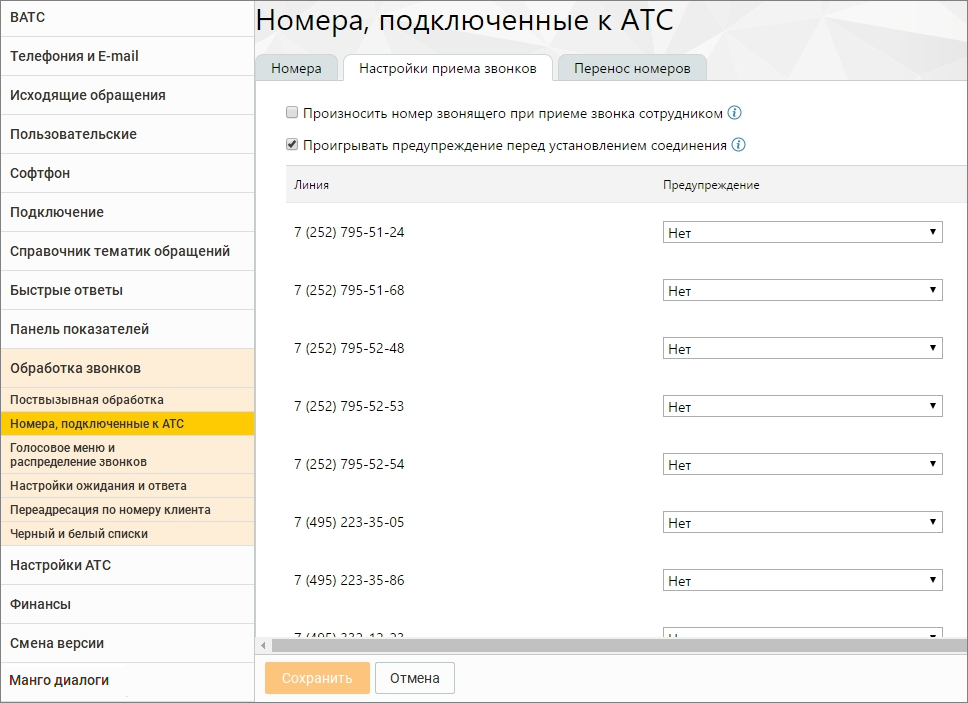

> **Иллюстрация CC-09-55** · стр. 79 · раздел «2.5.1. Меню программы» · снимок экрана интерфейса, 968×703 px.
> Иллюстрирует текст руководства: «Вкладка отображается, если пользователь имеет хотя бы одну подконтрольную группу или роль Администратор.»
> Следующий за иллюстрацией текст: «Подробное описание настроек приведено в п.4.4 справочника абонента "Виртуальная АТС MANGO OFFICE". 2.5.1.3.13.1. Поствызывная обработка»

Подробное описание настроек приведено в п.4.4 справочника абонента "Виртуальная АТС MANGO OFFICE". 2.5.1.3.13.1. Поствызывная обработка

Вкладка отображается, если пользователь имеет хотя бы одну подконтрольную группу или роль Администратор.

На вкладке настраивается время, в течение которого операторы группы, завершившие разговор, переходят в выбранный статус. По истечении установленного времени поствызывной обработки или при клике по кнопке "Готов к работе" статус текущего оператора группы автоматически возвращается к предыдущему значению. Если выбранный пользовательский статус к завершению вызова удален или в Личном кабинете ВАТС отключена услуга "Пользовательский статус", оператор переходит в статус "Не беспокоить". Максимальное время, в течение которого возможна задержка обновления информации о правилах постзвонковой обработки для операторов группы – 10 минут. Поствызывная обработка применяется при внешних вызовах (в том числе к автоперезвонам и заказу обратного звонка), кроме кампаний Исходящего обзвона. Поствызывная обработка применяется только после завершения внешних вызовов: состоявшихся исходящих и принятых входящих. При выходе пользователя из приложения во время поствызывной обработки, она прекращается, т. е. таймер поствызывной обработки останавливается. Пользователь переходит в статус "Не в сети". После повторного входа в приложение таймер поствызывной обработки не запускается.

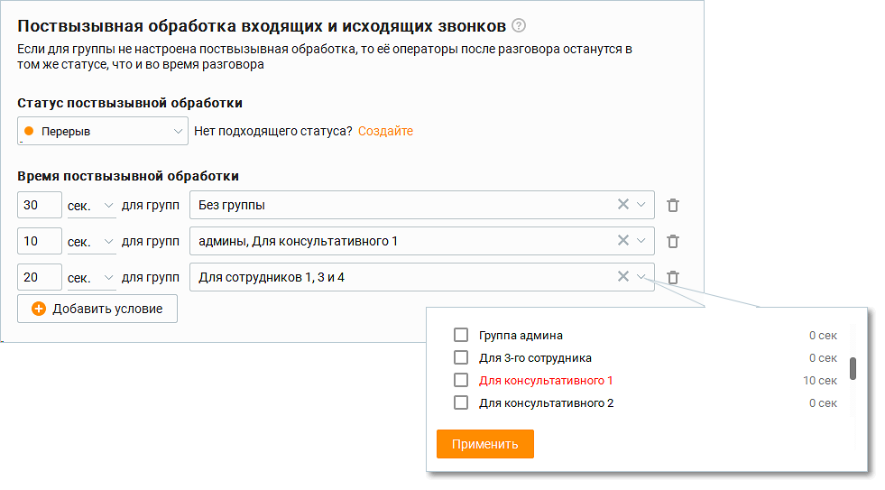

> **Иллюстрация CC-09-56** · стр. 80 · раздел «2.5.1. Меню программы» · снимок экрана интерфейса, 981×543 px.
> Иллюстрирует текст руководства: «На вкладке настраивается время, в течение которого операторы группы, завершившие разговор, переходят в выбранный статус. По истечении установленного времени поствызывной обработки или при клике по кнопке "Готов к работе" статус текущего оператора группы автоматически возвращается к предыдущему …»
> Следующий за иллюстрацией текст: «Кнопка "Добавить условие" открывает поле для добавления нового условия. Группы, для которых условие поствызывной обработки уже настроено, отображаются в выпадающем списке красным цветом. Повторный …»

Кнопка "Добавить условие" открывает поле для добавления нового условия. Группы, для которых условие поствызывной обработки уже настроено, отображаются в выпадающем списке красным цветом. Повторный выбор группы сопровождается системным сообщением о подтверждении назначения нового правила. Если оператор состоит более чем в одной группе, и значения для поствызывной обработки в группах отличаются, то в качестве времени обработки выбирается максимальное время из значений по группам, в которых он состоит.

Максимальное количество условий – 50.

> **Иллюстрация CC-09-57** · стр. 81 · раздел «2.5.1. Меню программы» · значок (элемент интерфейса), встроенный в текст, 16×19 px.
> Поясняющий текст руководства (рядом с элементом): «Чтобы удалить условие поствызывной обработки, кликните по пиктограмме (корзина). 2.5.1.3.13.2. Работа с пропущенными»
> Предшествующий контекст: «Максимальное количество условий – 50.»

Чтобы удалить условие поствызывной обработки, кликните по пиктограмме (корзина). 2.5.1.3.13.2. Работа с пропущенными

Вкладка предназначена для настройки периода отображения пропущенных звонков.

Настройка доступна только пользователям с ролью Администратор.

Администратор может настроить период, за которой считает необходимым перезванивать по пропущенным звонка. Таким образом операторы будут работать только по горячим контактам и не тратить время на обработку холодных. Для гибкого обслуживания клиентов, обращающихся в компанию по разным вопросам, возможно настроить различный период отображения для разных групп операторов.

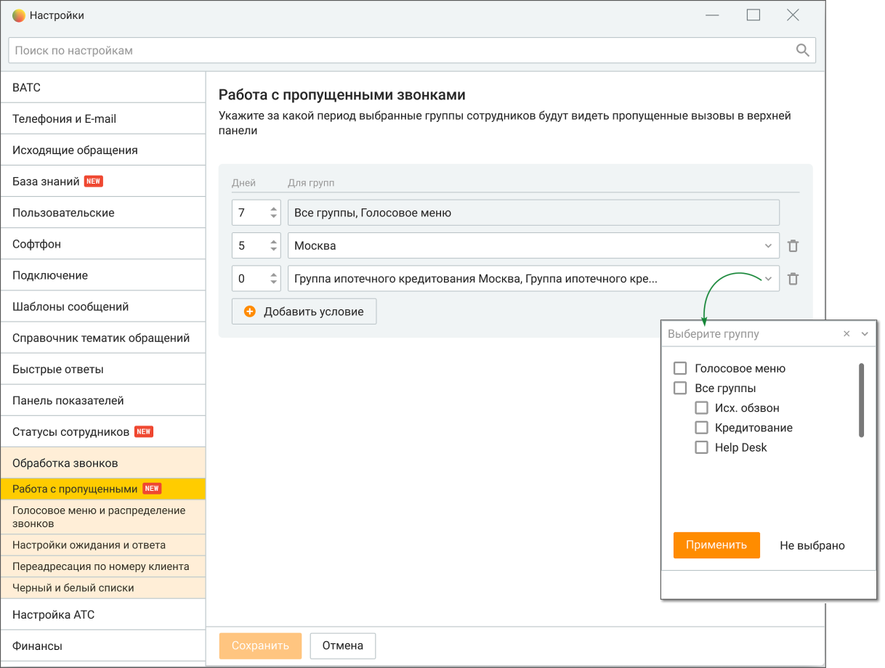

> **Иллюстрация CC-09-58** · стр. 81 · раздел «2.5.1. Меню программы» · снимок экрана интерфейса, 1218×920 px.
> Иллюстрирует текст руководства: «Администратор может настроить период, за которой считает необходимым перезванивать по пропущенным звонка. Таким образом операторы будут работать только по горячим контактам и не тратить время на обработку холодных. Для гибкого обслуживания клиентов, обращающихся в компанию по разным вопросам, …»
> Следующий за иллюстрацией текст: «На вкладке пользователю доступны следующие настройки: Дней – количество дней, за которые будут отображаться пропущенные вызовы. Максимальное количество – 7 дней. Для групп – выбор групп, для которых …»

На вкладке пользователю доступны следующие настройки: Дней – количество дней, за которые будут отображаться пропущенные вызовы. Максимальное количество – 7 дней. Для групп – выбор групп, для которых будет действовать правило. Возможен выбор следующих значений:  Все группы и каждая группа отдельно  Голосовое меню Кнопка "Добавить условие" – добавление строки условия. Максимальное количество условий – 10.

Фильтрация вызовов происходит по группе, пропустившей звонок, а не по вхождению текущего пользователя в группу, которая пропустила звонок. Если пользователь состоит в двух группах, пропустивших звонок, то правило действует с учетом настроек для последней группы, пропустившей звонок. Если звонок пропущен в Голосовом меню, то настройка применяется для всех пользователей на продукте, состоящих в какой-либо группе или нет.

2.5.1.3.14. Настройки АТС

Данная вкладка содержит блоки настроек АТС.

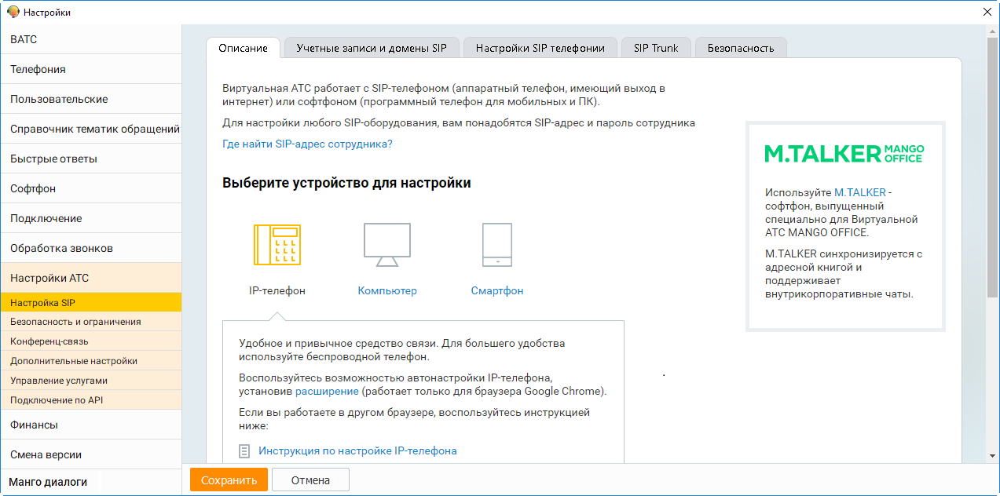

> **Иллюстрация CC-09-59** · стр. 83 · раздел «2.5.1. Меню программы» · снимок экрана интерфейса, 1273×632 px.
> Иллюстрирует текст руководства: «Данная вкладка содержит блоки настроек АТС.»
> Следующий за иллюстрацией текст: «Подробное описание настроек приведено в справочнике абонента "Виртуальная АТС MANGO OFFICE". 2.5.1.3.15. Финансы»

Подробное описание настроек приведено в справочнике абонента "Виртуальная АТС MANGO OFFICE". 2.5.1.3.15. Финансы

Данная вкладка содержит настройки и инструменты для работы с текущим Лицевым счетом:

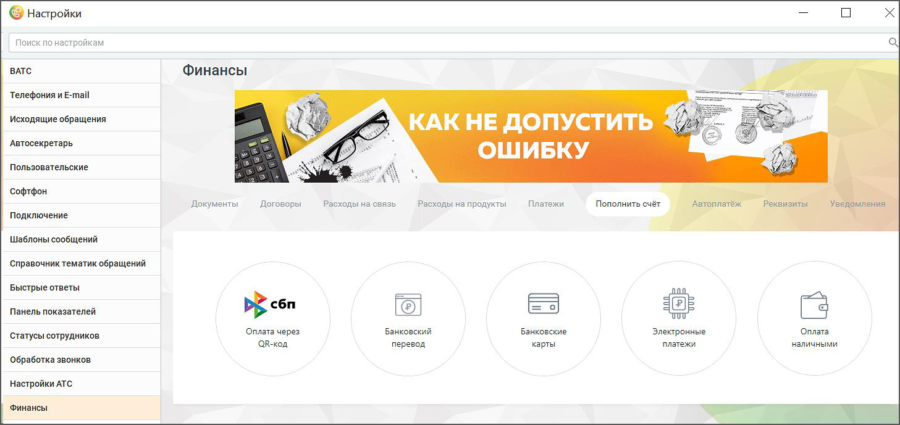

> **Иллюстрация CC-09-60** · стр. 83 · раздел «2.5.1. Меню программы» · снимок экрана интерфейса, 1457×689 px.
> Иллюстрирует текст руководства: «Данная вкладка содержит настройки и инструменты для работы с текущим Лицевым счетом:»
> Следующий за иллюстрацией текст: «Подробное описание настроек приведено в справочнике абонента "Виртуальная АТС MANGO OFFICE".»

Подробное описание настроек приведено в справочнике абонента "Виртуальная АТС MANGO OFFICE".

2.5.1.3.16. Смена версии

Данная вкладка предназначена для изменения версии и тарифа продукта на другие, согласно потребностям и расходам. А также для подключения дополнительных сервисов.

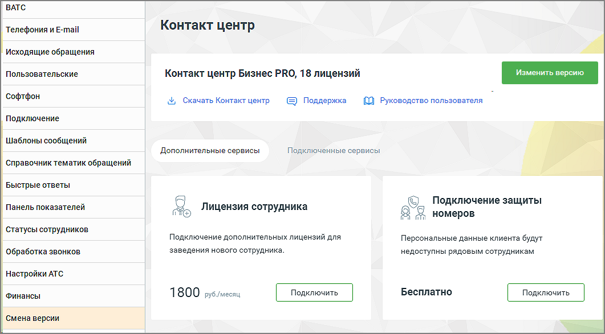

> **Иллюстрация CC-09-61** · стр. 84 · раздел «2.5.1. Меню программы» · снимок экрана интерфейса, 1061×587 px.
> Иллюстрирует текст руководства: «Данная вкладка предназначена для изменения версии и тарифа продукта на другие, согласно потребностям и расходам. А также для подключения дополнительных сервисов.»
> Следующий за иллюстрацией текст: «Подробное описание процесса приведено в справочнике абонента "Виртуальная АТС MANGO OFFICE". 2.5.1.3.17. Текстовые коммуникации»

Подробное описание процесса приведено в справочнике абонента "Виртуальная АТС MANGO OFFICE". 2.5.1.3.17. Текстовые коммуникации

Данная вкладка предназначена для работы с группами каналов Текстовых коммуникаций.

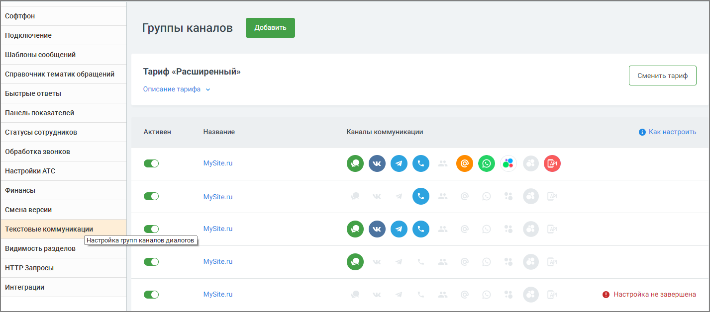

> **Иллюстрация CC-09-62** · стр. 84 · раздел «2.5.1. Меню программы» · снимок экрана интерфейса, 1427×628 px.
> Иллюстрирует текст руководства: «Данная вкладка предназначена для работы с группами каналов Текстовых коммуникаций.»
> Следующий за иллюстрацией текст: «На закладке отображается информация о тарифе и список подключенных групп каналов в порядке их создания. Для каждой группы указывается следующее:»

На закладке отображается информация о тарифе и список подключенных групп каналов в порядке их создания. Для каждой группы указывается следующее:

 Активность группы с возможностью ее активировать/деактивировать, по умолчанию при создании группа активна. При деактивации не отображается на сайте, сообщения из соц. сетей не поступают.

Активация/деактивация группы каналов не приводит к подключению или отключению услуг.

 Название группы каналов – активная ссылка, по нажатию открывается форма редактирования группы;  Список подключенных каналов в виде иконок. При наведении на иконку отображается название канала, а также кто обрабатывает обращения с данного канала (название группы, сотрудника или sip-линии в зависимости от канала). Узнайте больше о настройках и работе Текстовых коммуникаций в Руководстве пользователя. 2.5.1.3.18. Видимость разделов

Вкладка предназначена для настройки отображения разделов Контакт-центра MANGO OFFICE Персонализированное рабочее место: Пользователь Личного кабинета MANGO OFFICE с правом "Изменять права доступа сотрудников" (по умолчанию: Руководитель компании и Администратор) может настроить в ЛК рабочие места сотрудников на основании их ролей, что позволяет гибко адаптировать доступные функции для каждой роли. Все настройки сохраняются в облаке (на сервере MANGO OFFICE), что исключает необходимость ручного конфигурирования на каждом компьютере. Преимущества персонализированных настроек:  Настройка рабочего места для новых сотрудников происходит быстрее.  Рабочее место каждого сотрудника соответствует его задачам.  Улучшена производительность за счет отключения ненужных модулей и снижения нагрузки на ПК. Подробнее о настройке Персонализированного рабочего места узнайте в Справочнике ВАТС, раздел Безопасность и ограничения → Настройка доступа. Если у пользователя не подключена услуга на какой-либо модуль или вкладку, то настройка модуля или вкладки не отображается. По умолчанию часть модулей и настроек отключена. Недоступные для изменения в Контакт-центре настройки можно изменить в Личном кабинете MANGO OFFICE, раздел Безопасность и ограничения → Настройка доступа.

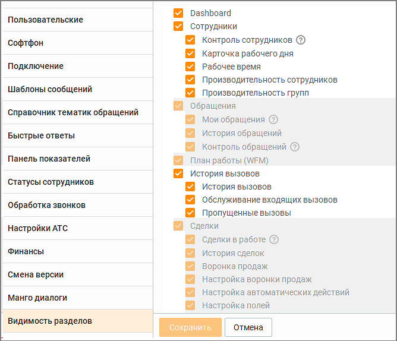

> **Иллюстрация CC-09-63** · стр. 86 · раздел «2.5.1. Меню программы» · снимок экрана интерфейса, 668×574 px.
> Иллюстрирует текст руководства: «Вкладка предназначена для настройки отображения разделов Контакт-центра MANGO OFFICE Персонализированное рабочее место: Пользователь Личного кабинета MANGO OFFICE с правом "Изменять права доступа сотрудников" (по умолчанию: Руководитель компании и Администратор) может настроить в ЛК рабочие места …»
> Следующий за иллюстрацией текст: «После внесения необходимых изменений в доступных настройках, сохраните их, кликнув по кнопке Сохранить. Размещение настроек персонализированного рабочего места в Личном кабинете ВАТС для …»

После внесения необходимых изменений в доступных настройках, сохраните их, кликнув по кнопке Сохранить. Размещение настроек персонализированного рабочего места в Личном кабинете ВАТС для соответствующих разделов Контакт-центра: Видимость разделов в Контакт-центре Настройка доступа в ЛК ВАТС Расположение в ЛК: Безопасность и ограничения → Категория Раздел Настройка доступа → Инструменты → ... Главное окно Пропущенные вызовы Инструменты → Управление (монитор пропущенных звонками → Монитор вызовов) пропущенных Инструменты → Управление сотрудниками → Настройки Статусы сотрудников Редактирование кастомных статусов Инструменты → Управление Софтфон звонками → Использовать внешний телефон / софтфон

Инструменты → Отчеты Контакт-Центра → Dashboard Виджеты Dashboard Просматривать виджеты Dashboard Обращения Мои обращения Инструменты → Обращения Инструменты → Отчеты Контакт-Центра → История обращений Просматривать классификацию обращений Инструменты → Обращения Контроль обращений → Просматривать вкладку контроль обращений План работы (WFM) Инструменты → WFM → График работы, График работы и Планирование входящих планирования Инструменты → WFM → Шаблоны графика работ Шаблоны графика работ Инструменты → WFM → Настройка автоматических Настройка автоматических действий действий Инструменты → WFM → Работа по трудовому договору Работа по трудовому договору Инструменты → WFM → Производственный календарь Производственный календарь Инструменты → WFM → Отчеты Отчеты Сделки в работе, История Сделки Инструменты → Сделки сделок Воронка продаж Инструменты → Сделки → Настраивать воронку продаж Инструменты → Сделки → Настраивать автоматические действия Инструменты → Сделки → Настраивать поля в сделках Клиенты Инструменты → Адресная Клиенты книга Инструменты → Адресная Организации книга Инструменты → Адресная Настройка полей книга → Настраивать поля в адресной книге

Инструменты → Адресная книга → чекбокс Настройка разрешения на "Коммуникация с просмотр персональных персональными контактам контактов и звонки (возможность позвонить и персональным номерам написать на персональный контакт)" Инструменты → Исходящий Исходящий обзвон обзвон Инструменты → Обращения Очередь обращений → "Очередь обращений" Инструменты → Обращения Вызовы → "Очередь обращений", чекбокс "очередь звонков" Инструменты → Обращения → "Очередь обращений", Чаты чекбокс "очередь текстовых обращений" Инструменты → Обращения Заказы ОЗ → "Очередь обращений", чекбокс "заказы ОЗ" Внутреннее общение Инструменты → Сотрудники Чаты → Сотрудники и группы → Внутренние чаты Инструменты → Настройки Комнаты конференций АТС → Конференц-связь История вызовов Инструменты → История История вызовов вызовов Инструменты → Отчеты Контакт-Центра → Пропущенные вызовы Просматривать историю пропущенных вызовов Инструменты → Отчеты Обслуживание входящих Контакт-Центра → вызовов Просматривать обслуживание входящих вызовов Инструменты → Текстовые Текстовые рассылки рассылки При изменении доступности разделов в Личном кабинете ВАТС для определенной роли, изменения вступают в силу после перезагрузки Контакт-центра. 2.5.1.3.19. HTTP Запросы

Функция предназначена для быстрого заполнения внешней базы данных, а также поиска по базе. При внешнем входящем вызове в браузере открывается заданная ссылка.

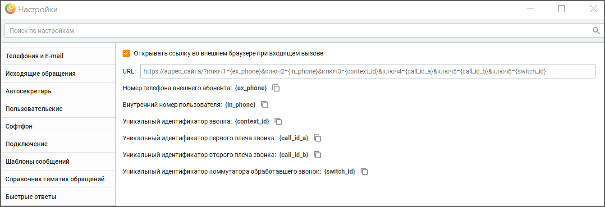

> **Иллюстрация CC-09-64** · стр. 89 · раздел «2.5.1. Меню программы» · снимок экрана интерфейса, 1342×459 px.
> Иллюстрирует текст руководства: «Функция предназначена для быстрого заполнения внешней базы данных, а также поиска по базе. При внешнем входящем вызове в браузере открывается заданная ссылка.»
> Следующий за иллюстрацией текст: «Последовательность настройки функции пользователем:  проставить галочку в чекбоксе, включающем/выключающем работу функции;  прописать целевой url. Сохраните внесенные изменения кнопкой Сохранить. …»

Последовательность настройки функции пользователем:  проставить галочку в чекбоксе, включающем/выключающем работу функции;  прописать целевой url. Сохраните внесенные изменения кнопкой Сохранить. При входящем вызове в заданном по умолчанию браузере будет открыт URL, содержащий вместо переменных следующие номера телефонов:  {ex_phone} – номер телефона внешнего абонента, совершающего вызов;  {in_phone} – внутренний номер пользователя, на который поступает вызов;  {context_id} – уникальный идентификатор звонка;  {call_id_a} – уникальный идентификатор первого плеча звонка ;  {call_id_b}- уникальный идентификатор второго плеча звонка;  {switch_id} – уникальный идентификатор коммутатора, обработавшего звонок.

Примеры заполнения пользователем поля URL http://консалтинг.рф/?ключ1={ex_phone}&ключ2={in_phone} https://investproekt.ru/contact/?ключ1={ex_phone}&ключ2={in_phone} 2.5.1.3.20. Интеграции

На вкладке настраиваются интеграции с CRM Битрикс 24, сервисом рассылок Unisender и сервисом приема платежей ЮKassa. Вкладка доступна пользователям с ролью Администратор.

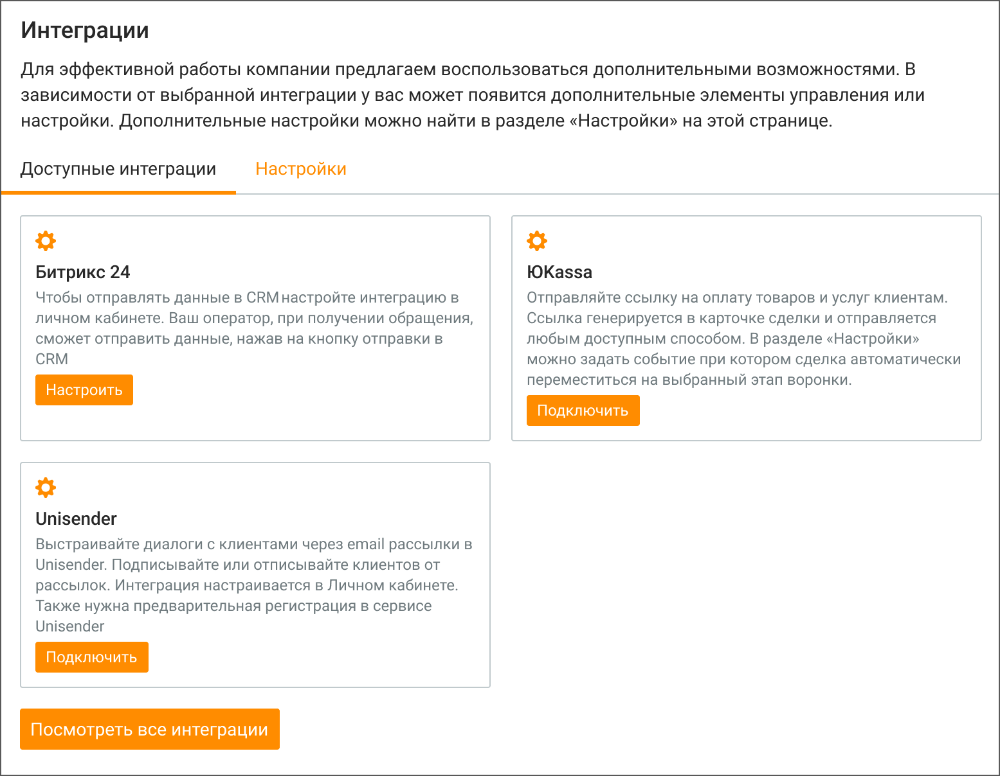

> **Иллюстрация CC-09-65** · стр. 90 · раздел «2.5.1. Меню программы» · снимок экрана интерфейса, 1555×1208 px.
> Иллюстрирует текст руководства: «На вкладке настраиваются интеграции с CRM Битрикс 24, сервисом рассылок Unisender и сервисом приема платежей ЮKassa. Вкладка доступна пользователям с ролью Администратор.»
> Следующий за иллюстрацией текст: «Клик по кнопке "Посмотреть все интеграции" открывает модуль Интеграции в Личном кабинете пользователя ВАТС. В блоках интеграций Битрикс 24, ЮKassa и Unisender в зависимости от статуса подключения, …»

Клик по кнопке "Посмотреть все интеграции" открывает модуль Интеграции в Личном кабинете пользователя ВАТС. В блоках интеграций Битрикс 24, ЮKassa и Unisender в зависимости от статуса подключения, доступны следующие кнопки:  кнопка "Подключить", если услуга не подключена;  кнопка "Настроить", если услуга подключена. Подраздел Настройки вкладки доступен если в ЛК ВАТС подключена услуга ЮKassa.

2.5.1.3.20.1. Битрикс 24

Для отправки данных из Контакт-центра в CRM Битрикс 24 необходимо подключить услугу Интеграции в Личном кабинете пользователя ВАТС, а также настроить API коннектор. Подключение осуществляется в разделе "Интеграции" → кнопка "API коннектор" → подраздел "Дополнительные параметры API". Установите галочку в чекбоксе "Отправка данных о лиде из Контакт-центра". Перезапустите приложение Контакт-центр MANGO OFFICE для обновления настроек.

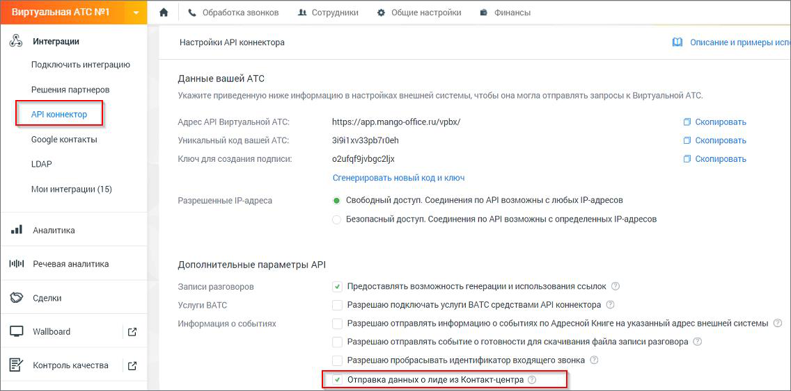

> **Иллюстрация CC-09-66** · стр. 91 · раздел «2.5.1. Меню программы» · снимок экрана интерфейса, 1136×563 px.
> Иллюстрирует текст руководства: «Для отправки данных из Контакт-центра в CRM Битрикс 24 необходимо подключить услугу Интеграции в Личном кабинете пользователя ВАТС, а также настроить API коннектор. Подключение осуществляется в разделе "Интеграции" → кнопка "API коннектор" → подраздел "Дополнительные параметры API". Установите …»
> Следующий за иллюстрацией текст: «При подключенной интеграции на вкладке в Контакт-центре отображается уведомление – Услуга подключена. По умолчанию включен режим ручной отправки данных операторами Контакт-центра, кликом по кнопке …»

При подключенной интеграции на вкладке в Контакт-центре отображается уведомление – Услуга подключена. По умолчанию включен режим ручной отправки данных операторами Контакт-центра, кликом по кнопке "Отправить".

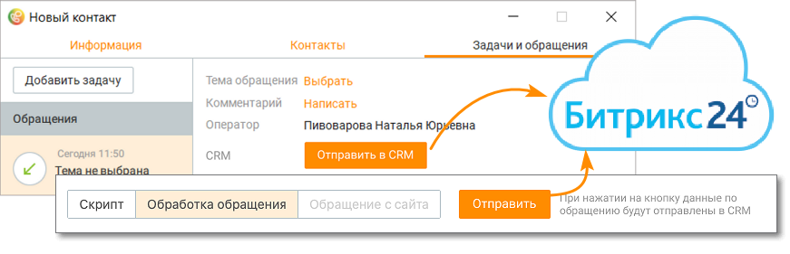

> **Иллюстрация CC-09-67** · стр. 91 · раздел «2.5.1. Меню программы» · снимок экрана интерфейса, 871×281 px.
> Иллюстрирует текст руководства: «При подключенной интеграции на вкладке в Контакт-центре отображается уведомление – Услуга подключена. По умолчанию включен режим ручной отправки данных операторами Контакт-центра, кликом по кнопке "Отправить".»
> Следующий за иллюстрацией текст: «Отправка обращения в Битрикс24 возможна, только если обращение привязано к контакту адресной книги (вкладка Клиенты/Контакты). 2.5.1.3.20.2. ЮKassa»

Отправка обращения в Битрикс24 возможна, только если обращение привязано к контакту адресной книги (вкладка Клиенты/Контакты). 2.5.1.3.20.2. ЮKassa

Настройки подраздела "Настройка" влияют только на интеграцию с ЮKassa и на иные интеграции не распространяется.

При подключении услуги ЮKassa пользователю доступен следующий функционал:

 Настройка интеграции (производятся в Личном кабинете пользователя ВАТС на странице интеграции);  Отправка запроса на формирование ссылки на оплат, из любой сделки в Контакт- центре;  Настройка действий при получении оплаты (вкладка Интеграции/Настройки).

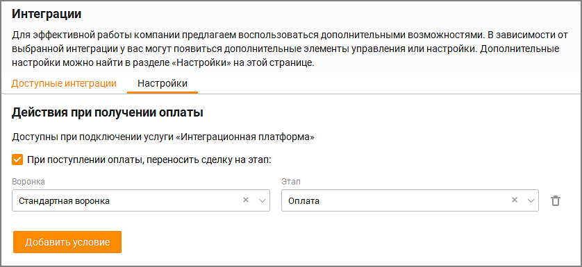

> **Иллюстрация CC-09-68** · стр. 92 · раздел «2.5.1. Меню программы» · снимок экрана интерфейса, 838×385 px.
> Иллюстрирует текст руководства: « Настройка интеграции (производятся в Личном кабинете пользователя ВАТС на странице интеграции);  Отправка запроса на формирование ссылки на оплат, из любой сделки в Контакт- центре;  Настройка действий при получении оплаты (вкладка Интеграции/Настройки).»
> Следующий за иллюстрацией текст: «Настройте условия, при которых сделка будет автоматически перемещена на этап воронки при получении оплаты. Доступен выбор следующих условий:  воронка – выбор воронки из списка доступных воронок на …»

Настройте условия, при которых сделка будет автоматически перемещена на этап воронки при получении оплаты. Доступен выбор следующих условий:  воронка – выбор воронки из списка доступных воронок на продукте;  этап воронки – выбор этапа воронки.

> **Иллюстрация CC-09-69** · стр. 92 · раздел «2.5.1. Меню программы» · значок (элемент интерфейса), встроенный в текст, 16×19 px.
> Поясняющий текст руководства (рядом с элементом): «Клик по пиктограмме удаляет условие перемещения сделки. Клик по кнопке Добавить условие добавляет условие. Максимальное количество условий – 5. 2.5.1.3.20.3. Unisender»
> Предшествующий контекст: «Настройте условия, при которых сделка будет автоматически перемещена на этап воронки при получении оплаты. Доступен выбор следующих условий:  воронка – выбор воронки из списка доступных воронок на …»

Клик по пиктограмме удаляет условие перемещения сделки. Клик по кнопке Добавить условие добавляет условие. Максимальное количество условий – 5. 2.5.1.3.20.3. Unisender

Интеграция Контакт-центра Mango OFFICE с сервисом рассылок Unisender позволяет настроить синхронизацию списков рассылок в Unisender и списков клиентов в Адресной книге, вносить изменения в списки рассылок на стороне Unisender из Контакт-центра.

Для настройки интеграции необходимо иметь аккаунт в Unisender, а также роль в Контакт- центре, с правом настраивать интеграции.

Кликните по кнопке Подключить в блоке Unisender.

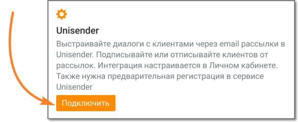

> **Иллюстрация CC-09-70** · стр. 92 · раздел «2.5.1. Меню программы» · снимок экрана интерфейса, 604×247 px.
> Иллюстрирует текст руководства: «Кликните по кнопке Подключить в блоке Unisender.»
> Следующий за иллюстрацией текст: «Откроется окно Личного кабинета пользователя ВАТС, вкладка "Дополнительные сервисы". Найдите блок "Unisender" и нажмите кнопку Подключить. В открывшемся окне подтвердите согласие на подключение.»

Откроется окно Личного кабинета пользователя ВАТС, вкладка "Дополнительные сервисы". Найдите блок "Unisender" и нажмите кнопку Подключить. В открывшемся окне подтвердите согласие на подключение.

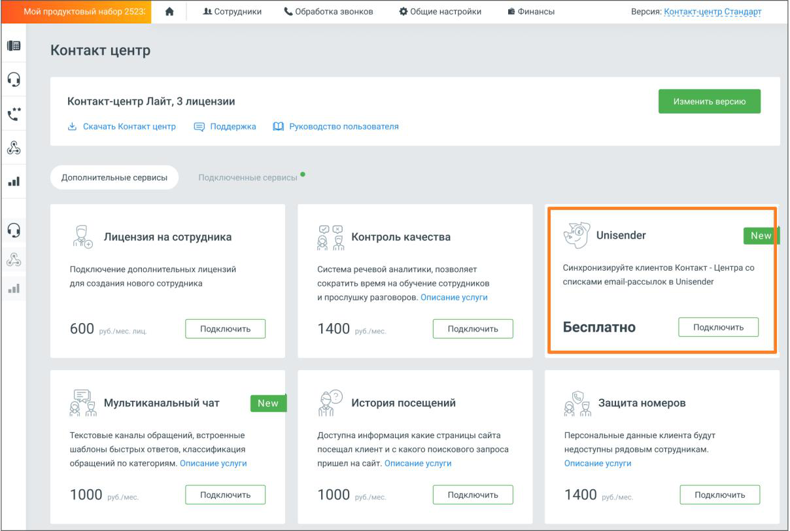

> **Иллюстрация CC-09-71** · стр. 93 · раздел «2.5.1. Меню программы» · снимок экрана интерфейса, 1208×812 px.
> Иллюстрирует текст руководства: «Откроется окно Личного кабинета пользователя ВАТС, вкладка "Дополнительные сервисы". Найдите блок "Unisender" и нажмите кнопку Подключить. В открывшемся окне подтвердите согласие на подключение.»
> Следующий за иллюстрацией текст: «Далее на вкладке "Подключенные сервисы" в блоке "Unisender" необходимо произвести настройки интеграции. Нажмите кнопку Настроить.»

Далее на вкладке "Подключенные сервисы" в блоке "Unisender" необходимо произвести настройки интеграции. Нажмите кнопку Настроить.

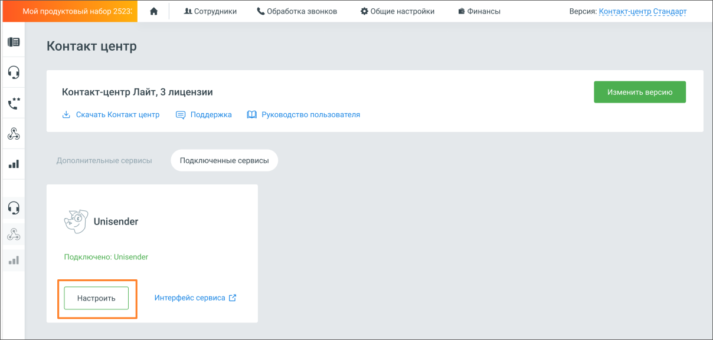

> **Иллюстрация CC-09-72** · стр. 93 · раздел «2.5.1. Меню программы» · снимок экрана интерфейса, 1208×577 px.
> Иллюстрирует текст руководства: «Далее на вкладке "Подключенные сервисы" в блоке "Unisender" необходимо произвести настройки интеграции. Нажмите кнопку Настроить.»
> Следующий за иллюстрацией текст: «Откроется окно основных настроек интеграции:»

Откроется окно основных настроек интеграции:

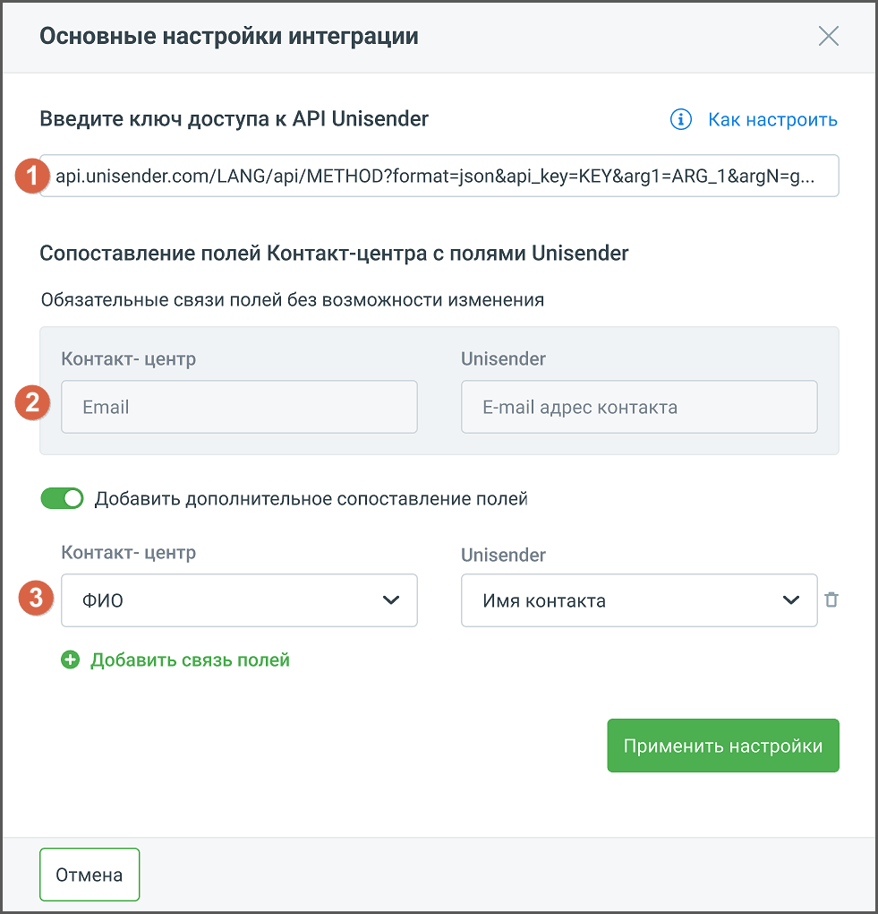

> **Иллюстрация CC-09-73** · стр. 94 · раздел «2.5.1. Меню программы» · снимок экрана интерфейса, 981×1020 px.
> Иллюстрирует текст руководства: «Откроется окно основных настроек интеграции:»
> Следующий за иллюстрацией текст: «Окно настроек содержит следующие элементы:»

Окно настроек содержит следующие элементы:

1. Поле для ввода ключа доступа – ключ предоставляется на стороне Unisender. Чтобы получить ключ, пройдите по ссылке API-ключ UniSender и выполните указанные в инструкции действия.

2. Информационный блок обязательных связей – связь между указанными полями Контакт- центра и Unisender будет создана автоматически.

3. Блок дополнительной связи – открывается, если переключатель "Добавить дополнительное сопоставление полей" активен. Здесь можно настроить дополнительные связи между полями Контакт-центра и Unisender. Например, передавать в Unisender имя пользователя, для настройки персонализированного обращения в рассылке. Кнопка "Добавить связь полей" добавляет новую связку "Контакт-центр/Unisender". Сохраните внесенные изменения кликом по кнопке Применить настройки. После интеграции доступны следующие действия:  Отписать клиентов (email) – единичная и массовая отписка  Подписать клиентов (email) – единичная и массовая подписка  Создать новый список рассылки  Удалить список рассылки  Изменить наименование списка рассылки

2.5.1.4. Квесты

Модуль Квесты доступен при подключении в Личном кабинете соответствующей услуги. Для подключения обратитесь к Персональному менеджеру.

Список доступных пользователю квестов зависит от его роли и находится в п. "Квесты" в Меню программы.

> **Иллюстрация CC-09-74** · стр. 95 · раздел «2.5.1. Меню программы» · значок (элемент интерфейса), встроенный в текст, 23×21 px.
> Поясняющий текст руководства (рядом с элементом): «В пункте меню значком отображается количество не пройденных пользователем квестов. Квесты, пройденные в режиме обучения, считаются не пройденными. Если у пользователя»
> Предшествующий контекст: «Список доступных пользователю квестов зависит от его роли и находится в п. "Квесты" в Меню программы.»

В пункте меню значком отображается количество не пройденных пользователем квестов. Квесты, пройденные в режиме обучения, считаются не пройденными. Если у пользователя

> **Иллюстрация CC-09-75** · стр. 95 · раздел «2.5.1. Меню программы» · значок (элемент интерфейса), встроенный в текст, 42×41 px.
> Поясняющий текст руководства (рядом с элементом): «имеется хотя бы один не пройденный квест, на аватаре профиля отображается значок . При нажатии на иконку профиля, и далее на строчку меню Квесты открывается окно с блоком квестов.»
> Предшествующий контекст: «В пункте меню значком отображается количество не пройденных пользователем квестов. Квесты, пройденные в режиме обучения, считаются не пройденными. Если у пользователя»

имеется хотя бы один не пройденный квест, на аватаре профиля отображается значок . При нажатии на иконку профиля, и далее на строчку меню Квесты открывается окно с блоком квестов.

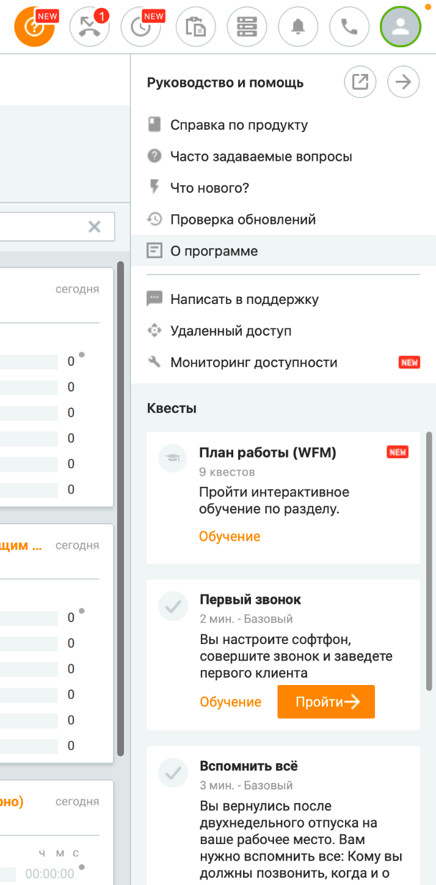

> **Иллюстрация CC-09-76** · стр. 95 · раздел «2.5.1. Меню программы» · снимок экрана интерфейса, 714×1447 px.
> Иллюстрирует текст руководства: «имеется хотя бы один не пройденный квест, на аватаре профиля отображается значок . При нажатии на иконку профиля, и далее на строчку меню Квесты открывается окно с блоком квестов.»
> Следующий за иллюстрацией текст: «В списке квестов отображаются следующие данные:»

В списке квестов отображаются следующие данные:

 Состояние квеста – "Заново" или "Пройти";  Название квеста;  Описание квеста;  Максимальное время прохождения квеста;  Уровень сложности квеста – "Базовый", "Средний", "Продвинутый";  Фактическое время выполнения – в формате ММ:СС, только для квестов в состоянии "Пройден". Если квест был пройден несколько раз, отображается минимальное время прохождения из всех попыток; Прохождение квеста – это пошаговое выполнение пользователем ключевых действий. Прохождение квестов позволяет сотруднику получать Достижения.  За успешное прохождение одного квеста сотруднику даётся достижение Знаток и значок

> **Иллюстрация CC-09-77** · стр. 96 · раздел «2.5.1. Меню программы» · значок (элемент интерфейса), встроенный в текст, 40×40 px.
> Поясняющий текст руководства (рядом с элементом): «.  За успешное прохождение всех квестов сотруднику даётся достижение Знаток и значок»
> Предшествующий контекст: « Состояние квеста – "Заново" или "Пройти";  Название квеста;  Описание квеста;  Максимальное время прохождения квеста;  Уровень сложности квеста – "Базовый", "Средний", "Продвинутый";  …»

.  За успешное прохождение всех квестов сотруднику даётся достижение Знаток и значок

> **Иллюстрация CC-09-78** · стр. 96 · раздел «2.5.1. Меню программы» · значок (элемент интерфейса), встроенный в текст, 40×40 px.
> Поясняющий текст руководства (рядом с элементом): «.»
> Предшествующий контекст: «.  За успешное прохождение всех квестов сотруднику даётся достижение Знаток и значок»

.

Режим обучения Пользователь может пройти квест в режиме обучения, нажав на кнопку "Обучение" в списке квестов. Пользователь может приостановить выполнение квеста на любом шаге нажатием на кнопку

> **Иллюстрация CC-09-79** · стр. 96 · раздел «2.5.1. Меню программы» · значок (элемент интерфейса), встроенный в текст, 16×16 px.
> Поясняющий текст руководства (рядом с элементом): «, и продолжить позже. Также возможно повторное прохождение квеста в режиме обучения. Время выполнения квеста не ограничено. Режим "квест" Нажатие на кнопку»
> Предшествующий контекст: «Режим обучения Пользователь может пройти квест в режиме обучения, нажав на кнопку "Обучение" в списке квестов. Пользователь может приостановить выполнение квеста на любом шаге нажатием на кнопку»

, и продолжить позже. Также возможно повторное прохождение квеста в режиме обучения. Время выполнения квеста не ограничено. Режим "квест" Нажатие на кнопку

> **Иллюстрация CC-09-80** · стр. 96 · раздел «2.5.1. Меню программы» · значок (элемент интерфейса), встроенный в текст, 16×16 px.
> Поясняющий текст руководства (рядом с элементом): «приводит к завершению прохождения квеста. Впоследствии прохождение начинается сначала. Время выполнения квеста ограничено. По истечении времени выполнения квест прерывается и считается не выполненным. На каждом шаге»
> Предшествующий контекст: «, и продолжить позже. Также возможно повторное прохождение квеста в режиме обучения. Время выполнения квеста не ограничено. Режим "квест" Нажатие на кнопку»

приводит к завершению прохождения квеста. Впоследствии прохождение начинается сначала. Время выполнения квеста ограничено. По истечении времени выполнения квест прерывается и считается не выполненным. На каждом шаге

> **Иллюстрация CC-09-81** · стр. 96 · раздел «2.5.1. Меню программы» · значок (элемент интерфейса), встроенный в текст, 18×19 px.
> Поясняющий текст руководства (рядом с элементом): «выполнения квеста пользователь может вызвать подсказку нажатием на кнопку . Количество подсказок ограничено. При использовании всех подсказок, далее подсказки в рамках данной попытки прохождения квеста недоступны.»
> Предшествующий контекст: «приводит к завершению прохождения квеста. Впоследствии прохождение начинается сначала. Время выполнения квеста ограничено. По истечении времени выполнения квест прерывается и считается не …»

выполнения квеста пользователь может вызвать подсказку нажатием на кнопку . Количество подсказок ограничено. При использовании всех подсказок, далее подсказки в рамках данной попытки прохождения квеста недоступны.

> **Иллюстрация CC-09-82** · стр. 96 · раздел «2.5.1. Меню программы» · значок (элемент интерфейса), встроенный в текст, 32×32 px.
> Поясняющий текст руководства (рядом с элементом): «Если все ключевые действия квеста выполнены, пиктограмма меняется на , и квест считается пройденным. Квесты Контакт-центра периодически обновляются и дополняются. Примеры квестов:»
> Предшествующий контекст: «выполнения квеста пользователь может вызвать подсказку нажатием на кнопку . Количество подсказок ограничено. При использовании всех подсказок, далее подсказки в рамках данной попытки прохождения …»

> **Иллюстрация CC-09-83** · стр. 96 · раздел «2.5.1. Меню программы» · значок (элемент интерфейса), встроенный в текст, 32×32 px.
> Поясняющий текст руководства (рядом с элементом): «Если все ключевые действия квеста выполнены, пиктограмма меняется на , и квест считается пройденным. Квесты Контакт-центра периодически обновляются и дополняются. Примеры квестов:»
> Предшествующий контекст: «выполнения квеста пользователь может вызвать подсказку нажатием на кнопку . Количество подсказок ограничено. При использовании всех подсказок, далее подсказки в рамках данной попытки прохождения …»

Если все ключевые действия квеста выполнены, пиктограмма меняется на , и квест считается пройденным. Квесты Контакт-центра периодически обновляются и дополняются. Примеры квестов:

Квест "Клиент всегда прав"

№ Наименование шага Ключевое действие шага 1 Установите статус "Обзвон" Установка статуса "Обзвон". Если статус "Обзвон" уже был установлен ранее, требуется повторный выбор того же статуса 2 Откройте меню профиля Клик по кнопке "Профиль сотрудника"

3 Перейдите к настройкам Клик в пункте "Настройки" 4 Откройте настройки софтфона Клик в пункте меню "Софтфон" в окне настройки профиля

5 Перейдите к настройкам звука и Клик по кнопке "Настройки звука" настройте гарнитуру и микрофон 6 Проверьте микрофон и динамик, Нажатие на кнопку "Далее" в окне подсказки отрегулируйте громкость 7 Откройте софтфон Нажатие на кнопку вызова софтфона

8 Сделайте пробный звонок на номер Нажатие на кнопку "Вызов" своего мобильного телефона, Система начинает дозвон по набранному которого нет в адресной книге номеру. В случае некорректно набранного номера переход к следующему шагу не происходит

9 Примите свой собственный звонок (с Завершение вызова любым способом мобильного телефона) и завершите вызов

10 Перейдите в раздел "Обращения" Переход в раздел "Обращения" 11 Посмотрите обращение, созданное в Клик по вкладке "Мои обращения" ответ на ваш звонок в разделе "Мои обращения" 12 Создайте нового клиента из карточки Нажатие на кнопку "Создать клиента" обращения, внесите информацию о клиенте

13 Перейдите к обработке обращения во Клик по вкладке "Обработка обращения" вкладке "Обработка обращения" 14 Укажите тему обращения, добавьте Нажатие на кнопку "Сохранить" комментарий, сохраните изменения

Квест "Вспомнить все"

№ Наименование шага Ключевое шага действие

1 Откройте планировщик задач Клик по кнопке «Задачи» в шапке Контакт-центра 2 Создайте новую задачу Клик по кнопке «Добавить задачу»

3 Запланируйте время звонка Изменение значения поля "Время"

4 Выберите, кому нужно позвонить (на свой мобильный телефон Заполнены поля или клиенту из адресной книги) «Клиент» и «Номер» 5 Выберите режим автоматического звонка галочкой в чекбоксе Активен чекбокс "автоматический набор" «автоматический набор» 6 Сохраните задачу Клик по кнопке «Создать задачу»

7 Дождитесь автоматического звонка и ответьте на него Активация кнопки «Ответить» в карточке запланированного звонка 8 Примите вызов с номера своего мобильного телефона, далее Завершение завершите вызов вызова любым способом 9 Перейдите в раздел "Обращения" Переход в раздел "Обращения"

10 Посмотрите обращение, созданное в ответ на ваш звонок в Клик по вкладке разделе "Мои обращения" "Мои обращения"

11 Перейдите к обработке обращения во вкладке "Обработка Клик по вкладке обращения" "Обработка обращения"

12 Укажите тему обращения, добавьте комментарий, сохраните Нажатие на изменения кнопку "Сохранить"

Квест "Поймай меня, если сможешь"

№ Наименование шага Ключевое действие шага 1 Перейдите в Dashboard Переход в раздел Dashboard

2 Добавьте новый виджет Клик по кнопке «Добавить виджет» 3 Сформируйте отчет «Количество В поле «Показатель» указано значение исходящих звонков» «Количество исходящих звонков» 4 Выберите фильтр по сотрудникам Клик по кнопке фильтра «По сотруднику»

5 Выберите сотрудников для Поле «Выберите сотрудника» заполнено сравнения результатов

6 Выберите график «Рейтинг» Выбран вид графика «Рейтинг»

7 Выберите сортировку по Выбрано значение сортировки "от меньшего к возрастанию большему"

8 Добавьте виджет в рабочую область Клик по кнопке «Добавить» 9 Выберите фото для своего профиля Клик по кнопке Профиля – Пункт меню «Мой профиль»

10 Измените фотографию Клик на иконке аватара профиля 11 Посмотрите свой результат в общем Сперва клик на иконку аватара пользователя в рейтинге созданном виджете. Потом клик по кнопке "Далее" в окне подсказки 12 Установите плановое значение Клик по кнопке настройки виджета показателя ("шестеренка") 13 Укажите значение показателя в поле В поле "Задать вручную" введено значение "Задать вручную"

14 Сохраните изменения Клик по кнопке "Применить"

### 2.5.2. Виджет

Панель телефонии отображает только один вызов в состоянии "Разговор". Остальные принятые вызовы отображаются в виде виджетов. Расположите виджет на экране в удобном для вас месте, и система запомнит его размещение для отображения последующих вызовов. Также виджет отображается на экране в то время, когда:  свернута панель управления телефонии;  окно программы не активно;  окно программы свернуто.

> **Иллюстрация CC-09-84** · стр. 100 · раздел «2.5.2. Виджет» · снимок экрана интерфейса, 498×60 px.
> Иллюстрирует текст руководства: «Панель телефонии отображает только один вызов в состоянии "Разговор". Остальные принятые вызовы отображаются в виде виджетов. Расположите виджет на экране в удобном для вас месте, и система запомнит его размещение для отображения последующих вызовов. Также виджет отображается на экране в то время, …»
> Следующий за иллюстрацией текст: «Виджет позволяет:  включать/отключать микрофон;  переключаться между вызовами на удержании;  переводить вызов;  завершать вызов.»

Виджет позволяет:  включать/отключать микрофон;  переключаться между вызовами на удержании;  переводить вызов;  завершать вызов.

Номер абонента в плавающем виджете можно выделить и скопировать в буфер обмена с помощью стандартных горячих кнопок. Также пользователь может скопировать все данные софтфона, нажав правую клавишу мыши и выбрав в меню Ctrl+C (Копировать).

### 2.5.3. Совершение исходящих вызовов

Чтобы позвонить, введите нужный номер (способ связи) в поле клавиатурного блока. Кнопка

> **Иллюстрация CC-09-85** · стр. 100 · раздел «2.5.3. Совершение исходящих вызовов» · значок (элемент интерфейса), встроенный в текст, 60×60 px.
> Поясняющий текст руководства (рядом с элементом): «позволяет поочередно удалить все введенные в поле символы. Затем нажмите .»
> Предшествующий контекст: «Чтобы позвонить, введите нужный номер (способ связи) в поле клавиатурного блока. Кнопка»

> **Иллюстрация CC-09-86** · стр. 100 · раздел «2.5.3. Совершение исходящих вызовов» · значок (элемент интерфейса), встроенный в текст, 24×18 px.
> Поясняющий текст руководства (рядом с элементом): «позволяет поочередно удалить все введенные в поле символы. Затем нажмите .»
> Предшествующий контекст: «Чтобы позвонить, введите нужный номер (способ связи) в поле клавиатурного блока. Кнопка»

позволяет поочередно удалить все введенные в поле символы. Затем нажмите .

Телефонные номера следует вводить в международном формате. Пример: 74952000000.

Если вы хотите указать номер офисной АТС, которая поддерживает донабор в тональном режиме, можно указать номер телефона вместе с добавочным местным номером. Для этого добавочный номер необходимо указать сразу после основного, разделив их точкой или запятой без пробела. Пример: 74955555.253. Перед донабором добавочного номера выдерживается пауза в 5 секунд.

Для вызова абонента SIP введите адрес абонента (SIP ID) (например, ivanov@mangosip.ru). При этом идентификатор sip: является необязательным. Однако его можно указывать перед адресом абонента через двоеточие без пробела — например, при копировании контактной информации для звонка из других источников.

После соединения с абонентом вместо клавиатурного блока панель переходит в состоянии «Разговор».

При однократном нажатии на пиктограмму "трубка" в поле номеронабирателя подставляется последний (в рамках текущей сессии Контакт-центра) набранный номер.

### 2.5.4. Прием и классификация входящих вызовов

При поступлении вызова на номер (средство связи), выбранный для обслуживания вызовов, на экране появляется всплывающее окно карточки входящего вызова.

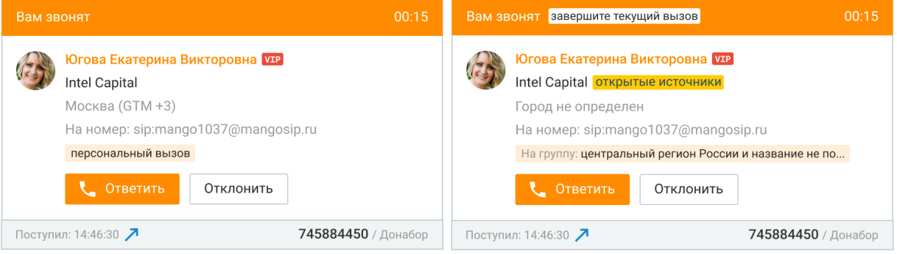

> **Иллюстрация CC-09-87** · стр. 101 · раздел «2.5.4. Прием и классификация входящих вызовов» · снимок экрана интерфейса, 1218×347 px.
> Иллюстрирует текст руководства: «При поступлении вызова на номер (средство связи), выбранный для обслуживания вызовов, на экране появляется всплывающее окно карточки входящего вызова.»
> Следующий за иллюстрацией текст: «В правом верхнем углу карточки входящего вызова отображается время дозвона (время, прошедшее с момента начала распределения текущего вызова на сотрудника). На самой карточке отображается:  …»

В правом верхнем углу карточки входящего вызова отображается время дозвона (время, прошедшее с момента начала распределения текущего вызова на сотрудника). На самой карточке отображается:  контактная информация звонящего абонента (при ее наличии). Если контактная информация отсутствует, то отображается номер абонента.  компания звонящего абонента. Если данные определены из открытых источников, об этом имеется пометка.  регион абонента или уведомление о том, что регион не определен.  номер, на который звонит абонент с шагами голосового меню, которые он прошел до поступления на оператора. При этом если в разделе ЛК ВАТС/Номера, подключенные к АТС поле "Комментарий" к номеру телефона или SIP-Trunk, на который пришел вызов, заполнено, то в карточке входящего вызова комментарий отображается вместо номера.  если звонок осуществляется на группу – отображается наименование группы, на которую поступил звонок; если входящий вызов поступил непосредственно на сотрудника, то отображается информация, что это персональный вызов. В нижней части указывается время поступления вызова, а также номер, на который звонил абонент с шагами голосового меню, которые он прошел до поступления на оператора. Если в Личном кабинете в блоке настроек "Номера, подключенные к АТС" для этого номера заполнено поле "Комментарий", то комментарий будет отображен вместо номера. Чтобы отклонить входящий вызов, нажмите кнопку Отклонить. Если вызов был распределен с группы, то он остается в очереди вызовов, дальнейшее его распределение осуществляется в соответствии с заданными настройками. Чтобы ответить на входящий вызов, нажмите кнопку Ответить. После этого карточка разговора переходит в состояние «Разговор».

Если вы уже участвуете в вызове, то после ответа на новый входящий вызов предыдущий вызов устанавливается на удержание.

Каждый поступивший вызов, номер которого был не определен или не найден в адресной книге, можно вручную привязать к новому или существующему контакту. Кроме того, вы можете отредактировать информацию о существующем контакте непосредственно из

карточки разговора. Подробное описание оперативного создания контактов приведено в этом разделе.

### 2.5.5. Перевод вызовов

С помощью карточки разговора, находящейся в состоянии «Разговор», вы можете перевести вызов на другого пользователя Контакт-центра MANGO OFFICE, номер (способ связи), контакт из адресной книги или группу операторов. В процессе перевода вы можете немедленно перевести вызов на нужного абонента (т. н. перевод «Без консультации») или предварительно переговорить с абонентом, на которого переводите вызов, чтобы сообщить ему необходимую информацию (т. н. «перевод с консультацией»). Для перевода вызова наведите курсор на имя и нажмите Перевести. При наличии

> **Иллюстрация CC-09-88** · стр. 102 · раздел «2.5.5. Перевод вызовов» · значок (элемент интерфейса), встроенный в текст, 39×32 px.
> Поясняющий текст руководства (рядом с элементом): «нескольких номеров нажмите на и нажмите Перевести напротив нужного номера. Укажите, необходима ли консультация Для автоматических "сотрудников-роботов" вариант перевода "с консультацией" отсутствует. Перевод вызова на сотрудника-робота может быть осуществлён только на внутренний номер робота. При …»
> Предшествующий контекст: «С помощью карточки разговора, находящейся в состоянии «Разговор», вы можете перевести вызов на другого пользователя Контакт-центра MANGO OFFICE, номер (способ связи), контакт из адресной книги или …»

нескольких номеров нажмите на и нажмите Перевести напротив нужного номера. Укажите, необходима ли консультация Для автоматических "сотрудников-роботов" вариант перевода "с консультацией" отсутствует. Перевод вызова на сотрудника-робота может быть осуществлён только на внутренний номер робота. При выборе варианта С консультацией осуществляется дозвон на выбранный номер с целью консультации, при этом текущий вызов автоматически ставится на удержание. После завершения консультации необходимо выполнить соединение оператора с клиентом, нажав на кнопку Объединить вызовы на панели управления телефонией. Если в карточке контакта помимо основного номера имеется еще и добавочный, то при переводе с консультацией/без возможен донабор на все имеющиеся номера.

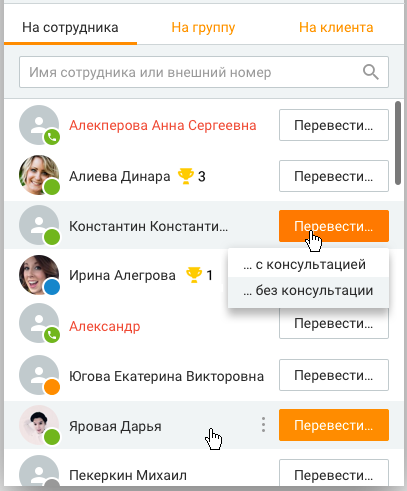

> **Иллюстрация CC-09-89** · стр. 103 · раздел «2.5.5. Перевод вызовов» · снимок экрана интерфейса, 407×491 px.
> Иллюстрирует текст руководства: «нескольких номеров нажмите на и нажмите Перевести напротив нужного номера. Укажите, необходима ли консультация Для автоматических "сотрудников-роботов" вариант перевода "с консультацией" отсутствует. Перевод вызова на сотрудника-робота может быть осуществлён только на внутренний номер робота. При …»
> Следующий за иллюстрацией текст: «Перевод вызова может осуществляться: На сотрудника: осуществляется выбор нужного сотрудника из отсортированного по алфавиту списка. Имя сотрудника, занятого в вызове, отображается красным; На группу: …»

Перевод вызова может осуществляться: На сотрудника: осуществляется выбор нужного сотрудника из отсортированного по алфавиту списка. Имя сотрудника, занятого в вызове, отображается красным; На группу: вызов переводится на группу сотрудников. В поле поиска задается наименование или часть наименования группы, после чего в выпадающем списке отображаются группы, соответствующие поисковому запросу. При раскрытии группы имена сотрудников, занятых в вызовах, отображаются красным/ Напротив наименования группы указывается количество свободных операторов, которые также находятся в статусе "На линии", и общее количество операторов;

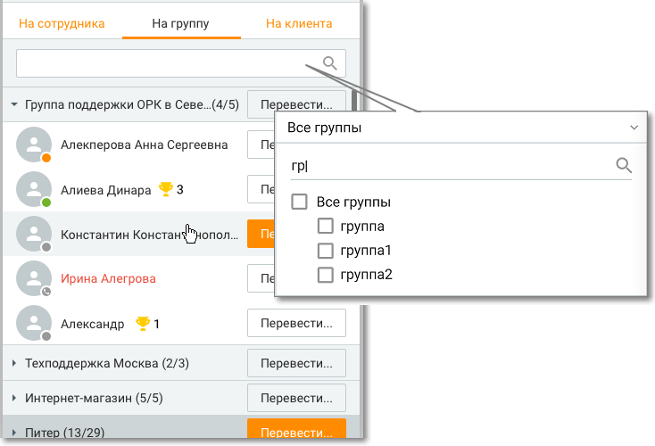

> **Иллюстрация CC-09-90** · стр. 104 · раздел «2.5.5. Перевод вызовов» · снимок экрана интерфейса, 734×500 px.
> Иллюстрирует текст руководства: «Перевод вызова может осуществляться: На сотрудника: осуществляется выбор нужного сотрудника из отсортированного по алфавиту списка. Имя сотрудника, занятого в вызове, отображается красным; На группу: вызов переводится на группу сотрудников. В поле поиска задается наименование или часть наименования …»
> Следующий за иллюстрацией текст: «На клиента: выберите нужный контакт, используя список контактов вашей адресной книги; На номер: вы можете переводить вызовы на телефонные номера, а также на абонентов SIP, указывая соответствующий …»

На клиента: выберите нужный контакт, используя список контактов вашей адресной книги; На номер: вы можете переводить вызовы на телефонные номера, а также на абонентов SIP, указывая соответствующий идентификатор перед именем абонента через двоеточие без пробела. Введите номер (способ связи) и нажмите Перевести. Вы можете переводить вызовы на внешние, внутренние номера и дополнительные номера сотрудников / групп.

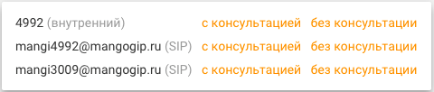

> **Иллюстрация CC-09-91** · стр. 104 · раздел «2.5.5. Перевод вызовов» · снимок экрана интерфейса, 480×102 px.
> Иллюстрирует текст руководства: «На клиента: выберите нужный контакт, используя список контактов вашей адресной книги; На номер: вы можете переводить вызовы на телефонные номера, а также на абонентов SIP, указывая соответствующий идентификатор перед именем абонента через двоеточие без пробела. Введите номер (способ связи) и …»
> Следующий за иллюстрацией текст: «Телефонные номера следует вводить в международном формате. Пример: 74952000000.»

Телефонные номера следует вводить в международном формате. Пример: 74952000000.

Если вы хотите указать номер офисной АТС, которая поддерживает донабор в тональном режиме, можно указать номер телефона вместе с добавочным местным номером. Для этого добавочный номер необходимо указать сразу после основного, разделив их точкой или запятой без пробелов. Пример: 74955555,253. Перед донабором добавочного номера выдерживается пауза в 5 секунд.

### 2.5.6. Постановка вызовов на удержание

Вы можете поставить текущий вызов в карточке разговора на удержание — например, чтобы ответить на другой входящий вызов. Затем вы можете снять вызов с удержания и продолжить разговор с абонентом.

> **Иллюстрация CC-09-92** · стр. 105 · раздел «2.5.6. Постановка вызовов на удержание» · значок (элемент интерфейса), встроенный в текст, 21×25 px.
> Поясняющий текст руководства (рядом с элементом): «Чтобы поставить вызов на удержание, нажмите кнопку Удержание на панели либо на соответствующем виджете. Вызов ставится на удержание, при этом заголовок панели и виджет меняют цвет. Отображается счетчик длительности удержания.»
> Предшествующий контекст: «Вы можете поставить текущий вызов в карточке разговора на удержание — например, чтобы ответить на другой входящий вызов. Затем вы можете снять вызов с удержания и продолжить разговор с абонентом.»

Чтобы поставить вызов на удержание, нажмите кнопку Удержание на панели либо на соответствующем виджете. Вызов ставится на удержание, при этом заголовок панели и виджет меняют цвет. Отображается счетчик длительности удержания.

> **Иллюстрация CC-09-93** · стр. 105 · раздел «2.5.6. Постановка вызовов на удержание» · снимок экрана интерфейса, 609×648 px.
> Иллюстрирует текст руководства: «Чтобы поставить вызов на удержание, нажмите кнопку Удержание на панели либо на соответствующем виджете. Вызов ставится на удержание, при этом заголовок панели и виджет меняют цвет. Отображается счетчик длительности удержания.»
> Следующий за иллюстрацией текст: «Чтобы снять вызов с удержания, нажмите кнопку Удержание еще раз.»

> **Иллюстрация CC-09-94** · стр. 105 · раздел «2.5.6. Постановка вызовов на удержание» · значок (элемент интерфейса), встроенный в текст, 21×25 px.
> Поясняющий текст руководства (рядом с элементом): «Чтобы снять вызов с удержания, нажмите кнопку Удержание еще раз.»
> Предшествующий контекст: «Чтобы поставить вызов на удержание, нажмите кнопку Удержание на панели либо на соответствующем виджете. Вызов ставится на удержание, при этом заголовок панели и виджет меняют цвет. Отображается …»

Чтобы снять вызов с удержания, нажмите кнопку Удержание еще раз.

При постановке вызова на удержание и снятии вызова с удержания длительность вызова не обнуляется.

При наличии двух (и более) вызовов на панели управления отображается только активный вызов, при этом второй вызов, находящийся на удержании, отображается в виде виджета. При снятии с удержания второго вызова первый автоматически переходит в режим удержания, при этом на панели отображается второй вызов.

> **Иллюстрация CC-09-95** · стр. 106 · раздел «2.5.6. Постановка вызовов на удержание» · снимок экрана интерфейса, 588×620 px.
> Иллюстрирует текст руководства: «При наличии двух (и более) вызовов на панели управления отображается только активный вызов, при этом второй вызов, находящийся на удержании, отображается в виде виджета. При снятии с удержания второго вызова первый автоматически переходит в режим удержания, при этом на панели отображается второй …»
> Следующий за иллюстрацией текст: «Кроме кнопки паузы, вызов можно поставить на удержание посредством DTMF-команды. Для этого при помощи клавиатурного блока введите команду ##. Более подробное описание DTMF-команд приведено в этом …»

Кроме кнопки паузы, вызов можно поставить на удержание посредством DTMF-команды. Для этого при помощи клавиатурного блока введите команду ##. Более подробное описание DTMF-команд приведено в этом разделе.

### 2.5.7. Организация конференций

Конференции обеспечивают возможность участия в разговоре трех и более абонентов. Эта функция Контакт-центра MANGO OFFICE наиболее востребована при проведении корпоративных совещаний, одновременном взаимодействии с несколькими заказчиками или удаленными партнерами. В качестве участников конференции могут выступать сотрудники Виртуальной АТС, контакты из адресной книги и другие внешние абоненты. Максимальное количество участников конференции, а также стоимость подключения дополнительных участников, зависит от тарифного плана ВАТС. Количество участников можно изменить в инструментах ВАТС на странице "Конференция". Информацию о стоимости услуги на разных тарифных планах вы можете получить, посетив эту страницу. С помощью панели управления телефонией вы можете создавать конференции и управлять ими.

> **Иллюстрация CC-09-96** · стр. 107 · раздел «2.5.7. Организация конференций» · значок (элемент интерфейса), встроенный в текст, 37×18 px.
> Поясняющий текст руководства (рядом с элементом): «Чтобы начать конференцию, нажмите кнопку Конф. и выберите тип участников конференции.»
> Предшествующий контекст: «Конференции обеспечивают возможность участия в разговоре трех и более абонентов. Эта функция Контакт-центра MANGO OFFICE наиболее востребована при проведении корпоративных совещаний, одновременном …»

Чтобы начать конференцию, нажмите кнопку Конф. и выберите тип участников конференции.

> **Иллюстрация CC-09-97** · стр. 107 · раздел «2.5.7. Организация конференций» · снимок экрана интерфейса, 356×434 px.
> Иллюстрирует текст руководства: «Чтобы начать конференцию, нажмите кнопку Конф. и выберите тип участников конференции.»
> Следующий за иллюстрацией текст: «После выбора собеседника нажмите Начать конференцию. В случае успешного дозвона собеседнику разговор переходит в режим конференции.»

После выбора собеседника нажмите Начать конференцию. В случае успешного дозвона собеседнику разговор переходит в режим конференции.

> **Иллюстрация CC-09-98** · стр. 108 · раздел «2.5.7. Организация конференций» · снимок экрана интерфейса, 542×643 px.
> Иллюстрирует текст руководства: «После выбора собеседника нажмите Начать конференцию. В случае успешного дозвона собеседнику разговор переходит в режим конференции.»
> Следующий за иллюстрацией текст: «Чтобы добавить участника в конференцию, нажмите "Добавить в конференцию" и выберите собеседника. Для просмотра участников конференции нажмите»

Чтобы добавить участника в конференцию, нажмите "Добавить в конференцию" и выберите собеседника. Для просмотра участников конференции нажмите

> **Иллюстрация CC-09-99** · стр. 108 · раздел «2.5.7. Организация конференций» · значок (элемент интерфейса), встроенный в текст, 16×16 px.
> Поясняющий текст руководства (рядом с элементом): «. В результате на панели управления отобразится список участников.»
> Предшествующий контекст: «Чтобы добавить участника в конференцию, нажмите "Добавить в конференцию" и выберите собеседника. Для просмотра участников конференции нажмите»

. В результате на панели управления отобразится список участников.

> **Иллюстрация CC-09-100** · стр. 109 · раздел «2.5.7. Организация конференций» · снимок экрана интерфейса, 376×589 px.
> Иллюстрирует текст руководства: «. В результате на панели управления отобразится список участников.»
> Следующий за иллюстрацией текст: «Чтобы удалить участника из конференции, откройте список участников, наведите курсор на номер и нажмите "Х".»

Чтобы удалить участника из конференции, откройте список участников, наведите курсор на номер и нажмите "Х".

Пользователь с ролью Оператор может удалять участников только из конференции, созданной им самим. Супервизор может удалять участников только из конференций, созданных операторами в группах, в которых он является супервизором. Администратор может удалять участников из любых конференций.

> **Иллюстрация CC-09-101** · стр. 109 · раздел «2.5.7. Организация конференций» · значок (элемент интерфейса), встроенный в текст, 62×62 px.
> Поясняющий текст руководства (рядом с элементом): «Чтобы завершить конференцию, нажмите .»
> Предшествующий контекст: «Пользователь с ролью Оператор может удалять участников только из конференции, созданной им самим. Супервизор может удалять участников только из конференций, созданных операторами в группах, в которых …»

Чтобы завершить конференцию, нажмите .

Пользователь с ролью Оператор может завершать только конференцию, созданную им самим. Супервизор может завершать только конференции, созданные операторами в группах, в которых он является супервизором. Администратор может завершать любые конференции.

### 2.5.8. Отправка СМС

Отправка СМС используется для связи с клиентом: подтверждение информации, напоминание, сопровождение заявки и т.д.

Не все сотрудники имеют право отправлять сообщения — права на отправку СМС регулируются отдельно для каждой роли в Личном кабинете ВАТС. Сотрудники без права отправки СМС не видят кнопок отправки в системе. Некоторые сотрудники могут отправлять только шаблонные сообщения, без возможности редактирования.

Оператор, на которого система распределила обработку звонка в рамках кампании исходящего обзвона, может инициировать отправку СМС в адрес собеседника:  1. До поднятия трубки собеседником – из всплывающей карточки звонка, кликом по кнопке "СМС" в правом нижнем углу окна:  2. После поднятия трубки собеседником – из карточки вызова в правой панели в

> **Иллюстрация CC-09-102** · стр. 110 · раздел «2.5.8. Отправка СМС» · значок (элемент интерфейса), встроенный в текст, 16×16 px.
> Поясняющий текст руководства (рядом с элементом): «Контакт-центре, кликом по пиктограмме .»
> Предшествующий контекст: «Оператор, на которого система распределила обработку звонка в рамках кампании исходящего обзвона, может инициировать отправку СМС в адрес собеседника:  1. До поднятия трубки собеседником – из …»

Контакт-центре, кликом по пиктограмме .

> **Иллюстрация CC-09-103** · стр. 110 · раздел «2.5.8. Отправка СМС» · снимок экрана интерфейса, 536×259 px.
> Иллюстрирует текст руководства: «Контакт-центре, кликом по пиктограмме .»
> Следующий за иллюстрацией текст: «После этого на экране отображается окно Отправить СМС.»

После этого на экране отображается окно Отправить СМС.

> **Иллюстрация CC-09-104** · стр. 111 · раздел «2.5.8. Отправка СМС» · снимок экрана интерфейса, 683×469 px.
> Иллюстрирует текст руководства: «После этого на экране отображается окно Отправить СМС.»
> Следующий за иллюстрацией текст: «Кнопка СМС также может быть доступна:  В карточке клиента (раздел "Контакты", "Организации")  В карточке обращения (если обращение связано с контактом или номером)  В карточке сделки»

Кнопка СМС также может быть доступна:  В карточке клиента (раздел "Контакты", "Организации")  В карточке обращения (если обращение связано с контактом или номером)  В карточке сделки

Телефонные номера следует вводить в международном формате. Пример: 74955555555.

На номер – Введите номер (способ связи) и нужный текст. Максимальное количество символов – 280 при использовании символов (хотя бы одного) русской раскладки и 560 – для латинской и цифр. Отправитель – В поле "Отправитель" отображается имя, от которого будет отправлено сообщение. Выбор имени отправителя доступен при подключении услуги "Отраслевое имя отправителя СМС" или "Индивидуальное имя отправителя СМС" в Личном кабинете ВАТС. Если услуга не подключена, ее можно подключить из всплывающего при клике на пиктограмму окна.

> **Иллюстрация CC-09-105** · стр. 111 · раздел «2.5.8. Отправка СМС» · значок (элемент интерфейса), встроенный в текст, 18×10 px.
> Поясняющий текст руководства (рядом с элементом): «Имена отправителя в выпадающем списке сгруппированы по категориям: "Стандартное имя", "Отраслевое имя", "Индивидуальное имя". Название категории отображается, только если в ней есть хотя бы одно имя. Такая же группировка имен используется во всех окнах выбора имени отправителя СМС: в шаблонах …»
> Предшествующий контекст: «На номер – Введите номер (способ связи) и нужный текст. Максимальное количество символов – 280 при использовании символов (хотя бы одного) русской раскладки и 560 – для латинской и цифр. Отправитель …»

Имена отправителя в выпадающем списке сгруппированы по категориям: "Стандартное имя", "Отраслевое имя", "Индивидуальное имя". Название категории отображается, только если в ней есть хотя бы одно имя. Такая же группировка имен используется во всех окнах выбора имени отправителя СМС: в шаблонах сообщений, при создании текстовых рассылок, а также в настройках автоматической отправки СМС (в обращениях, сделках, исходящем обзвоне и плане работы). Шаблон – Если пользователь отправляет сообщение на основе шаблона (даже если меняет в нем текст и/или переменную), отправка происходит от имени отправителя, выбранного в настройке соответствующего шаблона. Кнопка Добавить/настроить шаблоны доступна только пользователям, в роли которых прописана данная настройка. Клик по кнопке открывает форму настроек шаблонов.

После ввода сообщения нажмите "Отправить". После этого Контакт-центр MANGO OFFICE регистрирует запрос на отправку СМС-сообщения.

Если в результате подстановки переменных при отправке хотя бы одна переменная не заполнена для конкретного контакта, то отправка СМС на номер это контакта не осуществляется.

Для пользователя номер телефона клиента может быть скрыт настройками безопасности, тем не менее отправка смс-сообщения данному клиенту осуществляется. Вместе с отправкой СМС создается закрытое обращение со следующими атрибутами:  Имя отправителя СМС  Идентификатор сотрудника, инициировавшего отправку СМС  Получатель СМС  Текст сообщения  Дата и время инициации отправки СМС  Результат отправки СМС Закрытое СМС-обращение отображается в:  истории обращений по контакту (в карточке контакта)

> **Иллюстрация CC-09-106** · стр. 112 · раздел «2.5.8. Отправка СМС» · снимок экрана интерфейса, 671×79 px.
> Иллюстрирует текст руководства: «Для пользователя номер телефона клиента может быть скрыт настройками безопасности, тем не менее отправка смс-сообщения данному клиенту осуществляется. Вместе с отправкой СМС создается закрытое обращение со следующими атрибутами:  Имя отправителя СМС  Идентификатор сотрудника, инициировавшего …»
> Следующий за иллюстрацией текст: « общей истории обращений (отчет История обращений)»

 общей истории обращений (отчет История обращений)

> **Иллюстрация CC-09-107** · стр. 112 · раздел «2.5.8. Отправка СМС» · снимок экрана интерфейса, 920×597 px.
> Иллюстрирует текст руководства: « общей истории обращений (отчет История обращений)»
> Следующий за иллюстрацией текст: «Ограничения на отправку СМС»

Ограничения на отправку СМС

Если у вас доступ только к шаблонным сообщениям:  Нельзя редактировать текст сообщения  Нельзя создавать или изменять шаблоны  Нельзя вставлять переменные в текст Если у вас нет прав на отправку СМС:  Кнопки и функция полностью скрыты Что видит руководитель Все отправленные сообщения сохраняются и доступны руководителю, включая:  Когда было отправлено  Кому  Какой текст Это помогает разбирать инциденты и контролировать расходы.

### 2.5.9. Настройка гарнитуры во время разговора

Чтобы настроить гарнитуру во время разговора, нажмите кнопку

> **Иллюстрация CC-09-108** · стр. 113 · раздел «2.5.9. Настройка гарнитуры во время разговора» · значок (элемент интерфейса), встроенный в текст, 17×16 px.
> Поясняющий текст руководства (рядом с элементом): «на панели телефонии (она расположена в нижнем левом углу панели). После этого на экране отображается всплывающее окно с регуляторами, позволяющими установить нужную чувствительность микрофона и / или громкость головного телефона (телефонов) гарнитуры.»
> Предшествующий контекст: «Чтобы настроить гарнитуру во время разговора, нажмите кнопку»

на панели телефонии (она расположена в нижнем левом углу панели). После этого на экране отображается всплывающее окно с регуляторами, позволяющими установить нужную чувствительность микрофона и / или громкость головного телефона (телефонов) гарнитуры.

> **Иллюстрация CC-09-109** · стр. 113 · раздел «2.5.9. Настройка гарнитуры во время разговора» · снимок экрана интерфейса, 224×183 px.
> Иллюстрирует текст руководства: «на панели телефонии (она расположена в нижнем левом углу панели). После этого на экране отображается всплывающее окно с регуляторами, позволяющими установить нужную чувствительность микрофона и / или громкость головного телефона (телефонов) гарнитуры.»
> Следующий за иллюстрацией текст: «Чтобы оперативно отключить микрофон, нажмите на кнопку .»

> **Иллюстрация CC-09-110** · стр. 113 · раздел «2.5.9. Настройка гарнитуры во время разговора» · значок (элемент интерфейса), встроенный в текст, 24×25 px.
> Поясняющий текст руководства (рядом с элементом): «Чтобы оперативно отключить микрофон, нажмите на кнопку .»
> Предшествующий контекст: «на панели телефонии (она расположена в нижнем левом углу панели). После этого на экране отображается всплывающее окно с регуляторами, позволяющими установить нужную чувствительность микрофона и / или …»

Чтобы оперативно отключить микрофон, нажмите на кнопку .

> **Иллюстрация CC-09-111** · стр. 113 · раздел «2.5.9. Настройка гарнитуры во время разговора» · значок (элемент интерфейса), встроенный в текст, 24×25 px.
> Поясняющий текст руководства (рядом с элементом): «После этого микрофон гарнитуры отключается, на что указывает вид нажатой кнопки .»
> Предшествующий контекст: «Чтобы оперативно отключить микрофон, нажмите на кнопку .»

После этого микрофон гарнитуры отключается, на что указывает вид нажатой кнопки .

> **Иллюстрация CC-09-112** · стр. 113 · раздел «2.5.9. Настройка гарнитуры во время разговора» · значок (элемент интерфейса), встроенный в текст, 24×25 px.
> Поясняющий текст руководства (рядом с элементом): «Чтобы вновь включить микрофон, нажмите кнопку .»
> Предшествующий контекст: «После этого микрофон гарнитуры отключается, на что указывает вид нажатой кнопки .»

Чтобы вновь включить микрофон, нажмите кнопку .

При отключении гарнитуры на экране отображается уведомление вида "Микрофон и динамики не найдены. Проверьте подключение устройств".

Список гарнитур, поддерживаемых Контакт-центром Mango OFFICE:  JABRA EVOLVE 20 UC Stereo  JABRA PRO 930  JABRA UC VOICE 150 DUO  Plantronics BlackWire C320M

### 2.5.10. Оперативное создание контактов

Вы можете работать с контактами в ходе разговора. Чтобы создать новый контакт, нажмите кнопку

> **Иллюстрация CC-09-113** · стр. 114 · раздел «2.5.10. Оперативное создание контактов» · значок (элемент интерфейса), встроенный в текст, 16×16 px.
> Поясняющий текст руководства (рядом с элементом): «и выберите действие "Создать контакт":»
> Предшествующий контекст: «Вы можете работать с контактами в ходе разговора. Чтобы создать новый контакт, нажмите кнопку»

и выберите действие "Создать контакт":

> **Иллюстрация CC-09-114** · стр. 114 · раздел «2.5.10. Оперативное создание контактов» · снимок экрана интерфейса, 320×224 px.
> Иллюстрирует текст руководства: «и выберите действие "Создать контакт":»
> Следующий за иллюстрацией текст: «После этого на экране отобразится карточка нового контакта. Чтобы привязать номер к другому контакту, нажмите ссылку "Привязать к существующему". После этого на экране отображается всплывающее окно, …»

После этого на экране отобразится карточка нового контакта. Чтобы привязать номер к другому контакту, нажмите ссылку "Привязать к существующему". После этого на экране отображается всплывающее окно, позволяющее найти и выбрать нужный контакт. При вводе ФИО контакта работает автоподбор.

### 2.5.11. Запись разговоров

Контакт-центр MANGO OFFICE позволяет записывать текущий разговор непосредственно из карточки разговора.

Вы не можете записывать разговоры, участником которых не являетесь. Аналогичное ограничение действует и для прослушивания уже совершенных разговоров.

Пользователь с ролью Супервизор может записывать разговоры, в которых участвуют операторы в группах, где он является супервизором. Для этого необходимо подключиться к существующему разговору в режиме прослушивания или суфлирования, а потом включить запись собственного вызова.

> **Иллюстрация CC-09-115** · стр. 114 · раздел «2.5.11. Запись разговоров» · значок (элемент интерфейса), встроенный в текст, 40×18 px.
> Поясняющий текст руководства (рядом с элементом): «Чтобы начать запись разговора, нажмите кнопку . Также запись может начинаться автоматически, если в Личном кабинете подключен сервис "Запись разговоров" и в настройках установлена опция "Записывать все разговоры". На состояние записи указывает внешний вид кнопки.»
> Предшествующий контекст: «Пользователь с ролью Супервизор может записывать разговоры, в которых участвуют операторы в группах, где он является супервизором. Для этого необходимо подключиться к существующему разговору в режиме …»

Чтобы начать запись разговора, нажмите кнопку . Также запись может начинаться автоматически, если в Личном кабинете подключен сервис "Запись разговоров" и в настройках установлена опция "Записывать все разговоры". На состояние записи указывает внешний вид кнопки.

Во время разговора остановить начатую запись нельзя.

Запись останавливается автоматически после завершения разговора. После завершения записи вы сможете:  прослушать разговор с использованием Истории вызовов;  прослушать разговор, открыв карточку контакта;

 прослушать разговор или скачать запись в почтовом ящике / облачном хранилище Виртуальной АТС, с которой используется Контакт-центр MANGO OFFICE. Способ хранения записи разговоров – в облачном хранилище или на внешнем ftp-сервере – настраивается в Личном кабинете ВАТС. В Контакт-центре значение этой настройки не изменяется.

Наличие возможности прослушивания и скачивания записей разговоров с использованием Личного кабинета Виртуальной АТС зависит от настроек дополнительной услуги «Запись разговоров». Для получения более подробной информации ознакомьтесь с подразделами «Записи разговоров» и «Управление услугами» справочной системы Личного кабинета для Виртуальной АТС.

Вы также можете включить запись разговора с помощью специальной команды. Подробнее — в подразделе Использование DTMF-команд.

### 2.5.12. Использование DTMF-команд

Благодаря интеграции с Виртуальной АТС вы можете в ходе разговора оперативно использовать ее возможности с применением DTMF-команд — команд, вводимых с клавиатуры в тоновом режиме. При этом интерфейс пользователя не используется либо используется в минимальной степени (только для ввода команд с помощью клавиатурного блока), что может оказаться удобным в некоторых ситуациях. DTMF-команды можно вводить:  если вы используете встроенный софтфон Контакт-центра MANGO OFFICE) — с использованием клавиатурного блока карточки разговора или с клавиатуры компьютера;  если вы используете внешний аппаратный телефон — с помощью клавиатуры этого телефона;  если вы используете внешний софтфон — с использованием средств, предоставляемых этой программой.

Чтобы донабрать номер после установления соединения (например, для соединения с добавочным номером офисной АТС компании, на номер телефона которой вы дозвонились), просто введите нужный номер. Чтобы перевести вызов без консультации, введите команду # #, затем номер сотрудника и еще раз введите #. После этого положите трубку. Чтобы перевести вызов с консультацией, введите команду # #. При этом ваш текущий собеседник устанавливается на удержание. Затем наберите номер нужного сотрудника, еще раз введите # — и ждите ответа сотрудника.  Если сотрудник не отвечает — еще раз введите команду # #, и вы вернетесь к разговору с текущим собеседником. После этого вы можете, например, набрать номер другого сотрудника и перевести звонок на него.  Если сотрудник ответил — сообщите ему нужную информацию и положите трубку телефона. После этого удерживаемый на линии собеседник соединяется с сотрудником, на которого вы переводите вызов. Чтобы создать конференцию, введите команду # * или # # на клавиатуре во время разговора. После этого Виртуальная АТС устанавливает вашего первого собеседника на удержание и выдает приглашение к вводу номера. Наберите нужный номер.

Если нужный номер не отвечает, введите команду # #, чтобы вернуться к разговору. А после успешного дозвона до нужного номера для создания конференции нужно будет нажать # *. Чтобы добавить участника в конференцию, снова введите команду # * или # #. После этого Виртуальная АТС временно выводит вас из числа участников конференции. Далее действуйте так же, как при создании конференции — наберите нужный номер и т. д. Чтобы выйти из текущей конференции, повесьте трубку телефона. Чтобы записать текущий разговор, введите команду # 5 на клавиатуре.

Вы также можете осуществлять запись разговоров с помощью карточки разговора. Подробнее — в подразделе Запись разговоров.
