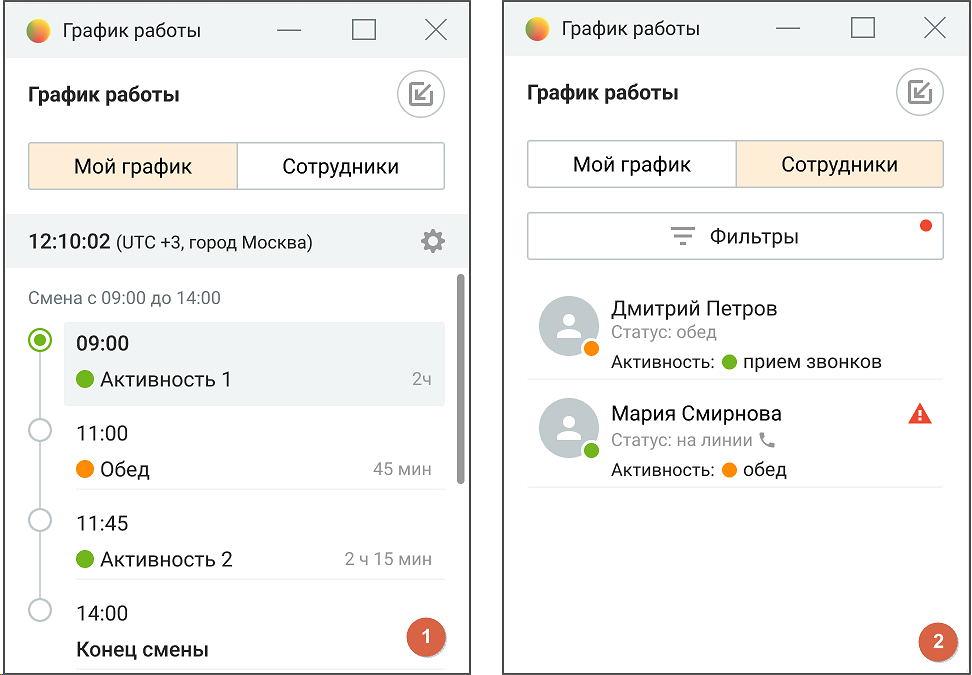

# 2.6. Панель графика работы

> Трассировка: PDF §2.6 · сквозные стр. 116-117 · источники: ч.1 `kb/sources/mango-cc-manual/CC_manual_1.26.42-1-295.pdf` с.116-117.

Панель графика работы предоставляет информацию о текущем статусе и активности сотрудников, а также обеспечивает возможность контроля за соблюдением рабочего графика.

> **Иллюстрация CC-10-1** · стр. 116 · раздел «2.6. Панель графика работы» · снимок экрана интерфейса, 816×106 px.
> Иллюстрирует текст руководства: «Панель графика работы предоставляет информацию о текущем статусе и активности сотрудников, а также обеспечивает возможность контроля за соблюдением рабочего графика.»
> Следующий за иллюстрацией текст: «Панель доступна в двух режимах: Мой график (для оператора) и Сотрудники (для руководителя). Оба режима позволяют получать информацию в реальном времени и оперативно реагировать на отклонения от …»

Панель доступна в двух режимах: Мой график (для оператора) и Сотрудники (для руководителя). Оба режима позволяют получать информацию в реальном времени и оперативно реагировать на отклонения от графика.

> **Иллюстрация CC-10-2** · стр. 116 · раздел «2.6. Панель графика работы» · снимок экрана интерфейса, 972×675 px.
> Иллюстрирует текст руководства: «Панель доступна в двух режимах: Мой график (для оператора) и Сотрудники (для руководителя). Оба режима позволяют получать информацию в реальном времени и оперативно реагировать на отклонения от графика.»
> Следующий за иллюстрацией текст: «Описание функциональных возможностей:»

Описание функциональных возможностей:

1. Мой график: o Отображает текущее время и часовой пояс. o Отображает текущее расписание: активные статусы, перерывы. o Предоставляет уведомления о статусах и предстоящих событиях. o Показывает таймер до начала следующей активности. o Информирует об отклонениях от расписания (например, пропущенные звонки, нарушения графика). o Позволяет выбрать часовой пояс для корректного отображения времени. o Позволяет фильтровать активности по типам. o Отображается поверх всех окон для упрощения работы в режиме линии.

2. Сотрудники: o Отображает список сотрудников с указанием текущего статуса и активности. o Предоставляет информацию о нарушениях: пропущенные звонки, опоздания, несоблюдение графика. o Фильтры для отображения сотрудников по статусам, группам и активностям. o Предоставляет данные о текущей занятости сотрудников и их доступности. o Уведомляет о нарушениях по каждому сотруднику в режиме реального времени. Элементы панели:  Пиктограмма настройки часового пояса

> **Иллюстрация CC-10-3** · стр. 117 · раздел «2.6. Панель графика работы» · значок (элемент интерфейса), встроенный в текст, 13×14 px.
> Поясняющий текст руководства (рядом с элементом): «— элемент для настройки отображения времени в соответствии с рабочим регионом.  Текущая активность — индикатор активности сотрудника, где: o Зелёный цвет — активный статус, o Оранжевый — перерыв, o Красный — наличие нарушений.  Фильтры — позволяют настроить отображение сотрудников по различным …»
> Предшествующий контекст: «2. Сотрудники: o Отображает список сотрудников с указанием текущего статуса и активности. o Предоставляет информацию о нарушениях: пропущенные звонки, опоздания, несоблюдение графика. o Фильтры для …»

— элемент для настройки отображения времени в соответствии с рабочим регионом.  Текущая активность — индикатор активности сотрудника, где: o Зелёный цвет — активный статус, o Оранжевый — перерыв, o Красный — наличие нарушений.  Фильтры — позволяют настроить отображение сотрудников по различным критериям: статус, тип активности, наличие нарушений.  Иконки нарушений — отображают наличие нарушений (например, пропущенные звонки, отклонение от графика) с помощью значков предупреждения.

Примеры использования:  Оператор использует панель для получения актуальной информации о графике и статусах, а также для получения уведомлений о предстоящих активностях. Возможность выбора часового пояса помогает операторам, работающим в разных регионах.  Руководитель контролирует выполнение графика сотрудниками, отслеживает нарушения, и может своевременно корректировать работу, назначая задачи или перераспределяя нагрузку среди сотрудников.
