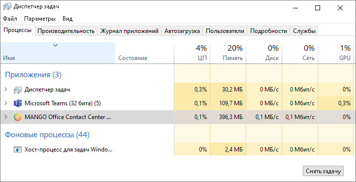
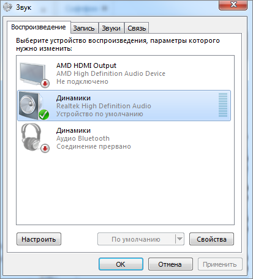
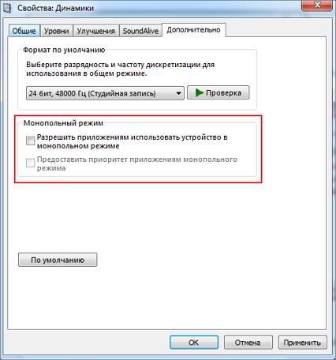
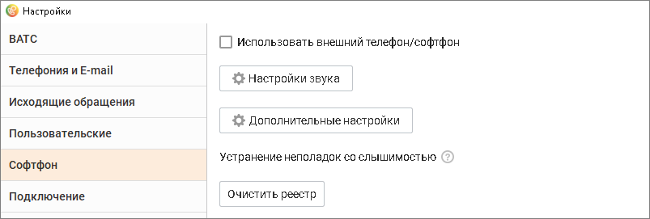
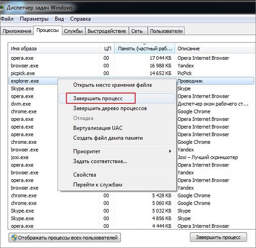
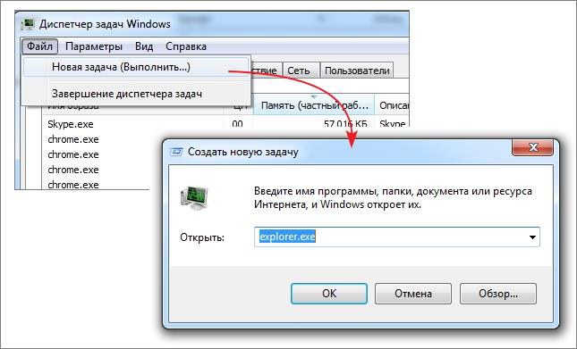
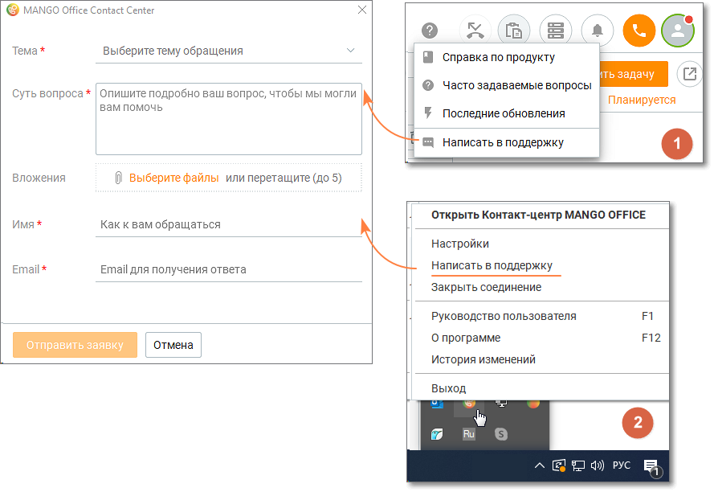

# 24. Приложение 8. Устранение неполадок

> Трассировка: PDF §24 · сквозные стр. 585-590 · источники: ч.2 `kb/sources/mango-cc-manual/CC_manual_1.26.42-296-590.pdf` с.290-295.

Помощь в устранении неполадок доступна в окне Меню справочной системы.

Устранение неполадок со слышимостью Для устранения неполадок со слышимостью необходимо произвести очистку реестра. Действуйте в следующей последовательности:

1. Закройте все программы, которые имеют доступ к микрофону. Для этого откройте Диспетчер задач Windows, выберите необходимое приложение и нажмите кнопку Снять задачу.

> **Иллюстрация CC-102-1** · стр. 585 · раздел «24. Приложение 8. Устранение неполадок» · снимок экрана интерфейса, 723×370 px.
> Иллюстрирует текст руководства: «1. Закройте все программы, которые имеют доступ к микрофону. Для этого откройте Диспетчер задач Windows, выберите необходимое приложение и нажмите кнопку Снять задачу.»
> Следующий за иллюстрацией текст: «2. Отключите монопольный режим для ввода и вывода звука. Для этого откройте Панель управления компьютера, выберите раздел Звук.»

2. Отключите монопольный режим для ввода и вывода звука. Для этого откройте Панель управления компьютера, выберите раздел Звук.

> **Иллюстрация CC-102-2** · стр. 586 · раздел «24. Приложение 8. Устранение неполадок» · снимок экрана интерфейса, 413×456 px.
> Иллюстрирует текст руководства: «2. Отключите монопольный режим для ввода и вывода звука. Для этого откройте Панель управления компьютера, выберите раздел Звук.»
> Следующий за иллюстрацией текст: «рис.1 Пример окна "ЗВУК" для Windows 7 Перейдите в свойства подключенных Динамиков, кликнув по наименованию устройства. Во вкладке Дополнительно уберите галочки настроек Монопольного режима. Нажмите …»

рис.1 Пример окна "ЗВУК" для Windows 7 Перейдите в свойства подключенных Динамиков, кликнув по наименованию устройства. Во вкладке Дополнительно уберите галочки настроек Монопольного режима. Нажмите кнопку Применить.

> **Иллюстрация CC-102-3** · стр. 587 · раздел «24. Приложение 8. Устранение неполадок» · снимок экрана интерфейса, 426×456 px.
> Иллюстрирует текст руководства: «рис.1 Пример окна "ЗВУК" для Windows 7 Перейдите в свойства подключенных Динамиков, кликнув по наименованию устройства. Во вкладке Дополнительно уберите галочки настроек Монопольного режима. Нажмите кнопку Применить.»
> Следующий за иллюстрацией текст: «рис.2 Пример окна "Свойства: Динамики" для Windows 7»

рис.2 Пример окна "Свойства: Динамики" для Windows 7

3. Запустите скрипт очистки реестра Контакт-центра MANGO OFFICE. Для этого запустите Контакт-центр, откройте Настройки/Софтфон и нажмите кнопку Очистить реестр.

> **Иллюстрация CC-102-4** · стр. 587 · раздел «24. Приложение 8. Устранение неполадок» · снимок экрана интерфейса, 803×271 px.
> Иллюстрирует текст руководства: «3. Запустите скрипт очистки реестра Контакт-центра MANGO OFFICE. Для этого запустите Контакт-центр, откройте Настройки/Софтфон и нажмите кнопку Очистить реестр.»
> Следующий за иллюстрацией текст: «4. Перепустите процесс explorer.exe. Для этого в Диспетчере задач завершите процесс explorer.exe.»

4. Перепустите процесс explorer.exe. Для этого в Диспетчере задач завершите процесс explorer.exe.

> **Иллюстрация CC-102-5** · стр. 588 · раздел «24. Приложение 8. Устранение неполадок» · снимок экрана интерфейса, 506×490 px.
> Иллюстрирует текст руководства: «4. Перепустите процесс explorer.exe. Для этого в Диспетчере задач завершите процесс explorer.exe.»
> Следующий за иллюстрацией текст: «Далее в меню Файл Диспетчера задач кликните строку подменю Новая задача. В открывшейся командной строке введите explorer.exe и нажмите кнопку ok. Перезагружать ПК необязательно.»

Далее в меню Файл Диспетчера задач кликните строку подменю Новая задача. В открывшейся командной строке введите explorer.exe и нажмите кнопку ok. Перезагружать ПК необязательно.

> **Иллюстрация CC-102-6** · стр. 589 · раздел «24. Приложение 8. Устранение неполадок» · снимок экрана интерфейса, 645×391 px.
> Иллюстрирует текст руководства: «Далее в меню Файл Диспетчера задач кликните строку подменю Новая задача. В открывшейся командной строке введите explorer.exe и нажмите кнопку ok. Перезагружать ПК необязательно.»
> Следующий за иллюстрацией текст: «Если эти действия не помогли устранить проблему слышимости, обратитесь в службу технической поддержки MANGO OFFICE.»

Если эти действия не помогли устранить проблему слышимости, обратитесь в службу технической поддержки MANGO OFFICE.

Ошибка "Не удалось совершить вызов. Возможно проблема со звуковым устройством" При возникновении ошибки "Не удалось совершить вызов. Возможно проблема со звуковым устройством" в первую очередь следует проверить настройки гарнитуры. Если гарнитура подключена корректно, для диагностики причины неполадок попробуйте временно отключить антивирус "Касперский". Далее обратитесь в службу технической поддержки.

Обращение в службу технической поддержки MANGO OFFICE Пользователь может обратиться в службу технической поддержки одним из указанных способов:

1. С помощью нажатия на иконку вопросительного знака в главном меню программы. В открывшемся списке следует выбрать "Написать в поддержку".

2. С помощью вызова меню в трее, и нажатию на кнопку "Написать в поддержку".

> **Иллюстрация CC-102-7** · стр. 590 · раздел «24. Приложение 8. Устранение неполадок» · снимок экрана интерфейса, 889×612 px.
> Иллюстрирует текст руководства: «2. С помощью вызова меню в трее, и нажатию на кнопку "Написать в поддержку".»
> Следующий за иллюстрацией текст: «Указанные способы инициации заявки работают только при наличии соединения с сервером.»

Указанные способы инициации заявки работают только при наличии соединения с сервером.
