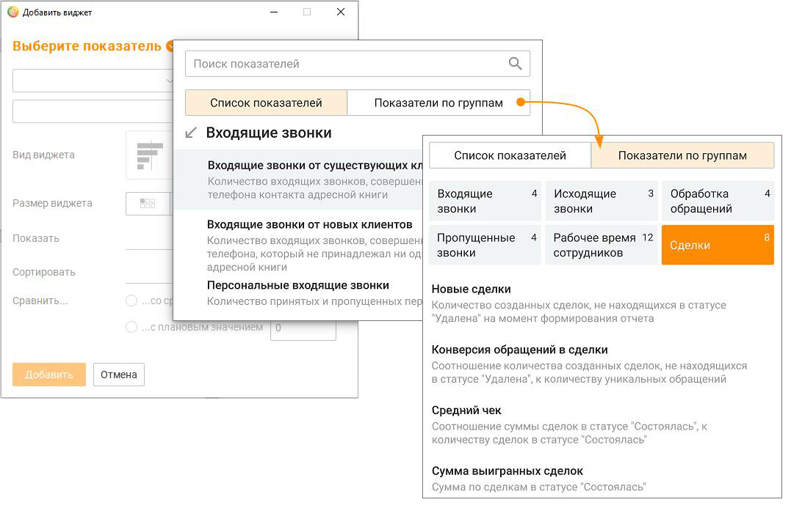
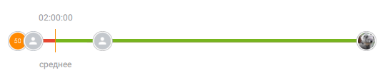
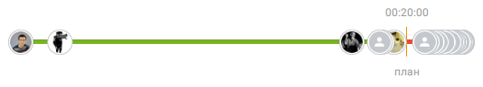
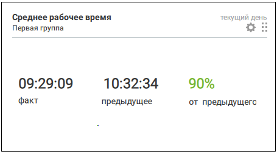

# 3.1. Создание и настройка виджета

> Трассировка: PDF §3.1 · сквозные стр. 119-126 · источники: ч.1 `kb/sources/mango-cc-manual/CC_manual_1.26.42-1-295.pdf` с.119-126.

Для добавления на вкладку Dashboard нового виджета нажмите кнопку Добавить виджет. При создании нового виджета необходимо настроить показатели данных для быстрого формирования отчета о текущем состоянии системы.

Кнопка добавления виджета доступна только после выбора показателя.

> **Иллюстрация CC-12-1** · стр. 120 · раздел «3.1. Создание и настройка виджета» · снимок экрана интерфейса, 1077×689 px.
> Иллюстрирует текст руководства: «Кнопка добавления виджета доступна только после выбора показателя.»
> Следующий за иллюстрацией текст: «Настройка показателей данных для виджета Поиск показателей доступен по наименованию групп показателей, наименованию показателей и текстам подсказки. Вкладка Список показателей отображает все …»

Настройка показателей данных для виджета Поиск показателей доступен по наименованию групп показателей, наименованию показателей и текстам подсказки. Вкладка Список показателей отображает все показатели данных, без группировки. Вкладка Показатели по группам группирует показатели по следующим признакам: Входящие звонки  входящие звонки  персональные входящие звонки  входящие звонки от новых клиентов  входящие звонки от существующих клиентов  входящие звонки дольше ... мин. Исходящие звонки  исходящие звонки существующим клиентам  исходящие звонки новым клиентам  исходящие звонки  исходящие звонки дольше ... мин. Обработка обращений  время обработки обращения (среднее)  время ожидания ответа (среднее).  обработанные обращения  закрытые обращения

Время обработки обращений – время, в течение которого пользователь обрабатывал внешние вызовы и/или текстовые обращения в период с момента первой авторизации до последней деавторизации по каждому дню отдельно за выбранный период. Пропущенные звонки  попыток дозвона (среднее)  скорость перезвона (средняя)  успешно перезвонили  пропущенные вызовы

Рабочее время сотрудников  время обработки текстовых обращений (суммарно)  исходящие разговоры (суммарно)  входящие разговоры (суммарно)  время "на линии" (суммарно)  рабочее время (суммарно)  рабочий день (по статусам)  загруженность (среднее)  время обработки текстовых обращений (среднее)  исходящие разговоры (среднее)  входящие разговоры (среднее)  время «на линии» (среднее)  рабочее время (среднее)  принято персональных звонков  пропущено персональных звонков Сделки  звонки клиентам без сделок  новые сделки  выигранные сделки  проигранные сделки  сумма выигранных сделок  средний чек  конверсия продаж  конверсия обращений в сделки

Правила расчета показателей данных виджета № Показатель Группа Способ подсчета 1 Входящие звонки Входящие звонки Значение соответствует сумме показателей "Количество принятых групповых вызовов" и "Количество пропущенных групповых вызовов" в отчете Производительность сотрудников 2 Персональные

Входящие звонки Значение соответствует сумме показателей "Количество принятых входящие звонки персональных вызовов" и "Количество пропущенных персональных вызовов" в отчете Производительность сотрудников 3 Входящие звонки от Входящие Количество входящих (принятых персональных и групповых) звонков, новых клиентов обращения совершенных с номера телефона, который не принадлежал ни одному контакту ни одной адресной книги на продукте (желтые страницы в текущем показателе не учитываются) на момент завершения вызова 4 Входящие звонки от Входящие Количество входящих (принятых персональных и групповых) звонков, существующих

обращения совершенных с номера телефона контакта любой адресной книги на клиентов продукте, кроме желтых страниц, на момент инициации вызова 5 Входящие звонки Количество Входящие звонки входящих звонков заданной продолжительности. дольше ... мин. Результативными звонками считаются звонки с длительностью больше указанного пользователем значения. Значение зависит от бизнес процесса. 6 Исходящие звонки Исходящие Значение соответствует значению показателя "Количество звонки совершенных вызовов" в отчете Производительность сотрудников 7 Исходящие звонки Исходящие Количество исходящих звонков, совершенных на номер телефона, новым клиентам звонки который не принадлежал ни одному контакту ни одной адресной книги на продукте (желтые страницы в текущем показателе не учитываются) на момент инициации вызова

8 Исходящие звонки Исходящие Количество исходящих звонков, совершенных на номер телефона звонки существующим контакта любой адресной книги на продукте, кроме желтых страниц, клиентам на момент инициации вызова 9 Исходящие звонки Исходящие Количество исходящих звонков заданной продолжительности. дольше ... мин. звонки Результативными звонками считаются звонки с длительностью больше указанного пользователем значения. Значение зависит от бизнес процесса. 10 Пропущенные вызовы Пропущенные Количество историй перезвона во всех статусах по операторам, звонки которые с точки зрения отчета Производительность сотрудников пропустили групповой вызов (последний пропустивший групповой вызов оператор) 11 Успешно перезвонили Пропущенные Количество историй перезвона со статусом Перезвонили по звонки операторам, которые осуществили исходящий состоявшийся 12 Скорость перезвона Пропущенные Средняя по перезвонам скорость перезвона по пропущенным звонкам (средняя) звонки согласно соответствующему показателю в отчете Пропущенные вызовы 13 Попыток дозвона Пропущенные Среднее количество попыток дозвона согласно соответствующему (среднее) звонки показателю в отчете Пропущенные вызовы 14 Закрытые обращения Обработка

Количество обращений в отчете История обращений обращений 15 Обработанные Обработка Количество обращений, закрытых с результатом "Обработано", в обращения обращений отчете История обращений 16 Время ожидания ответа Обработка Среднее время ожидания ответа на обращение в отчете История (среднее) обращений обращений. В показателе не учитываются обращения, созданные сотрудником. 17 Время обработки Обработка Среднее время обработки обращения в отчете История обращений. В обращения (среднее) обращений показателе не учитываются обращения, созданные сотрудником. 18 Рабочее время Рабочее время Среднее значение по сотрудникам за "рабочий" день выбранного (среднее) сотрудников периода на основании значения показателя "Суммарное рабочее время" в отчете Производительность сотрудников по операторам выбранных групп или по сотрудникам 19 Время на линии Рабочее время Среднее значение по сотрудникам за "рабочий" день выбранного (среднее) сотрудников периода на основании значения показателя "Суммарное время На линии" в отчете Производительность сотрудников по операторам выбранных групп или по сотрудникам 20 Входящие разговоры Рабочее время Среднее значение по вызовам за выбранный период на основании (среднее) сотрудников значения показателя "Средняя продолжительность разговора (Все принятые вызовы)" в отчете Производительность сотрудников по операторам выбранных групп или по сотрудникам 21 Исходящие разговоры Рабочее время Среднее значение по вызовам за выбранный период на основании (среднее) сотрудников значения показателя "Средняя продолжительность разговора (Исходящие вызовы)" в отчете Производительность сотрудников по операторам выбранных групп или по сотрудникам 22 Время обработки Рабочее время Среднее значение по сотрудникам за "рабочий" день выбранного сотрудников текстовых обращений периода на основании значения показателя "Время обработки (среднее) текстовых обращений" в отчете Рабочее время сотрудника по операторам выбранных групп или по сотрудникам 23 Загруженность Рабочее время Среднее значение по сотрудникам за "рабочий" день выбранного (среднее) сотрудников периода на основании значения показателя "Уровень загруженности" в отчете Рабочее время сотрудника по операторам выбранных групп или по сотрудникам 24 Рабочий день по Рабочее время График соответствует графику "Рабочий день по статусам" в отчете статусам сотрудников Рабочее время сотрудника по выбранному сотруднику 25 Рабочее время Рабочее время Суммарное значение по сотрудникам за "рабочий" день выбранного (суммарно) сотрудников периода на основании значения показателя "Суммарное рабочее

время" в отчете Производительность сотрудников по операторам выбранных групп или по сотрудникам 26 Время на линии Рабочее время Суммарное значение по сотрудникам за "рабочий" день выбранного (суммарно) сотрудников периода на основании значения показателя "Суммарное время На линии" в отчете Производительность сотрудников по операторам выбранных групп или по сотрудникам 27 Входящие разговоры Рабочее время Суммарное значение по сотрудникам за "рабочий" день выбранного (суммарно) сотрудников периода на основании значения показателя "Суммарное время принятых групповых вызовов" в отчете Производительность сотрудников по операторам выбранных групп или по сотрудникам 28 Исходящие разговоры Рабочее время Суммарное значение по сотрудникам за "рабочий" день выбранного (суммарно) сотрудников периода на основании значения показателя "Суммарное время совершенных вызовов" в отчете Производительность сотрудников по операторам выбранных групп или по сотрудникам 29 Время обработки Рабочее время Суммарное значение по сотрудникам за "рабочий" день выбранного текстовых обращений

сотрудников периода на основании значения показателя "Время обработки (суммарно) текстовых обращений" в отчете Рабочее время сотрудника по операторам выбранных групп или по сотрудникам 30 Пропущено Рабочее время Значение соответствует показателю "Количество пропущенных персональных звонков сотрудников персональных вызовов" в отчете Производительность сотрудников за выбранный период по выбранному оператору 31 Принято персональных Рабочее время Значение соответствует показателю "Количество принятых звонков сотрудников персональных вызовов" в отчете Производительность сотрудников за выбранный период по выбранному оператору 32 Звонки клиентам без Показатели по Количество исходящих звонковых обращений на уникальные номера, сделок сделкам не связанных со сделками, плюс количество исходящих звонковых обращений, на базе которых были созданы сделки Новые сделки 33 Показатели по Количество созданных за выбранный период сделок, которые на сделкам момент формирования отчета не находятся в статусе "Удалена" 34

Выигранные сделки Показатели по Количество сделок, которые были переведены в статус "Состоялась" сделкам за выбранный период и на момент формирования отчета эти сделки в статусе "Состоялась" 35

Проигранные сделки Показатели по Количество сделок, которые были переведены в статус "Не сделкам состоялась" за выбранный период и на момент формирования отчета эти сделки в статусе "Не состоялась"

36 Сумма выигранных Показатели по Сумма сделок, которые были переведены в статус "Состоялась" за сделок сделкам выбранный период и на момент формирования отчета эти сделки в статусе "Состоялась" Средний чек 37 Показатели по Сумма сделок, которые были переведены в статус "Состоялась" за сделкам выбранный период и на момент формирования отчета эти сделки в статусе "Состоялась" разделенная на количество сделок, которые были переведены в статус "Состоялась" за выбранный период и на момент формирования отчета эти сделки в статусе "Состоялась" (среднее арифметическое) 38

Конверсия продаж, % Показатели по Количество сделок, которые были переведены в статус "Состоялась" сделкам за выбранный период и на момент формирования отчета эти сделки в статусе "Состоялась" разделенное на Количество созданных сделок за выбранный период, которые на момент формирования отчета не находятся в статусе "Удалена". Показатель округляется до целого значения процента. 39 Конверсия обращений Показатели по Количество созданных сделок за выбранный период, которые на в сделки, % сделкам момент формирования отчета не находятся в статусе "Удалена" разделенное на количество уникальных обращений за выбранный период. В сделках в отчете "Воронка продаж" этот показатель

называется "Уникальные клиенты". Число показателя округляется до целого. Примечание: при подсчете показателя связь обращений и сделок не учитывается.

Настройка источников данных виджета

1. Период отображения данных  Сегодня – начиная с 00:00:00 текущей календарной даты  Вчера – начиная с 00:00:00 до 23:59:59 предыдущей календарной даты  Последние 2 дня – последние 48 часов, до 23:59:59 предыдущей даты  Текущая неделя – начиная с 00:00:00 понедельника текущей недели  Текущий месяц – начиная с 00:00:00 первого числа текущего месяца  Произвольный период – любой период длительностью не более 30 дней. Не применим для показателей "Пропущенные вызовы", "Успешно перезвонили", "Скорость перезвона (средняя)", "Попыток дозвона (среднее)".

2. Выбор сотрудника или группы, по которым будут отображаться данные  По группе – отображается список групп, которые доступны для просмотра текущим пользователем. Не применим для показателя "Рабочий день по статусам".  По сотруднику – отображается список сотрудников, которые доступны для просмотра текущим пользователем. Не применим для показателей "Скорость перезвона (средняя)" и "Попыток дозвона (среднее)" и "Рабочий день по статусам" если в виджете выбрано более одного сотрудника. Можно выбрать несколько сотрудников или несколько групп.

Настройка внешнего вида виджета

1. Вид графика виджета  Гистограмма – данные отображаются в виде горизонтальных полос разных цветов  Сравнение – данные отображаются, как числа  Диаграмма – данные отображаются в виде кольца с сегментами разного цвета  Рейтинг – данные отображаются на горизонтальном графике. При наведении курсора на сотрудника отображается всплывающее окно с фото и именем сотрудника, а также значением соответствующего показателя. По клику на имени открывается карточка сотрудника.

> **Иллюстрация CC-12-2** · стр. 124 · раздел «3.1. Создание и настройка виджета» · снимок экрана интерфейса, 456×79 px.
> Иллюстрирует текст руководства: «1. Вид графика виджета  Гистограмма – данные отображаются в виде горизонтальных полос разных цветов  Сравнение – данные отображаются, как числа  Диаграмма – данные отображаются в виде кольца с сегментами разного цвета  Рейтинг – данные отображаются на горизонтальном графике. При наведении …»
> Следующий за иллюстрацией текст: «Допускается выбор только одного из предложенных вариантов.»

Допускается выбор только одного из предложенных вариантов.

2. Группировка данных виджета В зависимости от выбранного показателя и вида графика виджета доступна группировка данных по одному из следующих каналов:  по группам;  по сотрудникам;  по точкам входа;  по тематикам;  по каналам;  по результату;  по воронкам. Допускается выбор только одного из предложенных вариантов.

3. Сортировка данных виджета В зависимости от вида графика виджета доступна сортировка данных:  От большего к меньшему;  От меньшего к большему;  По алфавиту. Допускается выбор только одного из предложенных вариантов.

4. Сравнить Возможен выбор одного из вариантов сравнения значений показателей:  с предыдущим периодом (для графика вида "Сравнение") или со средним арифметическим (для графиков вида "Гистограмма" и "Рейтинг");  с плановым значением. Допустимые форматы ввода планового значения вручную зависят от выбранного показателя.  целое положительное число – для различных количественных показателей, для показателей процента загруженности;  время (ЧЧ:ММ:СС) – для различных показателей длительности разговоров, пребывания в статусах и пр. Среднее значение отображается на графиках вида "Гистограмма" и "Рейтинг" по всем выбранным группам/сотрудникам за выбранный период. Значения меньше и больше среднего трактуются как хуже, так и лучше, в зависимости от показателя. Цвет части сектора "хуже" среднего – красный, цвет части сектора "лучше" среднего -зеленый.

> **Иллюстрация CC-12-3** · стр. 125 · раздел «3.1. Создание и настройка виджета» · снимок экрана интерфейса, 539×106 px.
> Иллюстрирует текст руководства: «4. Сравнить Возможен выбор одного из вариантов сравнения значений показателей:  с предыдущим периодом (для графика вида "Сравнение") или со средним арифметическим (для графиков вида "Гистограмма" и "Рейтинг");  с плановым значением. Допустимые форматы ввода планового значения вручную зависят от …»
> Следующий за иллюстрацией текст: «рис.1 Значение для сравнения формируется автоматически – "среднее".»

рис.1 Значение для сравнения формируется автоматически – "среднее".

> **Иллюстрация CC-12-4** · стр. 125 · раздел «3.1. Создание и настройка виджета» · снимок экрана интерфейса, 534×97 px.
> Иллюстрирует текст руководства: «рис.1 Значение для сравнения формируется автоматически – "среднее".»
> Следующий за иллюстрацией текст: «рис.2 Значение для сравнения задается вручную – "план" На графике вида "Среднее" – данные отображаются, как числа.»

рис.2 Значение для сравнения задается вручную – "план" На графике вида "Среднее" – данные отображаются, как числа.

> **Иллюстрация CC-12-5** · стр. 125 · раздел «3.1. Создание и настройка виджета» · снимок экрана интерфейса, 455×253 px.
> Иллюстрирует текст руководства: «рис.2 Значение для сравнения задается вручную – "план" На графике вида "Среднее" – данные отображаются, как числа.»
> Следующий за иллюстрацией текст: «Если выбрана одна группа или один сотрудник, и в качестве среднего выбрано среднее арифметическое, то среднее значение не отображается.»

Если выбрана одна группа или один сотрудник, и в качестве среднего выбрано среднее арифметическое, то среднее значение не отображается.

5. Размер виджета В зависимости от вида графика виджета доступно отображение окна в следующих вариантах:  1х1  1х2  2х1  2х2  1х3

> **Иллюстрация CC-12-6** · стр. 126 · раздел «3.1. Создание и настройка виджета» · снимок экрана интерфейса, 462×51 px.
> Иллюстрирует текст руководства: «5. Размер виджета В зависимости от вида графика виджета доступно отображение окна в следующих вариантах:  1х1  1х2  2х1  2х2  1х3»
> Следующий за иллюстрацией текст: «Допускается выбор только одного из предложенных вариантов.»

Допускается выбор только одного из предложенных вариантов.

Как скопировать уже существующий виджет Вы также можете добавить новый виджет путем копирования уже существующего. Для этого

> **Иллюстрация CC-12-7** · стр. 126 · раздел «3.1. Создание и настройка виджета» · значок (элемент интерфейса), встроенный в текст, 19×15 px.
> Поясняющий текст руководства (рядом с элементом): «щелкните по кнопке и откройте виджет, который хотите скопировать. Далее нажмите кнопку Дублировать. Копия виджета будет размещена на свободном поле вкладки Dashboard. При необходимости копию виджета можно отредактировать. Подробнее о редактировании в разделе "Редактирование виджета"»
> Предшествующий контекст: «Как скопировать уже существующий виджет Вы также можете добавить новый виджет путем копирования уже существующего. Для этого»

щелкните по кнопке и откройте виджет, который хотите скопировать. Далее нажмите кнопку Дублировать. Копия виджета будет размещена на свободном поле вкладки Dashboard. При необходимости копию виджета можно отредактировать. Подробнее о редактировании в разделе "Редактирование виджета"

Создаваемый виджет может быть полностью идентичен ранее созданному виджету
