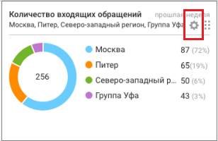
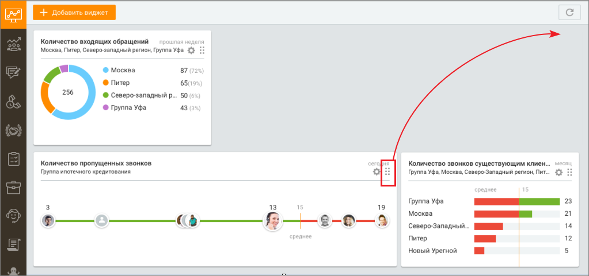

# 3.2. Редактирование виджета

> Трассировка: PDF §3.2 · сквозные стр. 126-127 · источники: ч.1 `kb/sources/mango-cc-manual/CC_manual_1.26.42-1-295.pdf` с.126-127.

Пользователь может отредактировать (изменить настройки) любого виджета ранее добавленного на Dashboard. Чтобы отредактировать виджет, нажмите пиктограмму

> **Иллюстрация CC-13-1** · стр. 126 · раздел «3.2. Редактирование виджета» · значок (элемент интерфейса), встроенный в текст, 19×15 px.
> Поясняющий текст руководства (рядом с элементом): «в правом верхнем углу окна виджета.»
> Предшествующий контекст: «Пользователь может отредактировать (изменить настройки) любого виджета ранее добавленного на Dashboard. Чтобы отредактировать виджет, нажмите пиктограмму»

в правом верхнем углу окна виджета.

> **Иллюстрация CC-13-2** · стр. 126 · раздел «3.2. Редактирование виджета» · снимок экрана интерфейса, 308×200 px.
> Иллюстрирует текст руководства: «в правом верхнем углу окна виджета.»
> Следующий за иллюстрацией текст: «После редактирования настроек нажмите кнопку Применить Пользователь может изменить расположение выбранного виджета относительно других»

После редактирования настроек нажмите кнопку Применить Пользователь может изменить расположение выбранного виджета относительно других

> **Иллюстрация CC-13-3** · стр. 126 · раздел «3.2. Редактирование виджета» · значок (элемент интерфейса), встроенный в текст, 19×20 px.
> Поясняющий текст руководства (рядом с элементом): «виджетов путем перемещения. Для этого зафиксируйте курсор на пиктограмме в правом верхнем углу окна виджета и перемещайте виджет на свободное поле вкладки Dashboard.»
> Предшествующий контекст: «После редактирования настроек нажмите кнопку Применить Пользователь может изменить расположение выбранного виджета относительно других»

виджетов путем перемещения. Для этого зафиксируйте курсор на пиктограмме в правом верхнем углу окна виджета и перемещайте виджет на свободное поле вкладки Dashboard.

> **Иллюстрация CC-13-4** · стр. 127 · раздел «3.2. Редактирование виджета» · снимок экрана интерфейса, 1023×481 px.
> Иллюстрирует текст руководства: «виджетов путем перемещения. Для этого зафиксируйте курсор на пиктограмме в правом верхнем углу окна виджета и перемещайте виджет на свободное поле вкладки Dashboard.»
