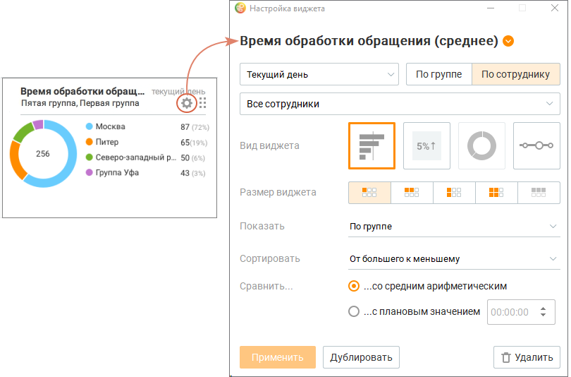

# 3.3. Удаление виджета

> Трассировка: PDF §3.3 · сквозные стр. 127-128 · источники: ч.1 `kb/sources/mango-cc-manual/CC_manual_1.26.42-1-295.pdf` с.127-128.

Пользователь может удалить любой ранее добавленный виджет на Dashboard. Чтобы удалить виджет, нажмите пиктограмму

> **Иллюстрация CC-14-1** · стр. 127 · раздел «3.3. Удаление виджета» · значок (элемент интерфейса), встроенный в текст, 19×15 px.
> Поясняющий текст руководства (рядом с элементом): «в правом верхнем углу окна.»
> Предшествующий контекст: «Пользователь может удалить любой ранее добавленный виджет на Dashboard. Чтобы удалить виджет, нажмите пиктограмму»

в правом верхнем углу окна.

> **Иллюстрация CC-14-2** · стр. 127 · раздел «3.3. Удаление виджета» · снимок экрана интерфейса, 810×534 px.
> Иллюстрирует текст руководства: «в правом верхнем углу окна.»
> Следующий за иллюстрацией текст: «В открывшемся окне нажмите кнопку Удалить. Во всплывающем окне подтвердите свое согласие на удаление.»

В открывшемся окне нажмите кнопку Удалить. Во всплывающем окне подтвердите свое согласие на удаление.

При удалении настройки виджета нигде не сохраняются. Восстановить удаленный виджет невозможно.
