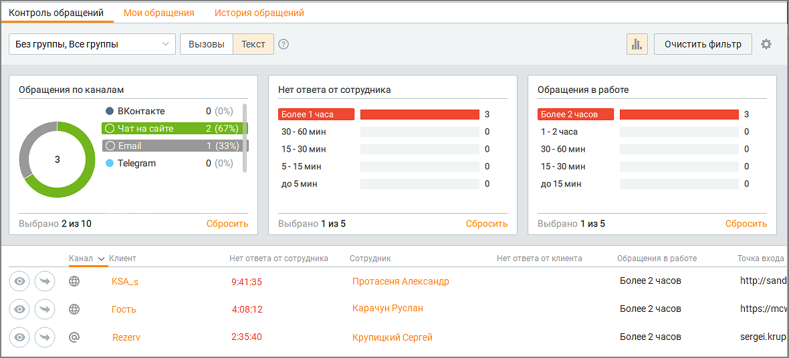

# 4.1. Контроль обращений

> Трассировка: PDF §4.1 · сквозные стр. 129-132 · источники: ч.1 `kb/sources/mango-cc-manual/CC_manual_1.26.42-1-295.pdf` с.129-132.

Данный инструмент предназначен для мониторинга обращений в режиме реального времени по выбранной группе в разрезе вызовов и текстовых обращений. Для получения отчета выберите одну либо несколько групп, по которым необходимо получить данные и нажмите кнопку Применить. Клик по кнопке "Очистить фильтр" удаляет заданные параметры фильтрации.

> **Иллюстрация CC-17-1** · стр. 129 · раздел «4.1. Контроль обращений» · снимок экрана интерфейса, 1180×536 px.
> Иллюстрирует текст руководства: «Данный инструмент предназначен для мониторинга обращений в режиме реального времени по выбранной группе в разрезе вызовов и текстовых обращений. Для получения отчета выберите одну либо несколько групп, по которым необходимо получить данные и нажмите кнопку Применить. Клик по кнопке "Очистить …»
> Следующий за иллюстрацией текст: «В отчете учитываются все каналы коммуникации – текстовые и звонковые, которые подключены в Личном кабинете пользователя ВАТС. Отчет отображается в виде трех»

В отчете учитываются все каналы коммуникации – текстовые и звонковые, которые подключены в Личном кабинете пользователя ВАТС. Отчет отображается в виде трех

> **Иллюстрация CC-17-2** · стр. 129 · раздел «4.1. Контроль обращений» · значок (элемент интерфейса), встроенный в текст, 32×32 px.
> Поясняющий текст руководства (рядом с элементом): «графиков и табличной формы. Клик по пиктограмме открывает блок графиков отчета. Клик по области графика (тексту либо изображению) приводит к фильтрации списка в таблице соответственно выбранному значению. Повторный клик по этой области приводит к отмене фильтрации. Клик по кнопке Сбросить очищает …»
> Предшествующий контекст: «В отчете учитываются все каналы коммуникации – текстовые и звонковые, которые подключены в Личном кабинете пользователя ВАТС. Отчет отображается в виде трех»

графиков и табличной формы. Клик по пиктограмме открывает блок графиков отчета. Клик по области графика (тексту либо изображению) приводит к фильтрации списка в таблице соответственно выбранному значению. Повторный клик по этой области приводит к отмене фильтрации. Клик по кнопке Сбросить очищает фильтр графика.

В зависимости от роли пользователя в Контакт-центре некоторые столбцы таблицы могут быть недоступны для просмотра.

Вызовы Для обращений с типом "Вызовы" предусмотрены следующие графики:  Типы вызовов — абсолютное и относительное количество вызовов, распределенных по типам;  Длительность вызова — абсолютное и относительное количество вызовов, распределенных по длительности обработки вызова;  Клиенты — абсолютное и относительное количество вызовов, распределенных по типам клиентов: o Новые — количество обращений от клиентов, не найденных в адресной книге, либо клиентов, обращавшихся ранее, но не сохраненных в адресной книге; o Существующие — количество обращений от клиентов, найденных в адресной книге. В нижней части отчета отображаются сведения по каждому обращению в виде таблицы. Вы можете самостоятельно выбрать, какие столбцы будут отображаться на панели. Для этого щелкните правой кнопкой мыши по пиктограмме

> **Иллюстрация CC-17-3** · стр. 130 · раздел «4.1. Контроль обращений» · значок (элемент интерфейса), встроенный в текст, 19×15 px.
> Поясняющий текст руководства (рядом с элементом): «и установите/снимите флаги напротив наименований столбцов, либо воспользуйтесь фильтром в шапке отчета. По умолчанию отображается весь набор столбцов. Таблица включает следующие столбцы:»
> Предшествующий контекст: «Вызовы Для обращений с типом "Вызовы" предусмотрены следующие графики:  Типы вызовов — абсолютное и относительное количество вызовов, распределенных по типам;  Длительность вызова — абсолютное и …»

и установите/снимите флаги напротив наименований столбцов, либо воспользуйтесь фильтром в шапке отчета. По умолчанию отображается весь набор столбцов. Таблица включает следующие столбцы:

> **Иллюстрация CC-17-4** · стр. 130 · раздел «4.1. Контроль обращений» · значок (элемент интерфейса), встроенный в текст, 17×19 px.
> Поясняющий текст руководства (рядом с элементом): « Пиктограмма для перехода к просмотру обращения;»
> Предшествующий контекст: «и установите/снимите флаги напротив наименований столбцов, либо воспользуйтесь фильтром в шапке отчета. По умолчанию отображается весь набор столбцов. Таблица включает следующие столбцы:»

 Пиктограмма для перехода к просмотру обращения;

> **Иллюстрация CC-17-5** · стр. 130 · раздел «4.1. Контроль обращений» · значок (элемент интерфейса), встроенный в текст, 34×34 px.
> Поясняющий текст руководства (рядом с элементом): « Пиктограмма для перевода обращения на другого сотрудника;  Тип — тип вызова (входящий, исходящий, обзвон);  Клиент — при наличии клиента среди контактов адресной книги поле содержит кликабельное имя контакта. Нажатие на ссылку приводит к открытию карточки контакта;  Длительность вызова — …»
> Предшествующий контекст: « Пиктограмма для перехода к просмотру обращения;»

 Пиктограмма для перевода обращения на другого сотрудника;  Тип — тип вызова (входящий, исходящий, обзвон);  Клиент — при наличии клиента среди контактов адресной книги поле содержит кликабельное имя контакта. Нажатие на ссылку приводит к открытию карточки контакта;  Длительность вызова — длительность обработки обращения текущим сотрудником. Указывается время с момента начала разговора сотрудника с клиентом;  Сотрудник — имя сотрудника, обрабатывающего обращение в данный момент. Нажатие на имя приводит к открытию карточки сотрудника;  Точка входа — адрес компании, на который обратился клиент. Для исходящих обращений к клиенту, созданных по инициативе сотрудника, точка входа не указывается. Для входящих обращений точка входа указывается как "Создал сотрудник".  Комментарий номера — информация из поля «Комментарий» в разделе ЛК ВАТС «Номера, подключенные к АТС». Просматривая отчет, супервизоры могут учитывать специфику обслуживания для каждого номера.

Текст Для обращений с типом "Текст" предусмотрены следующие графики:  Обращения по каналам — абсолютное и относительное количество обращений в статусе "В работе", распределенных по каналам;  Нет ответа от сотрудника — абсолютное и относительное количество обращений в статусе "В работе", распределенных по времени, прошедшему с момента получения последнего сообщения от клиента;  Обращения в работе — абсолютное и относительное количество обращений, распределенных по времени обработки обращения сотрудником. В нижней части отчета отображаются сведения по каждому обращению в виде таблицы. Вы можете самостоятельно выбрать, какие столбцы будут отображаться на панели. Для этого

> **Иллюстрация CC-17-6** · стр. 130 · раздел «4.1. Контроль обращений» · значок (элемент интерфейса), встроенный в текст, 19×15 px.
> Поясняющий текст руководства (рядом с элементом): «щелкните правой кнопкой мыши по пиктограмме и установите/снимите флаги напротив наименований столбцов, либо воспользуйтесь фильтром в шапке отчета. По умолчанию отображается весь набор столбцов. Таблица включает следующие столбцы:»
> Предшествующий контекст: «Текст Для обращений с типом "Текст" предусмотрены следующие графики:  Обращения по каналам — абсолютное и относительное количество обращений в статусе "В работе", распределенных по каналам;  Нет …»

щелкните правой кнопкой мыши по пиктограмме и установите/снимите флаги напротив наименований столбцов, либо воспользуйтесь фильтром в шапке отчета. По умолчанию отображается весь набор столбцов. Таблица включает следующие столбцы:

> **Иллюстрация CC-17-7** · стр. 130 · раздел «4.1. Контроль обращений» · значок (элемент интерфейса), встроенный в текст, 17×19 px.
> Поясняющий текст руководства (рядом с элементом): « Пиктограмма для перехода к просмотру обращения;»
> Предшествующий контекст: «щелкните правой кнопкой мыши по пиктограмме и установите/снимите флаги напротив наименований столбцов, либо воспользуйтесь фильтром в шапке отчета. По умолчанию отображается весь набор столбцов. …»

 Пиктограмма для перехода к просмотру обращения;

 Канал — пиктограмма канала, по которому поступило обращение;  Клиент — при наличии клиента среди контактов адресной книги поле содержит кликабельное имя контакта. Нажатие на ссылку приводит к открытию карточки контакта. Если клиент обращается по Telegram, Max, VK, Авито и получено имя аккаунта клиента, то отображается Имя аккаунта. Если обращение создано на основе СМС, WhatsApp или вызова от абонента, которого нет в адресной книге, то отображается номер телефона абонента. Иначе – отображается текст "Гость";  Нет ответа от сотрудника — время, прошедшее с момента получения последнего сообщения от клиента. Не отображается в случае, когда последнее сообщение в обращении получено от сотрудника;  Сотрудник — имя сотрудника, обрабатывающего обращение в данный момент. Нажатие на имя приводит к открытию карточки сотрудника;  Нет ответа от клиента — время, прошедшее с момента отправки последнего сообщения от сотрудника. Не отображается в случае, когда последнее сообщение в обращении получено от клиента;  Обращения в работе — время обработки обращения текущим сотрудником;  Точка входа — адрес компании, на который обратился клиент. Для исходящих обращений к клиенту, созданных по инициативе сотрудника, точка входа не указывается. Для входящих обращений точка входа указывается как "Создал сотрудник".
