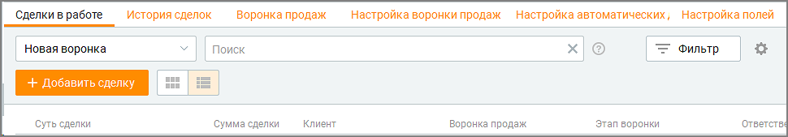
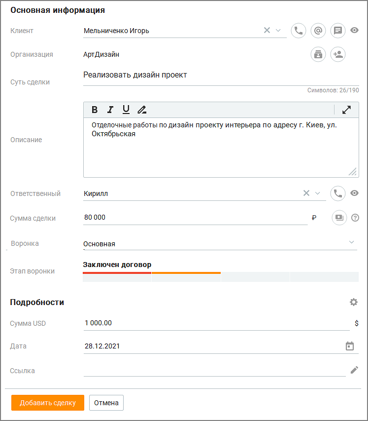
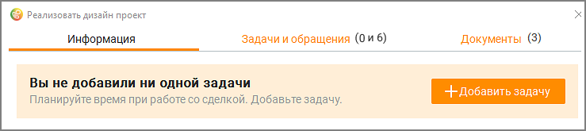
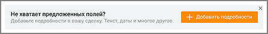
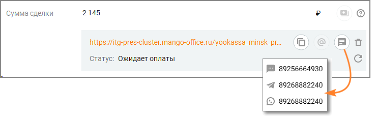
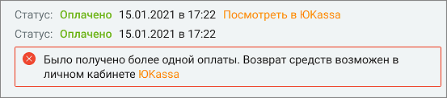
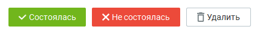

# 5. Сделки

> Трассировка: PDF §5 · сквозные стр. 166-170 · источники: ч.1 `kb/sources/mango-cc-manual/CC_manual_1.26.42-1-295.pdf` с.166-170.

Модуль "Сделки" отображается, если у пользователя Контакт-центра имеются соответствующие права. Настройка прав осуществляется в ЛК ВАТС, в разделе Безопасность и ограничения → Настройка доступа → (Выбрать роль) → Инструменты → Сделки.

Модуль Сделки в меню разделов содержит список всех сделок, доступных к просмотру пользователю, в зависимости от его роли. Модуль включает в себя несколько инструментов:  Сделки в работе  История сделок  Воронка продаж  Настройка воронки продаж (для пользователей с ролями Руководитель компании и Администратор)  Настройка автоматических действий (для пользователей с ролями Руководитель компании и Администратор)  Настройка пользовательских полей (для пользователей с ролями Руководитель компании и Администратор)  Настройка причин отказа

На данный раздел распространяется возможность скрытия номера клиента. Узнать больше здесь.

Для создания новой сделки откройте окно Сделки в меню разделов и нажмите Добавить сделку. По достижении количества сделок 1000, попытка добавить еще одну сделку приводит к появлению уведомления о достижении лимита.

При изменении подключенных услуг сделки сверх лимита не удаляются, но для работы доступно лишь 1000 последних по дате создания сделок (созданных или переоткрытых).

> **Иллюстрация CC-22-1** · стр. 166 · раздел «5. Сделки» · снимок экрана интерфейса, 970×169 px.
> Иллюстрирует текст руководства: «При изменении подключенных услуг сделки сверх лимита не удаляются, но для работы доступно лишь 1000 последних по дате создания сделок (созданных или переоткрытых).»
> Следующий за иллюстрацией текст: «На карточке сделки заполните стандартные и пользовательские поля:  Клиент - контакт адресной книги (вкладка Клиенты/Контакты). Если клиент был удален, то в созданной ранее сделке отображается как …»

На карточке сделки заполните стандартные и пользовательские поля:  Клиент - контакт адресной книги (вкладка Клиенты/Контакты). Если клиент был удален, то в созданной ранее сделке отображается как Удаленный клиент. Также можно добавить нового клиента кликом по кнопке "+ Новый клиент".  Организация – поле автоматически заполняется данными об организации указанного выше клиента;  Суть сделки – поле является обязательным к заполнению, допускается несколько сделок с одинаковым названием.  Описание – описание сделки, не более 3000 символов;

 Ответственный – сотрудник, создавший сделку либо сотрудник, на которого назначена сделка при её создании. Ответственный сотрудник впоследствии может быть изменен вручную или автоматически. При смене Ответственного вручную пользователю будет предложено назначить связанные со сделкой задачи на нового Ответственного.  Сумма сделки – сумма сделки, не более 12 цифр;  Воронка продаж - наименование воронки продаж, к которой относится сделка (выбор из выпадающего списка);  Этап воронки – выбор этапа сделки.

> **Иллюстрация CC-22-2** · стр. 167 · раздел «5. Сделки» · снимок экрана интерфейса, 747×853 px.
> Иллюстрирует текст руководства: « Ответственный – сотрудник, создавший сделку либо сотрудник, на которого назначена сделка при её создании. Ответственный сотрудник впоследствии может быть изменен вручную или автоматически. При смене Ответственного вручную пользователю будет предложено назначить связанные со сделкой задачи на …»
> Следующий за иллюстрацией текст: «Пользовательские поля размещаются в блоке "Подробности". Клик по пиктограмме»

Пользовательские поля размещаются в блоке "Подробности". Клик по пиктограмме

> **Иллюстрация CC-22-3** · стр. 167 · раздел «5. Сделки» · значок (элемент интерфейса), встроенный в текст, 19×15 px.
> Поясняющий текст руководства (рядом с элементом): «открывает вкладку Настройка пользовательских полей.»
> Предшествующий контекст: «Пользовательские поля размещаются в блоке "Подробности". Клик по пиктограмме»

открывает вкладку Настройка пользовательских полей.

Помимо полей, заполняемых пользователем при создании сделки, карточка сделки содержит пиктограммы:

> **Иллюстрация CC-22-4** · стр. 168 · раздел «5. Сделки» · значок (элемент интерфейса), встроенный в текст, 32×32 px.
> Поясняющий текст руководства (рядом с элементом): «– звонок клиенту или сотруднику. Кнопка активна, если в карточке клиента/сотрудника имеется номер телефона;»
> Предшествующий контекст: «Помимо полей, заполняемых пользователем при создании сделки, карточка сделки содержит пиктограммы:»

– звонок клиенту или сотруднику. Кнопка активна, если в карточке клиента/сотрудника имеется номер телефона;

> **Иллюстрация CC-22-5** · стр. 168 · раздел «5. Сделки» · значок (элемент интерфейса), встроенный в текст, 30×30 px.
> Поясняющий текст руководства (рядом с элементом): «– отправить e-mail. Кнопка активна, если в карточке клиента указан адрес электронной почты. Для отправки e-mail в настройке Телефония и E-mail должен быть указан и авторизован адрес электронной почты сотрудника;»
> Предшествующий контекст: «– звонок клиенту или сотруднику. Кнопка активна, если в карточке клиента/сотрудника имеется номер телефона;»

– отправить e-mail. Кнопка активна, если в карточке клиента указан адрес электронной почты. Для отправки e-mail в настройке Телефония и E-mail должен быть указан и авторизован адрес электронной почты сотрудника;

> **Иллюстрация CC-22-6** · стр. 168 · раздел «5. Сделки» · значок (элемент интерфейса), встроенный в текст, 34×34 px.
> Поясняющий текст руководства (рядом с элементом): «- отправить текстовое обращение. Кнопка активна, если в карточке клиента указан хотя бы один канал для текстовых обращений;»
> Предшествующий контекст: «– отправить e-mail. Кнопка активна, если в карточке клиента указан адрес электронной почты. Для отправки e-mail в настройке Телефония и E-mail должен быть указан и авторизован адрес электронной почты …»

- отправить текстовое обращение. Кнопка активна, если в карточке клиента указан хотя бы один канал для текстовых обращений;

> **Иллюстрация CC-22-7** · стр. 168 · раздел «5. Сделки» · значок (элемент интерфейса), встроенный в текст, 32×32 px.
> Поясняющий текст руководства (рядом с элементом): «– открывает список всех контактов организации в модуле "Клиенты";»
> Предшествующий контекст: «- отправить текстовое обращение. Кнопка активна, если в карточке клиента указан хотя бы один канал для текстовых обращений;»

– открывает список всех контактов организации в модуле "Клиенты";

> **Иллюстрация CC-22-8** · стр. 168 · раздел «5. Сделки» · значок (элемент интерфейса), встроенный в текст, 32×34 px.
> Поясняющий текст руководства (рядом с элементом): «- открывает карточку добавления нового контакта в указанную организацию;»
> Предшествующий контекст: «– открывает список всех контактов организации в модуле "Клиенты";»

- открывает карточку добавления нового контакта в указанную организацию;

> **Иллюстрация CC-22-9** · стр. 168 · раздел «5. Сделки» · значок (элемент интерфейса), встроенный в текст, 32×29 px.
> Поясняющий текст руководства (рядом с элементом): «– просмотр карточки клиента/сотрудника;»
> Предшествующий контекст: «- открывает карточку добавления нового контакта в указанную организацию;»

– просмотр карточки клиента/сотрудника;

> **Иллюстрация CC-22-10** · стр. 168 · раздел «5. Сделки» · значок (элемент интерфейса), встроенный в текст, 15×15 px.
> Поясняющий текст руководства (рядом с элементом): «– редактирование текста;»
> Предшествующий контекст: «– просмотр карточки клиента/сотрудника;»

– редактирование текста;

> **Иллюстрация CC-22-11** · стр. 168 · раздел «5. Сделки» · значок (элемент интерфейса), встроенный в текст, 32×32 px.
> Поясняющий текст руководства (рядом с элементом): «– формирование ссылки на оплату сделки в сервисе ЮKassa. После создания карточку сделки можно открыть в режиме просмотра и редактирования. У вновь созданной сделки отсутствуют задачи, поэтому отобразится соответствующее информационное сообщение.»
> Предшествующий контекст: «– редактирование текста;»

– формирование ссылки на оплату сделки в сервисе ЮKassa. После создания карточку сделки можно открыть в режиме просмотра и редактирования. У вновь созданной сделки отсутствуют задачи, поэтому отобразится соответствующее информационное сообщение.

> **Иллюстрация CC-22-12** · стр. 168 · раздел «5. Сделки» · снимок экрана интерфейса, 739×165 px.
> Иллюстрирует текст руководства: «– формирование ссылки на оплату сделки в сервисе ЮKassa. После создания карточку сделки можно открыть в режиме просмотра и редактирования. У вновь созданной сделки отсутствуют задачи, поэтому отобразится соответствующее информационное сообщение.»
> Следующий за иллюстрацией текст: «Если у пользователя имеются права на настройку пользовательских полей, при создании сделки будут отображаться дополнительные блоки уведомлении.»

Если у пользователя имеются права на настройку пользовательских полей, при создании сделки будут отображаться дополнительные блоки уведомлении.

> **Иллюстрация CC-22-13** · стр. 168 · раздел «5. Сделки» · снимок экрана интерфейса, 447×58 px.
> Иллюстрирует текст руководства: «Если у пользователя имеются права на настройку пользовательских полей, при создании сделки будут отображаться дополнительные блоки уведомлении.»
> Следующий за иллюстрацией текст: «Оплата сделки В карточке сделки сотрудник может cгенерировать ссылку на оплату сделки в сервисе ЮKassa.»

Оплата сделки В карточке сделки сотрудник может cгенерировать ссылку на оплату сделки в сервисе ЮKassa.

В Личном кабинете пользователя ВАТС должна быть подключена интеграция с ЮKassa.

> **Иллюстрация CC-22-14** · стр. 168 · раздел «5. Сделки» · значок (элемент интерфейса), встроенный в текст, 32×32 px.
> Поясняющий текст руководства (рядом с элементом): «Чтобы сгенерировать ссылку, кликните по пиктограмме в строке "Сумма сделки". После того, как ссылка будет сгенерирована, ее можно:»
> Предшествующий контекст: «В Личном кабинете пользователя ВАТС должна быть подключена интеграция с ЮKassa.»

Чтобы сгенерировать ссылку, кликните по пиктограмме в строке "Сумма сделки". После того, как ссылка будет сгенерирована, ее можно:

> **Иллюстрация CC-22-15** · стр. 168 · раздел «5. Сделки» · значок (элемент интерфейса), встроенный в текст, 19×20 px.
> Поясняющий текст руководства (рядом с элементом): « скопировать в буфер обмена кликом по пиктограмме ;»
> Предшествующий контекст: «Чтобы сгенерировать ссылку, кликните по пиктограмме в строке "Сумма сделки". После того, как ссылка будет сгенерирована, ее можно:»

 скопировать в буфер обмена кликом по пиктограмме ;

> **Иллюстрация CC-22-16** · стр. 169 · раздел «5. Сделки» · значок (элемент интерфейса), встроенный в текст, 30×30 px.
> Поясняющий текст руководства (рядом с элементом): « отправить на e-mail, указанный в карточке клиента, кликом по пиктограмме ;  отправить СМС-уведомлением (в преднастроенном системном шаблоне), WhasApp- уведомлением или текстовым обращением по выбранному каналу кликом по»
> Предшествующий контекст: « скопировать в буфер обмена кликом по пиктограмме ;»

 отправить на e-mail, указанный в карточке клиента, кликом по пиктограмме ;  отправить СМС-уведомлением (в преднастроенном системном шаблоне), WhasApp- уведомлением или текстовым обращением по выбранному каналу кликом по

> **Иллюстрация CC-22-17** · стр. 169 · раздел «5. Сделки» · значок (элемент интерфейса), встроенный в текст, 34×34 px.
> Поясняющий текст руководства (рядом с элементом): «пиктограмме ;»
> Предшествующий контекст: « отправить на e-mail, указанный в карточке клиента, кликом по пиктограмме ;  отправить СМС-уведомлением (в преднастроенном системном шаблоне), WhasApp- уведомлением или текстовым обращением по …»

пиктограмме ;

> **Иллюстрация CC-22-18** · стр. 169 · раздел «5. Сделки» · значок (элемент интерфейса), встроенный в текст, 16×19 px.
> Поясняющий текст руководства (рядом с элементом): « удалить кликом по пиктограмме . После удаления ссылка становится недействительной, платеж по ней не может быть произведен.  Клик по пиктограмме»
> Предшествующий контекст: «пиктограмме ;»

 удалить кликом по пиктограмме . После удаления ссылка становится недействительной, платеж по ней не может быть произведен.  Клик по пиктограмме

> **Иллюстрация CC-22-19** · стр. 169 · раздел «5. Сделки» · значок (элемент интерфейса), встроенный в текст, 17×18 px.
> Поясняющий текст руководства (рядом с элементом): «обновляет статус платежа.»
> Предшествующий контекст: « удалить кликом по пиктограмме . После удаления ссылка становится недействительной, платеж по ней не может быть произведен.  Клик по пиктограмме»

обновляет статус платежа.

> **Иллюстрация CC-22-20** · стр. 169 · раздел «5. Сделки» · снимок экрана интерфейса, 741×232 px.
> Иллюстрирует текст руководства: «обновляет статус платежа.»
> Следующий за иллюстрацией текст: «После получения оплаты статус платежа меняется на Оплачено. В карточке сделки отображаются дата и время оплаты, а также ссылка "Посмотреть в ЮKassa".»

После получения оплаты статус платежа меняется на Оплачено. В карточке сделки отображаются дата и время оплаты, а также ссылка "Посмотреть в ЮKassa".

Ограничение по времени для оплаты платежей настраивается пользователем в личном кабинете ЮKassa. По истечении данного срока не оплаченный платеж автоматически отменяется, ссылка на оплату становится не действительной. В настройках можно задать автоматическое перемещение сделки на выбранный этап после поступления оплаты. Если клиент произвел оплату по ссылке несколько раз, в карточке сделки отразится информация обо всех полученных платежах, а также ссылка на Личный кабинет ЮKassa для возврата ошибочного платежа.

> **Иллюстрация CC-22-21** · стр. 169 · раздел «5. Сделки» · снимок экрана интерфейса, 553×122 px.
> Иллюстрирует текст руководства: «Ограничение по времени для оплаты платежей настраивается пользователем в личном кабинете ЮKassa. По истечении данного срока не оплаченный платеж автоматически отменяется, ссылка на оплату становится не действительной. В настройках можно задать автоматическое перемещение сделки на выбранный этап …»
> Следующий за иллюстрацией текст: «Статус сделки Каждая сделка находится в одном из статусов:  В работе  Не в работе: Состоялась, Не состоялась, Удалена При создании сделки ей присваивается статус В работе. Пользователь может …»

Статус сделки Каждая сделка находится в одном из статусов:  В работе  Не в работе: Состоялась, Не состоялась, Удалена При создании сделки ей присваивается статус В работе. Пользователь может изменить статус сделки одной из кнопок в карточке сделки:

> **Иллюстрация CC-22-22** · стр. 169 · раздел «5. Сделки» · снимок экрана интерфейса, 430×56 px.
> Иллюстрирует текст руководства: «Статус сделки Каждая сделка находится в одном из статусов:  В работе  Не в работе: Состоялась, Не состоялась, Удалена При создании сделки ей присваивается статус В работе. Пользователь может изменить статус сделки одной из кнопок в карточке сделки:»
