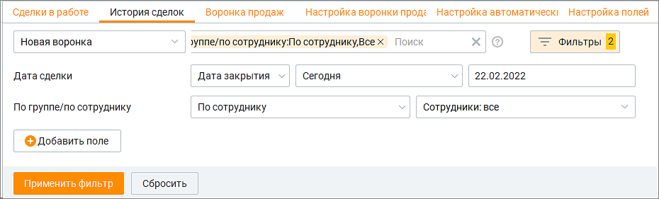
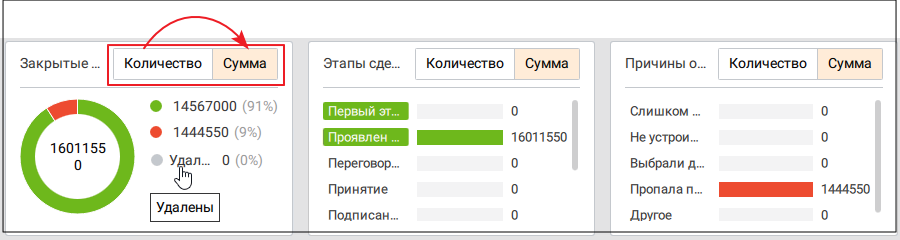
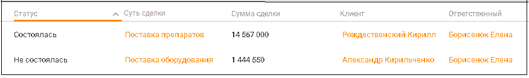
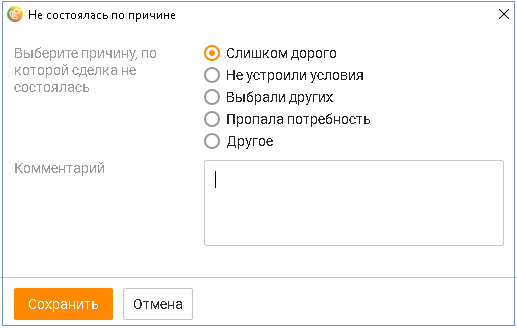

# 5.2. История сделок

> Трассировка: PDF §5.2 · сквозные стр. 179-182 · источники: ч.1 `kb/sources/mango-cc-manual/CC_manual_1.26.42-1-295.pdf` с.179-182.

Вкладка История сделок содержит сделки со статусом Состоялась, Не состоялась, Удалена. Пользователь может открывать и просматривать карточки сделок, а также возвращать сделкам статус В работе. Вкладка состоит из блока фильтров, блока визуализаций и табличной части. Вкладка содержит подробную детализацию по количеству сделок, их стоимости и статусам с учетом выбранных фильтров. По умолчанию доступна фильтрация:  по воронке – выбор из всех доступных пользователю воронок;  по дате сделки – дата создания сделки, дата закрытия сделки;  по времени – сегодня, вчера, текущая неделя, прошлая неделя, текущий месяц, текущий год, произвольный период;

 по участникам – по сотруднику, по группе (с возможностью выбора конкретных сотрудников или групп);  клиенту – доступные варианты: заполнен, неважно. При выборе "Заполнен" рядом отображается поисковая строка по клиентам с возможностью выбора неточного совпадения;  по организации – выбор из списка доступных пользователю организаций. Доступен поиск по точному или неточному совпадению наименования организации.  по сумме сделки – выбор в диапазоне сумм. Клик по кнопке "Добавить поле" открывает окно со списком полей вкладки Настройка полей для выбора дополнительного поля фильтрации. Выбранные фильтры сохраняются после выхода пользователя из Контакт-центра и повторной авторизации.

Длительность произвольного периода не может превышать 31 день.

> **Иллюстрация CC-24-1** · стр. 180 · раздел «5.2. История сделок» · снимок экрана интерфейса, 930×281 px.
> Иллюстрирует текст руководства: «Длительность произвольного периода не может превышать 31 день.»
> Следующий за иллюстрацией текст: «рис.1. Блок фильтров Блок визуализаций отображает информацию по:  количеству сделок  сумме сделок»

рис.1. Блок фильтров Блок визуализаций отображает информацию по:  количеству сделок  сумме сделок

> **Иллюстрация CC-24-2** · стр. 180 · раздел «5.2. История сделок» · снимок экрана интерфейса, 900×240 px.
> Иллюстрирует текст руководства: «рис.1. Блок фильтров Блок визуализаций отображает информацию по:  количеству сделок  сумме сделок»
> Следующий за иллюстрацией текст: «рис.2. Блок визуализаций»

рис.2. Блок визуализаций

> **Иллюстрация CC-24-3** · стр. 180 · раздел «5.2. История сделок» · значок (элемент интерфейса), встроенный в текст, 32×32 px.
> Поясняющий текст руководства (рядом с элементом): «Клик по пиктограмме сворачивает графики, оставляя открытой таблицу. Таблица формируется по срезу Группа/Сотрудники и заданному пользователем периоду.»
> Предшествующий контекст: «рис.2. Блок визуализаций»

Клик по пиктограмме сворачивает графики, оставляя открытой таблицу. Таблица формируется по срезу Группа/Сотрудники и заданному пользователем периоду.

> **Иллюстрация CC-24-4** · стр. 180 · раздел «5.2. История сделок» · снимок экрана интерфейса, 876×130 px.
> Иллюстрирует текст руководства: «Клик по пиктограмме сворачивает графики, оставляя открытой таблицу. Таблица формируется по срезу Группа/Сотрудники и заданному пользователем периоду.»
> Следующий за иллюстрацией текст: «рис.3. Табличная часть Предусмотрены следующие столбцы:»

рис.3. Табличная часть Предусмотрены следующие столбцы:

 Статус сделки  Суть сделки  Сумма сделки  Клиент  Организация  Воронка продаж  Этап воронки  Ответственный  Дата создания сделки  Дата закрытия сделки  Дата первого обращения  Дата последнего обращения  Всего задач  Обращений  Не состоялась по причине  Комментарий  ID сделки  а также все пользовательские поля Для сортировки данных по возрастанию/убыванию, следует щелкнуть левой кнопкой мыши

> **Иллюстрация CC-24-5** · стр. 181 · раздел «5.2. История сделок» · значок (элемент интерфейса), встроенный в текст, 19×15 px.
> Поясняющий текст руководства (рядом с элементом): «по пиктограмме и установить/снять флаги напротив наименований столбов. По умолчанию отображается весь набор столбцов. Перевод сделки в статус Состоялась Чтобы перевести сделку в статус Состоялась, необходимо щелкнуть по наименованию сделки, открыть карточку сделки и нажать на кнопку Состоялась. …»
> Предшествующий контекст: « Статус сделки  Суть сделки  Сумма сделки  Клиент  Организация  Воронка продаж  Этап воронки  Ответственный  Дата создания сделки  Дата закрытия сделки  Дата первого обращения  Дата …»

по пиктограмме и установить/снять флаги напротив наименований столбов. По умолчанию отображается весь набор столбцов. Перевод сделки в статус Состоялась Чтобы перевести сделку в статус Состоялась, необходимо щелкнуть по наименованию сделки, открыть карточку сделки и нажать на кнопку Состоялась. Карточка сделки промаркирована зеленым цветом.

> **Иллюстрация CC-24-6** · стр. 181 · раздел «5.2. История сделок» · снимок экрана интерфейса, 632×99 px.
> Иллюстрирует текст руководства: «по пиктограмме и установить/снять флаги напротив наименований столбов. По умолчанию отображается весь набор столбцов. Перевод сделки в статус Состоялась Чтобы перевести сделку в статус Состоялась, необходимо щелкнуть по наименованию сделки, открыть карточку сделки и нажать на кнопку Состоялась. …»
> Следующий за иллюстрацией текст: «Нажатие на кнопку Переоткрыть сделку возвращает сделке статус В работе.»

Нажатие на кнопку Переоткрыть сделку возвращает сделке статус В работе.

Перевод сделки в статус Не состоялась Чтобы перевести сделку в статус Не состоялась, необходимо открыть карточку сделки и нажать на кнопку Не состоялась. Далее следует выбрать причину, по которой сделка не состоялась, и сохранить внесенные изменения.

> **Иллюстрация CC-24-7** · стр. 182 · раздел «5.2. История сделок» · снимок экрана интерфейса, 517×328 px.
> Иллюстрирует текст руководства: «Перевод сделки в статус Не состоялась Чтобы перевести сделку в статус Не состоялась, необходимо открыть карточку сделки и нажать на кнопку Не состоялась. Далее следует выбрать причину, по которой сделка не состоялась, и сохранить внесенные изменения.»
> Следующий за иллюстрацией текст: «Сделка со статусом Не состоялась недоступна для редактирования. Карточка сделки промаркирована красным цветом.»

Сделка со статусом Не состоялась недоступна для редактирования. Карточка сделки промаркирована красным цветом.

> **Иллюстрация CC-24-8** · стр. 182 · раздел «5.2. История сделок» · снимок экрана интерфейса, 644×144 px.
> Иллюстрирует текст руководства: «Сделка со статусом Не состоялась недоступна для редактирования. Карточка сделки промаркирована красным цветом.»
> Следующий за иллюстрацией текст: «Нажатие на кнопку Переоткрыть сделку возвращает сделке статус В работе.»

Нажатие на кнопку Переоткрыть сделку возвращает сделке статус В работе.

Также изменить статус сделки можно в плиточном виде окна Сделки в работе.
