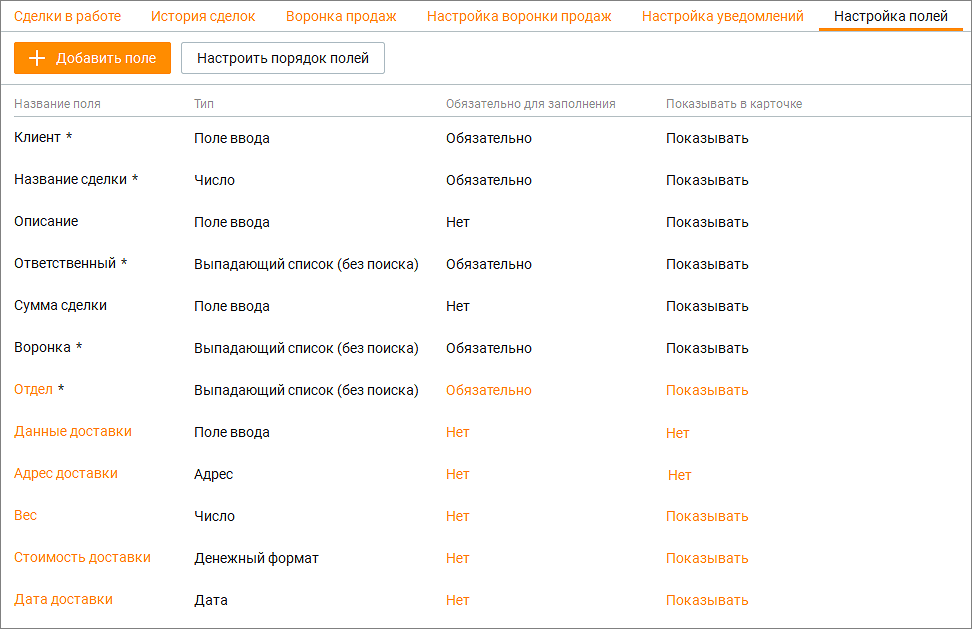
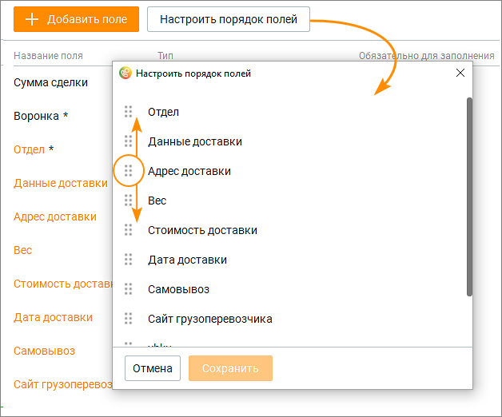

# 5.6. Настройка пользовательских полей

> Трассировка: PDF §5.6 · сквозные стр. 196-200 · источники: ч.1 `kb/sources/mango-cc-manual/CC_manual_1.26.42-1-295.pdf` с.196-200.

В модуле Сделки доступно добавление пользовательских полей. Максимальное количество пользовательских полей определяется условием дополнительно подключаемой услуги. Кнопка Добавить поле предназначена для добавления пользовательских полей в модуль Сделки. Кнопка Настроить порядок полей позволяет настроить порядок, в котором пользовательские поля будут отображаться в карточке сделки и быстрой карточке в разделе "Мои обращения".

> **Иллюстрация CC-28-1** · стр. 197 · раздел «5.6. Настройка пользовательских полей» · снимок экрана интерфейса, 972×629 px.
> Иллюстрирует текст руководства: «В модуле Сделки доступно добавление пользовательских полей. Максимальное количество пользовательских полей определяется условием дополнительно подключаемой услуги. Кнопка Добавить поле предназначена для добавления пользовательских полей в модуль Сделки. Кнопка Настроить порядок полей позволяет …»
> Следующий за иллюстрацией текст: «Поля отмеченные символом *, являются обязательными к заполнению. Если это поле отображается в карточке и быстрой карточке сделки, там оно также отмечено символом * (звездочка). Добавление …»

Поля отмеченные символом *, являются обязательными к заполнению. Если это поле отображается в карточке и быстрой карточке сделки, там оно также отмечено символом * (звездочка). Добавление пользовательских полей Для добавления пользовательского поля следует кликнуть по кнопке Добавить поле. Откроется выпадающий список с вариантами типов поля. Доступны следующие типы пользовательских полей: Поле ввода – от 1 до 255 символов, текст. Если необходимо больше символов, используйте поле «Текстовая область». Выпадающий список – количество значений от 1 до 300. Возможно два варианта списка: с единственным или множественным выбором; Адрес – поиск указанного адреса в Google-картах; Число – используется только для ввода целых чисел; Денежный формат – не более 14 знаков, после запятой не более 2 знаков. То есть 999999999999.99 максимально возможное значение; Дата – ввод данных в формате: ДД.ММ.ГГГГ; Флаг – содержит одно из двух значений: Да/Нет, Истина/Ложь или Вкл/Выкл.

Ссылка – хранение ссылок на URL-адреса; Текстовая область – от 1 до 1000 символов; Пользователь – список значений, отображающий всех пользователей ВАТС.

Созданные пользовательские поля применяются для старых и новых сделок всех статусов, во всех воронках.

Пользовательские поля доступны для сохранения в файл импорта при импорте сделок. Настройки пользовательских полей После выбора типа поля следует установить его настройки. Выбор типа пользовательского поля доступен только при создании. Изменение типа пользовательского поля в уже созданном поле – не доступно.

Отмеченные * настройки поля не могут быть впоследствии изменены.

В зависимости от типов полей доступны следующие настройки:

№ Тип настройки Описание настройки

1 Название поля Произвольное, уникальное имя. Не может повторять название стандартных полей. Длина не более 30 символов.

Доступна для всех типов полей. 2 Количество символов* Настройка ограничения на количество вводимых символов в содержимом поля.

Доступна для полей:  Поле ввода  Адрес  Число  Ссылка

3 Проверка Проверка содержимого пользовательского поля на заполненного уникальность при создании или изменении. Пустое значение значения на на уникальность не проверяется. уникальность* Доступна для полей:  Поле ввода  Адрес  Число  Денежный  Ссылка

4 Только для чтения Вне зависимости от прав и ролей пользователей, содержимое поля будет не доступно для изменения, в случае включения настройки.

Доступна для полей:  Поле ввода  Адрес  Число  Денежный

 Ссылка

5 Указать ограничение Настройка ограничения на ввод суммы чисел. для суммы* Доступна для полей:  Денежный

6 Валюта* Список содержит иконки трех валют для выбора:  Рубль  Евро  Доллар

Доступна для полей:  Денежный

7 Доступно несколько Переключает список с единичным выбором значения, на вариантов для список с множественным выбором. выбора* Доступна для полей:  Выпадающий список

8 Показывать поиск по Включает/отключает поисковое поле, с поиском по значениям значениям выпадающего списка.

Доступна для полей:  Выпадающий список  Пользователь

9 Действия со Доступны следующие действия: значениями выпадающего списка

 Наименование значения списка – произвольное, уникальное наименование значения выпадающего списка;  Добавление значения списка – настройка, добавляющая плюс еще одно значение выпадающего списка к существующему одному значению, созданному системой автоматически;  Изменение порядка расположения значений. Пользователю доступно изменение порядка созданных значений, повышая приоритет (перемещая выше), либо уменьшая приоритет (перемещая ниже);  Удаление значения списка – настройка, удаляющая значение выпадающего списка без возможности восстановления.

Доступна для полей:  Выпадающий список

Дополнительные настройки для пользовательских полей:

№ Наименование Описание настройки настройки 1 Обязательность При включенном состоянии, включена проверка, которая не заполнения позволяет создавать или изменять сделки, если содержимое поля – пусто 2 Показывать в карточке Включено или выключено отображение поля на интерфейсе карточки сделки

3 Порядок полей Настройка позволяет менять порядок расположения полей в интерфейсе. Влияет только на порядок расположения поля, не изменяет данные или содержимое пользовательского поля.

Настроить порядок пользовательских полей Клик по кнопке Настроить порядок полей открывает окно, в котором пользователь может изменить порядок отображения пользовательских полей.

> **Иллюстрация CC-28-2** · стр. 200 · раздел «5.6. Настройка пользовательских полей» · снимок экрана интерфейса, 628×522 px.
> Иллюстрирует текст руководства: «Настроить порядок пользовательских полей Клик по кнопке Настроить порядок полей открывает окно, в котором пользователь может изменить порядок отображения пользовательских полей.»
> Следующий за иллюстрацией текст: «Для изменения порядка полей зафиксируйте левую кнопку мыши на пиктограмме и переместите поле вверх или вниз по списку. Сохраните внесенные изменения кнопкой Сохранить. Удаление пользовательских полей …»

> **Иллюстрация CC-28-3** · стр. 200 · раздел «5.6. Настройка пользовательских полей» · значок (элемент интерфейса), встроенный в текст, 19×20 px.
> Поясняющий текст руководства (рядом с элементом): «Для изменения порядка полей зафиксируйте левую кнопку мыши на пиктограмме и переместите поле вверх или вниз по списку. Сохраните внесенные изменения кнопкой Сохранить. Удаление пользовательских полей Для удаления поля кликните на наименование поля и в открывшемся окне нажмите кнопку Удалить. …»
> Предшествующий контекст: «Настроить порядок пользовательских полей Клик по кнопке Настроить порядок полей открывает окно, в котором пользователь может изменить порядок отображения пользовательских полей.»

Для изменения порядка полей зафиксируйте левую кнопку мыши на пиктограмме и переместите поле вверх или вниз по списку. Сохраните внесенные изменения кнопкой Сохранить. Удаление пользовательских полей Для удаления поля кликните на наименование поля и в открывшемся окне нажмите кнопку Удалить. Подтвердите согласие на удаление.

При удалении пользовательского поля удаляется поле и все содержимое поля, без возможности восстановления.
