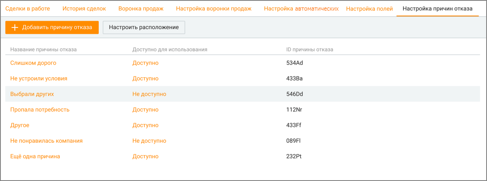
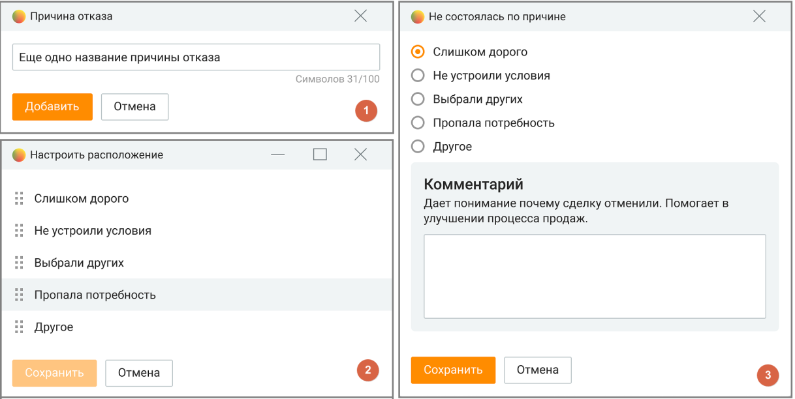

# 5.7. Настройка причин отказа

> Трассировка: PDF §5.7 · сквозные стр. 200-203 · источники: ч.1 `kb/sources/mango-cc-manual/CC_manual_1.26.42-1-295.pdf` с.200-203.

Вкладка доступна пользователю при наличии права "Настраивать причины отказа в сделках", установленного для роли пользователя в ЛК ВАТС. Для отображения вкладки отметьте ее в Настройки/Видимость разделов. Создаваемые причины отказа доступны как для новых, так и для существующих сделок.

> **Иллюстрация CC-29-1** · стр. 201 · раздел «5.7. Настройка причин отказа» · снимок экрана интерфейса, 1218×454 px.
> Иллюстрирует текст руководства: «Вкладка доступна пользователю при наличии права "Настраивать причины отказа в сделках", установленного для роли пользователя в ЛК ВАТС. Для отображения вкладки отметьте ее в Настройки/Видимость разделов. Создаваемые причины отказа доступны как для новых, так и для существующих сделок.»
> Следующий за иллюстрацией текст: «На вкладке пользователь может производить следующие действия:»

На вкладке пользователь может производить следующие действия:

1. Добавить причину отказа кликом по кнопке "Добавить причину отказа" (рис.1). Максимальное количество вариантов – 20. Предустановленные элементы списка:  Слишком дорого  Не устроили условия  Выбрали других  Пропала потребность  Другое

2. Настроить порядок причин отказа, кликом по кнопке "Настроить расположение". От настроек (рис.2) зависит в каком порядке причины отказа будут отображаться пользователю (рис.3). Для изменения порядка причин отказа установите курсор на

> **Иллюстрация CC-29-2** · стр. 201 · раздел «5.7. Настройка причин отказа» · значок (элемент интерфейса), встроенный в текст, 19×20 px.
> Поясняющий текст руководства (рядом с элементом): «пиктограмме и, удерживая левую кнопку мыши в нажатом состоянии, переместите причину вверх или вниз по списку.»
> Предшествующий контекст: «2. Настроить порядок причин отказа, кликом по кнопке "Настроить расположение". От настроек (рис.2) зависит в каком порядке причины отказа будут отображаться пользователю (рис.3). Для изменения …»

пиктограмме и, удерживая левую кнопку мыши в нажатом состоянии, переместите причину вверх или вниз по списку.

3. Удалить причину отказа. Для этого следует кликнуть по выбранной причине и в открывшемся окне нажать кнопку "Удалить". Если после удаления последней доступной причины отказа все остальные остаются не доступными, то первая недоступная причина отказа автоматически переводится в доступную.

4. Отредактировать причину отказа. Для этого следует кликнуть по выбранной причине и в открывшемся окне произвести изменения. Далее нажать кнопку "Сохранить".

5. Скрыть или отобразить причину отказа из доступного сотрудникам списка. Для этого следует кликнуть по строке Доступно или Недоступно в столбце "Доступно для использования".

> **Иллюстрация CC-29-3** · стр. 202 · раздел «5.7. Настройка причин отказа» · снимок экрана интерфейса, 1218×612 px.
> Иллюстрирует текст руководства: «5. Скрыть или отобразить причину отказа из доступного сотрудникам списка. Для этого следует кликнуть по строке Доступно или Недоступно в столбце "Доступно для использования".»
> Следующий за иллюстрацией текст: «Статистика по причинам отказа отображается в блоке визуализаций вкладки История сделок. В табличной части вкладки доступен для отображения столбец "Не состоялась по причине". Созданные пользователем …»

Статистика по причинам отказа отображается в блоке визуализаций вкладки История сделок. В табличной части вкладки доступен для отображения столбец "Не состоялась по причине". Созданные пользователем причины отказа доступны для сохранения в файл импорта при импорте сделок.
