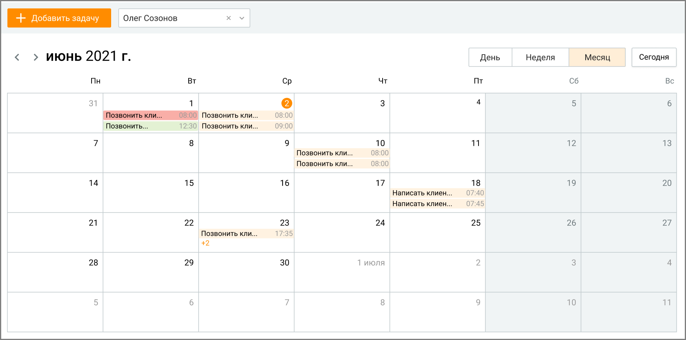
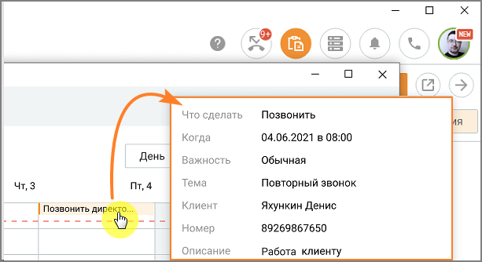

# 6.1. Календарь задач

> Трассировка: PDF §6.1 · сквозные стр. 203-205 · источники: ч.1 `kb/sources/mango-cc-manual/CC_manual_1.26.42-1-295.pdf` с.203-205.

Подраздел Календарь задач открывает окно календаря с кнопкой добавления задачи и выпадающим списком для выбора исполнителя задачи:

> **Иллюстрация CC-31-1** · стр. 204 · раздел «6.1. Календарь задач» · снимок экрана интерфейса, 1716×854 px.
> Иллюстрирует текст руководства: «Подраздел Календарь задач открывает окно календаря с кнопкой добавления задачи и выпадающим списком для выбора исполнителя задачи:»
> Следующий за иллюстрацией текст: «В выпадающем списке доступны все сотрудники из подконтрольных и своих групп пользователя, включая самого пользователя. В календаре отображаются задачи выбранного сотрудника, в которых он назначен …»

В выпадающем списке доступны все сотрудники из подконтрольных и своих групп пользователя, включая самого пользователя. В календаре отображаются задачи выбранного сотрудника, в которых он назначен исполнителем. Пользователь может просматривать календарь в периодах: за день, за неделю, за месяц. При наведении курсора на задачу всплывает окно, содержащее основную информацию о задаче из карточки задачи:  Что сделать  Когда  Важность  Тема  Клиент  Номер  Описание Временной интервал размещения задачи в календаре соответствует временному интервалу, установленному в карточке задачи. Задачи в календаре отображаются в виде цветных блоков:  красный – задача в статусе "Просрочена";  зеленый – в статусе "Завершена";  голубой – в статусе "Подтверждена";  светло-оранжевый – задачи в прочих статусах. Создание задачи

Пользователь с ролью Руководитель может создавать, редактировать и просматривать все задачи сотрудников из своей или подконтрольной группы. Пользователь с ролью Сотрудник может создавать задачи на других сотрудников, состоящих с ним в одной группе, редактировать и просматривать задачи, назначенные им на других сотрудников.

Чтобы создать новую задачу, нажмите на кнопку Добавить задачу, либо кликните левой кнопкой мыши по ячейке календаря. Откроется карточка создания задачи. Заполните карточку в соответствии с инструкцией из раздела Создание задачи.

Просмотр и редактирование задачи

Пользователь с ролью Сотрудник не может просматривать и редактировать задачи других сотрудников, назначенные другим пользователем.

При наведении курсора на блок задачи всплывает окно, содержащее краткую информацию о задаче.

> **Иллюстрация CC-31-2** · стр. 205 · раздел «6.1. Календарь задач» · снимок экрана интерфейса, 613×334 px.
> Иллюстрирует текст руководства: «При наведении курсора на блок задачи всплывает окно, содержащее краткую информацию о задаче.»
> Следующий за иллюстрацией текст: «Для просмотра или редактирования задачи кликните по блоку задачи в календаре, откорректируйте карточку и сохраните внесенные изменения.»

Для просмотра или редактирования задачи кликните по блоку задачи в календаре, откорректируйте карточку и сохраните внесенные изменения.
