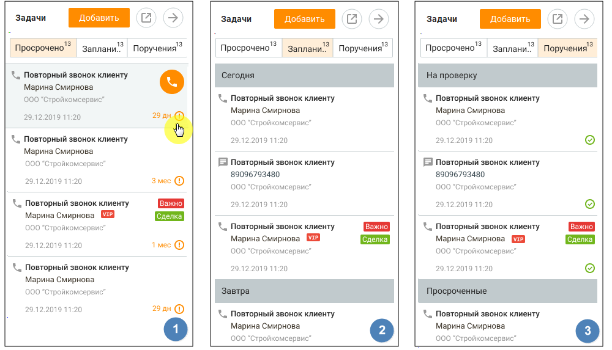

# 6.3. Список задач в верхней панели

> Трассировка: PDF §6.3 · сквозные стр. 206-208 · источники: ч.1 `kb/sources/mango-cc-manual/CC_manual_1.26.42-1-295.pdf` с.206-208.

> **Иллюстрация CC-33-1** · стр. 206 · раздел «6.3. Список задач в верхней панели» · значок (элемент интерфейса), встроенный в текст, 42×42 px.
> Поясняющий текст руководства (рядом с элементом): «Для просмотра списка задач из верхней панели нажмите . В правой части рабочей области отразится список задач, разделенный по трем вкладкам:»
> Предшествующий контекст: «6.3. Список задач в верхней панели»

Для просмотра списка задач из верхней панели нажмите . В правой части рабочей области отразится список задач, разделенный по трем вкладкам:

1. Просрочено – для авторов и исполнителей задач;

2. Запланировано – для авторов и исполнителей задач;

3. Поручения - отображается только для авторов задач. Вкладка "3.Поручения" не отображается, если у пользователя нет права постановки задач на других пользователей. Если на продукте включена услуга "Скрытие номера клиента", номер может быть недоступен для просмотра и редактирования. Узнать больше здесь.

> **Иллюстрация CC-33-2** · стр. 206 · раздел «6.3. Список задач в верхней панели» · снимок экрана интерфейса, 1000×573 px.
> Иллюстрирует текст руководства: «3. Поручения - отображается только для авторов задач. Вкладка "3.Поручения" не отображается, если у пользователя нет права постановки задач на других пользователей. Если на продукте включена услуга "Скрытие номера клиента", номер может быть недоступен для просмотра и редактирования. Узнать больше …»
> Следующий за иллюстрацией текст: «Кнопки для открепления и закрепления блока задач. Окно с открепленным блоком может быть расположено в любом месте рабочего стола, и отображается поверх всех окон.»

> **Иллюстрация CC-33-3** · стр. 207 · раздел «6.3. Список задач в верхней панели» · значок (элемент интерфейса), встроенный в текст, 35×35 px.
> Поясняющий текст руководства (рядом с элементом): «Кнопки для открепления и закрепления блока задач. Окно с открепленным блоком может быть расположено в любом месте рабочего стола, и отображается поверх всех окон.»
> Предшествующий контекст: «3. Поручения - отображается только для авторов задач. Вкладка "3.Поручения" не отображается, если у пользователя нет права постановки задач на других пользователей. Если на продукте включена услуга …»

> **Иллюстрация CC-33-4** · стр. 207 · раздел «6.3. Список задач в верхней панели» · значок (элемент интерфейса), встроенный в текст, 35×35 px.
> Поясняющий текст руководства (рядом с элементом): «Кнопки для открепления и закрепления блока задач. Окно с открепленным блоком может быть расположено в любом месте рабочего стола, и отображается поверх всех окон.»
> Предшествующий контекст: «3. Поручения - отображается только для авторов задач. Вкладка "3.Поручения" не отображается, если у пользователя нет права постановки задач на других пользователей. Если на продукте включена услуга …»

Кнопки для открепления и закрепления блока задач. Окно с открепленным блоком может быть расположено в любом месте рабочего стола, и отображается поверх всех окон.

> **Иллюстрация CC-33-5** · стр. 207 · раздел «6.3. Список задач в верхней панели» · значок (элемент интерфейса), встроенный в текст, 34×34 px.
> Поясняющий текст руководства (рядом с элементом): «Клик по кнопке»
> Предшествующий контекст: «Кнопки для открепления и закрепления блока задач. Окно с открепленным блоком может быть расположено в любом месте рабочего стола, и отображается поверх всех окон.»

Клик по кнопке

приводит к скрытию блока. Если в контактных данных клиента указан мобильный телефон, при наведении курсора на поле задачи доступны быстрые действия:

> **Иллюстрация CC-33-6** · стр. 207 · раздел «6.3. Список задач в верхней панели» · значок (элемент интерфейса), встроенный в текст, 32×32 px.
> Поясняющий текст руководства (рядом с элементом): « для задач типа "написать" клик по пиктограмме открывает окно создания СМС- сообщения;»
> Предшествующий контекст: «приводит к скрытию блока. Если в контактных данных клиента указан мобильный телефон, при наведении курсора на поле задачи доступны быстрые действия:»

 для задач типа "написать" клик по пиктограмме открывает окно создания СМС- сообщения;

> **Иллюстрация CC-33-7** · стр. 207 · раздел «6.3. Список задач в верхней панели» · значок (элемент интерфейса), встроенный в текст, 33×32 px.
> Поясняющий текст руководства (рядом с элементом): « для задач типа "позвонить" клик по пиктограмме инициирует исходящий вызов. Пользователь может позвонить на указанный в задаче номер:  из карточки клиента;  из карточки сотрудника;  из карточки сделки;  из уведомлений;  из списка задач в панели задач;  из списка задач выбранной сделки;  из …»
> Предшествующий контекст: « для задач типа "написать" клик по пиктограмме открывает окно создания СМС- сообщения;»

 для задач типа "позвонить" клик по пиктограмме инициирует исходящий вызов. Пользователь может позвонить на указанный в задаче номер:  из карточки клиента;  из карточки сотрудника;  из карточки сделки;  из уведомлений;  из списка задач в панели задач;  из списка задач выбранной сделки;  из быстрой карточки в разделе "Мои обращения".

Просроченные задачи В списке Просрочено отображаются просроченные задачи, где исполнитель – текущий пользователь. При наличии просроченных задач иконка модуля задач и вкладка "просроченные" помечаются красным маркером. При входе в Контакт-центр MANGO OFFICE пользователю отображаются уведомление о наличии просроченных задач.

> **Иллюстрация CC-33-8** · стр. 207 · раздел «6.3. Список задач в верхней панели» · фрагмент интерфейса (кнопка, поле, меню), 302×49 px.
> Поясняющий текст руководства (рядом с элементом): «Для каждой задачи из списка указывается следующая информация:  Пиктограмма, обозначающая действие, которое необходимо выполнить в рамках задачи: позвонить, написать, встретиться, сделать;  Дата и время выполнения задачи;  Краткое описание задачи;  ФИО клиента.  Наименование сделки При щелчке …»
> Предшествующий контекст: «Просроченные задачи В списке Просрочено отображаются просроченные задачи, где исполнитель – текущий пользователь. При наличии просроченных задач иконка модуля задач и вкладка "просроченные" …»

Для каждой задачи из списка указывается следующая информация:  Пиктограмма, обозначающая действие, которое необходимо выполнить в рамках задачи: позвонить, написать, встретиться, сделать;  Дата и время выполнения задачи;  Краткое описание задачи;  ФИО клиента.  Наименование сделки При щелчке по задаче выполняется переход к карточке задачи в режиме просмотра.

Запланированные задачи В списке Запланировано отображаются запланированные задачи, где исполнитель – текущий пользователь. Для каждой задачи из списка планируемых указывается та же информация, что и для просроченных задач. При наступлении времени выполнения задачи на экране отображается соответствующее уведомление и раздается звуковой сигнал. При этом инициация целевого действия (позвонить, написать) доступна из уведомления.

> **Иллюстрация CC-33-9** · стр. 208 · раздел «6.3. Список задач в верхней панели» · снимок экрана интерфейса, 302×87 px.
> Иллюстрирует текст руководства: «Запланированные задачи В списке Запланировано отображаются запланированные задачи, где исполнитель – текущий пользователь. Для каждой задачи из списка планируемых указывается та же информация, что и для просроченных задач. При наступлении времени выполнения задачи на экране отображается …»
> Следующий за иллюстрацией текст: «При щелчке по задаче на экране отображается карточка задачи в режиме редактирования.»

При щелчке по задаче на экране отображается карточка задачи в режиме редактирования.

Поручения В списке Поручения отображаются задачи, где текущий пользователь является автором, но не является исполнителем. Список состоит из трех частей:

> **Иллюстрация CC-33-10** · стр. 208 · раздел «6.3. Список задач в верхней панели» · значок (элемент интерфейса), встроенный в текст, 16×16 px.
> Поясняющий текст руководства (рядом с элементом): « На проверку – для задач в статусе Завершена, просроченных или запланированных.»
> Предшествующий контекст: «Поручения В списке Поручения отображаются задачи, где текущий пользователь является автором, но не является исполнителем. Список состоит из трех частей:»

 На проверку – для задач в статусе Завершена, просроченных или запланированных.

> **Иллюстрация CC-33-11** · стр. 208 · раздел «6.3. Список задач в верхней панели» · значок (элемент интерфейса), встроенный в текст, 18×17 px.
> Поясняющий текст руководства (рядом с элементом): « Просроченные – для просроченных незавершенных задач;»
> Предшествующий контекст: « На проверку – для задач в статусе Завершена, просроченных или запланированных.»

 Просроченные – для просроченных незавершенных задач;

> **Иллюстрация CC-33-12** · стр. 208 · раздел «6.3. Список задач в верхней панели» · значок (элемент интерфейса), встроенный в текст, 16×17 px.
> Поясняющий текст руководства (рядом с элементом): « Планируются - для запланированных незавершенных задач.»
> Предшествующий контекст: « Просроченные – для просроченных незавершенных задач;»

 Планируются - для запланированных незавершенных задач.
