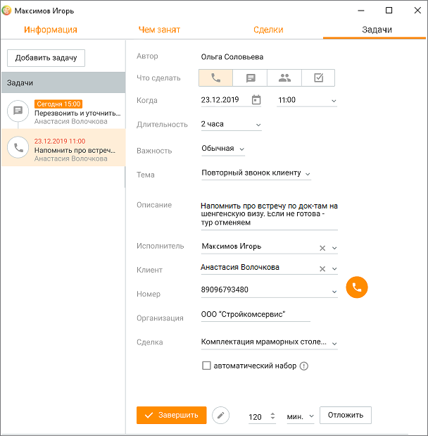

# 6.5. Просмотр задач из других модулей

> Трассировка: PDF §6.5 · сквозные стр. 212-214 · источники: ч.1 `kb/sources/mango-cc-manual/CC_manual_1.26.42-1-295.pdf` с.212-214.

Список задач, запланированных по клиенту, также доступен в карточке клиента на вкладке "Задачи и обращения", а также в карточке "Сделки". Cписок запланированных задач, назначенных на сотрудника, также доступен в карточке сотрудника на вкладке "Задачи".

> **Иллюстрация CC-35-1** · стр. 213 · раздел «6.5. Просмотр задач из других модулей» · снимок экрана интерфейса, 608×619 px.
> Иллюстрирует текст руководства: «Список задач, запланированных по клиенту, также доступен в карточке клиента на вкладке "Задачи и обращения", а также в карточке "Сделки". Cписок запланированных задач, назначенных на сотрудника, также доступен в карточке сотрудника на вкладке "Задачи".»
