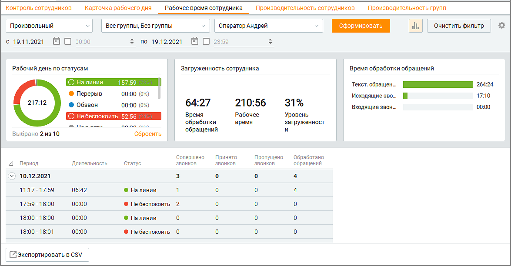
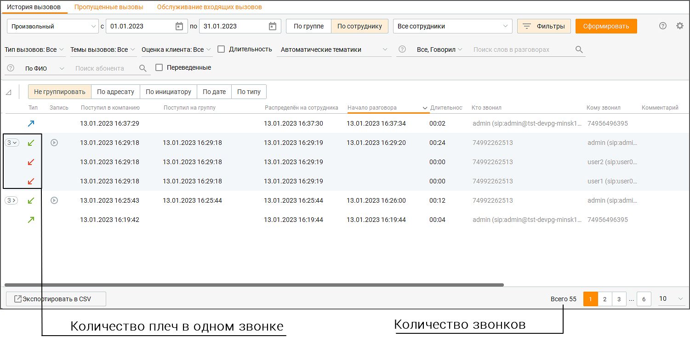

# 7.3. Рабочее время сотрудника

> Трассировка: PDF §7.3 · сквозные стр. 220-223 · источники: ч.1 `kb/sources/mango-cc-manual/CC_manual_1.26.42-1-295.pdf` с.220-223.

На вкладке можно получать аналитические данные о времени работы сотрудников Контакт- центра за выбранный период в разрезе их статусов. Для получения отчета об истории работы сотрудников отберите вызовы по периоду. Для этого выберите нужный период времени из списка Период.

> **Иллюстрация CC-39-1** · стр. 220 · раздел «7.3. Рабочее время сотрудника» · снимок экрана интерфейса, 1175×612 px.
> Иллюстрирует текст руководства: «На вкладке можно получать аналитические данные о времени работы сотрудников Контакт- центра за выбранный период в разрезе их статусов. Для получения отчета об истории работы сотрудников отберите вызовы по периоду. Для этого выберите нужный период времени из списка Период.»
> Следующий за иллюстрацией текст: «При выборе варианта Произвольный становятся доступными поля с и по, где вы можете ввести нужную дату или выбрать ее, нажав на значок календаря. Вы также можете дополнительно указать время суток для …»

При выборе варианта Произвольный становятся доступными поля с и по, где вы можете ввести нужную дату или выбрать ее, нажав на значок календаря. Вы также можете дополнительно указать время суток для полей с и по. Для этого включите соответствующие настройки и укажите время. Затем следует выбрать группу и её сотрудника, по которому необходимо получить аналитические данные. Для этого используйте раскрывающиеся списки Группы и Сотрудники.

При выборе варианта Без группы в списке Сотрудники также будут доступны сотрудники, не входящие ни в одну группу. При выборе определенной группы в списке Сотрудники доступны для выбора только сотрудники этой группы.

После завершения выбора критериев нажмите кнопку Сформировать. После этого создается отчет об истории работы операторов, сформированный в соответствии с критериями выбора, указанными вами выше. Клик по кнопке "Очистить фильтр" удаляет заданные параметры фильтрации.

> **Иллюстрация CC-39-2** · стр. 221 · раздел «7.3. Рабочее время сотрудника» · значок (элемент интерфейса), встроенный в текст, 32×32 px.
> Поясняющий текст руководства (рядом с элементом): «Отчет отображается в виде трех графиков и табличной формы. Клик по пиктограмме открывает блок графиков отчета. Предусмотрены следующие графики:  Рабочий день по статусам — длительность рабочего дня по каждому дню отдельно за выбранный период (включая статус "Не в сети", если пользователь пребывал …»
> Предшествующий контекст: «После завершения выбора критериев нажмите кнопку Сформировать. После этого создается отчет об истории работы операторов, сформированный в соответствии с критериями выбора, указанными вами выше. Клик …»

Отчет отображается в виде трех графиков и табличной формы. Клик по пиктограмме открывает блок графиков отчета. Предусмотрены следующие графики:  Рабочий день по статусам — длительность рабочего дня по каждому дню отдельно за выбранный период (включая статус "Не в сети", если пользователь пребывал в этом статусе во время рабочего дня. Рабочим днем считается время с момента первой авторизации до последней деавторизации пользователя в Контакт-центре. В скобках приводится значение в процентах пребывания сотрудника во всех статусах в течение рабочего дня (в том числе в статусе "Не в сети") с округлением до целых процентов. Щелчок по области графика (легенде либо изображению) приводит к фильтрации списка периодов в таблице соответственно выбранному значению. Отображение показателей определяется условием "ИЛИ", например: На линии "ИЛИ" Перерыв. Повторный щелчок по выделенной области отменяет фильтрацию.  Загруженность сотрудника — данный график приводит значения трех показателей: o Время обработки обращений — время, в течение которого пользователь обрабатывал внешние вызовы и/или текстовые обращения в период с момента первой авторизации до последней деавторизации по каждому дню отдельно за выбранный период; o Рабочее время — длительность рабочего дня за исключением длительности периодов пребывания сотрудника в статусе "Не в сети" и в статусе "Перерыв" с момента первой авторизации до последней деавторизации по каждому дню отдельно за выбранный период); o Уровень загруженности — отношение времени обработки обращения к рабочему времени в процентах.  Время обработки обращений — данный график приводит значения трех показателей: o Входящие звонки — суммарная длительность входящих внешних вызовов, обработанных текущим пользователем в течение выбранного рабочего дня; o Исходящие звонки — суммарная длительность исходящих внешних вызовов, обработанных текущим пользователем в течение выбранного рабочего дня; o Текстовые обращения — время обработки обращений без суммы времени обработки входящих вызовов и исходящих вызовов. Клик по области графика (тексту либо изображению) приводит к фильтрации списка в таблице соответственно выбранному значению. Повторный клик по этой области приводит к отмене фильтрации. Клик по кнопке Сбросить очищает фильтр графика. В табличной части отчета отображаются периоды, в которых статус пользователя не менялся, с приведением суммарных данных по приему и обработке вызовов и обращений. Для того,

> **Иллюстрация CC-39-3** · стр. 221 · раздел «7.3. Рабочее время сотрудника» · значок (элемент интерфейса), встроенный в текст, 16×16 px.
> Поясняющий текст руководства (рядом с элементом): «чтобы отобразить/скрыть колонку таблицы, щелкните по пиктограмме и выберите нужные колонки. Описание расчета показателей рабочего времени сотрудника: Наименование Описание Источник колонки 1 Дата Отображаются отдельно даты в»
> Предшествующий контекст: «Отчет отображается в виде трех графиков и табличной формы. Клик по пиктограмме открывает блок графиков отчета. Предусмотрены следующие графики:  Рабочий день по статусам — длительность рабочего дня …»

чтобы отобразить/скрыть колонку таблицы, щелкните по пиктограмме и выберите нужные колонки. Описание расчета показателей рабочего времени сотрудника: Наименование Описание Источник колонки 1 Дата Отображаются отдельно даты в

- течение выбранного в фильтре периода 2 Период Отображаются начало и конец

- каждого периода каждого дня отдельно, в течение которых

пользователь непрерывно находился в одном статусе 3 Длительность Длительность периода, в течение

- которого статус пользователя не менялся 4 Статус Длительность периода, в течение Указан в том числе по которого статус пользователя не пользовательским статусам, менялся существовавшим в выбранный период 5 Совершено Количество исходящих вызовов, Отчет "История вызовов", звонков совершенных выбранным разрез по сотруднику: оператором в выбранный день в Исходящие вызовы и выбранный период в выбранном Автоперезвоны . статусе Соответствует количеству плеч* в отчете "История вызовов" 6 Принято звонков Количество принятых внешних Отчет "История вызовов", групповых и персональных разрез по сотруднику: вызовов выбранным оператором в Входящие вызовы. Принятые выбранный день в выбранный вызовы, Автоперезвоны. период в выбранном статусе Соответствует количеству плеч* в отчете "История вызовов" 7 Пропущено Количество пропущенных Отчет "История вызовов", звонков выбранным оператором плеч* во разрез по сотруднику: внешних персональных и Пропущенные вызовы, групповых вызовах в выбранный Входящие вызовы. день в выбранный период в Соответствует выбранном статусе количеству плеч* в отчете "История вызовов" 8 Принято Количество принятых внешних Отчет "История вызовов", персональных персональных вызовов выбранным разрез по сотруднику: звонков оператором в выбранный день в Персональные вызовы, выбранный период в выбранном Входящие вызовы, Принятые статусе вызовы. Соответствует количеству плеч* в отчете "История вызовов" 9 Пропущено Количество пропущенных Отчет "История вызовов", персональных выбранным оператором плеч* во разрез по сотруднику: звонков внешних персональных вызовах в Входящие вызовы. выбранный день в выбранный Пропущенные вызовы. период в выбранном статусе Соответствует количеству плеч* в отчете "История вызовов 10 Обработано Суммарное количество текстовых Отчет "История обращений", обращений обращений (все каналы, кроме разрез по сотруднику: голосового), закрытых текущим Текстовые каналы пользователем за выбранный (Результаты: "Обработано", период в выбранный день в "Переведено") выбранном статусе с одним из

следующих результатов: "Обработано", "Переведено" Примечание: Данные в таблице могут не совпадать с данными в отчете "История вызовов", так как в текущей версии Контакт-центра в отчете "История вызовов" суммируется количество звонков, а при расчете показателей таблицы используется количество плеч* звонка. * Плечо - событие, инициированное в Контакт-центре поступлением звонка.

ПРИМЕР Поступил звонок, который был распределен на группу А из пяти сотрудников. Никто из сотрудников не ответил на звонок. Далее звонок был распределен на группу B из следующих пяти сотрудников. На звонок ответил один из сотрудников группы. Таким образом один звонок содержит 11 плеч: поступление (1 плечо), распределение на группу A (5 плеч), распределение на группу B (5 плеч).

Если необходимо вручную перепроверить данные, приведенные в таблице, перейдите на вкладку История вызовов/История вызовов, отфильтруйте необходимые данные по сотруднику и посчитайте количество плеч вызовов.

> **Иллюстрация CC-39-4** · стр. 223 · раздел «7.3. Рабочее время сотрудника» · снимок экрана интерфейса, 1501×759 px.
> Иллюстрирует текст руководства: «Если необходимо вручную перепроверить данные, приведенные в таблице, перейдите на вкладку История вызовов/История вызовов, отфильтруйте необходимые данные по сотруднику и посчитайте количество плеч вызовов.»
