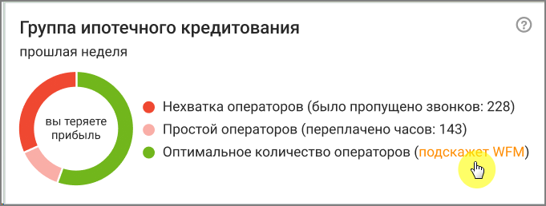
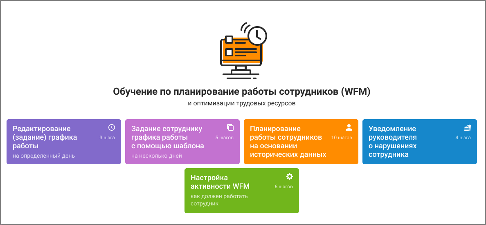
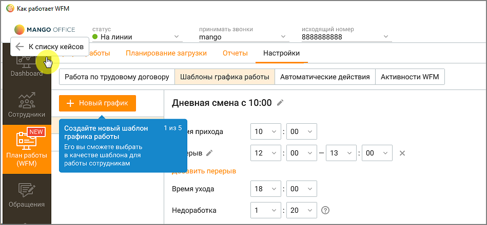

# 8. План работы (WFM)

> Трассировка: PDF §8 · сквозные стр. 245-246 · источники: ч.1 `kb/sources/mango-cc-manual/CC_manual_1.26.42-1-295.pdf` с.245-246.

План работы (WFM) подключается в Личном кабинете пользователя ВАТС, в разделе "Контакт-центр" → "Дополнительные сервисы".

Модуль "WFM" отображается, если он подключен в Личном кабинете ВАТС, и у пользователя Контакт-центра имеются соответствующие права. Настройка прав осуществляется в ЛК ВАТС, в разделе Безопасность и ограничения → Настройка доступа → (Выбрать роль) → Инструменты → WFM.

Модуль План работы (WFM) позволяет вести графики рабочего времени сотрудников, осуществлять контроль за сотрудниками в реальном времени, планировать загрузку сотрудников и распределение их работы в течение рабочего дня, уведомлять сотрудников о нарушении графиков. Отчеты и настройки вкладки:  График работы  Планирование входящих  Отчеты  Обмен сменами  Настройки

Если услуга "Планирование работы (WFM)" не подключена, Администратор и Руководитель компании, а также пользователь c ролью "Супервизор" могут ознакомиться с функционалом, пройдя по информационной ссылке.

> **Иллюстрация CC-43-1** · стр. 245 · раздел «8. План работы (WFM)» · снимок экрана интерфейса, 681×258 px.
> Иллюстрирует текст руководства: «Если услуга "Планирование работы (WFM)" не подключена, Администратор и Руководитель компании, а также пользователь c ролью "Супервизор" могут ознакомиться с функционалом, пройдя по информационной ссылке.»
> Следующий за иллюстрацией текст: «Онбординг позволяет пользователю быстро адаптировать функционал вкладки под свои потребности.»

Онбординг позволяет пользователю быстро адаптировать функционал вкладки под свои потребности.

> **Иллюстрация CC-43-2** · стр. 246 · раздел «8. План работы (WFM)» · снимок экрана интерфейса, 1188×551 px.
> Иллюстрирует текст руководства: «Онбординг позволяет пользователю быстро адаптировать функционал вкладки под свои потребности.»
> Следующий за иллюстрацией текст: «Возврат к разделам Онбординга происходит по нажатию кнопки "К списку кейсов"»

Возврат к разделам Онбординга происходит по нажатию кнопки "К списку кейсов"

> **Иллюстрация CC-43-3** · стр. 246 · раздел «8. План работы (WFM)» · снимок экрана интерфейса, 949×440 px.
> Иллюстрирует текст руководства: «Возврат к разделам Онбординга происходит по нажатию кнопки "К списку кейсов"»
