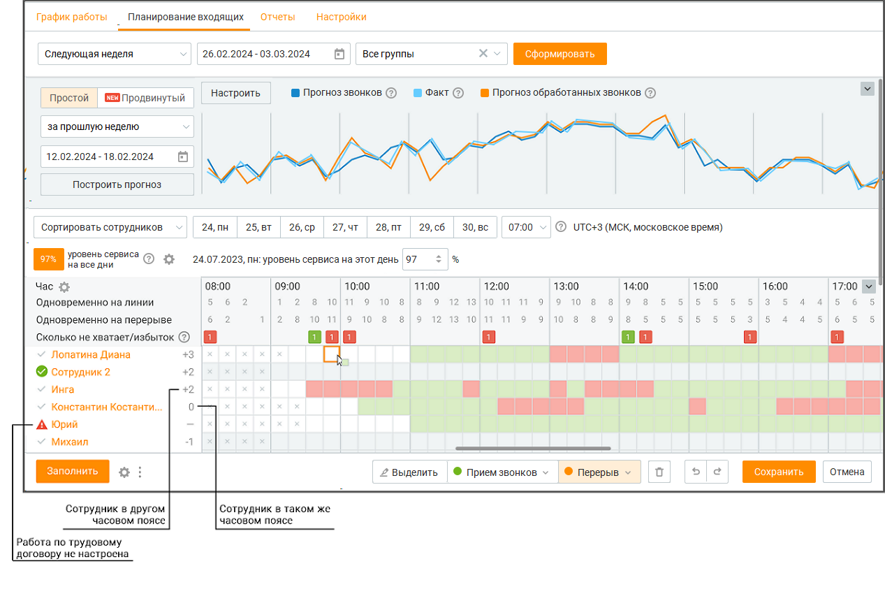
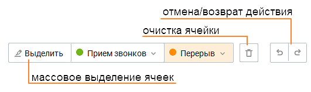
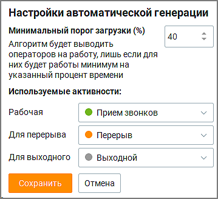
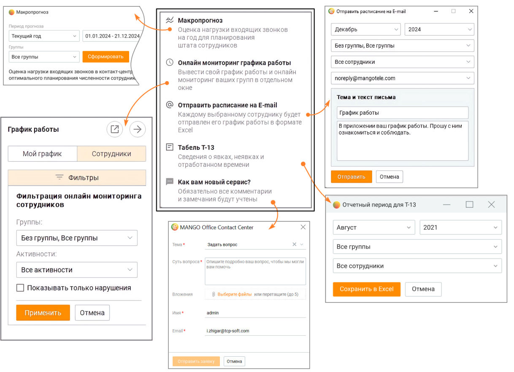
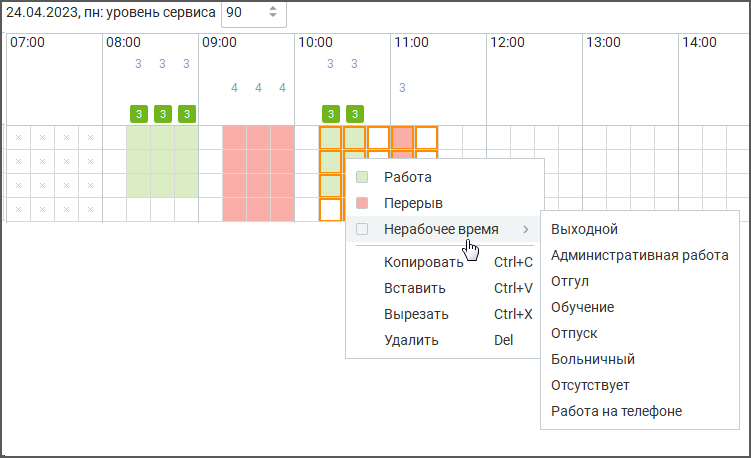
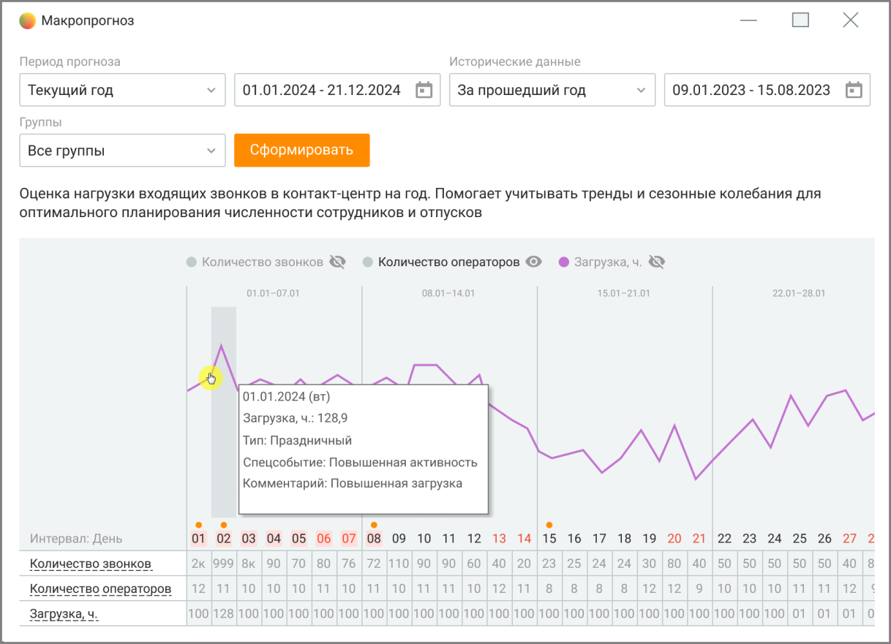

# 8.2. Планирование входящих

> Трассировка: PDF §8.2 · сквозные стр. 251-258 · источники: ч.1 `kb/sources/mango-cc-manual/CC_manual_1.26.42-1-295.pdf` с.251-258.

Раздел отображается только для пользовательских ролей Администратор и Руководитель компании при подключенной в ЛК ВАТС услуге "Планирование работы (WFM)".

При помощи планирования входящих звонков руководитель может внести "поправочные коэффициенты" и с их помощью увидеть плановую загрузку сотрудников за требуемый период:  Руководителю доступна информация для ввода об основных показателей работы подразделения за выбранный период (SLA, ATH и т.д)  Руководитель получает информацию о расчетном количестве сотрудников (плановом) за каждые 15 минут рабочего дня  Руководитель может заполнить согласно плановым данным расписание на следующий период Окно планирования содержит четыре блока: блок фильтров, блок графика прогноза, блок уровня сервиса и таблица настроек количества сотрудников.

> **Иллюстрация CC-45-1** · стр. 251 · раздел «8.2. Планирование входящих» · снимок экрана интерфейса, 1267×850 px.
> Иллюстрирует текст руководства: «При помощи планирования входящих звонков руководитель может внести "поправочные коэффициенты" и с их помощью увидеть плановую загрузку сотрудников за требуемый период:  Руководителю доступна информация для ввода об основных показателей работы подразделения за выбранный период (SLA, ATH и т.д)  …»
> Следующий за иллюстрацией текст: «Блок фильтров Пользователю доступна фильтрация по периоду (следующая неделя, следующий месяц, произвольный) и группе. Блок графика прогноза»

Блок фильтров Пользователю доступна фильтрация по периоду (следующая неделя, следующий месяц, произвольный) и группе. Блок графика прогноза

Чтобы получить прогноз о количестве входящих и обработанных звонков следует выбрать временной период, на основании которого будут строится графики, и нажать кнопку Получить прогноз. Данные рассчитываются по формуле Эрланга. Пользователям доступны два уровня прогнозирования обращений: простой и продвинутый. При подключенной в ЛК ВАТС услуге "WFM Pro" пользователи могут воспользоваться продвинутым уровнем прогнозирования, который учитывает различные факторы, такие как сезонность, тренды, выходные и праздничные дни. Кроме того, этот прогноз способен автоматически сглаживать пиковую нагрузку, обеспечивая эффективное управление обработкой обращений. График прогноза состоит из трех частей:  график запланированной нагрузки (синяя линия) – получен путем расчетов на основании данных предыдущего временного периода  график фактически распределенной нагрузки (оранжевая линия) – максимальное количество обработанных входящих звонков при текущей нагрузке и запланированном количестве сотрудников  график фактической нагрузки (голубая линия) – действительное количество входящих звонков Если на графике оранжевая линия будет ниже синей, это означает, что часть входящих звонков не будет обработана. В этом случае рекомендуется увеличить количество операторов, работающих на линии. Клик по шкале графика откроет всплывающее окно с данными о сотрудниках за выбранный день. Клик по названию графика отключает/включает график. Также данные частично отражаются в блоке ниже.

Кнопка Настроить - дополнительные пользовательские настройки Для корректного построения графика работы пользователь имеет возможность настраивать:  Время поствызывной обработки  Время ожидания на линии  Время разговора

> **Иллюстрация CC-45-2** · стр. 253 · раздел «8.2. Планирование входящих» · снимок экрана интерфейса, 399×308 px.
> Иллюстрирует текст руководства: «Кнопка Настроить - дополнительные пользовательские настройки Для корректного построения графика работы пользователь имеет возможность настраивать:  Время поствызывной обработки  Время ожидания на линии  Время разговора»
> Следующий за иллюстрацией текст: «Пример использования: У компании за полгода значительно сократилось время ожидания на линии и постзвонковая обработка. Компании необходимо использовать эти данные. С помощью пользовательских график …»

Пример использования: У компании за полгода значительно сократилось время ожидания на линии и постзвонковая обработка. Компании необходимо использовать эти данные. С помощью пользовательских график прогноза дня конкретной компании будет более точным.

Блок уровня сервиса  Уровень сервиса – процентный показатель количества звонков, отвеченных сотрудником, по отношению к общему количеству вызовов. В блоке пользователь может установить дневной уровень сервиса. Постоянный уровень сервиса задается пользователем в подвкладке "Настройки". 

> **Иллюстрация CC-45-3** · стр. 253 · раздел «8.2. Планирование входящих» · значок (элемент интерфейса), встроенный в текст, 19×15 px.
> Поясняющий текст руководства (рядом с элементом): «Час – диапазон времени. Клик по пиктограмме открывает окно настройки отображения информации о звонках.  Одновременно на линии – количество сотрудников, работающих в статусе "На линии".  Одновременно на перерыве – количество сотрудников, работающих в статусе "Перерыв".  Сколько не хватает/избыток:»
> Предшествующий контекст: «Блок уровня сервиса  Уровень сервиса – процентный показатель количества звонков, отвеченных сотрудником, по отношению к общему количеству вызовов. В блоке пользователь может установить дневной …»

Час – диапазон времени. Клик по пиктограмме открывает окно настройки отображения информации о звонках.  Одновременно на линии – количество сотрудников, работающих в статусе "На линии".  Одновременно на перерыве – количество сотрудников, работающих в статусе "Перерыв".  Сколько не хватает/избыток:

> **Иллюстрация CC-45-4** · стр. 253 · раздел «8.2. Планирование входящих» · значок (элемент интерфейса), встроенный в текст, 24×24 px.
> Поясняющий текст руководства (рядом с элементом): «– число в строке показывает сколько необходимо сотрудников для заданного уровня сервиса, на основании расчета прогноза количества входящих звонков и среднего времени обработки вызова сотрудником. Увеличьте количество сотрудников на указанное число для сохранения уровня сервиса.»
> Предшествующий контекст: «Час – диапазон времени. Клик по пиктограмме открывает окно настройки отображения информации о звонках.  Одновременно на линии – количество сотрудников, работающих в статусе "На линии".  …»

– число в строке показывает сколько необходимо сотрудников для заданного уровня сервиса, на основании расчета прогноза количества входящих звонков и среднего времени обработки вызова сотрудником. Увеличьте количество сотрудников на указанное число для сохранения уровня сервиса.

> **Иллюстрация CC-45-5** · стр. 253 · раздел «8.2. Планирование входящих» · значок (элемент интерфейса), встроенный в текст, 24×24 px.
> Поясняющий текст руководства (рядом с элементом): «- уменьшите количество сотрудников на указанное число для оптимизации трудовых ресурсов. Увеличить или уменьшить количество работающих сотрудников можно в таблице ниже. Таблица настроек количества сотрудников»
> Предшествующий контекст: «– число в строке показывает сколько необходимо сотрудников для заданного уровня сервиса, на основании расчета прогноза количества входящих звонков и среднего времени обработки вызова сотрудником. …»

- уменьшите количество сотрудников на указанное число для оптимизации трудовых ресурсов. Увеличить или уменьшить количество работающих сотрудников можно в таблице ниже. Таблица настроек количества сотрудников

Таблица содержит список сотрудников и данные о рабочем времени сотрудников на каждые 15 минут дня. Редактировать данные таблицы можно в окне таблицы, выбирая нажатием левой кнопки мыши на панели редактирования соответствующий маркер окраски и вставляя его в таблицу.

> **Иллюстрация CC-45-6** · стр. 254 · раздел «8.2. Планирование входящих» · снимок экрана интерфейса, 531×157 px.
> Иллюстрирует текст руководства: «Таблица содержит список сотрудников и данные о рабочем времени сотрудников на каждые 15 минут дня. Редактировать данные таблицы можно в окне таблицы, выбирая нажатием левой кнопки мыши на панели редактирования соответствующий маркер окраски и вставляя его в таблицу.»
> Следующий за иллюстрацией текст: «Кнопка ЗАПОЛНИТЬ Пользователь (с соответствующими правами доступа) имеет возможность выполнять автоматическую генерацию расписания сотрудников в Контакт-центре. Клик по кнопке Заполнить в левом …»

Кнопка ЗАПОЛНИТЬ Пользователь (с соответствующими правами доступа) имеет возможность выполнять автоматическую генерацию расписания сотрудников в Контакт-центре. Клик по кнопке Заполнить в левом нижнем углу экрана открывает форму быстрого заполнения графика работы сотрудников с учетом количества сотрудников на перерыве одновременно (1-10) и желаемого уровня экономии оплаты труда (минимальный, средний, максимальный).

> **Иллюстрация CC-45-7** · стр. 254 · раздел «8.2. Планирование входящих» · снимок экрана интерфейса, 600×476 px.
> Иллюстрирует текст руководства: «Кнопка ЗАПОЛНИТЬ Пользователь (с соответствующими правами доступа) имеет возможность выполнять автоматическую генерацию расписания сотрудников в Контакт-центре. Клик по кнопке Заполнить в левом нижнем углу экрана открывает форму быстрого заполнения графика работы сотрудников с учетом количества …»
> Следующий за иллюстрацией текст: «Клик по кнопке Сохранить сохраняет внесенные данные и закрывает форму. В предыдущем окне автоматически заполняется таблица настроек количества сотрудников. Дополнительные возможности на вкладке.»

Клик по кнопке Сохранить сохраняет внесенные данные и закрывает форму. В предыдущем окне автоматически заполняется таблица настроек количества сотрудников. Дополнительные возможности на вкладке.

> **Иллюстрация CC-45-8** · стр. 254 · раздел «8.2. Планирование входящих» · значок (элемент интерфейса), встроенный в текст, 19×15 px.
> Поясняющий текст руководства (рядом с элементом): «Кнопка Клик по кнопке»
> Предшествующий контекст: «Клик по кнопке Сохранить сохраняет внесенные данные и закрывает форму. В предыдущем окне автоматически заполняется таблица настроек количества сотрудников. Дополнительные возможности на вкладке.»

Кнопка Клик по кнопке

> **Иллюстрация CC-45-9** · стр. 254 · раздел «8.2. Планирование входящих» · значок (элемент интерфейса), встроенный в текст, 19×15 px.
> Поясняющий текст руководства (рядом с элементом): «в нижней части экрана открывает всплывающее окно с настройками автоматической генерации»
> Предшествующий контекст: «Кнопка Клик по кнопке»

в нижней части экрана открывает всплывающее окно с настройками автоматической генерации

> **Иллюстрация CC-45-10** · стр. 255 · раздел «8.2. Планирование входящих» · снимок экрана интерфейса, 359×327 px.
> Иллюстрирует текст руководства: «в нижней части экрана открывает всплывающее окно с настройками автоматической генерации»
> Следующий за иллюстрацией текст: «Кнопка .»

> **Иллюстрация CC-45-11** · стр. 255 · раздел «8.2. Планирование входящих» · значок (элемент интерфейса), встроенный в текст, 11×22 px.
> Поясняющий текст руководства (рядом с элементом): «Кнопка .»
> Предшествующий контекст: «в нижней части экрана открывает всплывающее окно с настройками автоматической генерации»

Кнопка .

> **Иллюстрация CC-45-12** · стр. 255 · раздел «8.2. Планирование входящих» · значок (элемент интерфейса), встроенный в текст, 11×22 px.
> Поясняющий текст руководства (рядом с элементом): «Клик по кнопке в нижней части экрана открывает всплывающее окно с дополнительными опциями вкладки.»
> Предшествующий контекст: «Кнопка .»

Клик по кнопке в нижней части экрана открывает всплывающее окно с дополнительными опциями вкладки.

> **Иллюстрация CC-45-13** · стр. 255 · раздел «8.2. Планирование входящих» · снимок экрана интерфейса, 1218×881 px.
> Иллюстрирует текст руководства: «Клик по кнопке в нижней части экрана открывает всплывающее окно с дополнительными опциями вкладки.»
> Следующий за иллюстрацией текст: «Макропрогноз – открывает вкладку Макропрогноз для оценки нагрузки входящих вызовов на год, что позволяет планировать нагрузку сотрудников компании на длительный срок.»

Макропрогноз – открывает вкладку Макропрогноз для оценки нагрузки входящих вызовов на год, что позволяет планировать нагрузку сотрудников компании на длительный срок.

Онлайн мониторинг графика работы – выводит в боковом окне график работы пользователя или подконтрольных ему сотрудников и позволяет отслеживать текущее состояние работы. Отправить расписание на E-mail – предоставляет возможность отправки графика работы выбранным сотрудникам в формате Excel на их электронную почту. Настраивается месяц, год, группа сотрудников и текст сообщения. Отчет по форме Т-13: Администратор может сохранить график работы сотрудника за месяц в форме "отчетного периода для Т13". Для этого необходимо выбрать месяц и группу, отметить чекбоксы сотрудников и нажать кнопку "Сохранить в Exel". Как вам новый сервис? Пользователь может оставить в форме свой комментарий по качеству сервиса и предложения по его улучшению.

Для упрощения работы пользователь имеет возможность работать с таблицей в планировании загрузки при помощи следующих комбинации клавиш:

Клавиши Действие

Ctrl+A выбрать всю таблицу

ESC отменить выделение Ctrl+C, Ctrl+Insert копировать выбранную область таблицы Ctrl+X, Shift+Delete вырезать выбранную область таблицы Ctrl+V, Shift+Insert вставить выбранную область таблицы

Ctrl+Z отменить Ctrl+Y вернуть Delete удалить значение в выбранных ячейках

Также пользователь имеет возможность выделять диапазон ячеек при помощи клавишей мыши или кнопки "Выделить," и в дальнейшем управлять выбранным диапазоном.

> **Иллюстрация CC-45-14** · стр. 256 · раздел «8.2. Планирование входящих» · снимок экрана интерфейса, 751×458 px.
> Иллюстрирует текст руководства: «Также пользователь имеет возможность выделять диапазон ячеек при помощи клавишей мыши или кнопки "Выделить," и в дальнейшем управлять выбранным диапазоном.»

### 8.2.1. Макропрогноз

Макропрогноз предназначен для стратегического планирования нагрузки и численности сотрудников компании на год. Этот инструмент помогает оптимально распределить ресурсы, планировать отпуска и тренинги сотрудников, а также учитывать сезонные колебания нагрузки.

> **Иллюстрация CC-45-15** · стр. 257 · раздел «8.2.1. Макропрогноз» · снимок экрана интерфейса, 1218×881 px.
> Иллюстрирует текст руководства: «Макропрогноз предназначен для стратегического планирования нагрузки и численности сотрудников компании на год. Этот инструмент помогает оптимально распределить ресурсы, планировать отпуска и тренинги сотрудников, а также учитывать сезонные колебания нагрузки.»
> Следующий за иллюстрацией текст: «Инструмент содержит:»

Инструмент содержит:

1. Периоды прогноза и исторические данные: o Пользователь может выбрать один из доступных периодов для формирования прогноза:  Текущий год — рассчитывается с текущей даты до конца года.  Следующий год — отображает данные с 1 января следующего года.  Текущий месяц — включает прогноз на оставшуюся часть текущего месяца.  Произвольный период — позволяет пользователю задать любой период времени. o Исторические данные используются для анализа трендов и формирования прогноза. Для исторических данных доступны выборки:  Прошлый год.  Все время.  Произвольный период.

2. Фильтр по группам. Этот фильтр позволяет учитывать особенности нагрузки разных отделов или категорий сотрудников. Пользователь может выбрать, для какой группы сотрудников формируется прогноз: o Все группы — данные рассчитываются по всем доступным группам. o Конкретная группа — прогноз формируется только для выбранной группы сотрудников.

3. Формирование прогноза. На основе выбранных параметров и исторических данных программа формирует прогноз с выводом следующих метрик:

o Количество звонков. o Необходимое количество операторов. o Загрузка операторов (в часах).

4. Отображение прогноза: o Прогноз доступен в виде графика, который показывает:  Динамику звонков по выбранному периоду.  Необходимое количество сотрудников.  Общую загрузку в часах. o Под графиком выводится таблица, содержащая детализированные данные по дням:  Количество звонков.  Количество операторов.  Загрузка в часах.

5. Учет специальных событий. Контакт-центр позволяет учитывать специальные события (например, праздничные дни или пиковые нагрузки), которые добавляются в производственный календарь. Эти события отображаются на графике и влияют на расчет нагрузки. o Перейдите в производственный календарь и добавьте нужные события (например, праздничные дни). o События автоматически отобразятся на графике прогноза.

6. Функционал наложения активностей: o В прогноз можно наложить дополнительные активности (например, отпуска, тренинги), что автоматически корректирует необходимые данные по нагрузке и численности операторов. Прогноз обновится с учетом этих изменений.
