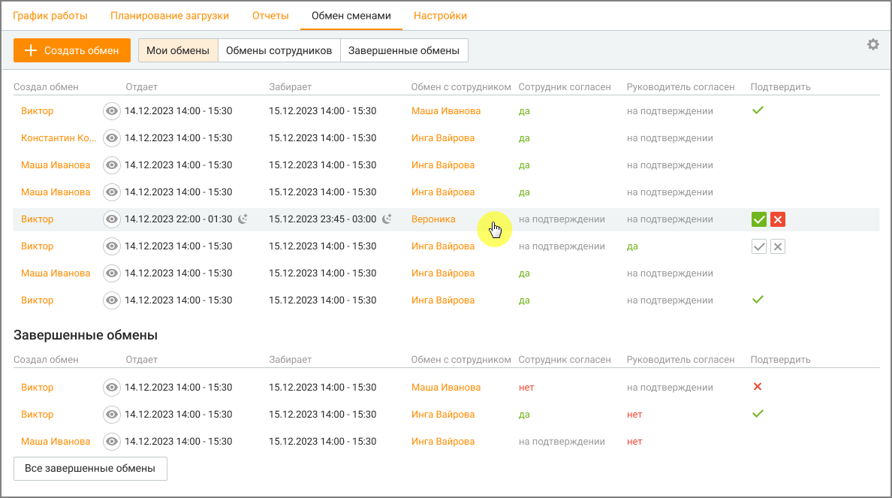
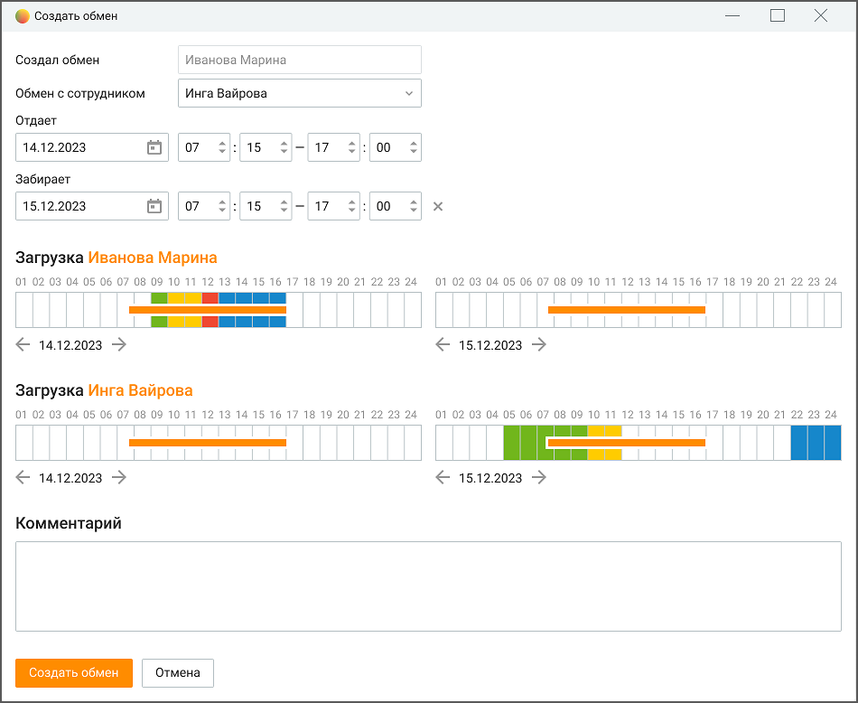
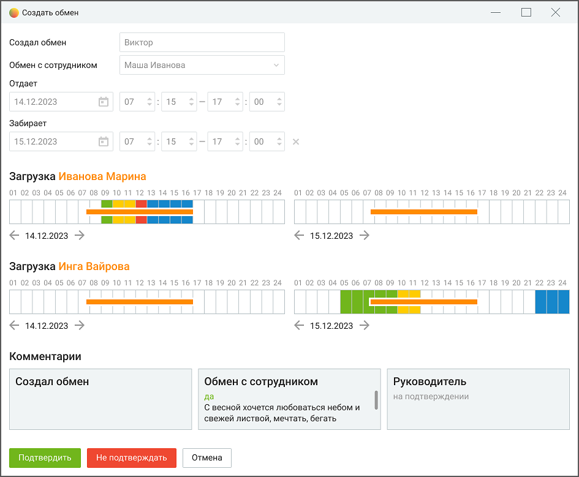

# 8.4. Обмен сменами

> Трассировка: PDF §8.4 · сквозные стр. 262-266 · источники: ч.1 `kb/sources/mango-cc-manual/CC_manual_1.26.42-1-295.pdf` с.262-266.

В случае жизненных обстоятельств для сотрудников важно иметь возможность оперативно меняться сменами между собой. В подразделе Обмен сменами сотрудник может совершить обмен сменами (рабочий/нерабочий день) с другим сотрудником. Подраздел "Обмен сменами" позволяет:  Просматривать доступные для обмена смены, свои и подконтрольных сотрудников.  Создавать запросы на обмен сменами.  Управлять запросами на обмен сменами, своими и подконтрольных сотрудников.  Просматривать историю обменов сменами, своими и подконтрольных сотрудников. Подраздел содержит следующие вкладки:  Мои обмены: отображает текущие и будущие обмены сменами сотрудника.  Обмены сотрудников: отображает обмены сменами подконтрольных сотрудников.  Завершенные обмены: отображает историю завершенных обменов сменами, своих и подконтрольных сотрудников.

> **Иллюстрация CC-47-1** · стр. 263 · раздел «8.4. Обмен сменами» · снимок экрана интерфейса, 1188×663 px.
> Иллюстрирует текст руководства: «В случае жизненных обстоятельств для сотрудников важно иметь возможность оперативно меняться сменами между собой. В подразделе Обмен сменами сотрудник может совершить обмен сменами (рабочий/нерабочий день) с другим сотрудником. Подраздел "Обмен сменами" позволяет:  Просматривать доступные для …»
> Следующий за иллюстрацией текст: «Действия с запросом на обмен обозначены пиктограммами:»

Действия с запросом на обмен обозначены пиктограммами:

> **Иллюстрация CC-47-2** · стр. 263 · раздел «8.4. Обмен сменами» · значок (элемент интерфейса), встроенный в текст, 18×18 px.
> Поясняющий текст руководства (рядом с элементом): «– отклонение запроса на обмен сменами.»
> Предшествующий контекст: «Действия с запросом на обмен обозначены пиктограммами:»

– отклонение запроса на обмен сменами.

> **Иллюстрация CC-47-3** · стр. 263 · раздел «8.4. Обмен сменами» · значок (элемент интерфейса), встроенный в текст, 18×18 px.
> Поясняющий текст руководства (рядом с элементом): «– подтверждение запроса на обмен сменами.»
> Предшествующий контекст: «– отклонение запроса на обмен сменами.»

– подтверждение запроса на обмен сменами.

> **Иллюстрация CC-47-4** · стр. 263 · раздел «8.4. Обмен сменами» · значок (элемент интерфейса), встроенный в текст, 32×32 px.
> Поясняющий текст руководства (рядом с элементом): «- просмотр подробной информации о запросе на обмен (карточки обмена). Доступные функции:  Создание обмена: нажмите кнопку "Создать обмен", чтобы начать процесс обмена сменами.  Опции просмотра: удобные вкладки позволяют сотруднику просматривать свои текущие обмены, обмены между подконтрольными …»
> Предшествующий контекст: «– подтверждение запроса на обмен сменами.»

- просмотр подробной информации о запросе на обмен (карточки обмена). Доступные функции:  Создание обмена: нажмите кнопку "Создать обмен", чтобы начать процесс обмена сменами.  Опции просмотра: удобные вкладки позволяют сотруднику просматривать свои текущие обмены, обмены между подконтрольными сотрудниками, завершенные обмены (свои и подконтрольных сотрудников) с учетом фильтрации по дате, группе или сотрудникам.  Настройка столбцов таблицы: нажатие кнопки "Настройка столбцов" позволяет выбрать и сохранить столбцы, которые необходимо отображать в таблице.

o Создал – имя сотрудника, который создал запрос на обмен. o Отдает – дата и время смены, которую сотрудник хочет отдать. o Забирает – дата и время смены, которую хочет взять сотрудник. o Обмен с сотрудником – имя сотрудника, с которым хочет поменяться сменами. o Сотрудник согласен – статус согласия сотрудника: "Да", "Нет" или "На подтверждении". o Руководитель согласен – статус согласия руководителя: "Да", "Нет" или "На подтверждении". o Подтвердить – пиктограмма подтверждения обмена (доступна только для создателя запроса). o Обмен состоялся – статус завершения обмена.

Создание обмена Для создания запроса на обмен, перейдите на вкладку "Мои обмены", затем нажмите кнопку "Создать обмен". Введите необходимую информацию о желаемом обмене и завершите процесс, нажав кнопку "Создать".

> **Иллюстрация CC-47-5** · стр. 264 · раздел «8.4. Обмен сменами» · снимок экрана интерфейса, 950×778 px.
> Иллюстрирует текст руководства: «Создание обмена Для создания запроса на обмен, перейдите на вкладку "Мои обмены", затем нажмите кнопку "Создать обмен". Введите необходимую информацию о желаемом обмене и завершите процесс, нажав кнопку "Создать".»
> Следующий за иллюстрацией текст: «1. Выбор сотрудника  В поле "Обмен с сотрудником" введите имя сотрудника, с которым вы хотите поменяться сменами.  Из списка выберите нужного сотрудника.»

1. Выбор сотрудника  В поле "Обмен с сотрудником" введите имя сотрудника, с которым вы хотите поменяться сменами.  Из списка выберите нужного сотрудника.

2. Выбор даты и времени  В поле "Отдает" выберите дату смены, которую вы отдаете, а также время начала и конца вашей смены.  В поле "Забирает" выберите дату смены, которую вы хотите взять взамен, а также время начала и конца смены.

3. Добавление комментария (необязательно)  В поле "Комментарий" вы можете добавить комментарий к своему запросу на обмен.

4. Отправка запроса

 Нажмите кнопку "Создать обмен".  Ваш запрос на обмен будет отправлен сотруднику, с которым вы хотите поменяться сменами.  Ваш запрос на обмен будет отправлен руководителю для подтверждения обмена. Дополнительная информация:  При создании запроса вы можете просматривать свои запланированные смены в календаре. Цвет элементов смены соответствует настройкам активностей WFM на обозначенное время.

> **Иллюстрация CC-47-6** · стр. 265 · раздел «8.4. Обмен сменами» · значок (элемент интерфейса), встроенный в текст, 18×18 px.
> Поясняющий текст руководства (рядом с элементом): « Вы можете отменить запрос на обмен в любое время, нажав на пиктограмму отклонения запроса.  Если руководитель и сотрудник, с которым вы хотите поменяться сменами, одобрит ваш запрос, вы получите уведомление в Контакт-центре.  Смены не могут пересекаться, и нельзя попросить другого работника …»
> Предшествующий контекст: « Нажмите кнопку "Создать обмен".  Ваш запрос на обмен будет отправлен сотруднику, с которым вы хотите поменяться сменами.  Ваш запрос на обмен будет отправлен руководителю для подтверждения …»

 Вы можете отменить запрос на обмен в любое время, нажав на пиктограмму отклонения запроса.  Если руководитель и сотрудник, с которым вы хотите поменяться сменами, одобрит ваш запрос, вы получите уведомление в Контакт-центре.  Смены не могут пересекаться, и нельзя попросить другого работника отработать, если у него уже назначена смена на этот день.  Ограничения трудового договора не учитываются при переносе смен: сотрудники сами отвечают за соблюдение этих ограничений.  Обмен возможен только между двумя людьми: это ограничение позволяет эффективно управлять процессом обмена. 

Просмотр, подтверждение, отклонение обмена Чтобы просмотреть запрос на обмен, свой или подконтрольных сотрудников, необходимо

> **Иллюстрация CC-47-7** · стр. 265 · раздел «8.4. Обмен сменами» · значок (элемент интерфейса), встроенный в текст, 32×32 px.
> Поясняющий текст руководства (рядом с элементом): «нажать на пиктограмму у соответствующего запроса из списка. В открывшейся карточке запроса доступна подробная информация о запросе: кто создал запрос, с кем происходит обмен, даты и время смен, а также любые дополнительные комментарии. Также здесь отображается текущий статус запроса.»
> Предшествующий контекст: «Просмотр, подтверждение, отклонение обмена Чтобы просмотреть запрос на обмен, свой или подконтрольных сотрудников, необходимо»

нажать на пиктограмму у соответствующего запроса из списка. В открывшейся карточке запроса доступна подробная информация о запросе: кто создал запрос, с кем происходит обмен, даты и время смен, а также любые дополнительные комментарии. Также здесь отображается текущий статус запроса.

> **Иллюстрация CC-47-8** · стр. 265 · раздел «8.4. Обмен сменами» · снимок экрана интерфейса, 945×779 px.
> Иллюстрирует текст руководства: «нажать на пиктограмму у соответствующего запроса из списка. В открывшейся карточке запроса доступна подробная информация о запросе: кто создал запрос, с кем происходит обмен, даты и время смен, а также любые дополнительные комментарии. Также здесь отображается текущий статус запроса.»
> Следующий за иллюстрацией текст: «Чтобы обмен считался завершенным, участвующий в обмене сотрудник и руководитель должны подтвердить обмен. Нажмите кнопку "Подтвердить", чтобы подтвердить запрос на обмен, или кнопку "Не …»

Чтобы обмен считался завершенным, участвующий в обмене сотрудник и руководитель должны подтвердить обмен. Нажмите кнопку "Подтвердить", чтобы подтвердить запрос на обмен, или кнопку "Не подтверждать", чтобы отклонить его. Также можно добавить комментарий к своему действию.
