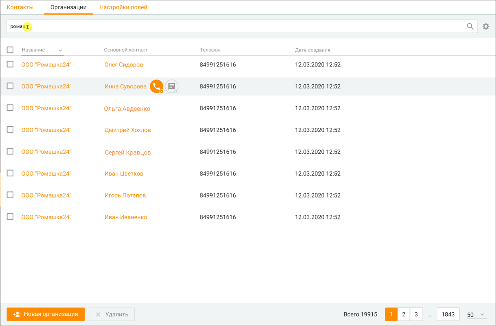
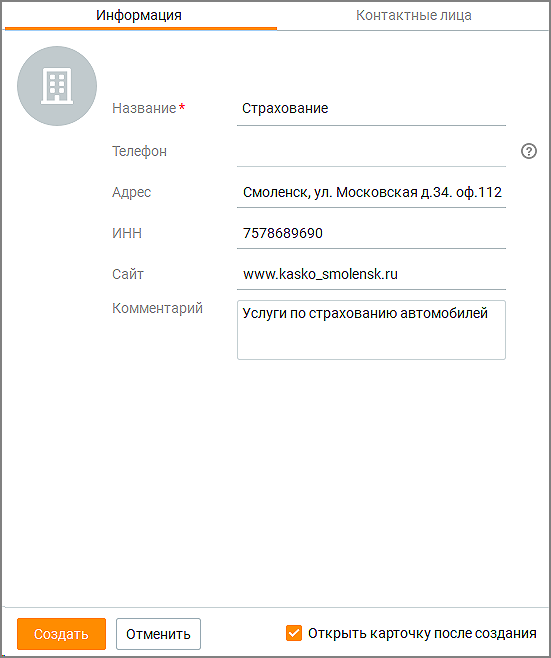
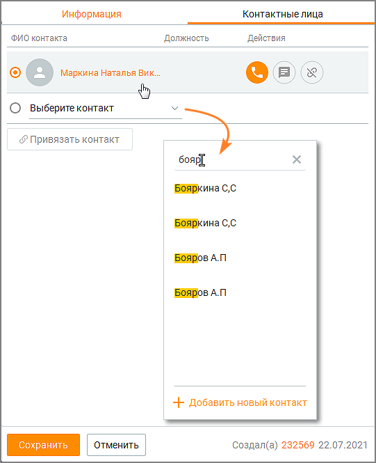

# 10.2. Организации

> Трассировка: PDF §10.2 · сквозные стр. 320-325 · источники: ч.2 `kb/sources/mango-cc-manual/CC_manual_1.26.42-296-590.pdf` с.25-30.

Вкладка для просмотра Организаций доступна, если пользователь обладает правом "Просматривать контакты" или правом "Просматривать персональные контакты".

Пользователь может открыть карточку организации из:  списка организаций на вкладке Клиенты/Организации;  списка клиентов на вкладке Клиенты/Контакты;  карточки клиента;  карточки задачи.

> **Иллюстрация CC-55-1** · стр. 321 · раздел «10.2. Организации» · снимок экрана интерфейса, 1222×804 px.
> Иллюстрирует текст руководства: «Пользователь может открыть карточку организации из:  списка организаций на вкладке Клиенты/Организации;  списка клиентов на вкладке Клиенты/Контакты;  карточки клиента;  карточки задачи.»
> Следующий за иллюстрацией текст: «Клик по наименованию организации открывает карточку организации. Клик по основному контакту открывает карточку клиента. Чтобы поддерживать в актуальном состоянии список контактных лиц организации, …»

Клик по наименованию организации открывает карточку организации. Клик по основному контакту открывает карточку клиента. Чтобы поддерживать в актуальном состоянии список контактных лиц организации, список обновляется при каждом просмотре карточки контакта, привязанного к текущей организации, удаления связи с контактом или привязки нового контакта. Вкладка содержит: Поле поиска - для поиска по организациям необходимо ввести как-минимум один символ и нажать "ввод". Если оставить поле пустым, поиск выдаст полный список имеющихся организаций. Поиск по организациям осуществляется по следующим полям: Название организации, Адрес, ИНН, Сайт, Комментарий, ID организации, ФИО основного привязанного контакта. Список организаций - В списке по умолчанию отображаются следующие колонки: Название, Телефон, Адрес, ИНН, Сайт, Основной контакт, Дата создания карточки организации, Автор. Вы можете самостоятельно выбрать, какие столбцы будут отображаться на панели. Для этого

> **Иллюстрация CC-55-2** · стр. 321 · раздел «10.2. Организации» · значок (элемент интерфейса), встроенный в текст, 19×15 px.
> Поясняющий текст руководства (рядом с элементом): «щелкните левой кнопкой мыши по пиктограмме и установите/снимите флаги напротив наименований столбцов. Кнопка Новая организация – создание новой организации. Кнопка Удалить – удаление организации.»
> Предшествующий контекст: «Клик по наименованию организации открывает карточку организации. Клик по основному контакту открывает карточку клиента. Чтобы поддерживать в актуальном состоянии список контактных лиц организации, …»

щелкните левой кнопкой мыши по пиктограмме и установите/снимите флаги напротив наименований столбцов. Кнопка Новая организация – создание новой организации. Кнопка Удалить – удаление организации.

На данный раздел распространяется возможность скрытия номера клиента. Узнать больше здесь.

### 10.2.1. Создание, редактирование и удаление организаций

Пользователь может создавать, редактировать организацию или связывать организацию с контактом, если он обладает правом "Создавать и редактировать контакты".

Создание новой организации возможно:  из вкладки Организации кликом по кнопке Новая организация;  из карточки контакта, при заполнении или редактировании поля "Организация". Для создания новой организации кликните по кнопке Новая организация и заполните данные создаваемой организации на вкладке Информация.

> **Иллюстрация CC-55-3** · стр. 323 · раздел «10.2.1. Создание, редактирование и удаление организаций» · снимок экрана интерфейса, 551×658 px.
> Иллюстрирует текст руководства: «Создание новой организации возможно:  из вкладки Организации кликом по кнопке Новая организация;  из карточки контакта, при заполнении или редактировании поля "Организация". Для создания новой организации кликните по кнопке Новая организация и заполните данные создаваемой организации на вкладке …»
> Следующий за иллюстрацией текст: «Название — поле является обязательным для заполнения. При вводе текста в поле предлагается выбор из выпадающего списка организаций, в название которых входит (в любой части названия) введенный текст; …»

Название — поле является обязательным для заполнения. При вводе текста в поле предлагается выбор из выпадающего списка организаций, в название которых входит (в любой части названия) введенный текст; Телефон — поле недоступно для заполнения пользователем. Заполняется данными основного контакта автоматически после привязки контакта на вкладке Контактные лица; Адрес — адрес организации; ИНН — ИНН организации; Сайт — веб-сайт организации; Комментарий — комментарий пользователя; Чекбокс Открыть карточку после создания – если чекбокс проставлен, после клика по кнопке "Создать" карточка организации откроется в режиме просмотра и редактирования. Сохраните внесенные изменения кликом по кнопке Создать. Клик по кнопке Отменить отменяет внесенные изменения.

Привязка контакта на вкладке Контактные лица при создании новой организации невозможна. Следует сначала создать новую организацию, далее открыть карточку организации в режиме редактирования.

> **Иллюстрация CC-55-4** · стр. 324 · раздел «10.2.1. Создание, редактирование и удаление организаций» · снимок экрана интерфейса, 541×665 px.
> Иллюстрирует текст руководства: «Привязка контакта на вкладке Контактные лица при создании новой организации невозможна. Следует сначала создать новую организацию, далее открыть карточку организации в режиме редактирования.»
> Следующий за иллюстрацией текст: «Вкладка Контактные лица содержит:  Кнопку Привязать контакт – при вводе текста в поле предлагается выбор из выпадающего списка контактов , в ФИО которых входит (в любой части ФИО) введенный текст. …»

Вкладка Контактные лица содержит:  Кнопку Привязать контакт – при вводе текста в поле предлагается выбор из выпадающего списка контактов , в ФИО которых входит (в любой части ФИО) введенный текст. Одна организация может быть привязана к множеству контактов. Личные контакты других сотрудников в выпадающем списке не отображаются.

> **Иллюстрация CC-55-5** · стр. 324 · раздел «10.2.1. Создание, редактирование и удаление организаций» · значок (элемент интерфейса), встроенный в текст, 14×14 px.
> Поясняющий текст руководства (рядом с элементом): «Список привязанных контактов – пиктограммой обозначается основной контакт организации. Телефон основного контакта автоматически отображается на вкладке Информация. Клик по ФИО контакта открывает карточку контакта в режиме просмотра и редактирования.»
> Предшествующий контекст: «Вкладка Контактные лица содержит:  Кнопку Привязать контакт – при вводе текста в поле предлагается выбор из выпадающего списка контактов , в ФИО которых входит (в любой части ФИО) введенный текст. …»

Список привязанных контактов – пиктограммой обозначается основной контакт организации. Телефон основного контакта автоматически отображается на вкладке Информация. Клик по ФИО контакта открывает карточку контакта в режиме просмотра и редактирования.

Клик по кнопке "Добавить новый контакт" открывает карточку создания нового контакта. При этом пользователь должен обладать правом "Создавать и редактировать контакты".

> **Иллюстрация CC-55-6** · стр. 325 · раздел «10.2.1. Создание, редактирование и удаление организаций» · значок (элемент интерфейса), встроенный в текст, 33×32 px.
> Поясняющий текст руководства (рядом с элементом): «Действия с привязанным контактом:»
> Предшествующий контекст: «Клик по кнопке "Добавить новый контакт" открывает карточку создания нового контакта. При этом пользователь должен обладать правом "Создавать и редактировать контакты".»

> **Иллюстрация CC-55-7** · стр. 325 · раздел «10.2.1. Создание, редактирование и удаление организаций» · значок (элемент интерфейса), встроенный в текст, 34×34 px.
> Поясняющий текст руководства (рядом с элементом): «Действия с привязанным контактом:»
> Предшествующий контекст: «Клик по кнопке "Добавить новый контакт" открывает карточку создания нового контакта. При этом пользователь должен обладать правом "Создавать и редактировать контакты".»

> **Иллюстрация CC-55-8** · стр. 325 · раздел «10.2.1. Создание, редактирование и удаление организаций» · значок (элемент интерфейса), встроенный в текст, 33×34 px.
> Поясняющий текст руководства (рядом с элементом): «Действия с привязанным контактом:»
> Предшествующий контекст: «Клик по кнопке "Добавить новый контакт" открывает карточку создания нового контакта. При этом пользователь должен обладать правом "Создавать и редактировать контакты".»

Действия с привязанным контактом:

– позвонить,

– написать сообщение,

– отвязать контакт от организации. Установить и удалить связь организации и контакта также можно из карточки контакта.  Автора (если есть) и дату создания организации – размещается в нижнем правом углу карточки организации. Если автор не удален из Контакт-центра, при клике на автора открывается карточка сотрудника, создавшего организацию.  Сохранить – клик по кнопке сохраняет внесенные изменения.  Отменить – клик по кнопке отменяет внесенные изменения.

Пользователь может удалить организацию, если обладает правом "Удалять контакты".

Для удаления организации отметьте в списке на вкладке "Организации" требуемые организации и нажмите кнопку Удалить. После подтверждения согласия на удаление организация безвозвратно удаляется из адресной книги. При этом все открытые карточки организаций закрываются.
