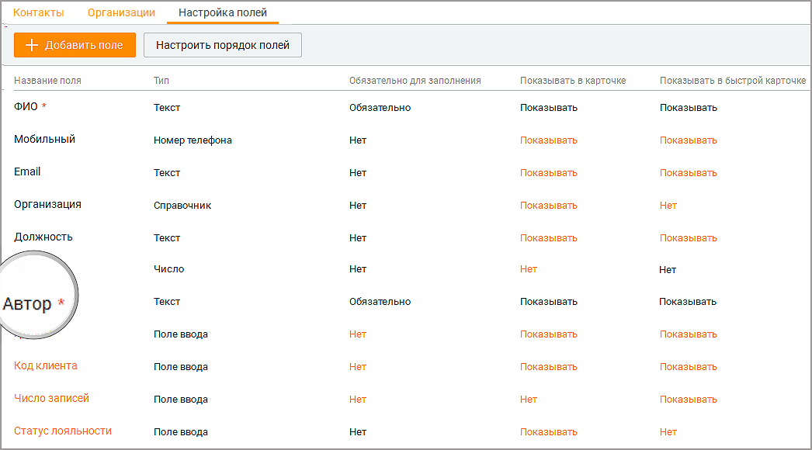
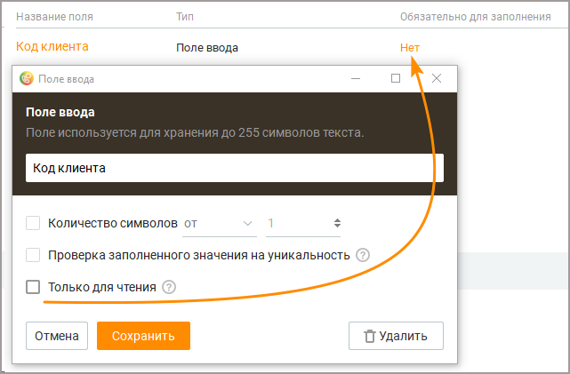

# 10.3. Настройка полей

> Трассировка: PDF §10.3 · сквозные стр. 325-331 · источники: ч.2 `kb/sources/mango-cc-manual/CC_manual_1.26.42-296-590.pdf` с.30-36.

Кнопка Добавить поле предназначена для добавления пользовательских полей в Контакты. Кнопка Настроить порядок полей позволяет настроить порядок, в котором пользовательские поля будут отображаться в карточке клиента и быстрой карточке в разделе "Мои обращения". По умолчанию отображаются только поля, помеченные как "Обязательно для заполнения".

> **Иллюстрация CC-56-1** · стр. 325 · раздел «10.3. Настройка полей» · снимок экрана интерфейса, 1046×580 px.
> Иллюстрирует текст руководства: «Кнопка Добавить поле предназначена для добавления пользовательских полей в Контакты. Кнопка Настроить порядок полей позволяет настроить порядок, в котором пользовательские поля будут отображаться в карточке клиента и быстрой карточке в разделе "Мои обращения". По умолчанию отображаются только поля, …»
> Следующий за иллюстрацией текст: «Поля отмеченные символом *, являются обязательными к заполнению. Если это поле отображается в карточке и быстрой карточке контакта, то оно также отмечено символом * (звездочка). Поля и их настройки, …»

Поля отмеченные символом *, являются обязательными к заполнению. Если это поле отображается в карточке и быстрой карточке контакта, то оно также отмечено символом * (звездочка). Поля и их настройки, выделенные в таблице черным цветом, недоступны для редактирования. Оранжевый цвет означает возможность редактирования значения. Полю, которое является обязательным для заполнения в карточке клиента или быстрой карточке клиента, невозможно установить статус "Не показывать". Настроенные пользователем поля попадают в:  карточку клиента (зависит от настройки Показывать/Нет);  быструю карточку клиента в разделе "Моих обращения" (зависит от настройки Показывать/Нет);  форму импорта/экспорта в адресной книге;  поле поиска по клиентам – становится доступен поиск по содержимому полей. В списке клиентов на вкладке Контакты пользовательские поля не показываются по умолчанию. Для их отображения щелкните левой кнопкой мыши по пиктограмме

> **Иллюстрация CC-56-2** · стр. 326 · раздел «10.3. Настройка полей» · значок (элемент интерфейса), встроенный в текст, 19×15 px.
> Поясняющий текст руководства (рядом с элементом): «и установите/снимите флаги напротив наименований столбцов.»
> Предшествующий контекст: «Поля отмеченные символом *, являются обязательными к заполнению. Если это поле отображается в карточке и быстрой карточке контакта, то оно также отмечено символом * (звездочка). Поля и их настройки, …»

и установите/снимите флаги напротив наименований столбцов.

Добавление поля в Контакты (адресную книгу) Для добавления пользовательского поля следует кликнуть по кнопке Добавить поле. Откроется выпадающий список с вариантами типов поля. Доступны следующие типы пользовательских полей: Поле ввода – от 1 до 255 символов, текст. Если необходимо больше символов, используйте поле «Текстовая область». Выпадающий список – количество значений от 1 до 300. Возможно два варианта списка: с единственным или множественным выбором; Адрес – поиск указанного адреса в Google-картах; Число – используется только для ввода целых чисел; Денежный формат – не более 14 знаков, после запятой не более 2 знаков. То есть 999999999999.99 максимально возможное значение; Дата – ввод данных в формате: ДД.ММ.ГГГГ; Флаг – содержит одно из двух значений: Да/Нет, Истина/Ложь или Вкл/Выкл. Ссылка – хранение ссылок на URL-адреса; Текстовая область – от 1 до 1000 символов; Пользователь – список значений, отображающий всех пользователей ВАТС.

Созданные пользовательские поля применяются для старых и новых сделок всех статусов, во всех воронках. Настройки пользовательских полей После выбора типа поля следует установить его настройки. Выбор типа пользовательского поля доступен только при создании. Изменение типа пользовательского поля в уже созданном поле – не доступно.

Отмеченные * настройки поля не могут быть впоследствии изменены. В зависимости от типов полей доступны следующие настройки: № Тип настройки Описание настройки 1 Название поля Произвольное, уникальное имя. Не может повторять название стандартных полей. Длина не более 30 символов.

Доступна для всех типов полей.

2 Количество символов* Настройка ограничения на количество вводимых символов в содержимом поля.

Доступна для полей:  Поле ввода  Адрес  Число  Ссылка

3 Проверка Проверка содержимого пользовательского поля на уникальность заполненного при создании или изменении. Пустое значение на уникальность значения на не проверяется. уникальность* Доступна для полей:  Поле ввода  Адрес  Число  Денежный  Ссылка

4 Только для чтения Вне зависимости от прав и ролей пользователей, содержимое поля будет не доступно для изменения, в случае включения настройки.

Доступна для полей:  Поле ввода  Адрес  Число  Денежный  Ссылка

5 Указать ограничение Настройка ограничения на ввод суммы чисел. для суммы* Доступна для полей:  Денежный

6 Валюта* Список содержит иконки трех валют для выбора:  Рубль  Евро  Доллар

Доступна для полей:  Денежный

7 Доступно несколько Переключает список с единичным выбором значения, на список вариантов для с множественным выбором. выбора* Доступна для полей:  Выпадающий список

8 Показывать поиск по Включает/отключает поисковое поле, с поиском по значениям значениям выпадающего списка.

Доступна для полей:

 Выпадающий список  Пользователь

9 Действия со Доступны следующие действия: значениями выпадающего списка

 Наименование значения списка – произвольное, уникальное наименование значения выпадающего списка;  Добавление значения списка – настройка, добавляющая плюс еще одно значение выпадающего списка к существующему одному значению, созданному системой автоматически;  Изменение порядка расположения значений. Пользователю доступно изменение порядка созданных значений, повышая приоритет (перемещая выше), либо уменьшая приоритет (перемещая ниже);  Удаление значения списка – настройка, удаляющая значение выпадающего списка без возможности восстановления.

Доступна для полей:  Выпадающий список Дополнительные настройки для пользовательских полей: № Наименование Описание настройки настройки 1 Обязательность При включенном состоянии, включена проверка, которая не заполнения позволяет создавать или изменять сделки, если содержимое поля

– пусто 2 Показывать в карточке Включено или выключено отображение поля на интерфейсе карточки сделки 3 Порядок полей Настройка позволяет менять порядок расположения полей в интерфейсе. Влияет только на порядок расположения поля, не изменяет данные или содержимое пользовательского поля.

Просмотр/редактирование полей адресной книги Для просмотра или редактирования пользовательского поля щелкните по названию поля и, при необходимости, внесите изменения в настройки поля. Для редактирования доступны только значения, выделенные оранжевым цветом.

> **Иллюстрация CC-56-3** · стр. 329 · раздел «10.3. Настройка полей» · снимок экрана интерфейса, 641×421 px.
> Иллюстрирует текст руководства: «Просмотр/редактирование полей адресной книги Для просмотра или редактирования пользовательского поля щелкните по названию поля и, при необходимости, внесите изменения в настройки поля. Для редактирования доступны только значения, выделенные оранжевым цветом.»
> Следующий за иллюстрацией текст: «Если чекбокс "Только для чтения" проставлен, пользовательское поле недоступно для заполнения. В графе "Обязательно для заполнения" значение "Нет" отображается оранжевым цветом.»

Если чекбокс "Только для чтения" проставлен, пользовательское поле недоступно для заполнения. В графе "Обязательно для заполнения" значение "Нет" отображается оранжевым цветом.

Настроить порядок полей Клик по кнопке Настроить порядок полей открывает окно, в котором пользователь может изменить порядок отображения пользовательских полей.

> **Иллюстрация CC-56-4** · стр. 330 · раздел «10.3. Настройка полей» · снимок экрана интерфейса, 628×522 px.
> Иллюстрирует текст руководства: «Настроить порядок полей Клик по кнопке Настроить порядок полей открывает окно, в котором пользователь может изменить порядок отображения пользовательских полей.»
> Следующий за иллюстрацией текст: «Для изменения порядка полей зафиксируйте левую кнопку мыши на пиктограмме и переместите поле вверх или вниз по списку. Сохраните внесенные изменения кнопкой Сохранить.»

> **Иллюстрация CC-56-5** · стр. 330 · раздел «10.3. Настройка полей» · значок (элемент интерфейса), встроенный в текст, 19×20 px.
> Поясняющий текст руководства (рядом с элементом): «Для изменения порядка полей зафиксируйте левую кнопку мыши на пиктограмме и переместите поле вверх или вниз по списку. Сохраните внесенные изменения кнопкой Сохранить.»
> Предшествующий контекст: «Настроить порядок полей Клик по кнопке Настроить порядок полей открывает окно, в котором пользователь может изменить порядок отображения пользовательских полей.»

Для изменения порядка полей зафиксируйте левую кнопку мыши на пиктограмме и переместите поле вверх или вниз по списку. Сохраните внесенные изменения кнопкой Сохранить.

Кнопка Настроить порядок полей недоступна, если на продукте имеется менее двух пользовательских полей.

Удаление пользовательских полей Для удаления поля кликните на наименование поля и в открывшемся окне нажмите кнопку Удалить. Подтвердите согласие на удаление.

При удалении пользовательского поля удаляется поле и все содержимое поля, без возможности восстановления.
