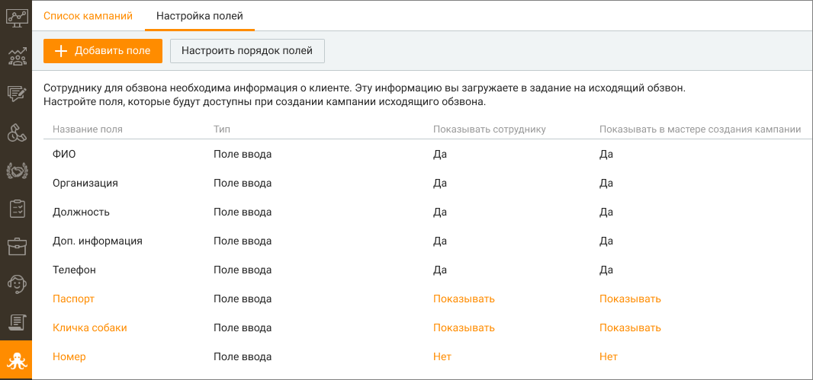
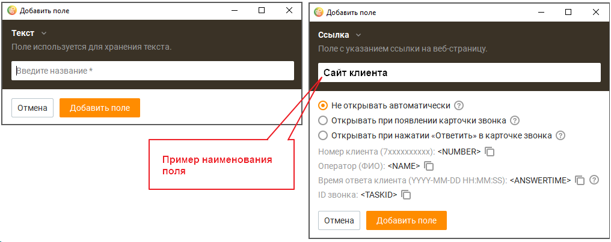
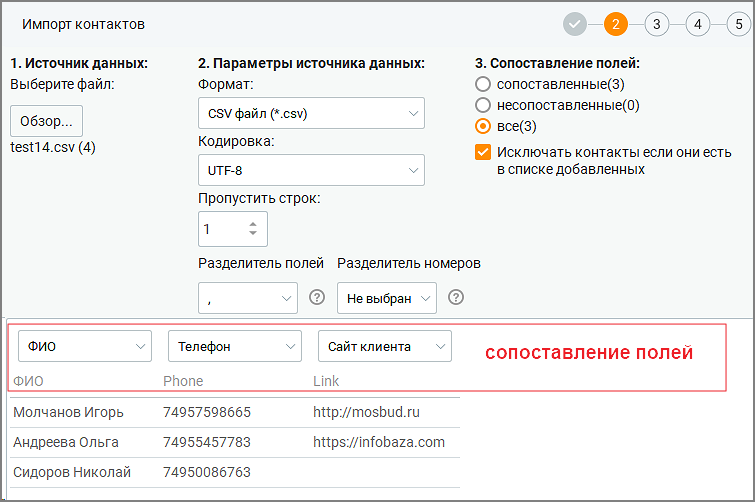
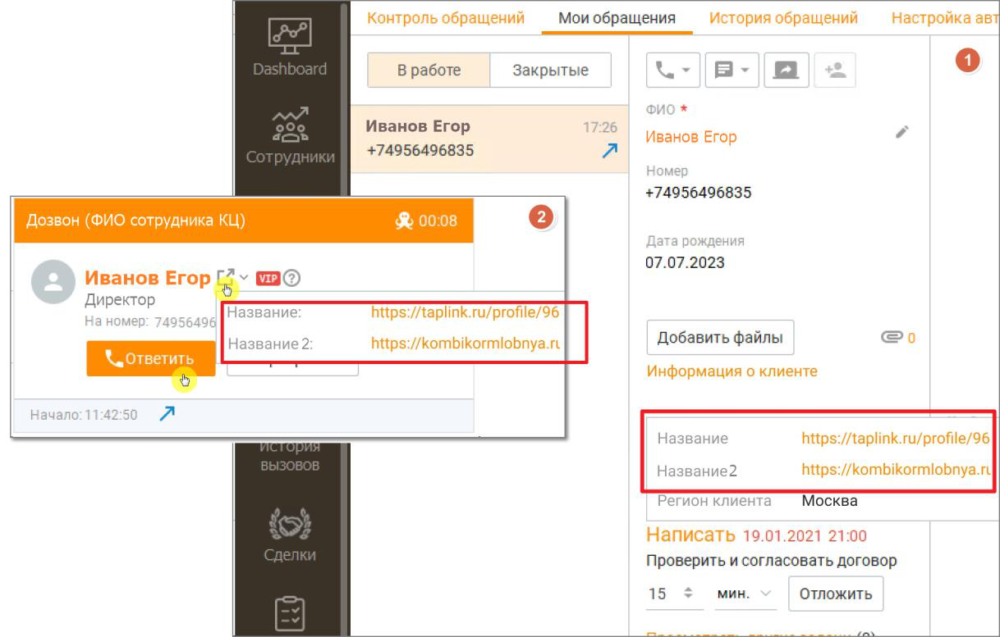

# 11.2. Настройка полей

> Трассировка: PDF §11.2 · сквозные стр. 337-339 · источники: ч.2 `kb/sources/mango-cc-manual/CC_manual_1.26.42-296-590.pdf` с.42-44.

На вкладке настраиваются пользовательские поля, информация которых используется во время исходящего обзвона. Имя пользовательского поля является переменной, которую можно добавить при настройке кампаний Исходящего обзвона.

> **Иллюстрация CC-59-1** · стр. 337 · раздел «11.2. Настройка полей» · снимок экрана интерфейса, 1066×499 px.
> Иллюстрирует текст руководства: «На вкладке настраиваются пользовательские поля, информация которых используется во время исходящего обзвона. Имя пользовательского поля является переменной, которую можно добавить при настройке кампаний Исходящего обзвона.»
> Следующий за иллюстрацией текст: «Максимальное количество пользовательских полей – 30. Для изменения имени поля, кликните на поле и в открывшемся окне внесите необходимые изменения. Кнопка Настроить порядок полей предназначена для …»

Максимальное количество пользовательских полей – 30. Для изменения имени поля, кликните на поле и в открывшемся окне внесите необходимые изменения. Кнопка Настроить порядок полей предназначена для формирования очередности отображения пользовательских полей в списке. В открывшемся окне зафиксируйте курсор на наименовании поля и, удерживая левую кнопку мыши нажатой, переместите поле вверх или вниз. В списке полей настраиваются следующие параметры:  Показывать сотруднику – при значении "Показывать" соответствующее поле и его значение будут отображаться в карточке обращения, поступающего оператору в рамках кампании Исходящего обзвона.  Показывать в мастере создания кампании – при значении "Показывать" соответствующее поле будет отображаться в списке доступных полей в мастере создания кампании Исходящего обзвона. Добавление поля Чтобы добавить новое пользовательское поле, нажмите кнопку Добавить поле. Выберите тип добавляемого поля: Текст или Ссылка.

> **Иллюстрация CC-59-2** · стр. 338 · раздел «11.2. Настройка полей» · снимок экрана интерфейса, 1016×404 px.
> Иллюстрирует текст руководства: «Максимальное количество пользовательских полей – 30. Для изменения имени поля, кликните на поле и в открывшемся окне внесите необходимые изменения. Кнопка Настроить порядок полей предназначена для формирования очередности отображения пользовательских полей в списке. В открывшемся окне зафиксируйте …»
> Следующий за иллюстрацией текст: «Текст – в открывшемся окне введите наименование поля и сохраните внесенные изменения кнопкой Сохранить. Ссылка – заполните наименование поля (например "Сайт клиента"). Далее выберите один из трех …»

Текст – в открывшемся окне введите наименование поля и сохраните внесенные изменения кнопкой Сохранить. Ссылка – заполните наименование поля (например "Сайт клиента"). Далее выберите один из трех вариантов показа данных поля:  Не открывать автоматически – ссылка не будет открыта во внешней системе и по ссылке можно будет перейти из карточки звонка;  Открывать при появлении карточки звонка – ссылка будет открыта в браузере при появлении карточки звонка оператору;  Открывать при нажатии «Ответить» в карточки звонка – ссылка будет открыта в браузере при нажатии оператором в карточке звонка кнопки Ответить.

Ссылка будет автоматически открыта в режиме дозвона "Сначала клиенту потом оператору".

Параметры number, name, answertime, taskid могут быть переданы в составе ссылки во внешнюю систему при выбранном режиме открытия и использованы для персональных целей. Параметры содержат информацию о звонке.  number – номер, на который дозвонилась система  name – имя оператора из карточки сотрудника  answertime – время поднятия трубки абонентом  taskid – идентификатор звонкового задания

Информация в параметре «answertime» доступна только в режимах дозвона «Сначала клиенту, потом оператору», «Предиктивный набор» и «Одновременно сотруднику и клиенту»

Ссылки можно добавлять, импортируя контакты из файла csv при создании кампании ИО. Ссылка не фигурирует в отчетах и будет недоступна после окончания работы со звонковым заданием.

> **Иллюстрация CC-59-3** · стр. 339 · раздел «11.2. Настройка полей» · снимок экрана интерфейса, 755×502 px.
> Иллюстрирует текст руководства: «Ссылки можно добавлять, импортируя контакты из файла csv при создании кампании ИО. Ссылка не фигурирует в отчетах и будет недоступна после окончания работы со звонковым заданием.»
> Следующий за иллюстрацией текст: «На примере ниже показано отображение данных поля Ссылка в карточке обращения (1), а»

На примере ниже показано отображение данных поля Ссылка в карточке обращения (1), а

> **Иллюстрация CC-59-4** · стр. 339 · раздел «11.2. Настройка полей» · значок (элемент интерфейса), встроенный в текст, 18×18 px.
> Поясняющий текст руководства (рядом с элементом): «также в карточке звонка (2) после клика по пиктограмме .»
> Предшествующий контекст: «На примере ниже показано отображение данных поля Ссылка в карточке обращения (1), а»

также в карточке звонка (2) после клика по пиктограмме .

> **Иллюстрация CC-59-5** · стр. 339 · раздел «11.2. Настройка полей» · снимок экрана интерфейса, 1218×777 px.
> Иллюстрирует текст руководства: «также в карточке звонка (2) после клика по пиктограмме .»
