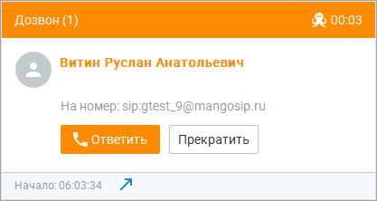
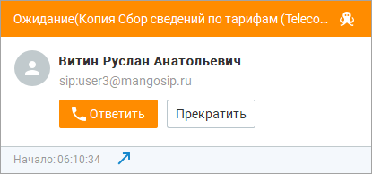
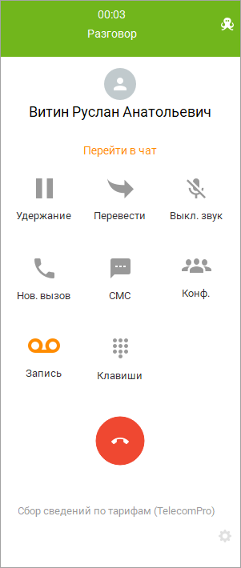

# 11.6. Карточка вызова

> Трассировка: PDF §11.6 · сквозные стр. 374-377 · источники: ч.2 `kb/sources/mango-cc-manual/CC_manual_1.26.42-296-590.pdf` с.79-82.

Вид карточки входящего вызова во время дозвона абоненту зависит от выбранного режима обзвона: При режиме "Одновременно оператору и абоненту":

> **Иллюстрация CC-63-1** · стр. 374 · раздел «11.6. Карточка вызова» · снимок экрана интерфейса, 417×222 px.
> Иллюстрирует текст руководства: «Вид карточки входящего вызова во время дозвона абоненту зависит от выбранного режима обзвона: При режиме "Одновременно оператору и абоненту":»
> Следующий за иллюстрацией текст: «При режиме "Сначала оператору, потом абоненту":»

При режиме "Сначала оператору, потом абоненту":

> **Иллюстрация CC-63-2** · стр. 374 · раздел «11.6. Карточка вызова» · снимок экрана интерфейса, 415×194 px.
> Иллюстрирует текст руководства: «При режиме "Сначала оператору, потом абоненту":»
> Следующий за иллюстрацией текст: «Также внешний вид карточки вызова при дозвоне зависит от источника данных: если контакт был найден во внешнем справочнике. Карточка разговора выглядит следующим образом:»

Также внешний вид карточки вызова при дозвоне зависит от источника данных: если контакт был найден во внешнем справочнике. Карточка разговора выглядит следующим образом:

> **Иллюстрация CC-63-3** · стр. 375 · раздел «11.6. Карточка вызова» · снимок экрана интерфейса, 301×710 px.
> Иллюстрирует текст руководства: «Также внешний вид карточки вызова при дозвоне зависит от источника данных: если контакт был найден во внешнем справочнике. Карточка разговора выглядит следующим образом:»
> Следующий за иллюстрацией текст: «После завершения вызова, в зависимости от установленного значения в поле "Поствызывная обработка" при добавлении кампании, сотруднику может быть предоставлено время для поствызывной обработки вызова. …»

После завершения вызова, в зависимости от установленного значения в поле "Поствызывная обработка" при добавлении кампании, сотруднику может быть предоставлено время для поствызывной обработки вызова. В течение этого времени новые вызовы на оператора не распределяются. Предусмотрена возможность инициировать готовность принятия следующего вызова, не дожидаясь времени поствызывной обработки. Для этого следует нажать кнопку "Не ждать" во всплывающем уведомлении.

> **Иллюстрация CC-63-4** · стр. 376 · раздел «11.6. Карточка вызова» · снимок экрана интерфейса, 302×86 px.
> Иллюстрирует текст руководства: «После завершения вызова, в зависимости от установленного значения в поле "Поствызывная обработка" при добавлении кампании, сотруднику может быть предоставлено время для поствызывной обработки вызова. В течение этого времени новые вызовы на оператора не распределяются. Предусмотрена возможность …»
