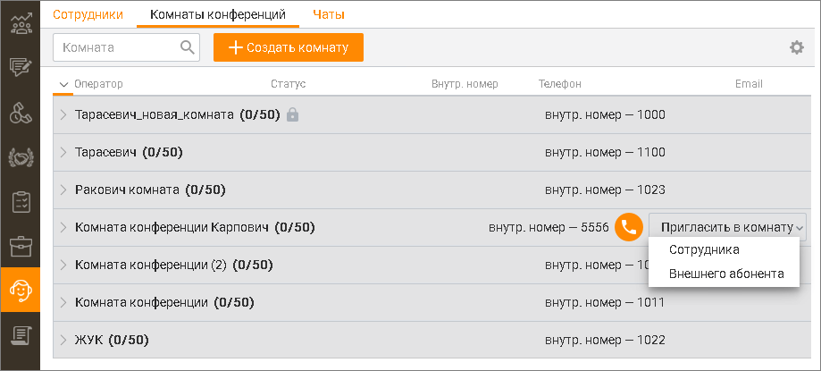

# 13.2. Комнаты конференций

> Трассировка: PDF §13.2 · сквозные стр. 397-398 · источники: ч.2 `kb/sources/mango-cc-manual/CC_manual_1.26.42-296-590.pdf` с.102-103.

Вкладка "Конференции" служит для группировки операторов по виртуальным комнатам конференций. Список и настройки комнат конференций ведется в Личном кабинете.

> **Иллюстрация CC-70-1** · стр. 397 · раздел «13.2. Комнаты конференций» · снимок экрана интерфейса, 919×415 px.
> Иллюстрирует текст руководства: «Вкладка "Конференции" служит для группировки операторов по виртуальным комнатам конференций. Список и настройки комнат конференций ведется в Личном кабинете.»
> Следующий за иллюстрацией текст: «Каждая строка содержит:  Наименование комнаты;  Количество пользователей в комнате / общее количество мест в комнате;  При запросе ПИН-кода для доступа в комнату напротив названия комнаты …»

Каждая строка содержит:  Наименование комнаты;  Количество пользователей в комнате / общее количество мест в комнате;  При запросе ПИН-кода для доступа в комнату напротив названия комнаты отображается

> **Иллюстрация CC-70-2** · стр. 397 · раздел «13.2. Комнаты конференций» · значок (элемент интерфейса), встроенный в текст, 23×28 px.
> Поясняющий текст руководства (рядом с элементом): «пиктограмма ;  Внутренний номер для доступа в комнату.»
> Предшествующий контекст: «Каждая строка содержит:  Наименование комнаты;  Количество пользователей в комнате / общее количество мест в комнате;  При запросе ПИН-кода для доступа в комнату напротив названия комнаты …»

пиктограмма ;  Внутренний номер для доступа в комнату.

Для создания новой комнаты нажмите кнопку Создать комнату. При этом выполняется переход в соответствующий продукт ВАТС на закладку "Комнаты конференций" страницы "Конференц-связь". Предусмотрена возможность приглашения в комнату дополнительных пользователей — как сотрудников (кроме сотрудников-роботов), так и внешних абонентов, при условии, что настройки комнаты позволяют их подключение и в комнатах есть свободные места. Для этого наведите курсор на строку с нужной комнатой, нажмите кнопку Пригласить в комнату и выберите пользователя: оператора или внешнего абонента. При приглашении сотрудника укажите:  Имя сотрудника;  Внутренний номер. При приглашении внешнего абонента укажите:  Номер абонента. При звонке в комнату со внешнего номера в отчете Истории обращений в качестве клиента отображается имя абонента Адресной книги либо его внешний номер (при отсутствии абонента в Адресной книге), в качестве точки входа – комната, куда звонит абонент. Максимальное количество участников конференции указано в Личном кабинете ВАТС в разделе Конференц-связь.
