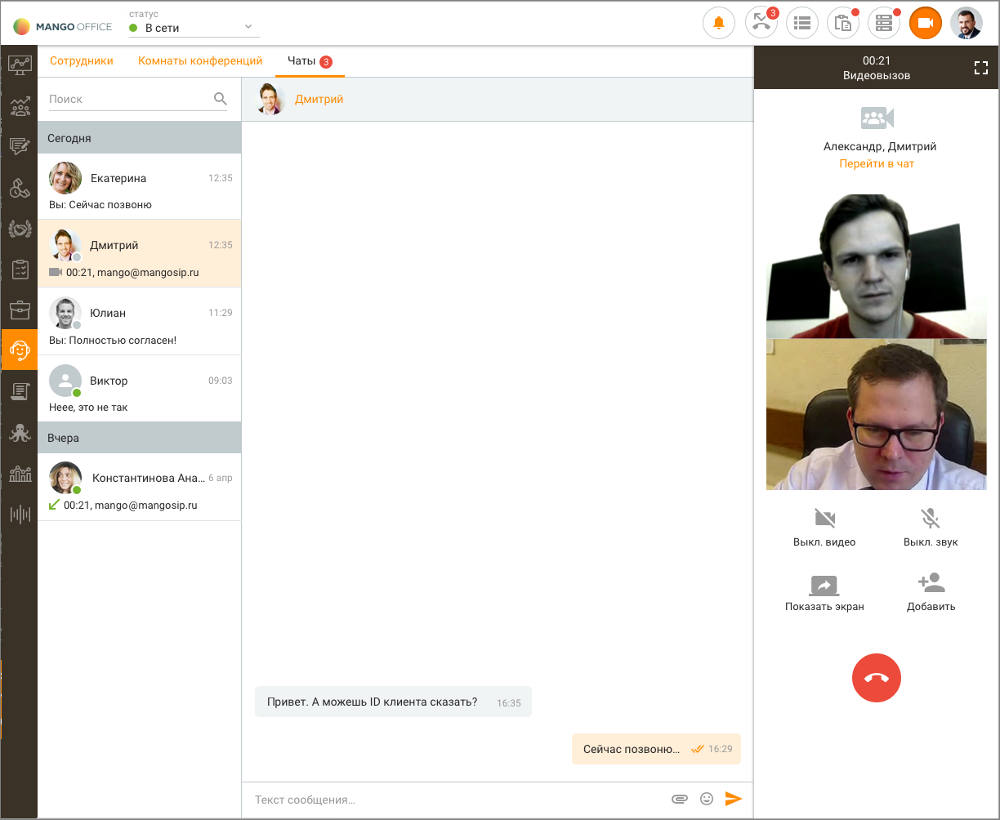
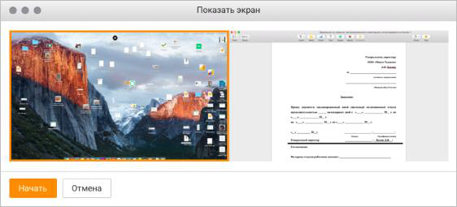
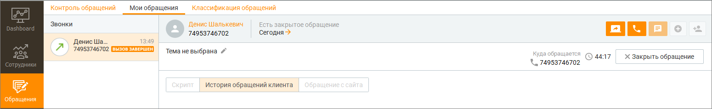
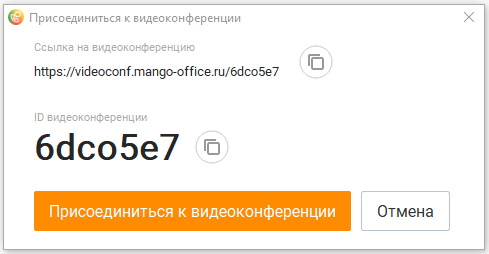

# 13.4. Видеоконференции

> Трассировка: PDF §13.4 · сквозные стр. 402-406 · источники: ч.2 `kb/sources/mango-cc-manual/CC_manual_1.26.42-296-590.pdf` с.107-111.

Видеозвонки позволяют двум и более участникам общаться друг с другом при помощи голоса и видео. В ходе групповой конференции возможен групповой чат и передача файлов (чат и файлы сохранятся и после завершения конференции). Исходящий видео вызов инициируется в любом статусе одним из следующих способов:  из персонального текстового чата с сотрудником;  из группового текстового чата;  из списка сотрудников вкладки "Внутреннее общение";  по ссылке, сгенерированной в окне "Мои обращения".

В случае, когда текущий пользователь уже участвует хотя бы в одном видео вызове, видеоконференции или аудиовызове, то при попытке инициации видео вызова отображается уведомление вида: "Нельзя одновременно участвовать в видео вызове и в другом вызове".

При получении входящего видео вызова на экране отображается виджет вида:

> **Иллюстрация CC-72-1** · стр. 402 · раздел «13.4. Видеоконференции» · снимок экрана интерфейса, 453×210 px.
> Иллюстрирует текст руководства: «При получении входящего видео вызова на экране отображается виджет вида:»
> Следующий за иллюстрацией текст: «Кнопка С видео доступна только при наличии хотя бы одной подключенной камеры. В противном случае кнопка заблокирована, доступна только голосовая связь с абонентом. Если»

Кнопка С видео доступна только при наличии хотя бы одной подключенной камеры. В противном случае кнопка заблокирована, доступна только голосовая связь с абонентом. Если

версия Контакт-центра пользователя не поддерживает видеоконференций, в панели софтфона и в плавающем виджете отображается обычный аудио-вызов. После принятия вызова панель софтфона переходит в состояние "Разговор":

> **Иллюстрация CC-72-2** · стр. 403 · раздел «13.4. Видеоконференции» · снимок экрана интерфейса, 1224×1004 px.
> Иллюстрирует текст руководства: «версия Контакт-центра пользователя не поддерживает видеоконференций, в панели софтфона и в плавающем виджете отображается обычный аудио-вызов. После принятия вызова панель софтфона переходит в состояние "Разговор":»
> Следующий за иллюстрацией текст: «При сворачивании панели софтфона либо окна приложения на экране отображается виджет видео вызова. Двойной щелчок по виджету в состоянии разговора приводит к активации основного окна приложения и …»

При сворачивании панели софтфона либо окна приложения на экране отображается виджет видео вызова. Двойной щелчок по виджету в состоянии разговора приводит к активации основного окна приложения и отображению текущего вызова в панели софтфона (если она была скрыта).

> **Иллюстрация CC-72-3** · стр. 403 · раздел «13.4. Видеоконференции» · снимок экрана интерфейса, 479×83 px.
> Иллюстрирует текст руководства: «При сворачивании панели софтфона либо окна приложения на экране отображается виджет видео вызова. Двойной щелчок по виджету в состоянии разговора приводит к активации основного окна приложения и отображению текущего вызова в панели софтфона (если она была скрыта).»
> Следующий за иллюстрацией текст: «Панель софтфона содержит функции:»

Панель софтфона содержит функции:

> **Иллюстрация CC-72-4** · стр. 403 · раздел «13.4. Видеоконференции» · значок (элемент интерфейса), встроенный в текст, 20×19 px.
> Поясняющий текст руководства (рядом с элементом): «Развернуть разговор в отдельном окне»
> Предшествующий контекст: «Панель софтфона содержит функции:»

Развернуть разговор в отдельном окне

> **Иллюстрация CC-72-5** · стр. 403 · раздел «13.4. Видеоконференции» · значок (элемент интерфейса), встроенный в текст, 25×25 px.
> Поясняющий текст руководства (рядом с элементом): «Выключить видео»
> Предшествующий контекст: «Развернуть разговор в отдельном окне»

Выключить видео

> **Иллюстрация CC-72-6** · стр. 403 · раздел «13.4. Видеоконференции» · значок (элемент интерфейса), встроенный в текст, 24×25 px.
> Поясняющий текст руководства (рядом с элементом): «Выключить микрофон»
> Предшествующий контекст: «Выключить видео»

Выключить микрофон

> **Иллюстрация CC-72-7** · стр. 403 · раздел «13.4. Видеоконференции» · значок (элемент интерфейса), встроенный в текст, 38×25 px.
> Поясняющий текст руководства (рядом с элементом): «Показать экран»
> Предшествующий контекст: «Выключить микрофон»

Показать экран

> **Иллюстрация CC-72-8** · стр. 403 · раздел «13.4. Видеоконференции» · значок (элемент интерфейса), встроенный в текст, 33×24 px.
> Поясняющий текст руководства (рядом с элементом): «Добавить в конференцию пользователя»
> Предшествующий контекст: «Показать экран»

Добавить в конференцию пользователя

> **Иллюстрация CC-72-9** · стр. 404 · раздел «13.4. Видеоконференции» · значок (элемент интерфейса), встроенный в текст, 20×19 px.
> Поясняющий текст руководства (рядом с элементом): «Развернуть разговор в отдельном окне»
> Предшествующий контекст: «Добавить в конференцию пользователя»

Развернуть разговор в отдельном окне

> **Иллюстрация CC-72-10** · стр. 404 · раздел «13.4. Видеоконференции» · значок (элемент интерфейса), встроенный в текст, 60×60 px.
> Поясняющий текст руководства (рядом с элементом): «Завершить разговор»
> Предшествующий контекст: «Развернуть разговор в отдельном окне»

Завершить разговор

> **Иллюстрация CC-72-11** · стр. 404 · раздел «13.4. Видеоконференции» · значок (элемент интерфейса), встроенный в текст, 38×25 px.
> Поясняющий текст руководства (рядом с элементом): «Для демонстрации своего экрана нажмите кнопку . При этом на экране отобразится окно выбора экрана демонстрации вида:»
> Предшествующий контекст: «Завершить разговор»

Для демонстрации своего экрана нажмите кнопку . При этом на экране отобразится окно выбора экрана демонстрации вида:

> **Иллюстрация CC-72-12** · стр. 404 · раздел «13.4. Видеоконференции» · снимок экрана интерфейса, 562×255 px.
> Иллюстрирует текст руководства: «Для демонстрации своего экрана нажмите кнопку . При этом на экране отобразится окно выбора экрана демонстрации вида:»
> Следующий за иллюстрацией текст: «При наличии нескольких экранов выберите нужный экран для демонстрации собеседнику и нажмите кнопку Начать. В результате окно выбора экрана скрывается, при этом собеседнику демонстрируется выбранный …»

При наличии нескольких экранов выберите нужный экран для демонстрации собеседнику и нажмите кнопку Начать. В результате окно выбора экрана скрывается, при этом собеседнику демонстрируется выбранный экран вместо видео с камеры.

> **Иллюстрация CC-72-13** · стр. 404 · раздел «13.4. Видеоконференции» · значок (элемент интерфейса), встроенный в текст, 38×25 px.
> Поясняющий текст руководства (рядом с элементом): «Для того, чтобы остановить демонстрацию экрана, следует еще раз нажать кнопку . При этом демонстрация экрана останавливается и возобновляется публикация видео с камеры (в зависимости от состояния кнопки Выкл. видео).»
> Предшествующий контекст: «При наличии нескольких экранов выберите нужный экран для демонстрации собеседнику и нажмите кнопку Начать. В результате окно выбора экрана скрывается, при этом собеседнику демонстрируется выбранный …»

Для того, чтобы остановить демонстрацию экрана, следует еще раз нажать кнопку . При этом демонстрация экрана останавливается и возобновляется публикация видео с камеры (в зависимости от состояния кнопки Выкл. видео).

Сотрудник может пригласить абонента к участию в видеоконференции, сгенерировав ссылку-приглашение в окне обращения.

> **Иллюстрация CC-72-14** · стр. 404 · раздел «13.4. Видеоконференции» · снимок экрана интерфейса, 1550×239 px.
> Иллюстрирует текст руководства: «Сотрудник может пригласить абонента к участию в видеоконференции, сгенерировав ссылку-приглашение в окне обращения.»
> Следующий за иллюстрацией текст: «При этом немедленного начала видеоконференции не происходит. Видеоконференция начинается только после нажатия Клиентом или Гостем кнопки Присоединиться к видеоконференции во всплывающем окне …»

При этом немедленного начала видеоконференции не происходит. Видеоконференция начинается только после нажатия Клиентом или Гостем кнопки Присоединиться к видеоконференции во всплывающем окне уведомления. Там же можно скопировать ссылку

> **Иллюстрация CC-72-15** · стр. 404 · раздел «13.4. Видеоконференции» · значок (элемент интерфейса), встроенный в текст, 41×54 px.
> Поясняющий текст руководства (рядом с элементом): «или ID видеоконференции в буфер обмена, кликнув по кнопке .»
> Предшествующий контекст: «При этом немедленного начала видеоконференции не происходит. Видеоконференция начинается только после нажатия Клиентом или Гостем кнопки Присоединиться к видеоконференции во всплывающем окне …»

или ID видеоконференции в буфер обмена, кликнув по кнопке .

> **Иллюстрация CC-72-16** · стр. 405 · раздел «13.4. Видеоконференции» · снимок экрана интерфейса, 489×254 px.
> Иллюстрирует текст руководства: «или ID видеоконференции в буфер обмена, кликнув по кнопке .»
> Следующий за иллюстрацией текст: «Клик по кнопке Отмена приводит к скрытию окна Присоединиться к видеоконференции. Пользователь Контакт-центра может участвовать в видео-конференциях с пользователями приложения M. TALKER. При …»

Клик по кнопке Отмена приводит к скрытию окна Присоединиться к видеоконференции. Пользователь Контакт-центра может участвовать в видео-конференциях с пользователями приложения M. TALKER. При отключении организатора аудиоконференция завершается автоматически для всех участников. Для продолжения общения требуется создание новой конференции.
