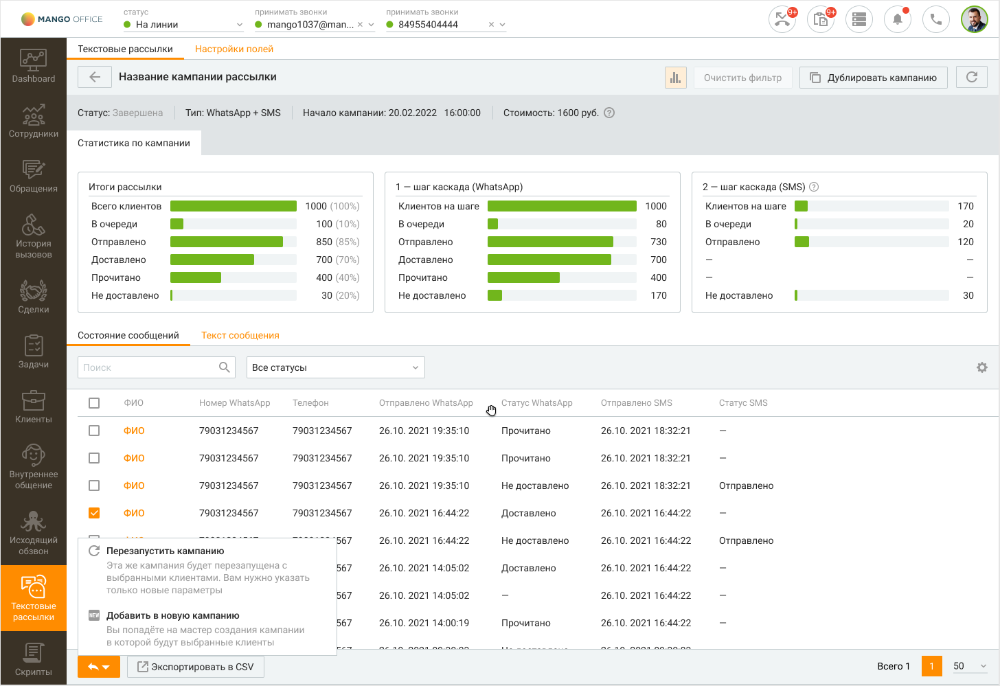
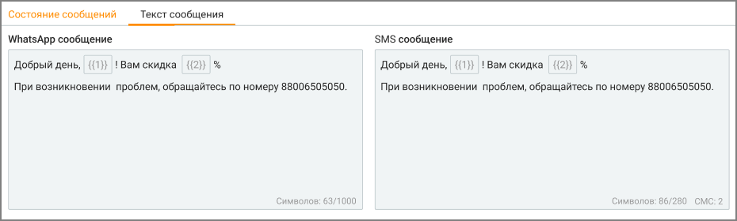

# 14.2. Карточка кампании

> Трассировка: PDF §14.2 · сквозные стр. 415-418 · источники: ч.2 `kb/sources/mango-cc-manual/CC_manual_1.26.42-296-590.pdf` с.120-123.

Карточка кампании открывается по клику на наименование кампании в списке кампаний текстовых рассылок. Карточка кампании состоит из двух блоков:

> **Иллюстрация CC-75-1** · стр. 415 · раздел «14.2. Карточка кампании» · значок (элемент интерфейса), встроенный в текст, 32×32 px.
> Поясняющий текст руководства (рядом с элементом): « инфографика (открывается кликом по пиктограмме );  данные текущей кампании, разделенные на вкладки.»
> Предшествующий контекст: «Карточка кампании открывается по клику на наименование кампании в списке кампаний текстовых рассылок. Карточка кампании состоит из двух блоков:»

 инфографика (открывается кликом по пиктограмме );  данные текущей кампании, разделенные на вкладки.

> **Иллюстрация CC-75-2** · стр. 415 · раздел «14.2. Карточка кампании» · снимок экрана интерфейса, 1456×999 px.
> Иллюстрирует текст руководства: « инфографика (открывается кликом по пиктограмме );  данные текущей кампании, разделенные на вкладки.»
> Следующий за иллюстрацией текст: «Клик по кнопке F5 или пиктограмме обновляет данные в отчетах. Клик по кнопке Очистить фильтр удаляет заданные параметры фильтрации.»

> **Иллюстрация CC-75-3** · стр. 415 · раздел «14.2. Карточка кампании» · значок (элемент интерфейса), встроенный в текст, 58×36 px.
> Поясняющий текст руководства (рядом с элементом): «Клик по кнопке F5 или пиктограмме обновляет данные в отчетах. Клик по кнопке Очистить фильтр удаляет заданные параметры фильтрации.»
> Предшествующий контекст: « инфографика (открывается кликом по пиктограмме );  данные текущей кампании, разделенные на вкладки.»

Клик по кнопке F5 или пиктограмме обновляет данные в отчетах. Клик по кнопке Очистить фильтр удаляет заданные параметры фильтрации.

В заголовке отображаются параметры рассылки: статус, тип, начало (дата, время), стоимость. Описание статусов приведено в разделе Текстовые рассылки.

> **Иллюстрация CC-75-4** · стр. 416 · раздел «14.2. Карточка кампании» · значок (элемент интерфейса), встроенный в текст, 32×21 px.
> Поясняющий текст руководства (рядом с элементом): «Для возвращения к списку кампаний нажмите пиктограмму»
> Предшествующий контекст: «В заголовке отображаются параметры рассылки: статус, тип, начало (дата, время), стоимость. Описание статусов приведено в разделе Текстовые рассылки.»

Для возвращения к списку кампаний нажмите пиктограмму

Инфографика Данные о текстовой рассылке выбранной кампании приведены в виде инфографики, включающей три диаграммы. Обновление информации осуществляется автоматически каждые 10 секунд либо при нажатии кнопки F5. Клик по кнопке Сбросить очищает фильтр графика.

Данные текущей кампании, разделенные на вкладки Блок данных текущей кампании разделен на вкладки "Состояние сообщений" и "Текст сообщений".

Пользователь видит только те вкладки, к которым у него есть доступ. Вкладка "Состояние сообщений" содержит табличную часть со сводной статистикой. Для

> **Иллюстрация CC-75-5** · стр. 416 · раздел «14.2. Карточка кампании» · значок (элемент интерфейса), встроенный в текст, 16×16 px.
> Поясняющий текст руководства (рядом с элементом): «настройки отображения столбцов таблицы нажмите Настройки. Допускается отображение следующих столбцов:  Статус WhatsApp – текущий статус WhatsApp сообщения данному абоненту  Номер WhatsApp – номер мобильного телефона, на который отправляется WhatsApp сообщение данному абоненту  Статус СМС – …»
> Предшествующий контекст: «Пользователь видит только те вкладки, к которым у него есть доступ. Вкладка "Состояние сообщений" содержит табличную часть со сводной статистикой. Для»

настройки отображения столбцов таблицы нажмите Настройки. Допускается отображение следующих столбцов:  Статус WhatsApp – текущий статус WhatsApp сообщения данному абоненту  Номер WhatsApp – номер мобильного телефона, на который отправляется WhatsApp сообщение данному абоненту  Статус СМС – текущий статус СМС сообщения данному абоненту  Телефон – номер мобильного телефона, на который отправляется СМС сообщение данному абоненту  ФИО – ФИО абонента  Отправлено WhatsApp – дата и время отправки WhatsApp сообщения  Доставлено WhatsApp – дата и время доставки WhatsApp сообщения  Прочитано WhatsApp – дата и время прочтения WhatsApp сообщения абонентом  Не доставлено WhatsApp– отметка о не доставленном WhatsApp сообщении  Отправлено СМС – дата и время отправки СМС сообщения  Имя отправителя – имя отправителя сообщения Вкладка "Текст сообщения" содержит текст WhatsApp или СМС сообщения кампании.

> **Иллюстрация CC-75-6** · стр. 416 · раздел «14.2. Карточка кампании» · снимок экрана интерфейса, 930×280 px.
> Иллюстрирует текст руководства: «настройки отображения столбцов таблицы нажмите Настройки. Допускается отображение следующих столбцов:  Статус WhatsApp – текущий статус WhatsApp сообщения данному абоненту  Номер WhatsApp – номер мобильного телефона, на который отправляется WhatsApp сообщение данному абоненту  Статус СМС – …»
> Следующий за иллюстрацией текст: «Просмотр статистики по текстовой рассылке С помощью статистики можно понять, как сработала рассылка по WhatsApp и SMS: сколько сообщений дошло до адресатов, сколько было прочитано, а сколько – нет. …»

Просмотр статистики по текстовой рассылке С помощью статистики можно понять, как сработала рассылка по WhatsApp и SMS: сколько сообщений дошло до адресатов, сколько было прочитано, а сколько – нет. Это помогает принимать решения о повторной отправке и готовить отчёты. Как использовать статистику по максимуму: 1) Работайте с данными:  Фильтрация – можно выбрать, например, только тех, кому не доставлено.

 Поиск – по имени или номеру.  Экспорт – можно скачать таблицу в формате CSV.  Обновление данных – статистику можно обновить вручную по кнопке. 2) Обратите внимание:  Удалить рассылку можно только после завершения.  Статистика не обновляется автоматически – нужно нажимать кнопку.  Статусы доставки отображаются отдельно для WhatsApp и SMS.  Имя клиента – просто для ориентира, перейти в карточку клиента нельзя. 3) Полезные советы:  Если много «не доставлено» – проверьте правильность номеров.  Перед повторной рассылкой лучше отфильтровать тех, кто не получил сообщение. 4) Когда смотреть статистику:  Сразу после завершения кампании – чтобы понять, как сработала.  При планировании повторной рассылки – чтобы не дублировать сообщения тем, кто уже прочитал.  Для подготовки отчётов и анализа эффективности.

### 14.2.1. Анализ отписок и недоставленных сообщений.

Адресат маркетинговых рассылок может отписаться от получения текстовых рассылок с помощью опции "Отписаться", доступной в шаблоне сообщения WhatsApp. Эта функция автоматизирует процесс исключения абонентов из маркетинговых рассылок, что снижает вероятность блокировки аккаунта WhatsApp (WABA) и повышает репутационный рейтинг компании. Контакт-центр предоставляет функционал для анализа данных текстовой рассылки, включая отображение причин отписок и недоставок сообщений. Эта функциональность доступна в Карточке кампании текстовой рассылки. Отображение признаков отписки В таблице со списком абонентов в карточке кампании добавлена колонка "Отписался от рассылки". Эта колонка содержит информацию о:  абонентах, которым сообщение было доставлено, но они отписались от текущей рассылки.  абонентах, которые ранее отписались от рассылки и были автоматически исключены из отправки. Отображение причин недоставки Для статуса "Не доставлено" в таблице имеется колонка "Причины недоставки", которая содержит следующие сведения:  Абоненты, добавленные в список отписки. Возможности фильтрации В карточке кампании доступен дополнительный фильтр "Причины недоставки", который позволяет быстро находить абонентов с определенными статусами доставки сообщений. Совместимость с предыдущими кампаниями Указанные колонки и фильтры отображаются для всех ранее созданных карточек кампаний. Это позволяет анализировать исторические данные без необходимости внесения изменений в старые записи.
