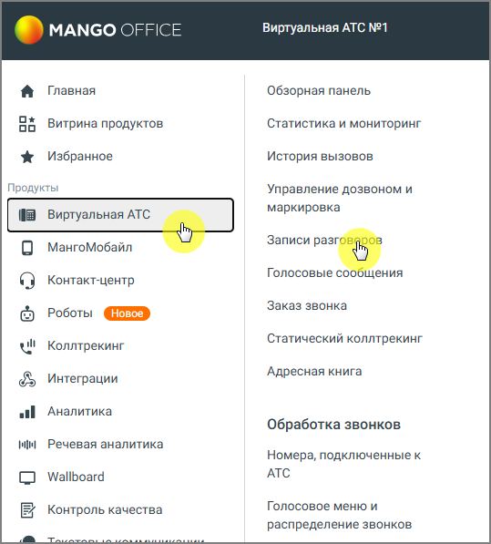

# 16. Речевая аналитика

> Трассировка: PDF §16 · сквозные стр. 451-452 · источники: ч.2 `kb/sources/mango-cc-manual/CC_manual_1.26.42-296-590.pdf` с.156-157.

Речевая аналитика распознает записанные разговоры и текстовые сообщения и производит в них поиск (вручную или автоматически) необходимой информации. Рабочая область раздела Речевая аналитика содержит следующие вкладки: Отчеты Настройки Расходы Речевой аналитики Тегирование разговоров Текстовые коммуникации ИИ Помощники Пользователю доступны следующие функции:  Поиск в распознанных записях разговоров заданных слов и выражений (см. Руководство пользователя Речевой аналитики)  Автоматическое проставление тематики звонка  Текстовая расшифровка разговора  Аналитика текстовых коммуникаций выбранных сотрудников  Составление отчетов  Формирования чек-листов и получение статистики по чек-листам  Получение уведомлений  Подача заявок на распознавание, для улучшения качества распознавания

Для работы Речевой аналитики в Личном кабинете пользователя ВАТС должна быть подключена услуга Запись разговоров. (Не относится к пользователям, использующим оффлайновые источники аудиозаписей или аналитику текстовых коммуникаций). Если в настройках способа хранения записей разговоров выбран способ Не хранить, записи и расшифровки разговоров не сохраняются. Рекомендуется использовать многоканальный режим записи: одноканальные записи не расшифровываются.

> **Иллюстрация CC-80-1** · стр. 452 · раздел «16. Речевая аналитика» · снимок экрана интерфейса, 539×597 px.
> Иллюстрирует текст руководства: «Для работы Речевой аналитики в Личном кабинете пользователя ВАТС должна быть подключена услуга Запись разговоров. (Не относится к пользователям, использующим оффлайновые источники аудиозаписей или аналитику текстовых коммуникаций). Если в настройках способа хранения записей разговоров выбран способ …»
