# 16.1. Отчеты речевой аналитики

> Трассировка: PDF §16.1 · сквозные стр. 452-482 · источники: ч.2 `kb/sources/mango-cc-manual/CC_manual_1.26.42-296-590.pdf` с.157-187.

Вкладка Отчеты содержит детальную аналитическую информацию о распознанных вызовах в соответствии с заданными параметрами фильтрации. Страница Мои отчеты – главный экран отчетов Речевой аналитики. На ней собраны ключевые показатели разговоров, сводка по ИИ Помощникам и сохраненные отчеты Анализ сотрудников. Фильтры. В верхней части страницы расположены фильтры: период (Сегодня, Вчера, Неделя, Месяц, Произвольный период), Сотрудники и Группы. По умолчанию выбраны период «Сегодня», все сотрудники и все группы. Фильтры применяются к блокам Основные показатели и ИИ Помощники. Выбранные значения сохраняются и восстанавливаются при следующем входе на страницу.

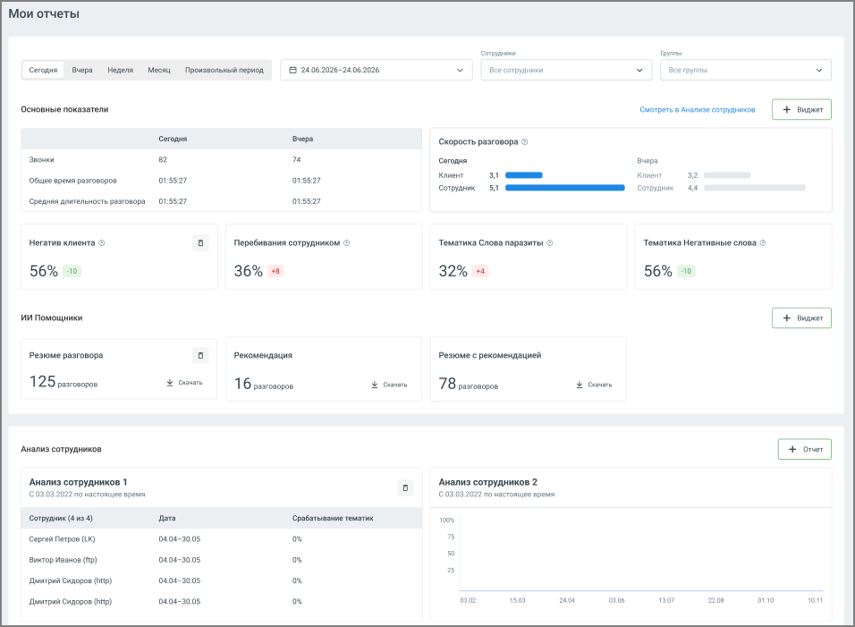

> **Иллюстрация CC-81-1** · стр. 453 · раздел «16.1. Отчеты речевой аналитики» · снимок экрана интерфейса, 956×701 px.
> Иллюстрирует текст руководства: «Вкладка Отчеты содержит детальную аналитическую информацию о распознанных вызовах в соответствии с заданными параметрами фильтрации. Страница Мои отчеты – главный экран отчетов Речевой аналитики. На ней собраны ключевые показатели разговоров, сводка по ИИ Помощникам и сохраненные отчеты Анализ …»
> Следующий за иллюстрацией текст: «Основные показатели. Блок отображает показатели разговоров за выбранный период и их изменение относительно предыдущего периода такой же длительности: сегодня – по сравнению со вчера, неделя – с …»

Основные показатели. Блок отображает показатели разговоров за выбранный период и их изменение относительно предыдущего периода такой же длительности: сегодня – по сравнению со вчера, неделя – с прошлой неделей, месяц – с прошлым месяцем. По умолчанию отображаются: звонки, общее время и средняя длительность разговоров, скорость разговора сотрудника и клиента, негатив клиента, перебивания сотрудником, тематики «Слова паразиты» и «Негативные слова». Для показателей, рост которых нежелателен (негатив, перебивания, доля обоюдного молчания), рост выделяется красным цветом, снижение – зеленым; изменения остальных показателей отображаются серым. Кнопка Виджет добавляет в блок другие показатели разговора, тематики и ИИ тематики. Ссылка Смотреть в Анализе сотрудников открывает отчет Анализ сотрудников. ИИ Помощники. Блок отображает виджеты ИИ Помощников: название помощника и количество разговоров, проанализированных за выбранный период. Кнопка Скачать выгружает данные в файл Excel (.xlsx) с полями: дата звонка, имя оператора, номер/имя клиента, время звонка, длительность, ответ помощника. Если данных за период нет, кнопка недоступна. Кнопка Виджет добавляет виджет ИИ Помощника, значок корзины удаляет виджет. Если ИИ Помощники не созданы, в блоке отображается предложение добавить помощника. Добавлять виджеты и скачивать данные могут пользователи с доступом к отчетам, в том числе без права «Просматривать и изменять настройки». Анализ сотрудников. Блок отображает сохраненные отчеты Анализ сотрудников – не более 10, новые отображаются сверху. Чтобы добавить отчет, нажмите кнопку Отчет: откроется отчет Анализ сотрудников. Сформируйте отчет, нажмите Сохранить и выберите вариант отображения – миниатюра графиком, миниатюра таблицей (первые 5 строк) или график с таблицей. Содержание таблицы (сотрудники или группы) зависит от положения чекбокса «Показать группы». При открытии страницы данные отчетов обновляются на текущую дату с учетом фильтров, сохраненных в отчете; фильтры страницы на них не влияют. Клик по

названию отчета открывает его с сохраненными параметрами. Сохраненные отчеты доступны только создавшему их пользователю на любом устройстве. Также доступны отчеты:  Расходы Речевой аналитики  Анализ сотрудников  Анализ разговоров  Анализ по чек-листам  Ловец инсайтов

### 16.1.1. Расходы Речевой аналитики

Страница расходов помогает быстро понять, сколько стоит использование сервиса за выбранный период и какие услуги вносят основной вклад в затраты.

Доступ к отчету регулируется в настройках ролей ЛК ВАТС. Доступ к отчету открыт, если у пользователя есть доступ к разделам Финансы и Баланс Лицевого счета: "Просматривать информацию о расходах за текущий и предыдущий месяцы".

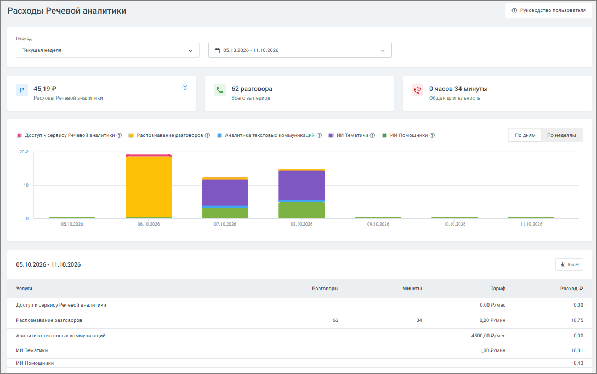

> **Иллюстрация CC-81-2** · стр. 454 · раздел «16.1.1. Расходы Речевой аналитики» · снимок экрана интерфейса, 1089×683 px.
> Иллюстрирует текст руководства: «Доступ к отчету регулируется в настройках ролей ЛК ВАТС. Доступ к отчету открыт, если у пользователя есть доступ к разделам Финансы и Баланс Лицевого счета: "Просматривать информацию о расходах за текущий и предыдущий месяцы".»
> Следующий за иллюстрацией текст: «Период и выбор дат В верхней части страницы можно выбрать период, за который будут отображены расходы. Чаще всего пользователи выбирают:  текущий день или вчера — чтобы быстро оценить недавнюю …»

Период и выбор дат В верхней части страницы можно выбрать период, за который будут отображены расходы. Чаще всего пользователи выбирают:  текущий день или вчера — чтобы быстро оценить недавнюю активность;  текущую неделю или месяц — для регулярного мониторинга;  произвольный период — когда нужно посмотреть данные за конкретные даты.

После выбора периода информация на странице сразу обновляется — ничего дополнительно подтверждать не нужно. Основные показатели за период Под блоком выбора дат отображаются три ключевых значения, которые дают быстрый обзор ситуации:  сумма расходов за выбранный период;  количество обработанных разговоров;  общая длительность разговоров. Эти показатели помогают сразу оценить нагрузку и стоимость работы сервиса. График расходов График визуально показывает динамику затрат по дням или неделям. Это полезно, если вы хотите:  увидеть, когда были пики активности,  понять, какие услуги формируют ключевые расходы,  быстро сравнить дни между собой. Цветовая маркировка помогает сразу отличать:  расход на доступ к сервису,  распознавание разговоров,  аналитику текстовых коммуникаций,  ИИ Тематики,  ИИ Помощники. При наведении курсора на столбец появляется всплывающая подсказка с деталями по конкретному дню: сумма расходов по каждой услуге, количество разговоров и длительность. Для ИИ Тематик и ИИ Помощников отображается сумма, фактически переданная на списание. Если на аккаунте есть приветственные символы для ИИ Тематик и/или ИИ Помощников, информация о них отображается в блоке над графиком. Таблица расходов Внизу страницы расположена таблица с подробной разбивкой по услугам. Для каждой услуги указано:  сколько разговоров было обработано,  сколько минут распознано,  какой тариф использовался,  какая сумма начислена. В конце таблицы отображается итоговый расход за период. Если данные нужно передать коллегам или приложить к отчёту — таблица легко выгружается в формате Excel.

### 16.1.2. Отчет "Анализ сотрудников"

Отчет Анализ сотрудников состоит из трех блоков:

1. Блок фильтров

2. Блок визуализации «Срабатывание тематик»

3. Блок таблицы «Разговоры, детализация»

Блок фильтров

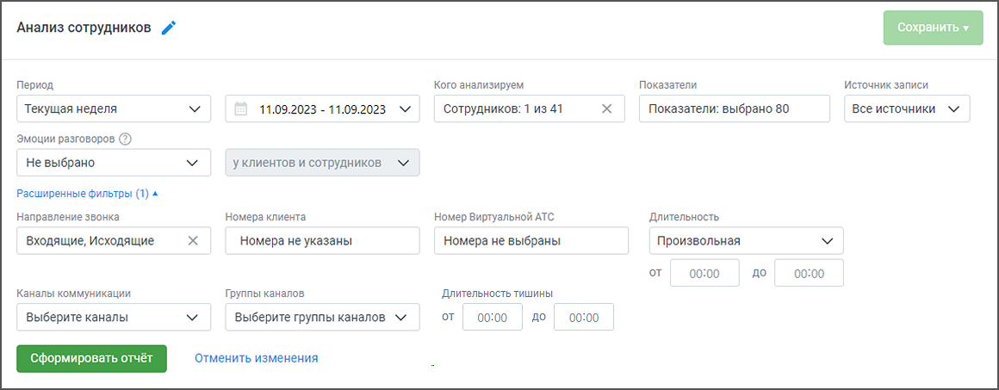

> **Иллюстрация CC-81-3** · стр. 456 · раздел «16.1.2. Отчет "Анализ сотрудников"» · снимок экрана интерфейса, 1160×453 px.
> Иллюстрирует текст руководства: «Блок фильтров»
> Следующий за иллюстрацией текст: «Кнопка Сохранить – становится активной после формирования отчета. При нажатии отображается список вариантов сохранения виджета на странице «Мои отчеты»: миниатюра графиком – отображается только …»

Кнопка Сохранить – становится активной после формирования отчета. При нажатии отображается список вариантов сохранения виджета на странице «Мои отчеты»: миниатюра графиком – отображается только график; миниатюра таблицей – отображается только таблица с первыми 5 строками; график с таблицей – отображаются график и таблица, таблица содержит первые 5 строк. Состав таблицы виджета (сотрудники или группы) определяется положением чекбокса «Показать группы» на момент сохранения отчета. На виджете данные всегда отсортированы по убыванию показателя «Тематик сработало», независимо от сортировки, установленной в самом отчете. Сохраненный отчет отображается в блоке «Анализ сотрудников» на странице «Мои отчеты». Кнопка Удалить – удаление отчета со страницы Мои отчеты; Пиктограмма «карандаш» – переименование отчета. При формировании отчета пользователям доступна фильтрация: Период – произвольный, текущий день, текущая неделя, текущий месяц, с прошлого месяца, с позапрошлого месяца, текущий год, весь период; Кого анализируем – в выпадающем списке фильтра есть два уровня: сначала отображаются группы, а внутри них — сотрудники. Пользователь может выбрать нужную группу, чтобы сразу увидеть всех её участников, или найти конкретного человека. Если ни один сотрудник не выбран, отчет формируется по всем сотрудникам. Показатели – все тематики (в том числе неактивные), а также характеристики разговора. Подробнее здесь; Источник записи – выбор типа записи разговора: телефонные разговоры/ офлайн-записи /текстовые коммуникации. Направление – входящий, исходящий, внутренний звонок или текстовое сообщение. Эмоции разговоров (по клиентам, по сотрудникам, по клиентам и сотрудникам) – дополнительная настройка для фильтрации разговоров в зависимости от выбранной эмоции: негативно, позитивно, нейтрально. В таблице отчета отображаются соответствующими пиктограммами-смайликами. Эмоции определяются на основании звуков (тембра, громкости). При выборе типа записи разговора «текстовые коммуникации» фильтр недоступен. Номер ВАТС – выбор номеров линии ВАТС (максимальное количество – 100). При выборе типа записи разговора «текстовые коммуникации» или «офлайн-записи» фильтр недоступен. Номер клиента – выбор произвольного номера клиента. При выборе типа записи разговора «текстовые коммуникации» фильтр недоступен. Длительность звонка – по умолчанию установлена произвольная длительность звонка. При выборе типа записи разговора «текстовые коммуникации» фильтр недоступен.

> **Иллюстрация CC-81-4** · стр. 457 · раздел «16.1.2. Отчет "Анализ сотрудников"» · снимок экрана интерфейса, 255×179 px.
> Иллюстрирует текст руководства: «Кнопка Сохранить – становится активной после формирования отчета. При нажатии отображается список вариантов сохранения виджета на странице «Мои отчеты»: миниатюра графиком – отображается только график; миниатюра таблицей – отображается только таблица с первыми 5 строками; график с таблицей – …»
> Следующий за иллюстрацией текст: «Каналы коммуникации – выбор из выпадающего списка каналов коммуникации, доступных в разделе МангоДиалоги → Каналы. Варианты: Чат на сайте, ВКонтакте, Telegram, Max, WhatsApp, Авито. При выборе типа …»

Каналы коммуникации – выбор из выпадающего списка каналов коммуникации, доступных в разделе МангоДиалоги → Каналы. Варианты: Чат на сайте, ВКонтакте, Telegram, Max, WhatsApp, Авито. При выборе типа записи разговора «офлайн-записи» или «телефонные разговоры» фильтр недоступен. Группы каналов – выбор из выпадающего списка групп каналов коммуникации, созданных в разделе МангоДиалоги → Каналы. При выборе типа записи разговора «офлайн-записи» или «телефонные разговоры» фильтр недоступен.

Внутри фильтра действует принцип фильтрации – ИЛИ (когда одно из условий истинно). Между фильтрами действует принцип фильтрации – И (когда все условия истинны). Длительность тишины – используя этот фильтр руководитель может контролировать сотрудников на предмет тишины в разговорах, для выявления слабых мест в работе операторов. Фильтр применим только к новым записям. Фильтр применим только к новым записям.  Если не выбрана величина "от" – отфильтруются все разговоры, где длительность тишины была до указанного времени.  Если не выбрала величина "до" – отфильтруются разговоры, где длительность тишины была более указанного времени. Длительность тишины также отображается на плеере расшифровки разговора.

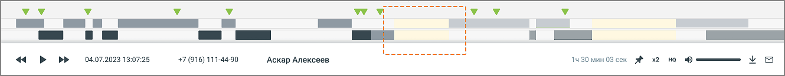

> **Иллюстрация CC-81-5** · стр. 457 · раздел «16.1.2. Отчет "Анализ сотрудников"» · снимок экрана интерфейса, 1330×130 px.
> Иллюстрирует текст руководства: «Внутри фильтра действует принцип фильтрации – ИЛИ (когда одно из условий истинно). Между фильтрами действует принцип фильтрации – И (когда все условия истинны). Длительность тишины – используя этот фильтр руководитель может контролировать сотрудников на предмет тишины в разговорах, для выявления …»
> Следующий за иллюстрацией текст: «Изменение какого-либо из дополнительных фильтров не приводит к автоматическому обновлению данных в отчете. Для обновления данных нажмите кнопку «Сформировать отчет».»

Изменение какого-либо из дополнительных фильтров не приводит к автоматическому обновлению данных в отчете. Для обновления данных нажмите кнопку «Сформировать отчет».

Блок визуализации срабатывания тематик Отчет предоставляет данные по количеству сработавших тематик в разговорах сотрудника/группы, которым были присвоены выбранные тематики. Отчет доступен в срезах По дням и По тематикам. Каждый цвет кривой на графике соответствует определенному сотруднику.

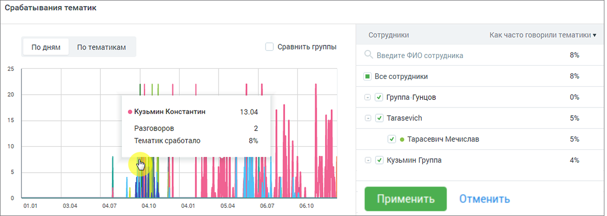

> **Иллюстрация CC-81-6** · стр. 458 · раздел «16.1.2. Отчет "Анализ сотрудников"» · снимок экрана интерфейса, 1186×424 px.
> Иллюстрирует текст руководства: «Блок визуализации срабатывания тематик Отчет предоставляет данные по количеству сработавших тематик в разговорах сотрудника/группы, которым были присвоены выбранные тематики. Отчет доступен в срезах По дням и По тематикам. Каждый цвет кривой на графике соответствует определенному сотруднику.»
> Следующий за иллюстрацией текст: «Рис.1. Срез «По дням»  По оси У графика «По дням» отображается сколько тематик сработало, то есть процентное значение срабатывания выбранных в "Показателях" тематик. Если чекбокс «Сравнить группы» …»

Рис.1. Срез «По дням»  По оси У графика «По дням» отображается сколько тематик сработало, то есть процентное значение срабатывания выбранных в "Показателях" тематик. Если чекбокс «Сравнить группы» проставлен, то график отображает данные по группам сотрудников. Иначе – по отдельным сотрудникам.  По оси Х отображается временной период в разбивке по дням относительно выбранного периода в фильтре "Период". ПРИМЕР 1:  В поле "Показатели" выбрано 3 тематики.  За указанную дату по сотруднику "Игорь Петров" было распознано 50 разговоров.  На 40 распознанных разговоров была проставлена каждая из выбранных тематик, оставшиеся 10 не проставилась ни одна тематика. Таким образом количество тем которые проставились на указанные разговоры = 120 (из возможных 150). Значение параметра "Тематик сработало" будет равняться: 120 / 150 * 100% = 80% По клику на графике отображается всплывающее окно с информацией по сотруднику на выбранную дату. Если чекбокс «Сравнить группы» проставлен, то всплывающее окно содержит данные по группе сотрудников на выбранную дату. Столбец «Как часто говорили тематики» рассчитывается как среднее значение по всем значениям параметра «Тематик сработало» за установленный период.

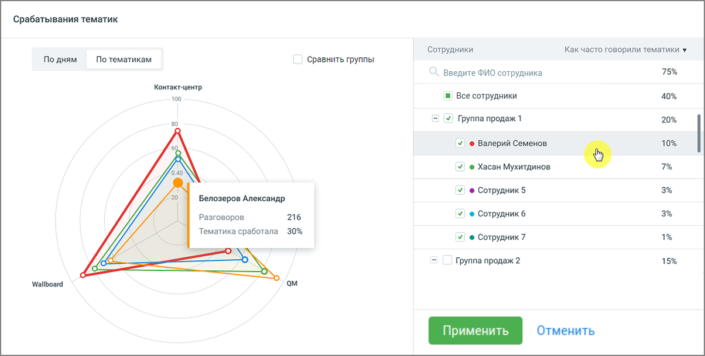

> **Иллюстрация CC-81-7** · стр. 458 · раздел «16.1.2. Отчет "Анализ сотрудников"» · снимок экрана интерфейса, 1204×610 px.
> Иллюстрирует текст руководства: «Рис.1. Срез «По дням»  По оси У графика «По дням» отображается сколько тематик сработало, то есть процентное значение срабатывания выбранных в "Показателях" тематик. Если чекбокс «Сравнить группы» проставлен, то график отображает данные по группам сотрудников. Иначе – по отдельным сотрудникам.  …»
> Следующий за иллюстрацией текст: «Рис.1. Срез «По тематикам»»

Рис.1. Срез «По тематикам»

Внутри окружности графика «По тематикам» располагается графическое отображение вхождения сработавших тематик в разговоры выбранных сотрудников (сколько тематик сработало, столько цветных фигур отображается на графике). Столбец «Как часто говорили тематики» рассчитывается как среднее значение по всем значениям параметра «Тематик сработало» для конкретного сотрудника. ПРИМЕР 2:  Значение "Тематик сработало" по сотруднику "Игорь Петров" за 01.01 = 50%, а за 0 70% Соответственно, значение "Как часто говорили тематики" по сотруднику "Игорь Петров" за выбранные 2 дня равняется [(50% + 70%) / 2)] = 60%

Блок таблицы Разговоры, детализация Табличная часть отчета состоит из трех разделов:  Разговоры  Тематики  Показатели разговора

Для типа записи разговора «Текстовые коммуникации» в качестве показателей отображаются только данные разговоров по тематикам.

1. Раздел «Разговоры, детализация» Детализация разговоров предоставляется в срезах Сотрудники/Клиенты. В таблице отчета данные выводятся с возможностью группировки согласно установленных фильтров.

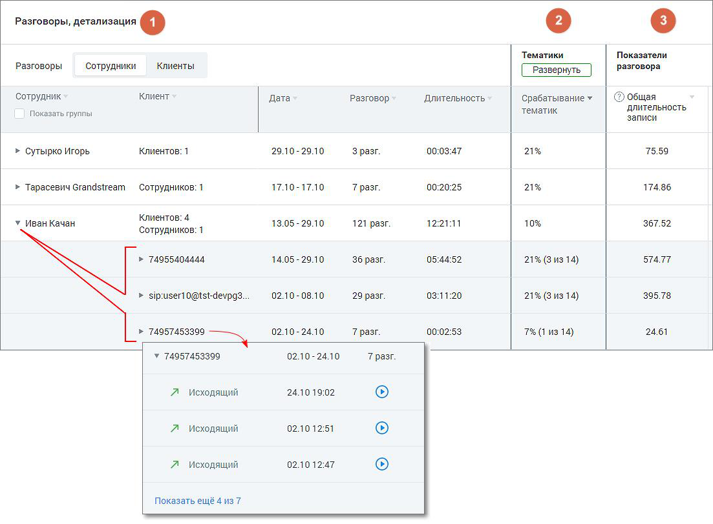

> **Иллюстрация CC-81-8** · стр. 459 · раздел «16.1.2. Отчет "Анализ сотрудников"» · снимок экрана интерфейса, 1103×812 px.
> Иллюстрирует текст руководства: «1. Раздел «Разговоры, детализация» Детализация разговоров предоставляется в срезах Сотрудники/Клиенты. В таблице отчета данные выводятся с возможностью группировки согласно установленных фильтров.»
> Следующий за иллюстрацией текст: «Таблица содержит следующие столбцы (рассмотрим пример для среза «Сотрудники»):  Сотрудник – имя сотрудника ВАТС.»

Таблица содержит следующие столбцы (рассмотрим пример для среза «Сотрудники»):  Сотрудник – имя сотрудника ВАТС.

 Клиент - количество уникальных внешних номеров (не привязанных ни к одному из сотрудников ВАТС) с которыми у выбранного сотрудника за выбранный период состоялся успешный звонок. По каждому номеру доступна детализация звонков с записями разговоров (если на ВАТС подключена услуга записи разговоров).  Дата – диапазон дат в которые у выбранного сотрудника имеются распознанные разговоры.  Разговор – суммарное количество распознанных разговоров выбранного сотрудника за выбранный период.  Длительность – суммарная длительность всех распознанных разговоров выбранного сотрудника за выбранный период в формате ЧЧ:ММ:СС.  Эмоции клиента – среднее значение, отображается смайлом.  Эмоции сотрудника – среднее значение, отображается смайлом.

> **Иллюстрация CC-81-9** · стр. 460 · раздел «16.1.2. Отчет "Анализ сотрудников"» · значок (элемент интерфейса), встроенный в текст, 20×20 px.
> Поясняющий текст руководства (рядом с элементом): «По клику на пиктограмму аудиозаписи»
> Предшествующий контекст: « Клиент - количество уникальных внешних номеров (не привязанных ни к одному из сотрудников ВАТС) с которыми у выбранного сотрудника за выбранный период состоялся успешный звонок. По каждому номеру …»

По клику на пиктограмму аудиозаписи

или пиктограмму текстового канала

> **Иллюстрация CC-81-10** · стр. 460 · раздел «16.1.2. Отчет "Анализ сотрудников"» · значок (элемент интерфейса), встроенный в текст, 20×22 px.
> Поясняющий текст руководства (рядом с элементом): «коммуникации (например ) открывается окно записи разговора. Если чекбокс «Показать группы» проставлен, столбец Сотрудник содержит двухуровневый иерархический список (группа/ сотрудник): т.е. сотрудники сгруппированы по группам. Данные в отчете в этом случае формируются и для группы в целом.»
> Предшествующий контекст: «или пиктограмму текстового канала»

коммуникации (например ) открывается окно записи разговора. Если чекбокс «Показать группы» проставлен, столбец Сотрудник содержит двухуровневый иерархический список (группа/ сотрудник): т.е. сотрудники сгруппированы по группам. Данные в отчете в этом случае формируются и для группы в целом.

2. Раздел «Тематики»

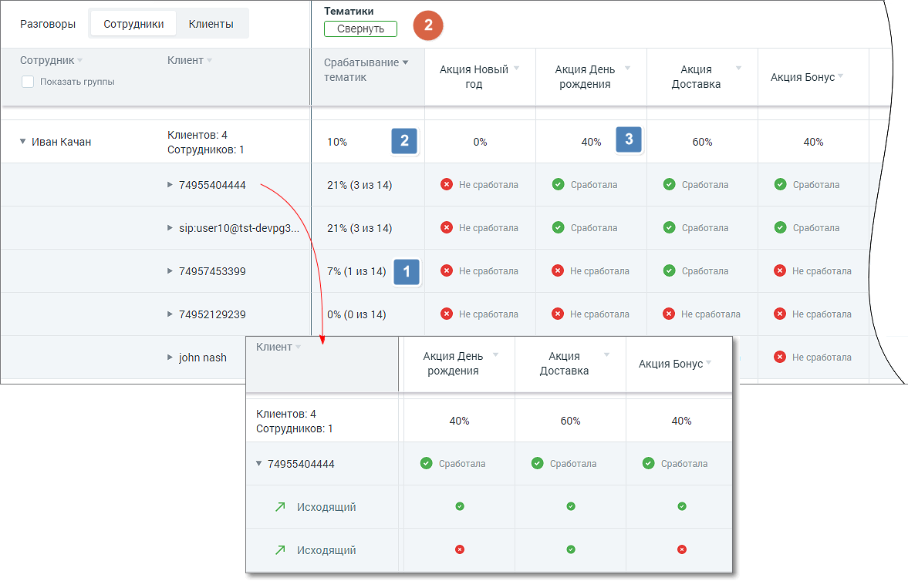

> **Иллюстрация CC-81-11** · стр. 460 · раздел «16.1.2. Отчет "Анализ сотрудников"» · снимок экрана интерфейса, 1177×754 px.
> Иллюстрирует текст руководства: «2. Раздел «Тематики»»
> Следующий за иллюстрацией текст: «В развернутом виде раздел таблицы содержит следующие столбцы:  Соответствие тематикам – показатель вида (N из M), где N – количество проставленных на данный разговор тематик, а M – общее количество …»

В развернутом виде раздел таблицы содержит следующие столбцы:  Соответствие тематикам – показатель вида (N из M), где N – количество проставленных на данный разговор тематик, а M – общее количество тематик, выбранных в блоке фильтрации;  Столбцы с наименованиями тематик – все тематики, выбранные в блоке фильтрации, с пометкой о срабатывании. В детализации звонков пометка о срабатывании отображается по каждому звонку. При расчете данных в столбцах используются следующие величины: N – количество проставленных на данный разговор тематик M – общее количество тематик, выбранных в блоке фильтрации

> **Иллюстрация CC-81-12** · стр. 461 · раздел «16.1.2. Отчет "Анализ сотрудников"» · значок (элемент интерфейса), встроенный в текст, 34×34 px.
> Поясняющий текст руководства (рядом с элементом): «– параметр, равный N/M*100%;»
> Предшествующий контекст: «В развернутом виде раздел таблицы содержит следующие столбцы:  Соответствие тематикам – показатель вида (N из M), где N – количество проставленных на данный разговор тематик, а M – общее количество …»

– параметр, равный N/M*100%;

> **Иллюстрация CC-81-13** · стр. 461 · раздел «16.1.2. Отчет "Анализ сотрудников"» · значок (элемент интерфейса), встроенный в текст, 34×34 px.
> Поясняющий текст руководства (рядом с элементом): «- параметр, равный среднему арифметическому данных в строке по всем выбранным тематикам;»
> Предшествующий контекст: «– параметр, равный N/M*100%;»

- параметр, равный среднему арифметическому данных в строке по всем выбранным тематикам;

> **Иллюстрация CC-81-14** · стр. 461 · раздел «16.1.2. Отчет "Анализ сотрудников"» · значок (элемент интерфейса), встроенный в текст, 34×34 px.
> Поясняющий текст руководства (рядом с элементом): «- параметр, равный отношению количества меток "Сработала" (по вертикали) к общему количеству меток ("Сработала " + "Не сработала ").»
> Предшествующий контекст: «- параметр, равный среднему арифметическому данных в строке по всем выбранным тематикам;»

- параметр, равный отношению количества меток "Сработала" (по вертикали) к общему количеству меток ("Сработала " + "Не сработала ").

3. Раздел «Показатели разговора»

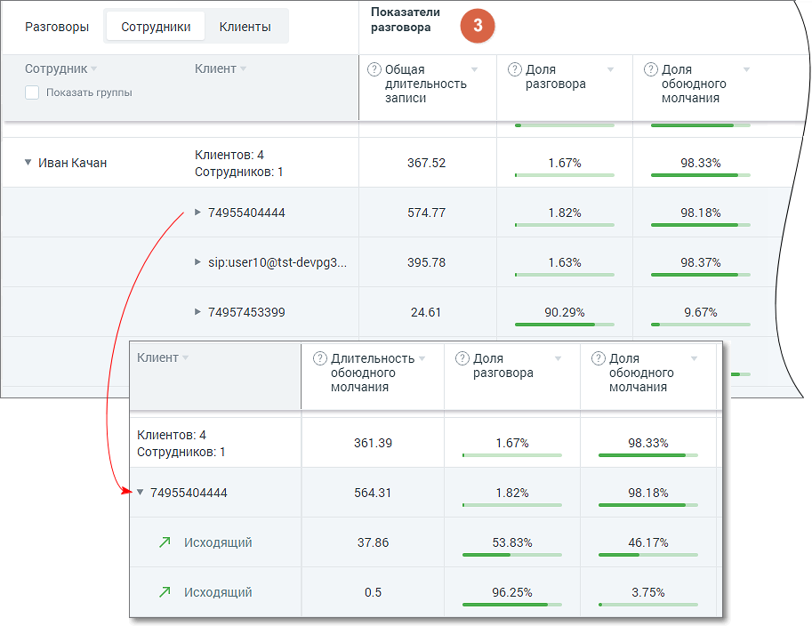

> **Иллюстрация CC-81-15** · стр. 461 · раздел «16.1.2. Отчет "Анализ сотрудников"» · снимок экрана интерфейса, 913×713 px.
> Иллюстрирует текст руководства: «3. Раздел «Показатели разговора»»
> Следующий за иллюстрацией текст: «Раздел таблицы содержит следующие столбцы:  Общая длительность записи  Длительность разговора  Длительность обоюдного молчания  Доля разговора  Доля обоюдного молчания  Количество перебиваний …»

Раздел таблицы содержит следующие столбцы:  Общая длительность записи  Длительность разговора  Длительность обоюдного молчания  Доля разговора  Доля обоюдного молчания  Количество перебиваний сотрудником  Количество перебиваний клиентом  Доля обоюдного разговора  Доля разговора сотрудника  Доля разговора клиента  Скорость разговора сотрудника  Скорость разговора клиента Чтобы узнать правило расчета каждого из показателей, наведите курсор на пиктограмму возле наименования показателя. Подробнее о значениях показателей узнайте здесь.

Для фильтрации данных отчета по возрастанию/убыванию следует щелкнуть по наименованию столбца. Для выгрузки данных отчета в формате CSV кликните на пиктограмму в правом верхнем углу табличной части. Доступны выгрузка файла отчета по сотрудникам и по клиентам.

Детализация разговоров

> **Иллюстрация CC-81-16** · стр. 462 · раздел «16.1.2. Отчет "Анализ сотрудников"» · значок (элемент интерфейса), встроенный в текст, 20×20 px.
> Поясняющий текст руководства (рядом с элементом): «По клику на пиктограмму открывается окно детализации звонка:»
> Предшествующий контекст: «Детализация разговоров»

По клику на пиктограмму открывается окно детализации звонка:

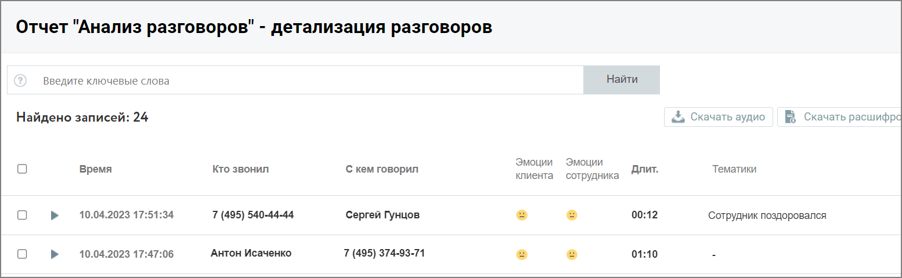

> **Иллюстрация CC-81-17** · стр. 462 · раздел «16.1.2. Отчет "Анализ сотрудников"» · снимок экрана интерфейса, 1554×480 px.
> Иллюстрирует текст руководства: «По клику на пиктограмму открывается окно детализации звонка:»
> Следующий за иллюстрацией текст: «Окно детализации разговоров содержит следующие данные о звонках:  Дату и время разговора  Кто инициировал разговор  С кем говорил  Эмоции клиента  Эмоции сотрудника  Длительность разговора  …»

Окно детализации разговоров содержит следующие данные о звонках:  Дату и время разговора  Кто инициировал разговор  С кем говорил  Эмоции клиента  Эмоции сотрудника  Длительность разговора  Список тематик, которые присвоены разговору  Общая длительность записи  Длительность обоюдного молчания  Доля разговора/обоюдного молчания  Количество перебиваний сотрудником/клиентом  Доля обоюдного разговора/сотрудника/клиента  Скорость разговора сотрудника/клиента В окне детализации разговоров пользователю доступны следующие действия: поиск по записям, прослушивание, просмотр расшифровки разговора (при наличии), скачивание аудиозаписи и расшифровки разговора. Если какие-то из показателей разговора не доступны для данного типа записи разговора или не выбраны в фильтрах, то в окне детализации они также не отражаются. Клик на пиктограмму разговора открывает окно со следующей информацией: Тематики и ключевые слова – список распознанных ключевых слов, сгруппированный по тематикам. Расшифровка текста разговора – помимо текста разговора включает данные сотрудника и клиента, а также метки вхождений. Для внутренних разговоров – данные обоих сотрудников. Плеер с отметками фрагментов разговора и вхождений терм.

### 16.1.3. Отчет "Анализ разговоров"

Отчет «Анализ разговоров» состоит из двух блоков:  Блока таблицы  Блока визуализаций: Тематики по словам и Динамика по времени.

Блоки визуализаций отображаются по щелчку на соответствующей вкладке:

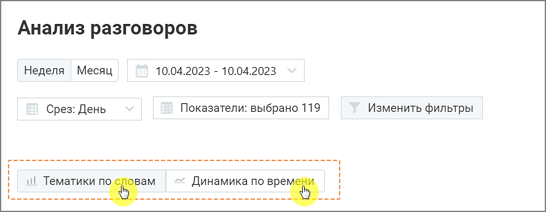

> **Иллюстрация CC-81-18** · стр. 463 · раздел «16.1.3. Отчет "Анализ разговоров"» · снимок экрана интерфейса, 889×345 px.
> Иллюстрирует текст руководства: «Блоки визуализаций отображаются по щелчку на соответствующей вкладке:»
> Следующий за иллюстрацией текст: «Визуализация “Тематики по словам” В поле визуализации “Тематики по словам” отображается:  Топ 5 выбранных тематик – наиболее популярные тематики (не более 5-ти) из тематик, выбранных пользователем …»

Визуализация “Тематики по словам” В поле визуализации “Тематики по словам” отображается:  Топ 5 выбранных тематик – наиболее популярные тематики (не более 5-ти) из тематик, выбранных пользователем во всплывающем окне Показатели, подраздел Количество разговоров по тематикам. Позволяет определить – какие из установленных тематик содержат наибольшее количество звонков. Таким образом руководитель может видеть, к примеру, вектор заинтересованности клиентов в тех или иных товарах. Клик по любой из предложенных тематик позволяет увидеть подробную детализацию по этой тематике.  Что говорят в тематике – для тематики, выбранной в “ТОП-5 популярных тематик”, показывает процентное соотношение распознанных терм по отношению к общему количеству терм тематики. В гистограмме отображается не более 10 строк. Если тематика содержит более 10 терм, наименее популярные из них помечаются, как Прочие.

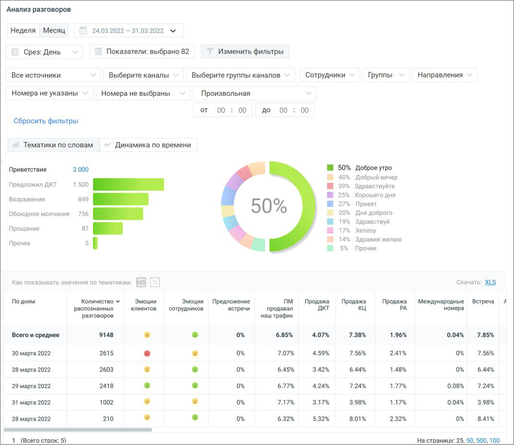

> **Иллюстрация CC-81-19** · стр. 464 · раздел «16.1.3. Отчет "Анализ разговоров"» · снимок экрана интерфейса, 1072×928 px.
> Иллюстрирует текст руководства: «Визуализация “Тематики по словам” В поле визуализации “Тематики по словам” отображается:  Топ 5 выбранных тематик – наиболее популярные тематики (не более 5-ти) из тематик, выбранных пользователем во всплывающем окне Показатели, подраздел Количество разговоров по тематикам. Позволяет определить – …»
> Следующий за иллюстрацией текст: «Визуализация “Динамика по времени” Визуализация “Динамика по времени” представляет собой график изменений выбранного показателя в заданный период времени. Выпадающий список в левом верхнем углу …»

Визуализация “Динамика по времени” Визуализация “Динамика по времени” представляет собой график изменений выбранного показателя в заданный период времени. Выпадающий список в левом верхнем углу графика содержит доступные для выбора показатели. При наведении курсора на элементы графика отображается всплывающая подсказка с информацией по соответствующему дню/месяцу.

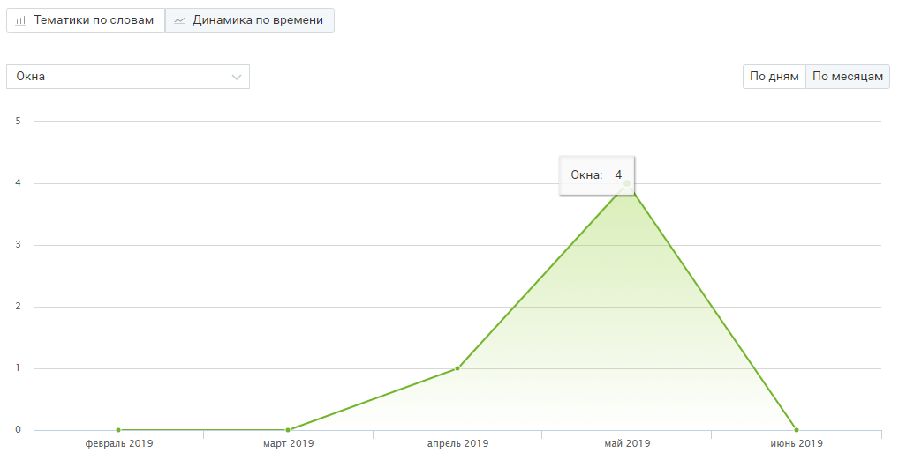

> **Иллюстрация CC-81-20** · стр. 464 · раздел «16.1.3. Отчет "Анализ разговоров"» · снимок экрана интерфейса, 1018×522 px.
> Иллюстрирует текст руководства: «Визуализация “Динамика по времени” Визуализация “Динамика по времени” представляет собой график изменений выбранного показателя в заданный период времени. Выпадающий список в левом верхнем углу графика содержит доступные для выбора показатели. При наведении курсора на элементы графика отображается …»
> Следующий за иллюстрацией текст: «Блок таблицы Таблица формируется по срезу День/Месяц/Год и заданным пользователем в окне "Показатели" параметрам.»

Блок таблицы Таблица формируется по срезу День/Месяц/Год и заданным пользователем в окне "Показатели" параметрам.

Для типа записи разговора «Текстовые коммуникации» в качестве показателей отображаются только данные разговоров по тематикам.

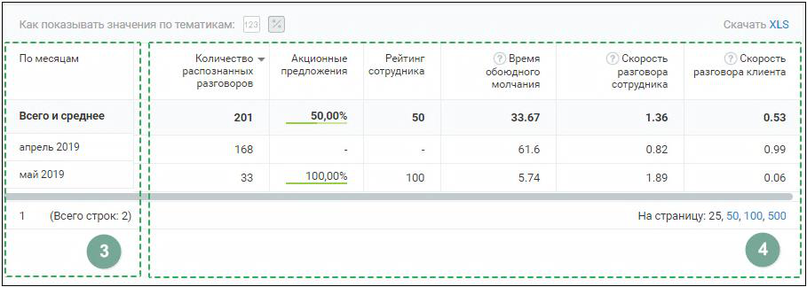

> **Иллюстрация CC-81-21** · стр. 465 · раздел «16.1.3. Отчет "Анализ разговоров"» · снимок экрана интерфейса, 909×324 px.
> Иллюстрирует текст руководства: «Для типа записи разговора «Текстовые коммуникации» в качестве показателей отображаются только данные разговоров по тематикам.»
> Следующий за иллюстрацией текст: «Таблица может включать следующие данные:»

Таблица может включать следующие данные:

> **Иллюстрация CC-81-22** · стр. 465 · раздел «16.1.3. Отчет "Анализ разговоров"» · значок (элемент интерфейса), встроенный в текст, 42×41 px.
> Поясняющий текст руководства (рядом с элементом): «Срез: день, месяц или год. Этот показатель присутствует в таблице всегда.»
> Предшествующий контекст: «Таблица может включать следующие данные:»

Срез: день, месяц или год. Этот показатель присутствует в таблице всегда.

> **Иллюстрация CC-81-23** · стр. 465 · раздел «16.1.3. Отчет "Анализ разговоров"» · значок (элемент интерфейса), встроенный в текст, 47×42 px.
> Поясняющий текст руководства (рядом с элементом): «Показатели:  название тематики – в примере на скриншоте выбрана тематика «Акционные предложения». При выборе для отчета большего количества тематик, данные по каждой из них будут отображаться в отдельном столбце. Где заголовок – название выбранной тематики.»
> Предшествующий контекст: «Срез: день, месяц или год. Этот показатель присутствует в таблице всегда.»

Показатели:  название тематики – в примере на скриншоте выбрана тематика «Акционные предложения». При выборе для отчета большего количества тематик, данные по каждой из них будут отображаться в отдельном столбце. Где заголовок – название выбранной тематики.

Данные столбца могут отображаться в двух вариантах: 1) в виде процентного соотношения разговоров в срезе, отнесенных к данной тематике, к общему числу разговоров в срезе 2) в числовом виде – количество разговоров в срезе, отнесенных к данной тематике.  Количество распознанных разговоров. Этот показатель присутствует в таблице всегда  Средняя длительность записи  Средняя длительность разговора  Средняя длительность молчания  Доля разговора  Доля обоюдного молчания  Количество перебиваний сотрудником  Количество перебиваний клиентом  Доля обоюдного разговора  Доля разговора сотрудника  Доля разговора клиента  Скорость разговора сотрудника  Скорость разговора клиента Чтобы узнать правило расчета каждого из показателей, наведите курсор на пиктограмму возле наименования показателя. Для фильтрации данных отчета по возрастанию/убыванию следует щелкнуть по наименованию столбца. Предусмотрен экспорт файла отчета «Тематики по словам» в формате XLS. После клика на кнопку XLS будет открыто стандартное диалоговое окно браузера, позволяющее сохранить файл.

Детализация По клику на цифру "Количество распознанных разговоров" открывается окно детализации разговоров - телефонных разговоров и текстовых коммуникаций - за выбранный период времени. Также можно просмотреть записи разговоров и тексты сообщений по конкретным тематикам. Для этого необходимо включить отображение данных по тематикам, как числовое. Окно детализации разговоров содержит следующие данные о разговорах: Дату и время разговора Кто инициатор разговора С кем говорил Длительность разговора Список тематик, которые присвоены разговору Длительность обоюдного молчания Доля разговора/обоюдного молчания Количество перебиваний сотрудником/клиентом Доля обоюдного разговора/сотрудника/клиента Скорость разговора сотрудника/клиента Если какие-то из показателей разговора не доступны для данного типа записи разговора или не выбраны в фильтрах, то в окне детализации они также не отражаются. В окне детализации разговоров пользователю доступны следующие действия: поиск по записям, прослушивание, просмотр расшифровки разговора (при наличии), просмотр текстовых сообщений, скачивание текстовых сообщений, аудиозаписи и расшифровки разговора. Клик на строку разговора открывает окно со следующей информацией: Тематики и ключевые слова – список распознанных ключевых слов, сгруппированный по тематикам. Расшифровка текста разговора – помимо текста разговора включает данные сотрудника и клиента, а также метки вхождений. Для внутренних разговоров – данные обоих сотрудников. Окно с текстом разговора и плеером с отметками фрагментов разговора и вхождений терм. Вид окна зависит от типа разговора (телефонный разговор или текстовые коммуникации).

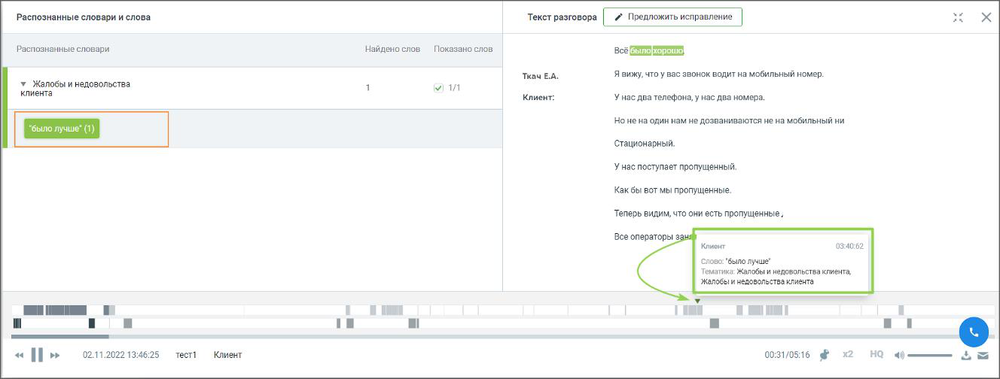

> **Иллюстрация CC-81-24** · стр. 466 · раздел «16.1.3. Отчет "Анализ разговоров"» · снимок экрана интерфейса, 1328×504 px.
> Иллюстрирует текст руководства: «Детализация По клику на цифру "Количество распознанных разговоров" открывается окно детализации разговоров - телефонных разговоров и текстовых коммуникаций - за выбранный период времени. Также можно просмотреть записи разговоров и тексты сообщений по конкретным тематикам. Для этого необходимо …»
> Следующий за иллюстрацией текст: «Как настраивается отчет “Анализ разговоров” Для построения отчета “Анализ разговоров” выберите временной период, срез (день/месяц/год) и показатели, по которым будет формироваться отчет.»

Как настраивается отчет “Анализ разговоров” Для построения отчета “Анализ разговоров” выберите временной период, срез (день/месяц/год) и показатели, по которым будет формироваться отчет.

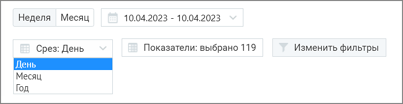

> **Иллюстрация CC-81-25** · стр. 467 · раздел «16.1.3. Отчет "Анализ разговоров"» · снимок экрана интерфейса, 818×211 px.
> Иллюстрирует текст руководства: «Как настраивается отчет “Анализ разговоров” Для построения отчета “Анализ разговоров” выберите временной период, срез (день/месяц/год) и показатели, по которым будет формироваться отчет.»
> Следующий за иллюстрацией текст: «О показателях, по которым осуществляется формирование отчета, подробнее здесь. Данные выбранных чекбоксов в таблице отчета “Анализ разговоров” отображаются, как столбцы. Для сохранения внесенных …»

О показателях, по которым осуществляется формирование отчета, подробнее здесь. Данные выбранных чекбоксов в таблице отчета “Анализ разговоров” отображаются, как столбцы. Для сохранения внесенных изменений нажмите на кнопку Применить.

> **Иллюстрация CC-81-26** · стр. 467 · раздел «16.1.3. Отчет "Анализ разговоров"» · значок (элемент интерфейса), встроенный в текст, 16×18 px.
> Поясняющий текст руководства (рядом с элементом): «Если нажать кнопку «Отменить» или пиктограмму , изменения не будут внесены, а выборка показателей вернется к последней сохраненной версии. По завершению работы указанных выше фильтров отчет будет сформирован автоматически. Для дополнительной фильтрации данных в отчете откройте выпадающий список …»
> Предшествующий контекст: «О показателях, по которым осуществляется формирование отчета, подробнее здесь. Данные выбранных чекбоксов в таблице отчета “Анализ разговоров” отображаются, как столбцы. Для сохранения внесенных …»

Если нажать кнопку «Отменить» или пиктограмму , изменения не будут внесены, а выборка показателей вернется к последней сохраненной версии. По завершению работы указанных выше фильтров отчет будет сформирован автоматически. Для дополнительной фильтрации данных в отчете откройте выпадающий список Изменить фильтры. Откроются поля дополнительных фильтров.

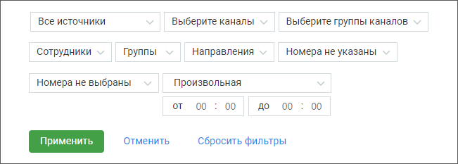

> **Иллюстрация CC-81-27** · стр. 467 · раздел «16.1.3. Отчет "Анализ разговоров"» · снимок экрана интерфейса, 651×233 px.
> Иллюстрирует текст руководства: «Если нажать кнопку «Отменить» или пиктограмму , изменения не будут внесены, а выборка показателей вернется к последней сохраненной версии. По завершению работы указанных выше фильтров отчет будет сформирован автоматически. Для дополнительной фильтрации данных в отчете откройте выпадающий список …»
> Следующий за иллюстрацией текст: «Источник записи – выбор типа записи разговора: телефонные разговоры/ офлайн-записи /текстовые коммуникации. Каналы коммуникации – выбор из выпадающего списка каналов коммуникации, доступных в разделе …»

Источник записи – выбор типа записи разговора: телефонные разговоры/ офлайн-записи /текстовые коммуникации. Каналы коммуникации – выбор из выпадающего списка каналов коммуникации, доступных в разделе МангоДиалоги → Каналы. Варианты: Чат на сайте, ВКонтакте, Telegram, Max, WhatsApp, Авито, Max.. При выборе типа записи разговора «телефонные разговоры» фильтр недоступен. Группы каналов – выбор из выпадающего списка групп каналов коммуникации, созданных в разделе МангоДиалоги → Каналы. При выборе типа записи разговора «офлайн-записи» или «телефонные разговоры» фильтр недоступен. Сотрудники – список всех сотрудников, сгруппированный по группам. При выборе типа записи разговора «текстовые коммуникации» в списке доступны только выбранные в разделе Настройки/Аналитика текстовых коммуникаций сотрудники. Если ни один сотрудник не выбран, отчет формируется по всем сотрудникам. Группы – при установке флага напротив наименования группы сформированный отчет будет включать только выбранные группы. Для быстрого выбора всех групп предусмотрен общий флаг. Направление – входящий, исходящий, внутренний звонок или текстовое сообщение. Номера клиента – фильтрация только по любым добавленным номерам. При выборе типа записи разговора «текстовые коммуникации» фильтр недоступен. Номер ВАТС – фильтрация только выбранным номерам ВАТС. При выборе типа записи разговора «текстовые коммуникации» или «офлайн-записи» фильтр недоступен.

Длительность – продолжительность разговора. По умолчанию установлен параметр «произвольная длительность». При выборе типа записи разговора «текстовые коммуникации» фильтр недоступен.

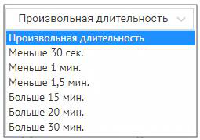

> **Иллюстрация CC-81-28** · стр. 468 · раздел «16.1.3. Отчет "Анализ разговоров"» · снимок экрана интерфейса, 255×179 px.
> Иллюстрирует текст руководства: «Длительность – продолжительность разговора. По умолчанию установлен параметр «произвольная длительность». При выборе типа записи разговора «текстовые коммуникации» фильтр недоступен.»
> Следующий за иллюстрацией текст: «Внутри фильтра действует принцип фильтрации – ИЛИ (когда одно из условий истинно). Между фильтрами действует принцип фильтрации – И (когда все условия истинны). Кнопкой Выбрать сохраните внесенные …»

Внутри фильтра действует принцип фильтрации – ИЛИ (когда одно из условий истинно). Между фильтрами действует принцип фильтрации – И (когда все условия истинны). Кнопкой Выбрать сохраните внесенные изменения.

### 16.1.4. Анализ по чек-листам

Отчет предназначен для автоматической оценки разговора сотрудника с клиентом на соответствие стандартам компании. Клик по строке меню «Анализ по чек-листам» открывает перечень всех созданных пользователем чек-листов для оценки разговоров операторов. В окне списка доступен просмотр средней оценки по созданным чек-листам и создание нового чек-листа в Конструкторе.

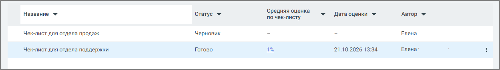

> **Иллюстрация CC-81-29** · стр. 468 · раздел «16.1.4. Анализ по чек-листам» · снимок экрана интерфейса, 1249×177 px.
> Иллюстрирует текст руководства: «Отчет предназначен для автоматической оценки разговора сотрудника с клиентом на соответствие стандартам компании. Клик по строке меню «Анализ по чек-листам» открывает перечень всех созданных пользователем чек-листов для оценки разговоров операторов. В окне списка доступен просмотр средней оценки по …»
> Следующий за иллюстрацией текст: «Заголовки столбцов (доступна сортировка): Название – задается автором на странице Конструктора Средняя оценка по чек-листу – отображается если чек-лист был просчитан. Может отображаться как цифрами, …»

Заголовки столбцов (доступна сортировка): Название – задается автором на странице Конструктора Средняя оценка по чек-листу – отображается если чек-лист был просчитан. Может отображаться как цифрами, так и в процентах. Если чек лист не был просчитан – ставится прочерк Дата оценки – дата и время, когда была выставлена оценка (задается автоматически). Если чек-лист не был просчитан – ставится прочерк Автор – автор чек-листа. Изменение чек-листа доступно только автору и тем сотрудникам, которым предоставлен доступ к чек-листу. Статус – чек-лист может находиться в одном из следующих статусов, задаваемых автоматически:  Черновик – анализ по чек-листу не проводился, статистики нет;  В процессе – чек-лист находится на этапе просчета;

 Ошибка просчета – любая из ошибок. При появлении ошибки рекомендуется запустить оценку по чек-листу повторно;  Готово – чек-лист оценен и есть цифровое значение. Ячейка с цифровыми данными является кнопкой, которая переводит на страницу Статистики.

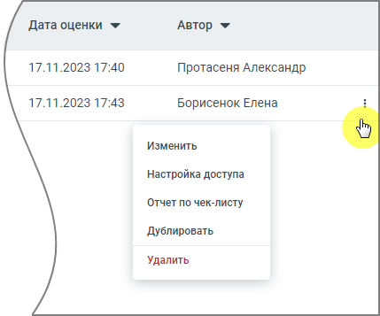

> **Иллюстрация CC-81-30** · стр. 469 · раздел «16.1.4. Анализ по чек-листам» · снимок экрана интерфейса, 429×357 px.
> Иллюстрирует текст руководства: « Ошибка просчета – любая из ошибок. При появлении ошибки рекомендуется запустить оценку по чек-листу повторно;  Готово – чек-лист оценен и есть цифровое значение. Ячейка с цифровыми данными является кнопкой, которая переводит на страницу Статистики.»
> Следующий за иллюстрацией текст: «Клик по пиктограмме в строке выделенного чек-листа открывает выпадающее меню:  Удалить – после подтверждения согласия на удаление чек-лист удаляется;  Дублировать – создание дубля чек-листа, в …»

> **Иллюстрация CC-81-31** · стр. 469 · раздел «16.1.4. Анализ по чек-листам» · значок (элемент интерфейса), встроенный в текст, 11×22 px.
> Поясняющий текст руководства (рядом с элементом): «Клик по пиктограмме в строке выделенного чек-листа открывает выпадающее меню:  Удалить – после подтверждения согласия на удаление чек-лист удаляется;  Дублировать – создание дубля чек-листа, в котором все поля кроме Названия и Описания заполнены так же, как и в оригинале. Если в списке уже …»
> Предшествующий контекст: « Ошибка просчета – любая из ошибок. При появлении ошибки рекомендуется запустить оценку по чек-листу повторно;  Готово – чек-лист оценен и есть цифровое значение. Ячейка с цифровыми данными …»

Клик по пиктограмме в строке выделенного чек-листа открывает выпадающее меню:  Удалить – после подтверждения согласия на удаление чек-лист удаляется;  Дублировать – создание дубля чек-листа, в котором все поля кроме Названия и Описания заполнены так же, как и в оригинале. Если в списке уже создано 10 чек-листов кнопка не работает;  Отчет по чек-листу – переход на страницу Статистики по данному чек-листу;  Настройка доступа – при нажатии на строку открывается окно, в котором автор может выбрать сотрудников, получающих доступ к чек-листу. Список доступных сотрудников не ограничивается подконтрольными группами — доступны все пользователи, имеющие права доступа к Речевой аналитике.  Изменить – переход на страницу Конструктора, с возможностью редактировать чек-лист. Меню доступно только автору чек-листа и сотрудникам, которым автор предоставил доступ к чек-листу.

16.1.4.1. Конструктор чек-листов

Возможно создание не более 20-ти чек-листов. Для создания нового чек-листа необходимо нажать на кнопку Создать чек-лист. Вы можете выбрать один из трёх вариантов: «Чек-лист для отдела продаж», «Чек-лист для отдела поддержки» или «Пустой чек-лист». Готовые шаблоны уже содержат ключевые критерии для оценки качества работы менеджеров, что помогает сразу выявлять типовые ошибки и точки роста. Выбранный шаблон можно сразу использовать для анализа или адаптировать под свои задачи, изменив, добавив или удалив пункты. «Пустой чек-лист» позволяет создать список с нуля, если требуется полностью индивидуальный подход.

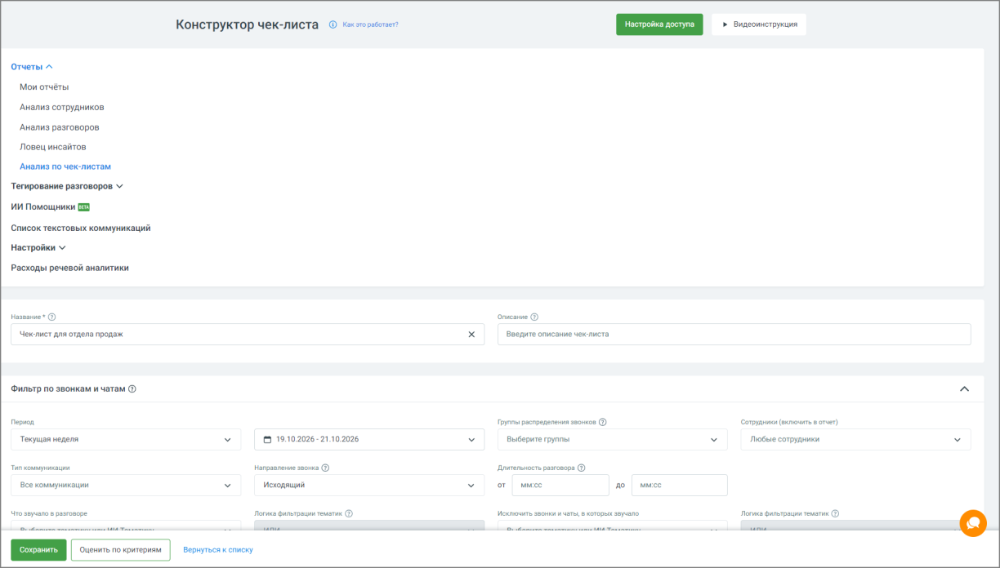

> **Иллюстрация CC-81-32** · стр. 470 · раздел «16.1.4. Анализ по чек-листам» · снимок экрана интерфейса, 1224×696 px.
> Иллюстрирует текст руководства: «Возможно создание не более 20-ти чек-листов. Для создания нового чек-листа необходимо нажать на кнопку Создать чек-лист. Вы можете выбрать один из трёх вариантов: «Чек-лист для отдела продаж», «Чек-лист для отдела поддержки» или «Пустой чек-лист». Готовые шаблоны уже содержат ключевые критерии для …»
> Следующий за иллюстрацией текст: «Основные данные:  Название – название, под которым чек-лист будет отображаться в списке чек-листов, не более 65 символов. Название должно быть уникальным в рамках списка чек-листов ЛК ВАТС. Поле …»

Основные данные:  Название – название, под которым чек-лист будет отображаться в списке чек-листов, не более 65 символов. Название должно быть уникальным в рамках списка чек-листов ЛК ВАТС. Поле обязательно для заполнения;  Описание – описание чек-листа, не более 255 символов;

Фильтр по звонкам и чатам:  Период – в какой период были осуществлены звонки и чаты, которые должны войти в отчет. Выпадающее меню, с вариантами периода: произвольный, текущий день, вчера, текущая неделя, текущий месяц, с прошлого месяца, с позапрошлого месяца;  Календарь – для указания временного промежутка, когда были осуществлены разговоры и переписки, которые должны войти в отчет. После выбора дат, нужно подтвердить выбор кнопкой «Выбрать»;  Длительность разговора – какой длительности должны быть звонки, которые должны войти в отчет (фильтр применяется только к звонкам); o Если в ячейке не указана цифра «от», то будут анализироваться все разговоры без учета нижней границы; o Если в ячейке не указана цифра «до», то будут анализироваться все разговоры без учета верхней границы; o Если в ячейке не указаны цифра «от» и «до», то будут анализироваться все разговоры, без учета этого фильтра;  Тип коммуникации – какие коммуникации должны войти в отчет: звонок, чат.  Тип звонка – какого типа звонки должны войти в отчет. Выпадающее меню с вариантами: исходящий, входящий, внутренний. После выбора показателей нужно подтвердить выбор кнопкой Выбрать;  Сотрудники – выпадающий список, в котором можно выбрать одного, нескольких или всех сотрудников, по разговорам и чатам которых будет строиться отчет. В списке фильтра есть два уровня: сначала отображаются группы, а внутри них — сотрудники. Пользователь

может выбрать нужную группу, чтобы сразу увидеть всех её участников, или найти конкретного человека.  Группы распределения звонков – при выборе каких-либо групп в отчетах будут отображаться только разговоры сотрудников, принадлежащих к выбранным группам. Если ни одно группа не выбрана, отчет формируется по всем группам;  Что звучало в разговоре – выбор одной или нескольких тематик (в том числе ИИ тематик) для оценки по чек-листу;  Исключить звонки и чаты, в которых звучало – звонки и чаты, которым проставились выбранные тематики, не будут участвовать в оценке по чек-листу;  Логика фильтрации – для включающего и исключающего тематики фильтра необходимо задать один из вариантов логики, по которой будут фильтроваться звонки и чаты: o «И» – ищет диалоги, где встречается тематика 1 И тематика 2 И остальные выбранные тематики; o «ИЛИ» – ищет диалоги, где встречается хотя бы одна из выбранных тематик.

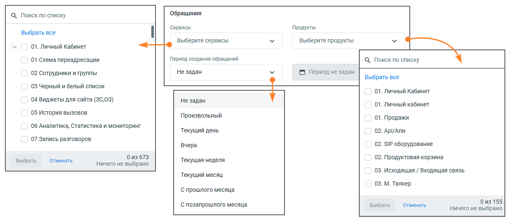

> **Иллюстрация CC-81-33** · стр. 471 · раздел «16.1.4. Анализ по чек-листам» · снимок экрана интерфейса, 1231×536 px.
> Иллюстрирует текст руководства: «может выбрать нужную группу, чтобы сразу увидеть всех её участников, или найти конкретного человека.  Группы распределения звонков – при выборе каких-либо групп в отчетах будут отображаться только разговоры сотрудников, принадлежащих к выбранным группам. Если ни одно группа не выбрана, отчет …»
> Следующий за иллюстрацией текст: «Фильтры по обращениям:  Сервисы – поле выбора категорий сервисов. Выпадающий список включает все сервисы ЛК ВАТС. Содержит элементы для поиска и массового выбора.  Продукты – поле выбора категорий …»

Фильтры по обращениям:  Сервисы – поле выбора категорий сервисов. Выпадающий список включает все сервисы ЛК ВАТС. Содержит элементы для поиска и массового выбора.  Продукты – поле выбора категорий продуктов. Выпадающий список включает все продукты ЛК ВАТС. Содержит элементы для поиска и массового выбора.  Период создания обращений – выпадающий список с вариантами периода. Доступные варианты: o Не задан, o Произвольный, o Текущий день, o Вчера, o Текущая неделя, o Текущий месяц, o С прошлого месяца, o С позапрошлого месяца.  Текущий результат – значение результата обращения, получаемое из CRM. Позволяет отфильтровать и оценить разговоры и чаты по итоговому статусу связанного обращения.  Дата закрытия обращения – период, в который было закрыто обращение, полученный из CRM.

Фильтры по CRM Инструмент фильтрации звонков по этапам сделок позволяет оценивать эффективность работы сотрудников не только по содержанию разговора, но и в контексте хода сделки.

> **Иллюстрация CC-81-34** · стр. 472 · раздел «16.1.4. Анализ по чек-листам» · снимок экрана интерфейса, 436×117 px.
> Иллюстрирует текст руководства: «Фильтры по CRM Инструмент фильтрации звонков по этапам сделок позволяет оценивать эффективность работы сотрудников не только по содержанию разговора, но и в контексте хода сделки.»
> Следующий за иллюстрацией текст: «Функция доступна при подключённой в ЛК ВАТС интеграции «Расширенный пакет Битрикс24». В настройках интеграции должен быть отмечен чекбокс «Передавать данные в Речевую аналитику».»

Функция доступна при подключённой в ЛК ВАТС интеграции «Расширенный пакет Битрикс24». В настройках интеграции должен быть отмечен чекбокс «Передавать данные в Речевую аналитику».

В выпадающем списке блока фильтров вы можете выбрать:  Тип воронки (например, «Продажи», «Поддержка»);  Этап сделки (например, «Первичный контакт», «Закрыто успешно»). После выбора параметров в таблице результатов отображается колонка «CRM», где для каждого разговора указываются статус сделки и её текущий этап в Битрикс24. Благодаря этим данным можно сразу увидеть, как конкретные звонки влияют на продвижение сделок и оценить эффективность работы менеджеров на разных стадиях продаж. Отфильтрованные результаты можно просматривать прямо в интерфейсе или выгружать в таблицу. Это удобно для последующего анализа или подготовки отчётов. Критерии чек-листа:

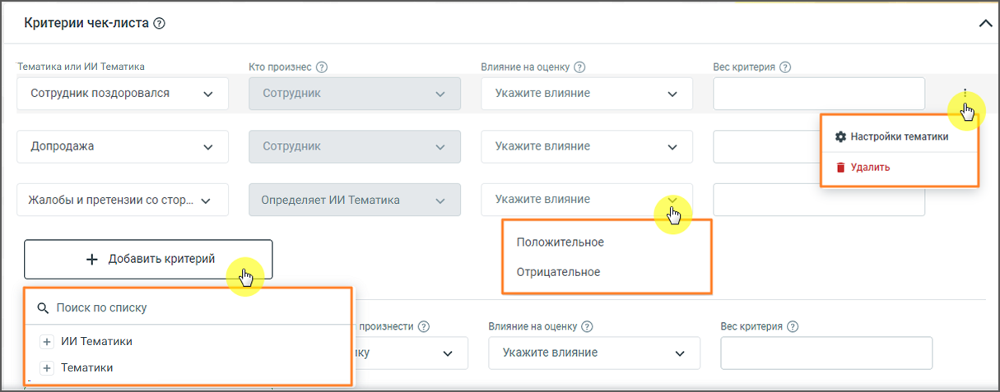

> **Иллюстрация CC-81-35** · стр. 472 · раздел «16.1.4. Анализ по чек-листам» · снимок экрана интерфейса, 1215×477 px.
> Иллюстрирует текст руководства: «В выпадающем списке блока фильтров вы можете выбрать:  Тип воронки (например, «Продажи», «Поддержка»);  Этап сделки (например, «Первичный контакт», «Закрыто успешно»). После выбора параметров в таблице результатов отображается колонка «CRM», где для каждого разговора указываются статус сделки и …»
> Следующий за иллюстрацией текст: «Доступные критерии: 1) Тематики и ИИ Тематики При создание нового чек-листа в блоке Критериев по умолчанию отображаются три тематики-»

Доступные критерии: 1) Тематики и ИИ Тематики При создание нового чек-листа в блоке Критериев по умолчанию отображаются три тематики-

> **Иллюстрация CC-81-36** · стр. 472 · раздел «16.1.4. Анализ по чек-листам» · значок (элемент интерфейса), встроенный в текст, 11×22 px.
> Поясняющий текст руководства (рядом с элементом): «критерия. Клик по пиктограмме в строке выделенного чек-листа открывает выпадающее меню:  Настройки тематики – переход в раздел Настройки тематик;  Удалить – удаление тематики или запроса к ИИ из чек-листа.»
> Предшествующий контекст: «Доступные критерии: 1) Тематики и ИИ Тематики При создание нового чек-листа в блоке Критериев по умолчанию отображаются три тематики-»

критерия. Клик по пиктограмме в строке выделенного чек-листа открывает выпадающее меню:  Настройки тематики – переход в раздел Настройки тематик;  Удалить – удаление тематики или запроса к ИИ из чек-листа.

Клик по кнопке «Добавить критерий» открывает список всех доступных тематик и запросов к ИИ с возможностью выбора одного из них. В список критериев добавляется строка с выбранной тематикой или запросом и полями для ввода и выбора данных:  Кто произнес – в каком канале звучала тематика или запрос: сотрудник, клиент, клиент или сотрудник;  Влияние на оценку – задается влияние тематики или запроса на общую оценку (положительное или отрицательное);  Вес критерия – оценка в баллах, как повлияет срабатывание критерия, на общую оценку, максимум можно вводить 4 цифры; Отображение поля «Кто произнес» для выбранных тематик и запросов:  Если в расширенных настройках Тематики пользователь указал вариант «клиент или сотрудник», то в чек-листе есть возможность выбрать или клиента, или сотрудника или оставить обоих.  Если тематика или запрос настроены на «клиент» или «сотрудник», то у пользователя в чек- листах не будет возможности выбрать – в ячейке будет указан или «клиент», или «сотрудник» по умолчанию.  Если у пользователя не было расширенных настроек, то данную ячейку пользователь заполняет в интерфейсе конструктора чек-листов самостоятельно. 2) Зависимость тематик

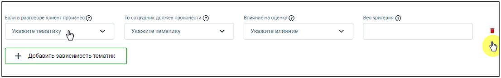

> **Иллюстрация CC-81-37** · стр. 473 · раздел «16.1.4. Анализ по чек-листам» · снимок экрана интерфейса, 1106×173 px.
> Иллюстрирует текст руководства: «Клик по кнопке «Добавить критерий» открывает список всех доступных тематик и запросов к ИИ с возможностью выбора одного из них. В список критериев добавляется строка с выбранной тематикой или запросом и полями для ввода и выбора данных:  Кто произнес – в каком канале звучала тематика или запрос: …»
> Следующий за иллюстрацией текст: «Эта настройка устанавливает зависимость ответа сотрудника от запроса клиента. У пользователя есть возможность выбрать тематики запроса и ответа, а также влияние критерия на оценку и вес критерия. …»

Эта настройка устанавливает зависимость ответа сотрудника от запроса клиента. У пользователя есть возможность выбрать тематики запроса и ответа, а также влияние критерия на оценку и вес критерия. Клик по кнопке "Добавить зависимость тематик" добавляет строку с полями для ввода/выбора данных. 3) Характеристики разговора

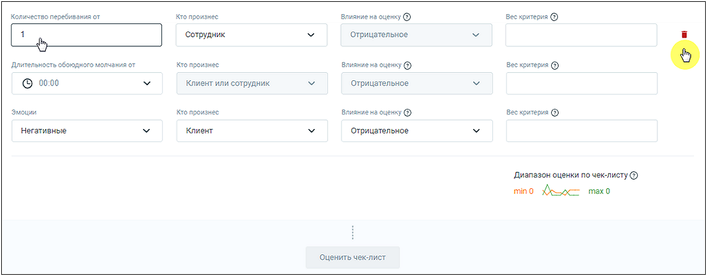

> **Иллюстрация CC-81-38** · стр. 473 · раздел «16.1.4. Анализ по чек-листам» · снимок экрана интерфейса, 1143×447 px.
> Иллюстрирует текст руководства: «Эта настройка устанавливает зависимость ответа сотрудника от запроса клиента. У пользователя есть возможность выбрать тематики запроса и ответа, а также влияние критерия на оценку и вес критерия. Клик по кнопке "Добавить зависимость тематик" добавляет строку с полями для ввода/выбора данных. 3) …»
> Следующий за иллюстрацией текст: «Также при создании чек-листа в блоке по умолчанию отображаются критерии – характеристики разговора:  Количество перебиваний – влияние на оценку автоматически проставлено как «отрицательное», вес не …»

Также при создании чек-листа в блоке по умолчанию отображаются критерии – характеристики разговора:  Количество перебиваний – влияние на оценку автоматически проставлено как «отрицательное», вес не указан

o Количество перебиваний от __ – количество перебиваний в разговоре сотрудником или клиентом (выбирается в следующем поле); o Кто произнес – для кого считается количество перебиваний. Варианты: сотрудник, клиент, клиент или сотрудник; o Влияние на оценку – по умолчанию проставлено как «отрицательное», изменение невозможно; o Вес критерия – оценка в баллах, как повлияет срабатывание критерия, на общую оценку, максимум можно вводить 4 цифры;  Длительность обоюдного молчания – по умолчанию проставлено как «отрицательное», изменение невозможно; o Длительность обоюдного молчания от__ вводится в формате ММ:СС. Пользователь может ввести цифру самостоятельно, либо выбрать из выпадающего меню, с шагом 10 секунд. o Кто произнес – имеется в виду «для кого считается длительность молчания». Вариант: сотрудник или клиент, изменение невозможно; o Влияние на оценку – по умолчанию проставлено как «отрицательное», изменение невозможно; o Вес критерия – оценка в баллах, как повлияет срабатывание критерия, на общую оценку, максимум можно вводить 4 цифры. После ввода веса каждого критерия, под таблицей автоматически считается и отображается диапазон оценок по чек-листу – максимальная и минимальная возможные оценки сотрудников. Для подсчета статистики по чек-листу нажмите кнопку «Оценить чек-лист». После нажатия кнопки все поля критериев будут недоступны для редактирования. Чтобы отредактировать критерии после подсчета статистки, прокрутите страницу чек-листа вверх и нажмите кнопку «Изменить чек-лист». Статистика по данному чек-листу будет сброшена, чек-лист перейдет в статус «черновик» до момента следующей оценки. Как поделиться чек-листом Руководитель направления может создать чек-лист с заранее определёнными критериями. Такой чек-лист можно передать другим пользователям — например, руководителям подразделений или супервайзерам. Кнопка Дать доступ размещена в нижней части страницы чек-листа. Возможность поделиться чек-листом доступна с любым сотрудником компании, у которого есть доступ к модулю речевой аналитики — не обязательно из одной группы или подразделения. При сохранении чек-листа пользователем с правами «только просмотр», сохраняется только его версия отчета с индивидуальными фильтрами — базовый (корневой) отчет не изменяется.

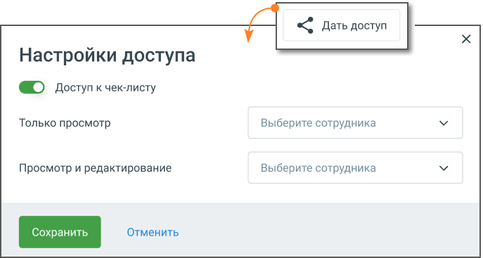

> **Иллюстрация CC-81-39** · стр. 475 · раздел «16.1.4. Анализ по чек-листам» · снимок экрана интерфейса, 687×367 px.
> Иллюстрирует текст руководства: «o Количество перебиваний от __ – количество перебиваний в разговоре сотрудником или клиентом (выбирается в следующем поле); o Кто произнес – для кого считается количество перебиваний. Варианты: сотрудник, клиент, клиент или сотрудник; o Влияние на оценку – по умолчанию проставлено как …»
> Следующий за иллюстрацией текст: «Сотрудники, которые получат доступ к чек-листу, могут использовать его для построения отчетов по нужным параметрам: выбрать конкретного сотрудника, задать нужный период, отфильтровать по другим …»

Сотрудники, которые получат доступ к чек-листу, могут использовать его для построения отчетов по нужным параметрам: выбрать конкретного сотрудника, задать нужный период, отфильтровать по другим параметрам. При этом сам чек-лист остается неизменным — редактированию подлежат только фильтры. После применения фильтров создаётся персональная версия отчета, доступная только тому сотруднику, кто её сформировал. Другие пользователи, имеющие доступ к чек-листу, не увидят чужие изменения в фильтрах и результатах отчета.

16.1.4.2. Статистика по чек-листам

Статистика отчета по Чек-листам содержит вкладки «Таблица» и «График», которые позволяют комплексно анализировать результаты оценок в отчете. Вкладка "Таблица" Статистика по чек-листу отображается в процентах и числах и показывает результаты просчета чек-листа (по звонкам и чатам) по заданным в блоке «Критерии» чек-листа критериям и фильтрам.

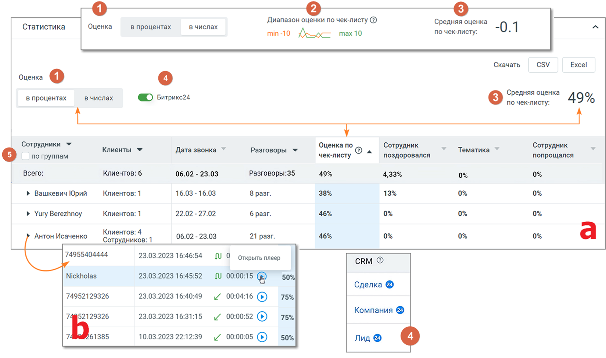

> **Иллюстрация CC-81-40** · стр. 476 · раздел «16.1.4. Анализ по чек-листам» · снимок экрана интерфейса, 1649×973 px.
> Иллюстрирует текст руководства: «Статистика отчета по Чек-листам содержит вкладки «Таблица» и «График», которые позволяют комплексно анализировать результаты оценок в отчете. Вкладка "Таблица" Статистика по чек-листу отображается в процентах и числах и показывает результаты просчета чек-листа (по звонкам и чатам) по заданным в …»
> Следующий за иллюстрацией текст: «Элементы окна статистики: 1) Заголовок окна»

Элементы окна статистики: 1) Заголовок окна

1. Выбор отображения данных: Оценка в процентах или числах. По умолчанию установлен вариант «в процентах». Если в окне статистики пользователь выбирает вариант «в числах», то в списке чек-листов средняя оценка по чек-листу также будет отображаться в числах.

2. Виджет "Диапазон оценки по чек-листу" – максимальные и минимальные оценки, которые можно получить по данному чек-листу. В отчете отображается если выбрана оценка «в числах».

3. Средняя оценка по чек-листу – отображается в процентах или в числах, в зависимости от выбора отображения данных.

4. Переключатель "Битрикс24" – в таблице статистики звонков переключатель добавляет возможность быстрого перехода к данным CRM из соответствующей строки записи. Для каждого звонка, связанного с CRM, отображается название сущности (лид, сделка или компания) которое служит активной ссылкой. При клике на ссылку открывается страница сущности в Битрикс24.

5. Чекбокс группировки сотрудников по группам – в таблице статистики имеется возможность группировки сотрудников по заранее определённым группам. Если чекбокс отмечен:

6. Статистика отображается для групп, а не для отдельных сотрудников.

7. На уровне каждой группы отображаются агрегированные данные — средние значения или суммы, в зависимости от показателя (например, средняя оценка, общее количество разговоров и т.п.).

8. Включение функции возможно только если подключена интеграция с Bitrix24 (расширенный пакет), а также настроена передача данных в Речевую аналитику. Подробнее о подключении узнайте здесь. 2) Таблица (a) с блоком детализации (b)  Сотрудники (с чекбоксом «по группам») – имя сотрудника или название группы, которых анализируем;  Клиенты – количество клиентов. В детализации номер телефона или имя клиента;

 Дата звонка и чата – диапазон дат, в которые совершались звонки и чаты. В детализации – дата и время конкретного звонка или чата;  Разговоры – количество разговоров и чатов. В детализации – длительность и тип разговора (пиктограмма со стрелкой: входящий, исходящий, внутренний) либо отметка о чате;  Оценка по чек-листу – усредненная оценка по чек-листу по всем разговорам. В детализации

– точная оценка по чек-листу каждого разговора. Отображается в зависимости от выбора отображения в процентах или числах;  Настраиваемые показатели – соответствуют названиям критериев, которые выбраны в Конструкторе при создании чек-листа. Отображаются в зависимости от выбора отображения в процентах или числах;

> **Иллюстрация CC-81-41** · стр. 477 · раздел «16.1.4. Анализ по чек-листам» · значок (элемент интерфейса), встроенный в текст, 20×20 px.
> Поясняющий текст руководства (рядом с элементом): «Клик по пиктограмме открывает окно встроенного плеера для прослушивания разговора со следующей информацией:  Тематики и ключевые слова – список распознанных ключевых слов, сгруппированный по тематикам.  Расшифровка текста разговора – помимо текста разговора включает данные сотрудника и клиента, а …»
> Предшествующий контекст: «– точная оценка по чек-листу каждого разговора. Отображается в зависимости от выбора отображения в процентах или числах;  Настраиваемые показатели – соответствуют названиям критериев, которые …»

Клик по пиктограмме открывает окно встроенного плеера для прослушивания разговора со следующей информацией:  Тематики и ключевые слова – список распознанных ключевых слов, сгруппированный по тематикам.  Расшифровка текста разговора – помимо текста разговора включает данные сотрудника и клиента, а также метки вхождений. Для внутренних разговоров – данные обоих сотрудников.

> **Иллюстрация CC-81-42** · стр. 477 · раздел «16.1.4. Анализ по чек-листам» · значок (элемент интерфейса), встроенный в текст, 70×22 px.
> Поясняющий текст руководства (рядом с элементом): « Плеер с отметками фрагментов разговора и вхождений терм .»
> Предшествующий контекст: «Клик по пиктограмме открывает окно встроенного плеера для прослушивания разговора со следующей информацией:  Тематики и ключевые слова – список распознанных ключевых слов, сгруппированный по …»

 Плеер с отметками фрагментов разговора и вхождений терм .

> **Иллюстрация CC-81-43** · стр. 477 · раздел «16.1.4. Анализ по чек-листам» · значок (элемент интерфейса), встроенный в текст, 15×11 px.
> Поясняющий текст руководства (рядом с элементом): «3) Кнопки «Сохранить», «Вернуться к списку»  Клик по кнопке «Вернуться к списку» открывает страницу списка чек-листов.  Клик по кнопке «Сохранить» сохраняет внесенные в чек-лист изменения. Если изменения не вносились, кнопка не активна. 4) Кнопки экспорта Файл статистики может быть экспортирован …»
> Предшествующий контекст: « Плеер с отметками фрагментов разговора и вхождений терм .»

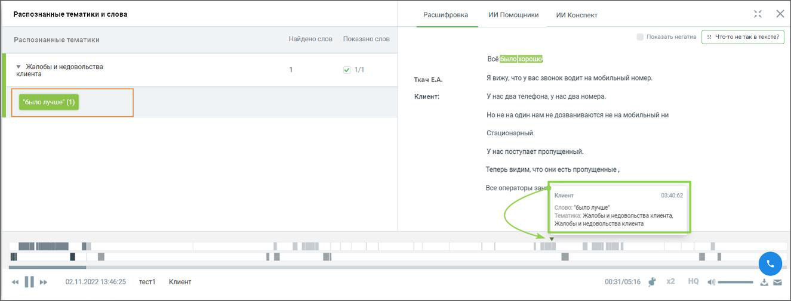

> **Иллюстрация CC-81-44** · стр. 477 · раздел «16.1.4. Анализ по чек-листам» · снимок экрана интерфейса, 1325×505 px.
> Иллюстрирует текст руководства: « Плеер с отметками фрагментов разговора и вхождений терм .»
> Следующий за иллюстрацией текст: «3) Кнопки «Сохранить», «Вернуться к списку»  Клик по кнопке «Вернуться к списку» открывает страницу списка чек-листов.  Клик по кнопке «Сохранить» сохраняет внесенные в чек-лист изменения. Если …»

3) Кнопки «Сохранить», «Вернуться к списку»  Клик по кнопке «Вернуться к списку» открывает страницу списка чек-листов.  Клик по кнопке «Сохранить» сохраняет внесенные в чек-лист изменения. Если изменения не вносились, кнопка не активна. 4) Кнопки экспорта Файл статистики может быть экспортирован в форматах Csv, Excel. Для экспорта нажмите кнопку соответствующего формата рядом с подсказкой «Скачать». Если по разговору сформированы ответы ИИ Помощников и/или ИИ Конспект, в выгрузку (вкладка «Детализация») можно включить чекбокс «ИИ Помощники» — тогда в файл добавляются ответы всех активных помощников (по одному столбцу на каждого, заголовок столбца — название помощника) и данные ИИ Конспекта. Вкладка "График"

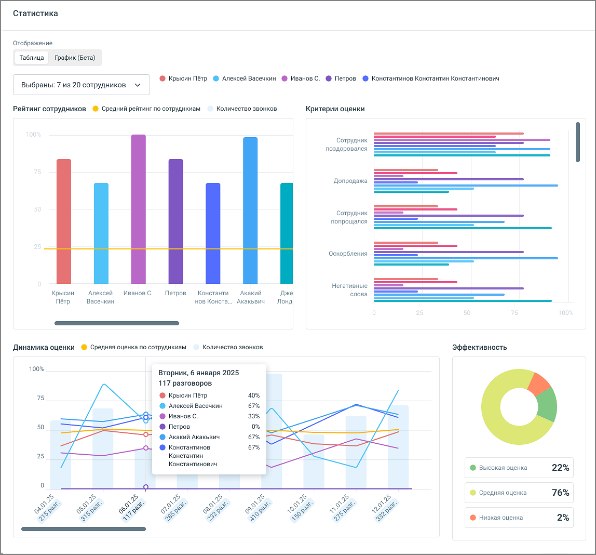

> **Иллюстрация CC-81-45** · стр. 478 · раздел «16.1.4. Анализ по чек-листам» · снимок экрана интерфейса, 1148×1068 px.
> Иллюстрирует текст руководства: «3) Кнопки «Сохранить», «Вернуться к списку»  Клик по кнопке «Вернуться к списку» открывает страницу списка чек-листов.  Клик по кнопке «Сохранить» сохраняет внесенные в чек-лист изменения. Если изменения не вносились, кнопка не активна. 4) Кнопки экспорта Файл статистики может быть экспортирован …»
> Следующий за иллюстрацией текст: «Вкладка "График" содержит следующие элементы:  Рейтинг сотрудников: Бары отображают сравнительный рейтинг выбранных в чек-листе сотрудников.  Критерии оценки: Горизонтальные линейные графики …»

Вкладка "График" содержит следующие элементы:  Рейтинг сотрудников: Бары отображают сравнительный рейтинг выбранных в чек-листе сотрудников.  Критерии оценки: Горизонтальные линейные графики показывают распределение различных оценочных критериев применительно к сотруднику.  Динамика оценки: Линейные графики для анализа изменений оценок каждого из сотрудников во времени.  Эффективность: Круговая диаграмма для визуализации процентного распределения оценок по сотрудникам.

### 16.1.5. Ловец инсайтов

Данные отчета позволяют прослеживать – как фраза или тематика разговора повлияла на ход разговора. Таким образом отчет Ловец инсайтов позволяет в наглядном виде ознакомиться с причинами, которые не позволяют сотруднику работать на максимуме своей эффективности.

Отчет состоит из двух блоков: 1) Блок параметров 2) Блок результатов Блок параметров

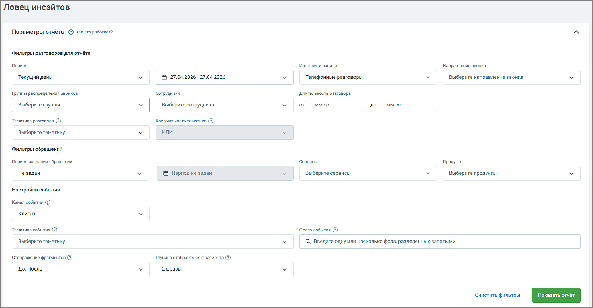

> **Иллюстрация CC-81-46** · стр. 479 · раздел «16.1.5. Ловец инсайтов» · снимок экрана интерфейса, 1628×848 px.
> Иллюстрирует текст руководства: «Отчет состоит из двух блоков: 1) Блок параметров 2) Блок результатов Блок параметров»
> Следующий за иллюстрацией текст: «При формировании отчета пользователям доступна фильтрация: Период – в какой период состоялись диалоги, которые должны войти в отчет. Выпадающее меню, с вариантами периода: произвольный, текущий день, …»

При формировании отчета пользователям доступна фильтрация: Период – в какой период состоялись диалоги, которые должны войти в отчет. Выпадающее меню, с вариантами периода: произвольный, текущий день, текущая неделя, текущий месяц, с прошлого месяца, с позапрошлого месяца; Источники записи – выбор типа записи разговора: телефонные разговоры, текстовые коммуникации; Направление звонка – входящий, исходящий, внутренний звонок или текстовое сообщение; Сотрудники – список всех сотрудников, сгруппированный по группам. Если ни один сотрудник не выбран, отчет формируется по всем сотрудникам; Группы распределения звонков – список всех групп сотрудников Личного кабинета. При выборе каких-либо групп в отчетах будут отображаться только разговоры сотрудников, принадлежащих к выбранным группам. Если ни одна группа не выбрана, отчет формируется по всем группам; Длительность разговора – продолжительность разговора; Тематика разговора – выбор одной или нескольких тематик, которые звучали в разговоре. Как учитывать тематики – выбор логики для тематик, с помощью которой будут фильтроваться звонки. И – в отчёт попадут разговоры, где прозвучала каждая из выбранных тематик. ИЛИ – в отчёт попадут разговоры, где прозвучала хотя бы одна из выбранных тематик; Период создания обращений – выбор периода, когда было создано обращение. Выпадающее меню, с вариантами периода: произвольный, текущий день, вчера, текущая неделя, текущий месяц, с прошлого месяца, с позапрошлого месяца; Сервисы – список доступных сервисов MANGO OFFICE; Продукты – список подключенных продуктов MANGO OFFICE;

Фраза события – триггер, т.е. слово или фраза, характеризующие важное для бизнеса событие, причины и реакции которых необходимо проанализировать. Для уточнения поиска используйте символы ! и " ", как указано в пункте Правила обработки поисковых запросов; Канал события – выбор канала Клиент или Сотрудник, в котором необходимо найти событие. Тематика события – выбор тематики, характеризующей важное для бизнеса событие, причины и реакции которой необходимо проанализировать. В выпадающем окне доступны тематики, настроенные для выбранного ранее канала. Отображение фрагментов: До – это фрагмент разговора сотрудника или клиента, который звучал до искомого события. После – это фрагмент разговора, который звучал после события. Если не выбран ни один из показателей, в отчете отобразится только контекст события; Глубина отображения фрагмента – количество фраз, которые отобразятся в Блоке результатов отчета; Клик по кнопке Очистить фильтры очищает выбранные параметры фильтрации. Клик по кнопке Показать отчет отображает блок результатов. Блок результатов

Блок содержит подробную информацию о срабатывание триггера, с отображением причины и результата срабатывания.

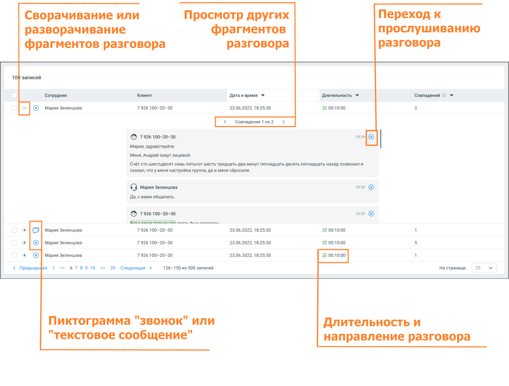

> **Иллюстрация CC-81-47** · стр. 480 · раздел «16.1.5. Ловец инсайтов» · снимок экрана интерфейса, 1218×926 px.
> Иллюстрирует текст руководства: «Блок содержит подробную информацию о срабатывание триггера, с отображением причины и результата срабатывания.»
> Следующий за иллюстрацией текст: «Блок результатов содержит следующие данные:  Клиент и сотрудник, участники разговора  Источник записи  Длительность и направление разговора  Дата и время разговора»

Блок результатов содержит следующие данные:  Клиент и сотрудник, участники разговора  Источник записи  Длительность и направление разговора  Дата и время разговора

 Количество совпадений с триггером в разговоре. Если в разговоре триггер сработал несколько раз, то для навигации по срабатываниям используйте пиктограммы влево <, и вправо >  Фрагменты разговора, в которых сработал триггер. В каждом фрагменте есть пиктограмма, которая открывает плеер или осциллограмму разговора: o с первой фразы причины триггера (для настроек отображения – Причина и Реакция) o с фразы, где имеется триггер (для настроек отображения – Реакция)

### 16.1.6. Показатели отчетов

Для построения отчетов устанавливаются показатели, по которым будет формироваться отчет.

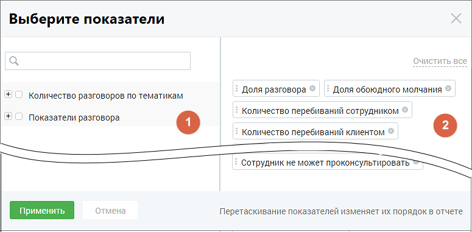

> **Иллюстрация CC-81-48** · стр. 481 · раздел «16.1.6. Показатели отчетов» · снимок экрана интерфейса, 775×381 px.
> Иллюстрирует текст руководства: «Для построения отчетов устанавливаются показатели, по которым будет формироваться отчет.»
> Следующий за иллюстрацией текст: «Окно выбора показателей содержит две группы:»

Окно выбора показателей содержит две группы:

1. В группе «Количество разговоров по тематикам» отображаются все тематики продукта: предустановленные и созданные пользователем, включая неактивные, а также ИИ тематики, распознанные с помощью ИИ Тегирования — в том числе по чатам, если подключена аналитика текстовых коммуникаций. По показателям можно проанализировать корректность речи сотрудника и речь клиента.

2. Для типа записи разговора «Текстовые коммуникации» в качестве показателей в отчетах отображаются только данные разговоров по тематикам.

3. Группа «Показатели разговора» включает в себя следующие характеристики звонка: Общая длительность записи – показывает общую длительности записи с момента подъема трубки до окончания разговора; Длительность разговора – показывает суммарное количество времени, когда хотя бы один из участников разговора говорил; Длительность обоюдного молчания – показывает, сколько времени сотрудник тратит на поиск информации, требующейся клиенту, а также насколько быстро сотрудник может ответить на вопросы клиента;

Доля разговора – отношение длительности разговора к общей длительности записи. Позволяет понять, какую долю от общего времени записи собеседники были заняты разговором; Доля обоюдного молчания – отношение длительности обоюдного молчанию к длительности записи. Позволяет понять, какую долю от общего времени записи клиент ожидает ответа сотрудника; Количество перебиваний сотрудником – позволяет понять, сколько раз сотрудник перебил клиента; Количество перебиваний клиентом - позволяет понять, сколько раз клиент перебил сотрудника. Если у какого-то сотрудника этот показатель сильно отличается от остальных, то, вероятно, способ донесения сотрудником информации не соответствует ожиданиям клиента; Доля обоюдного разговора – доля разговора, когда клиент и сотрудник говорили одновременно. Позволяет понять стиль общения сотрудника с клиентом; Доля разговора сотрудника – доля разговора, когда говорил только сотрудник. Позволяет понять, ведет ли сотрудник беседу, или её ведет клиент; Доля разговора клиента – доля разговора, когда говорил только клиент. Позволяет понять, ведет ли сотрудник беседу, или её ведет клиент; Скорость разговора клиента (количество слов в секунду); Скорость разговора сотрудника (количество слов в секунду) – позволяет анализировать, как сотрудник подстраивается под скорость речи клиента. Сравнив этот показатель среди всех сотрудников можно понять, кто слишком быстро говорит, а кто говорит чересчур медленно. Данные выбранных чекбоксов в таблице «Показатели разговора» отчета «Анализ сотрудников» отображаются, как столбцы. Выбранные показатели отображаются на правой стороне окна показателей (блок 2). Для

> **Иллюстрация CC-81-49** · стр. 482 · раздел «16.1.6. Показатели отчетов» · значок (элемент интерфейса), встроенный в текст, 23×26 px.
> Поясняющий текст руководства (рядом с элементом): «удаления показателя из списка выбранных нажмите пиктограмму удаления в строке показателя. Для сохранения внесенных изменений нажмите на кнопку «Применить».»
> Предшествующий контекст: «Доля разговора – отношение длительности разговора к общей длительности записи. Позволяет понять, какую долю от общего времени записи собеседники были заняты разговором; Доля обоюдного молчания – …»

удаления показателя из списка выбранных нажмите пиктограмму удаления в строке показателя. Для сохранения внесенных изменений нажмите на кнопку «Применить».

> **Иллюстрация CC-81-50** · стр. 482 · раздел «16.1.6. Показатели отчетов» · значок (элемент интерфейса), встроенный в текст, 38×32 px.
> Поясняющий текст руководства (рядом с элементом): «Если нажать кнопку «Отменить» или пиктограмму , изменения не будут внесены, а выборка показателей вернется к последней сохраненной версии.»
> Предшествующий контекст: «удаления показателя из списка выбранных нажмите пиктограмму удаления в строке показателя. Для сохранения внесенных изменений нажмите на кнопку «Применить».»

Если нажать кнопку «Отменить» или пиктограмму , изменения не будут внесены, а выборка показателей вернется к последней сохраненной версии.
