# 16.2. Тегирование разговоров в Речевoй аналитике

> Трассировка: PDF §16.2 · сквозные стр. 482-496 · источники: ч.2 `kb/sources/mango-cc-manual/CC_manual_1.26.42-296-590.pdf` с.187-201.

В Речевой аналитике тегирование разговоров выполняется автоматически на основе настроенных тематик, ключевых слов и анализа с использованием чата ИИ. Тематика – метка на разговор, которая устанавливается в зависимости от правил, заданных пользователем, и учитывающих вхождение введенных пользователем терм. Речевая аналитика позволяет автоматически проставлять звонку тематику. Таким образом Речевая аналитика классифицирует звонки, основываясь на наличии в разговоре заданных слов или фраз.

Одному звонку может быть проставлено более одной тематики. Тематика может иметь статус Активна/Неактивна. Распознанному звонку может присваиваться только активная тематика.

По умолчанию в Речевой аналитике включены 35 предустановленных тематик.

Рабочая область вкладки Тематики содержит поиск по тематикам, фильтр по группам тематик (Мои тематики, Совместные, Предустановленные) и таблицы по каждой группе тематик. Поле поиска позволяет искать тематики (без учета словоформ запроса) в названиях тематик, в термах в составе тематик (включая предустановленные тематики, полное содержимое которых скрыто в целях защиты авторских прав) и по ФИО создателей тематик. Доступность групп тематик определяется правами пользователя.

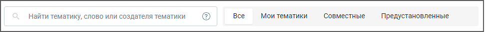

> **Иллюстрация CC-82-1** · стр. 483 · раздел «16.2. Тегирование разговоров в Речевoй аналитике» · снимок экрана интерфейса, 971×65 px.
> Иллюстрирует текст руководства: «Рабочая область вкладки Тематики содержит поиск по тематикам, фильтр по группам тематик (Мои тематики, Совместные, Предустановленные) и таблицы по каждой группе тематик. Поле поиска позволяет искать тематики (без учета словоформ запроса) в названиях тематик, в термах в составе тематик (включая …»
> Следующий за иллюстрацией текст: «1. Тумблер (в демо-версии цвет включенного тумблера – желтый) для новых тематик по умолчанию включен. Система проверяет на вхождение только записи, распознанные после включения тумблера;»

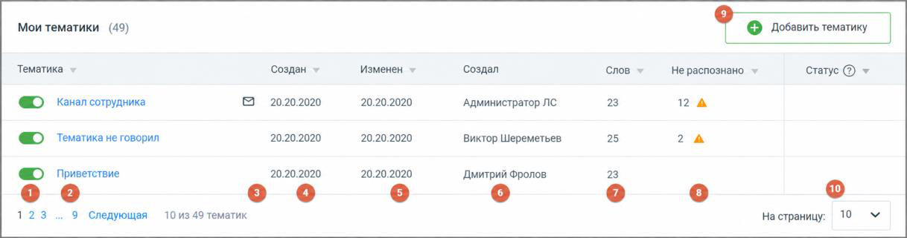

> **Иллюстрация CC-82-2** · стр. 483 · раздел «16.2. Тегирование разговоров в Речевoй аналитике» · снимок экрана интерфейса, 1218×321 px.
> Иллюстрирует текст руководства: «Рабочая область вкладки Тематики содержит поиск по тематикам, фильтр по группам тематик (Мои тематики, Совместные, Предустановленные) и таблицы по каждой группе тематик. Поле поиска позволяет искать тематики (без учета словоформ запроса) в названиях тематик, в термах в составе тематик (включая …»
> Следующий за иллюстрацией текст: «1. Тумблер (в демо-версии цвет включенного тумблера – желтый) для новых тематик по умолчанию включен. Система проверяет на вхождение только записи, распознанные после включения тумблера;»

> **Иллюстрация CC-82-3** · стр. 483 · раздел «16.2. Тегирование разговоров в Речевoй аналитике» · значок (элемент интерфейса), встроенный в текст, 41×27 px.
> Поясняющий текст руководства (рядом с элементом): «1. Тумблер (в демо-версии цвет включенного тумблера – желтый) для новых тематик по умолчанию включен. Система проверяет на вхождение только записи, распознанные после включения тумблера;»
> Предшествующий контекст: «Рабочая область вкладки Тематики содержит поиск по тематикам, фильтр по группам тематик (Мои тематики, Совместные, Предустановленные) и таблицы по каждой группе тематик. Поле поиска позволяет искать …»

1. Тумблер (в демо-версии цвет включенного тумблера – желтый) для новых тематик по умолчанию включен. Система проверяет на вхождение только записи, распознанные после включения тумблера;

2. Название тематики;

3. Пиктограмма «e-mail» – отображается в случае настроенного уведомления на E-mail и/или СМС;

4. Когда создана тематика – дата в формате "ДД.ММ.ГГГГ";

5. Когда изменена тематика – дата в формате "ДД.ММ.ГГГГ";

6. Кем создана тематика – ФИО, для всех тематик, кроме предустановленных;

7. Количество слов в тематике – общее количество распознанных и нераспознанных терм в составе тематики;

8. Количество не распознанных слов – общее количество нераспознанных терм в составе тематики на момент отображения данных;

9. Статус – показывает, на каком этапе находится повторное распознавание разговоров после изменения тематики.

10. Кнопка добавления новой тематики. Для сортировки данных таблицы кликните по наименованию столбца.

### 16.2.1. Создание и редактирование тематики

Для добавления новой тематики щелкните по кнопке "Добавить тематику". Максимальное количество тематик в рамках одного продукта ВАТС – 200. По достижении лимита появляется окно уведомления о необходимости удалить ранее созданные неактуальные тематики. Для редактирования тематики кликните левой кнопкой мыши на название тематики, которую требуется изменить. Внесите необходимые изменения в открывшемся окне тематики. Нажмите кнопку "Сохранить".

Если во вкладке Настройки отмечен чекбокс “Перезаписывание тематик” после редактирования тематики все разговоры – текстовые сообщения и распознанные аудиозаписи звонков – за последние 90 календарных дней будут проверены на соответствие изменившимся условиям. Это может привести к изменениям данных отчетов.

Подробнее о функции Перезаписывание тематик здесь. Панель создания (редактирования) тематики состоит из трех блоков:

1. Блок Ключевых слов (терм)

2. Блок Расширенные настройки

3. Блок Настройки уведомлений

Блок Ключевые слова Блок ключевых слов содержит следующие поля: Название тематики. По умолчанию новая тематика именуется Тематика. Изменить название можно, щелкнув по пиктограмме

> **Иллюстрация CC-82-4** · стр. 484 · раздел «16.2.1. Создание и редактирование тематики» · значок (элемент интерфейса), встроенный в текст, 15×15 px.
> Поясняющий текст руководства (рядом с элементом): «. Допускается ввод не более 62 символов. Ключевые слова. При вводе терм в поле "Ключевые слова" производится проверка на наличие каждого слова в словаре распознавания (с учетом словоформ). Если введенное слово отсутствует в словаре, оно выделяется пиктограммой «!». Вероятно, в написании слова …»
> Предшествующий контекст: «Блок Ключевые слова Блок ключевых слов содержит следующие поля: Название тематики. По умолчанию новая тематика именуется Тематика. Изменить название можно, щелкнув по пиктограмме»

. Допускается ввод не более 62 символов. Ключевые слова. При вводе терм в поле "Ключевые слова" производится проверка на наличие каждого слова в словаре распознавания (с учетом словоформ). Если введенное слово отсутствует в словаре, оно выделяется пиктограммой «!». Вероятно, в написании слова имеется ошибка, поэтому оно не может быть распознано. Речевая аналитика предложит исправить слово или добавить его в словарь распознавания.

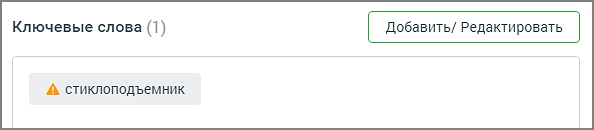

> **Иллюстрация CC-82-5** · стр. 484 · раздел «16.2.1. Создание и редактирование тематики» · снимок экрана интерфейса, 594×130 px.
> Иллюстрирует текст руководства: «. Допускается ввод не более 62 символов. Ключевые слова. При вводе терм в поле "Ключевые слова" производится проверка на наличие каждого слова в словаре распознавания (с учетом словоформ). Если введенное слово отсутствует в словаре, оно выделяется пиктограммой «!». Вероятно, в написании слова …»
> Следующий за иллюстрацией текст: «Подробнее о том, как сформулировать поисковый запрос, узнайте здесь. Блок ИИ. При помощи ИИ (искусственного интеллекта) пользователь может подобрать синонимы и аналогичные выражения к своему списку …»

Подробнее о том, как сформулировать поисковый запрос, узнайте здесь. Блок ИИ. При помощи ИИ (искусственного интеллекта) пользователь может подобрать синонимы и аналогичные выражения к своему списку ключевых слов. Для этого требуется указать несколько ключевых слов и нажать на кнопку «Подобрать слова». После этого в появившемся списке можно выбрать любое слово, и оно автоматически добавится в поле ключевых слов тематики. Также в блоке Искусственного интеллекта доступны следующие действия:

> **Иллюстрация CC-82-6** · стр. 484 · раздел «16.2.1. Создание и редактирование тематики» · фрагмент интерфейса (кнопка, поле, меню), 127×30 px.
> Поясняющий текст руководства (рядом с элементом): «– клик по кнопке добавляет все предложенные синонимы в поле ключевых слов тематики.»
> Предшествующий контекст: «Подробнее о том, как сформулировать поисковый запрос, узнайте здесь. Блок ИИ. При помощи ИИ (искусственного интеллекта) пользователь может подобрать синонимы и аналогичные выражения к своему списку …»

– клик по кнопке добавляет все предложенные синонимы в поле ключевых слов тематики.

> **Иллюстрация CC-82-7** · стр. 484 · раздел «16.2.1. Создание и редактирование тематики» · значок (элемент интерфейса), встроенный в текст, 31×30 px.
> Поясняющий текст руководства (рядом с элементом): «– обновить список синонимов.»
> Предшествующий контекст: «– клик по кнопке добавляет все предложенные синонимы в поле ключевых слов тематики.»

– обновить список синонимов.

> **Иллюстрация CC-82-8** · стр. 484 · раздел «16.2.1. Создание и редактирование тематики» · значок (элемент интерфейса), встроенный в текст, 28×30 px.
> Поясняющий текст руководства (рядом с элементом): «– удалить все синонимы.»
> Предшествующий контекст: «– обновить список синонимов.»

– удалить все синонимы.

> **Иллюстрация CC-82-9** · стр. 484 · раздел «16.2.1. Создание и редактирование тематики» · значок (элемент интерфейса), встроенный в текст, 59×30 px.
> Поясняющий текст руководства (рядом с элементом): «– отметить предложенные синонимы как подходящие или неподходящие.»
> Предшествующий контекст: «– удалить все синонимы.»

– отметить предложенные синонимы как подходящие или неподходящие.

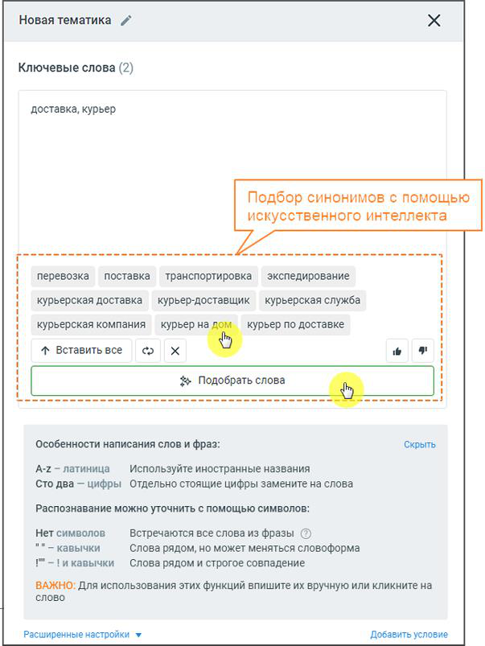

> **Иллюстрация CC-82-10** · стр. 485 · раздел «16.2.1. Создание и редактирование тематики» · снимок экрана интерфейса, 603×803 px.
> Иллюстрирует текст руководства: «– отметить предложенные синонимы как подходящие или неподходящие.»
> Следующий за иллюстрацией текст: «После ввода ключевых слов следует настроить опции распознавания, кликнув по кнопке Расширенные настройки.»

После ввода ключевых слов следует настроить опции распознавания, кликнув по кнопке Расширенные настройки.

Блок Расширенные настройки

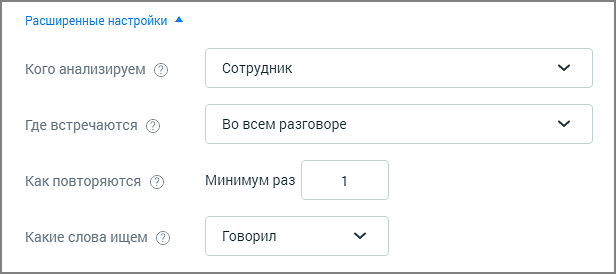

> **Иллюстрация CC-82-11** · стр. 486 · раздел «16.2.1. Создание и редактирование тематики» · снимок экрана интерфейса, 616×274 px.
> Иллюстрирует текст руководства: «Блок Расширенные настройки»
> Следующий за иллюстрацией текст: «Блок добавления условий содержит следующие поля: Кого анализируем – выбор канала для анализа. Если выбран канал «сотрудник», поиск вхождений ведется в том числе и по внутренним разговорам. Если …»

Блок добавления условий содержит следующие поля: Кого анализируем – выбор канала для анализа. Если выбран канал «сотрудник», поиск вхождений ведется в том числе и по внутренним разговорам. Если выбран канал «клиент», поиск вхождений по внутренним разговорам не ведется. Где встречаются - укажите в каком месте разговора искать термы (выберите из выпадающего списка):  Во всем разговоре;  В начале разговора: первые 20% длительности разговора;  В середине разговора: отрезок между началом и концом разговора;  В конце разговора: последние 20% длительности разговора; Для второго и третьего условия выпадающий список "Где встречаются" содержит дополнительные элементы:  В следующей фразе: только в следующем фрагменте разговора после срабатывания предыдущего условия;  В следующих фразах: во всех следующих фрагментах разговора после срабатывания предыдущего условия; Как повторяются - задайте минимальное количество вхождений, необходимое для срабатывания условия. Допускается ввод целого положительного числа, содержащего не более 3 цифр. Данное поле является обязательным для заполнения. Выбор числа, превышающего единицу, исключает возможность единичной ошибки распознавания термы при присвоении звонку тематики.

Эта функция требует осознанного подхода к использованию, так как при этом некоторые целевые звонки могут быть исключены из поиска.

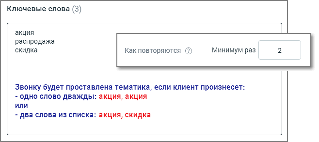

> **Иллюстрация CC-82-12** · стр. 487 · раздел «16.2.1. Создание и редактирование тематики» · снимок экрана интерфейса, 658×293 px.
> Иллюстрирует текст руководства: «Эта функция требует осознанного подхода к использованию, так как при этом некоторые целевые звонки могут быть исключены из поиска.»
> Следующий за иллюстрацией текст: «Какие слова ищем – выпадающий список Говорил/Не говорил задает поиск по наличию либо отсутствию терм в распознанных записях разговоров. Добавить дополнительные условия для данной тематики можно, …»

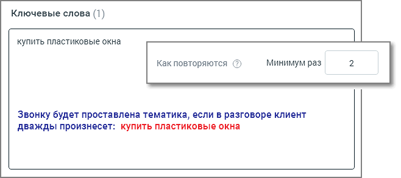

> **Иллюстрация CC-82-13** · стр. 487 · раздел «16.2.1. Создание и редактирование тематики» · снимок экрана интерфейса, 658×293 px.
> Иллюстрирует текст руководства: «Эта функция требует осознанного подхода к использованию, так как при этом некоторые целевые звонки могут быть исключены из поиска.»
> Следующий за иллюстрацией текст: «Какие слова ищем – выпадающий список Говорил/Не говорил задает поиск по наличию либо отсутствию терм в распознанных записях разговоров. Добавить дополнительные условия для данной тематики можно, …»

Какие слова ищем – выпадающий список Говорил/Не говорил задает поиск по наличию либо отсутствию терм в распознанных записях разговоров. Добавить дополнительные условия для данной тематики можно, щелкнув по кнопке Добавить условие. Для одной тематики можно добавить не более трех блоков условий. Модуль Речевая аналитика проверяет звонок на соответствие каждому из условий, в порядке их следования. Только если срабатывают все заданные условия, звонку присваивается тематика.

Настройка уведомлений При добавлении тематики пользователь задает ряд условий. Если срабатывают все заданные условия и звонок отмечается на соответствие тематике, пользователь получает уведомление по электронной почте или посредством СМС-сообщения.

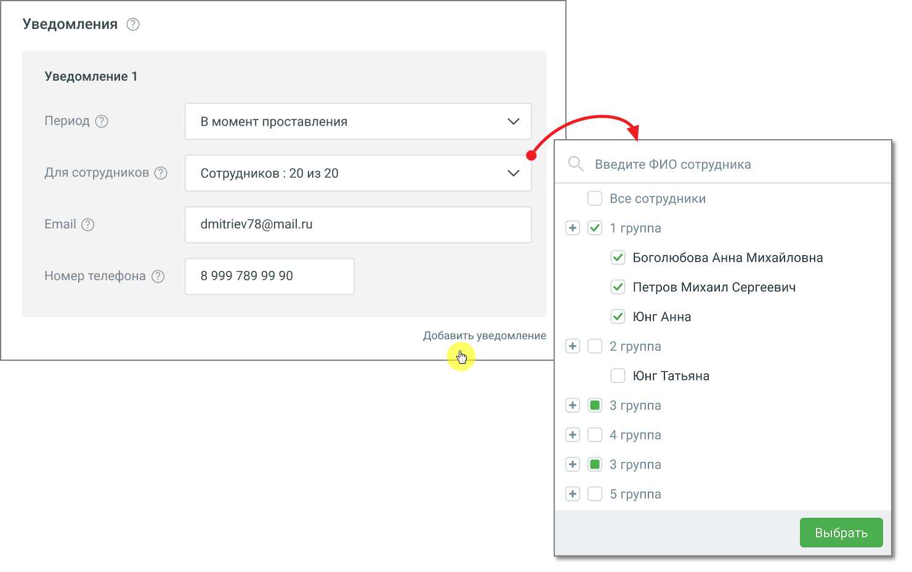

> **Иллюстрация CC-82-14** · стр. 488 · раздел «16.2.1. Создание и редактирование тематики» · снимок экрана интерфейса, 1481×929 px.
> Иллюстрирует текст руководства: «Настройка уведомлений При добавлении тематики пользователь задает ряд условий. Если срабатывают все заданные условия и звонок отмечается на соответствие тематике, пользователь получает уведомление по электронной почте или посредством СМС-сообщения.»
> Следующий за иллюстрацией текст: «Блок уведомлений состоит из строк. Каждая строка – отдельная настройка рассылки; для одной тематики можно добавить не более 10 строк. Строка содержит поля: Когда отправлять:  Не выбрано – …»

Блок уведомлений состоит из строк. Каждая строка – отдельная настройка рассылки; для одной тематики можно добавить не более 10 строк. Строка содержит поля: Когда отправлять:  Не выбрано – установлено по умолчанию;  В момент проставления – при выборе этого значения вам понадобится указать действующий адрес электронной почты, на который будут поступать уведомления о простановке звонку тематики; СМС-уведомления для этого периода недоступны: поле «Номер телефона» становится неактивным.  За прошлый день – уведомление о проставлении звонкам тематик будут поступать один раз в день, в 11 часов по московскому времени. При выборе этого значения вам также необходимо указать действующий адрес электронной почты и/или номер телефона для СМС-сообщений;  За прошлую неделю – уведомление о проставлении звонкам тематик будут поступать каждый понедельник, в 11 часов по московскому времени. При выборе этого значения необходимо указать действующий адрес электронной почты и/или номер телефона для СМС-сообщений (дополнительной оплаты доставки СМС-сообщений не требуется); Кому отправлять – выбор сотрудников и групп. Почта – адрес электронной почты для e-mail-уведомлений. Номер телефона – номер для СМС-уведомлений. СМС-уведомления доступны только для периодов «За прошлый день» и «За прошлую неделю». Значок корзины удаляет строку уведомления. Значок «+» в последней строке добавляет новую строку; после добавления 10 строк значок не отображается. Поля проверяются при нажатии кнопки «Создать» или «Сохранить». Для периода «В момент проставления» необходимо указать почту, для периодов «За прошлый день» и «За прошлую неделю» – почту или номер телефона. Поля с ошибками подсвечиваются, под ними отображается текст ошибки; тематика не сохраняется, пока ошибки не исправлены. Полностью пустая строка удаляется при сохранении тематики.

После установки обновления модуля «Речевая аналитика» параметры уведомлений, настроенные до обновления, сохраняются.

Правила рассылки уведомлений:

1. Отдельные уведомления независимы друг от друга. ПРИМЕР: В двух уведомлениях выбраны идентичные сотрудники, e-mail и номера телефона. В этом слу каждое из этих уведомлений рассылается независимо от другого.  Если на один e-mail/номер телефона настроено более одного уведомления "за пр день" (на, соответственно, более чем одну тематику), то информация агрегируетс одном письме/СМС.  Если на один e-mail/номер телефона настроено более одного уведомления "за пр неделю" (на, соответственно, более чем одну тематику), то информация агрегируе одном письме/СМС.  Пользователям, желающим получать уведомления на звонках «клиент-клиент» (например, на ВАТС без сотрудников, используемой только для Речевой аналитик получения таких уведомлений необходимо выбрать в настройках хотя бы одного сотрудника.

### 16.2.2. Примеры использования тематик

Пример 1. Тематика “Информирование о спецпредложении” Для увеличения среднего чека сотрудник в каждом разговоре должен рассказать клиенту о спецпредложении. Создается тематика “Информирование о спецпредложении”. Из отчета Анализ сотрудников понятно – кто из сотрудников предлагал акцию, а кто нет.

Пример 2. Тематика “Недобросовестные сотрудники” Руководителю необходимо понять, какие сотрудники негативно влияют на продажи/обслуживание. Создается тематика “Недобросовестные сотрудники”. Данные в отчете Анализ сотрудников покажут, какие сотрудники некорректно себя ведут в разговорах с клиентами.

Пример 3. Тематика “Потребность в дополнительных услугах” Необходимо выяснить, какие дополнительные услуги востребованы у клиентов. Создается тематика “Потребность в дополнительных услугах”. В отчете Анализ разговоров будет сформирован список наиболее востребованных услуг.

### 16.2.3. Правила и советы по настройке тематик

Терма – ключевое слово или словосочетание, которое необходимо найти в тексте записи разговора. При вводе терм допускается использование следующих символов:  Кавычки (" " или «») – для поиска точного соответствия поисковому запросу;  Дефис (тире) – для составных слов;

 Буквы (кириллица, латиница);  Цифры;  Пробел;  Восклицательный знак (!).

Виды терм

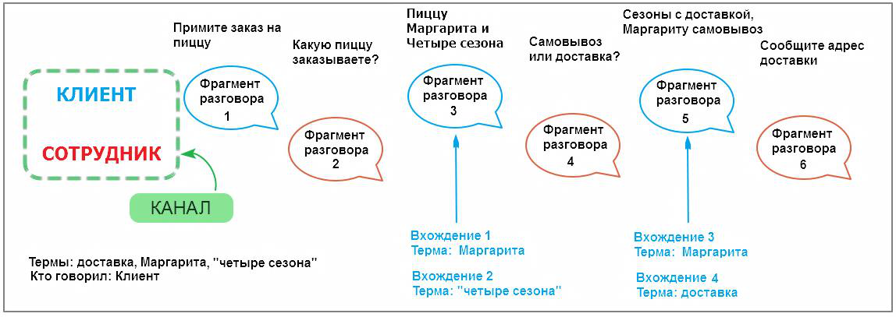

> **Иллюстрация CC-82-15** · стр. 490 · раздел «16.2.3. Правила и советы по настройке тематик» · снимок экрана интерфейса, 1148×407 px.
> Иллюстрирует текст руководства: «Виды терм»
> Следующий за иллюстрацией текст: «Простое слово. Например, слово окно. Допустим, пользователь ищет это слово в речи клиента. Вхождение засчитывается, когда слово окно (с учетом словоформ: окна, окон и т. д.) будет найдено в каком-то …»

Простое слово. Например, слово окно. Допустим, пользователь ищет это слово в речи клиента. Вхождение засчитывается, когда слово окно (с учетом словоформ: окна, окон и т. д.) будет найдено в каком-то из фрагментов разговора клиента. Если слово окно будет найдено 5 раз в одном фрагменте или слово окно будет найдено в 5-ти разных фрагментах, то количество вхождений слова окно будет равно 5.

Словосочетание Например словосочетание купить окно. Допустим, пользователь ищет это словосочетание в речи клиента. Вхождение засчитывается, когда одновременно слово купить и слово окно (с учетом словоформ) встретятся во фрагменте разговора клиента. Например, если клиент сказал Хочу купить ваше пластиковое окно, терма купить окно засчитается.

Словосочетание в точном соответствии Например “купить окно” (отличается от обычной фразы ТОЛЬКО кавычками). Допустим, пользователь ищет в речи клиента словосочетание “купить окно”. Вхождение засчитается только в том случае, когда во фрагменте речи клиента встретится фраза купить окно (с учетом словоформ). Например, если клиент сказал Хочу купить ваше пластиковое окно, терма “купить окно” НЕ засчитается. А если клиент сказал Я очень хочу купить окна, терма “купить окно” засчитается.

Слово или словосочетание без учета словоформ Например !окно (отличается от обычной фразы ТОЛЬКО символом «!») Допустим, пользователь ищет это слово в речи клиента Вхождение засчитывается, когда слово окно (без учета словоформ) будет найдено в каком-то из фрагментов разговора клиента. Например, если в каком-то из фрагментов разговора клиент скажет Я купил одно окно в этой организации.

Чтобы закрепить все словоформы словосочетания, необходимо использовать символ «!» перед первым словом словосочетания – !купить окно. Вхождение засчитывается, если в каком-то из фрагментов разговора клиент скажет Я хочу купить одно окно в этой организации.

Важно: Закрепить одно слово в словосочетании нельзя. Терма вида купить !окно является некорректной. Для поискового запроса !окно, найденные слова "окна", "окон" НЕ засчитываются как вхождение.

Слово или словосочетание в точном соответствии, без учета словоформ «!купить окно» – используйте кавычки и символ ! для закрепления словоформы поискового запроса в точном соответствии. !«купить окно» – второй вариант для закрепления словоформы поискового запроса в точном соответствии. Вхождение засчитывается, если в каком-то из фрагментов разговора клиент скажет Я хочу купить окно с установкой.

1. Создавайте простые тематики, чтобы одна тематика решала максимум одну задачу. Лучше задать несколько узконаправленных тематик, нежели одну общую.

ПРИМЕР Известны основные конкуренты компании, их преимущества, отличия и т. д. Клиенты в разговоре с сотрудниками сравнивают продукты компании с продуктами конкурентов, и руководителю важно понимать, с какими конкурентами сравнивают. Знать параметры – по каким компания выигрывает, по каким проигрывает. Таким образом можно запланировать изменения в продукте/ ценовой политике/ позиционировании на рынке и т. д. Решение: Создаем отдельные тематики для каждого из конкурентов с условиями Клиент, Говорил, Во всем разговоре и смотрим, как их упоминание меняется в динамике по времени. На основании полученных данных в работу компании вносятся изменения: меняется ценовая политика, корректируются позиционирование продукта, уникальное торговое предложение, скрипты продаж.

2. Создавайте несколько тематик для решения одной задачи. По данным отчетов вы сможете увидеть, на каком этапе разговора у сотрудников возникают проблемы.

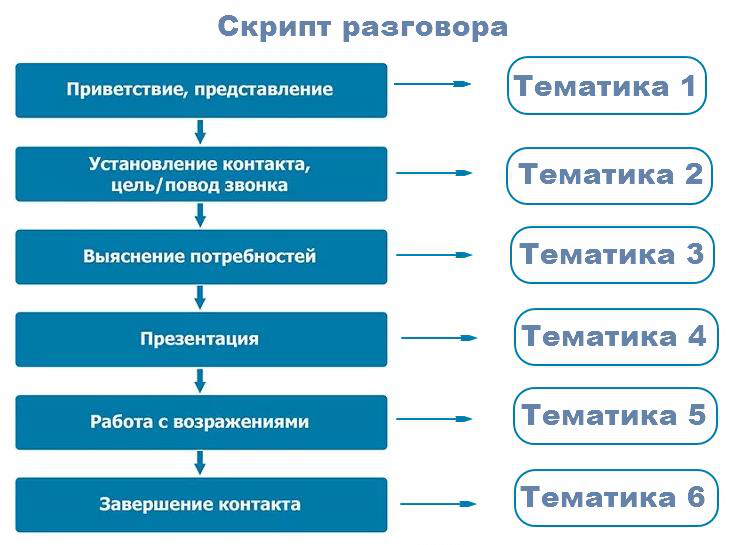

> **Иллюстрация CC-82-16** · стр. 492 · раздел «16.2.3. Правила и советы по настройке тематик» · снимок экрана интерфейса, 735×545 px.
> Иллюстрирует текст руководства: «2. Создавайте несколько тематик для решения одной задачи. По данным отчетов вы сможете увидеть, на каком этапе разговора у сотрудников возникают проблемы.»
> Следующий за иллюстрацией текст: «3. Создавая тематики на негативные сценарии, используйте фильтр НЕ ГОВОРИЛ Помните, что тематики “отрицательной” направленности – Недобросовестные сотрудники, Отказ в услуге и т. д. – могут повлиять …»

3. Создавая тематики на негативные сценарии, используйте фильтр НЕ ГОВОРИЛ Помните, что тематики “отрицательной” направленности – Недобросовестные сотрудники, Отказ в услуге и т. д. – могут повлиять на результаты расчета рейтинга сотрудника/группы.

4. При настройке тематик не задавайте противоречащие друг другу условия. Пример двух противоречащих условий в одной тематике:

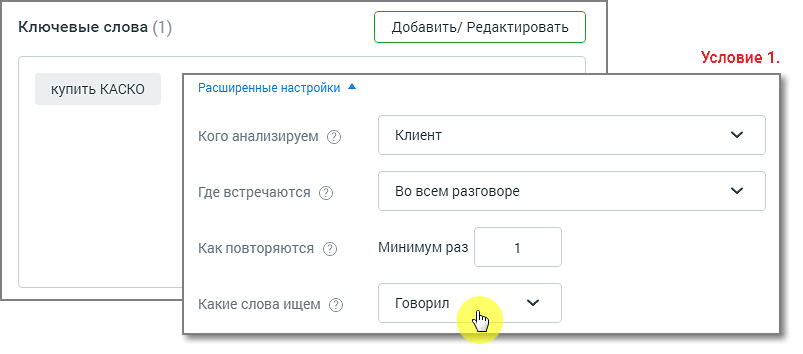

> **Иллюстрация CC-82-17** · стр. 492 · раздел «16.2.3. Правила и советы по настройке тематик» · снимок экрана интерфейса, 803×354 px.
> Иллюстрирует текст руководства: «4. При настройке тематик не задавайте противоречащие друг другу условия. Пример двух противоречащих условий в одной тематике:»
> Следующий за иллюстрацией текст: «5. Создавайте тематику из нескольких условий, только если это необходимо для решения конкретной задачи. Например, если в одном разговоре требуется проанализировать отдельно два канала – сотрудник и …»

> **Иллюстрация CC-82-18** · стр. 493 · раздел «16.2.3. Правила и советы по настройке тематик» · снимок экрана интерфейса, 803×354 px.
> Иллюстрирует текст руководства: «4. При настройке тематик не задавайте противоречащие друг другу условия. Пример двух противоречащих условий в одной тематике:»
> Следующий за иллюстрацией текст: «5. Создавайте тематику из нескольких условий, только если это необходимо для решения конкретной задачи. Например, если в одном разговоре требуется проанализировать отдельно два канала – сотрудник и …»

5. Создавайте тематику из нескольких условий, только если это необходимо для решения конкретной задачи. Например, если в одном разговоре требуется проанализировать отдельно два канала – сотрудник и клиент – на соответствие разным условиям.

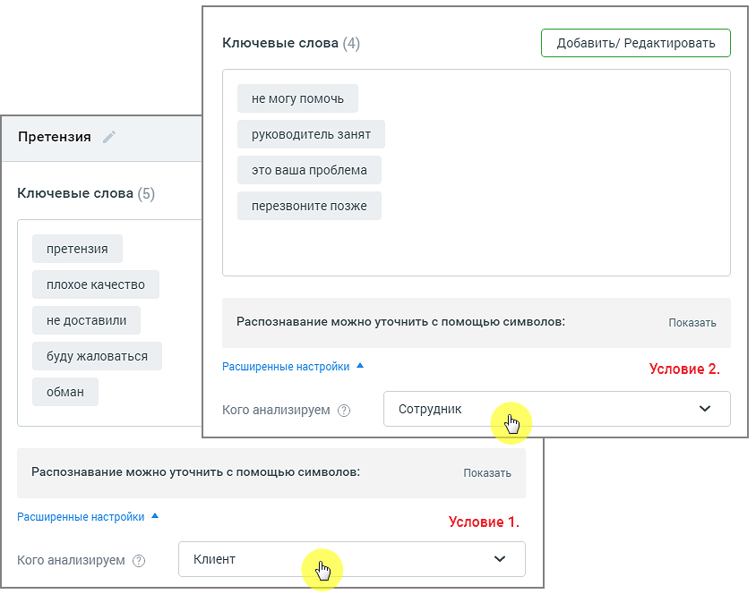

> **Иллюстрация CC-82-19** · стр. 493 · раздел «16.2.3. Правила и советы по настройке тематик» · снимок экрана интерфейса, 844×664 px.
> Иллюстрирует текст руководства: «5. Создавайте тематику из нескольких условий, только если это необходимо для решения конкретной задачи. Например, если в одном разговоре требуется проанализировать отдельно два канала – сотрудник и клиент – на соответствие разным условиям.»

### 16.2.4. ИИ Тематики

Модуль Речевая аналитика поддерживает семантический анализ разговоров на основе запросов к ИИ, что делает возможным анализ диалогов без необходимости подбора ключевых слов. Модуль содержит 15 предустановленных ИИ тематик, которые дают возможность отфильтровать диалоги по используемым в них запросам. Использование ИИ тематик доступно при подключении услуги “ИИ Тематики” в Настройках.

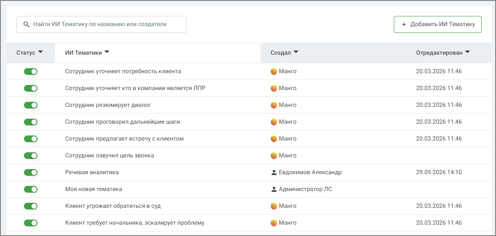

> **Иллюстрация CC-82-20** · стр. 494 · раздел «16.2.4. ИИ Тематики» · снимок экрана интерфейса, 1180×561 px.
> Иллюстрирует текст руководства: «Модуль Речевая аналитика поддерживает семантический анализ разговоров на основе запросов к ИИ, что делает возможным анализ диалогов без необходимости подбора ключевых слов. Модуль содержит 15 предустановленных ИИ тематик, которые дают возможность отфильтровать диалоги по используемым в них …»
> Следующий за иллюстрацией текст: «Для фильтрации диалога по тематике следует установить переключатель соответствующего запроса в положение “включено”. Клик по кнопке “Добавить ИИ Тематику” открывает окно добавления новой тематики. …»

Для фильтрации диалога по тематике следует установить переключатель соответствующего запроса в положение “включено”. Клик по кнопке “Добавить ИИ Тематику” открывает окно добавления новой тематики. Ознакомьтесь с информацией в открывшемся окне и выберите подходящий вариант создания.

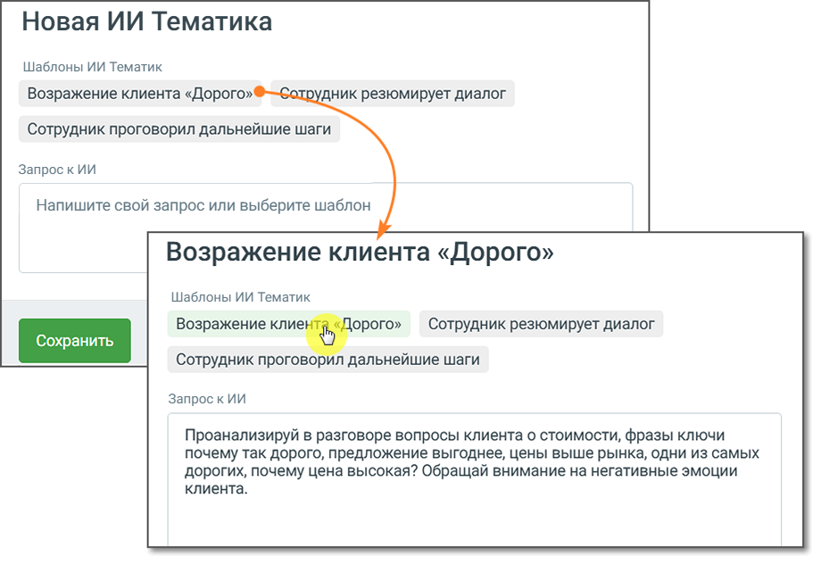

> **Иллюстрация CC-82-21** · стр. 495 · раздел «16.2.4. ИИ Тематики» · снимок экрана интерфейса, 920×632 px.
> Иллюстрирует текст руководства: «Для фильтрации диалога по тематике следует установить переключатель соответствующего запроса в положение “включено”. Клик по кнопке “Добавить ИИ Тематику” открывает окно добавления новой тематики. Ознакомьтесь с информацией в открывшемся окне и выберите подходящий вариант создания.»
> Следующий за иллюстрацией текст: «В этом окне сразу отображается несколько доступных шаблонов. Также доступно поле «Запрос к ИИ», в котором будет отображаться текст, соответствующий выбранному шаблону. При выборе шаблона содержимое …»

В этом окне сразу отображается несколько доступных шаблонов. Также доступно поле «Запрос к ИИ», в котором будет отображаться текст, соответствующий выбранному шаблону. При выборе шаблона содержимое поля запроса обновляется автоматически. При этом можно как переключаться между шаблонами, так и свободно редактировать текст запроса вручную. Однако при ручном редактировании текста в этом поле привязка к шаблону снимается, и тематика переходит в пользовательский режим.

Если у пользователя не подключена соответствующая услуга (которую активирует Персональный менеджер), при нажатии на кнопку Добавить ИИ Тематику будет предложено выбрать способ создания тематики. После этого система предложит заполнить форму обратной связи на подключение услуги. Далее с пользователем свяжется менеджер для активации услуги.

При создании тематики с помощью ИИ важно формулировать ее четко и конкретно. Указывайте контекст или дополнительные условия, если они необходимы для правильного понимания тематики. Вопрос должен быть сформулирован таким образом, чтобы на него можно было ответить только "да" или "нет". Чем точнее будет вопрос-промт, тем более конкретный и полезный результат вы получите. После сохранения ИИ Тематика будет автоматически активирована. Система начнет тегировать звонки согласно тематике. Ограничения:  Лимит символов: Текст тематики может содержать не более 400 символов. Название – до 64 символов. Поддерживаются символы: А-я, A-z, ёЁ, пробелы, знаки пунктуации (/, – . ?).  Лимит: Вы можете создать не более 500 ИИ тематик.  Лимит активных ИИ тематик: Если в системе уже активировано 20 ИИ тематик, новая ИИ тематика будет добавлена в выключенном состоянии.  Длительность разговора: разговоры короче 20 секунд ИИ тематиками не тегируются.

 Лимит бесплатных символов: для ИИ Тематик действует отдельный бесплатный лимит символов. Остаток отображается в Настройках, в блоке ИИ Тегирование; после исчерпания лимита там же отображается цена за 1 000 символов. Оплачиваются только символы промпта и ответа ИИ, длина самого разговора не тарифицируется. Списание происходит каждую ночь. После сохранения ИИ тематики пользователь имеет возможность отредактировать ее или удалить. Для удаления ИИ тематики необходимо подтверждение действия.
