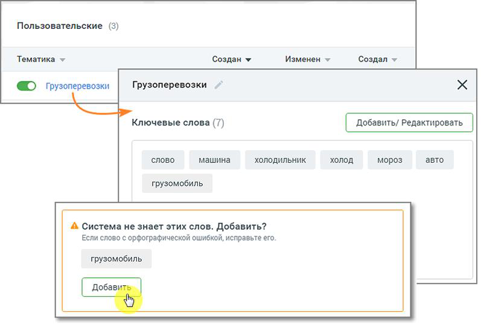
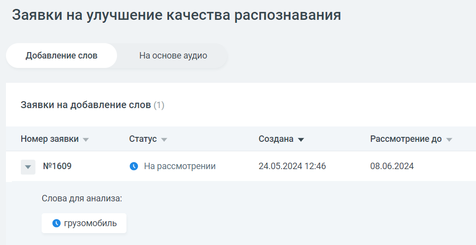
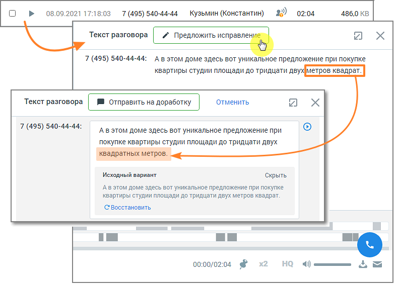
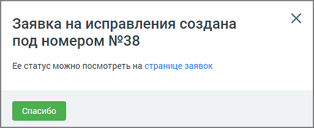
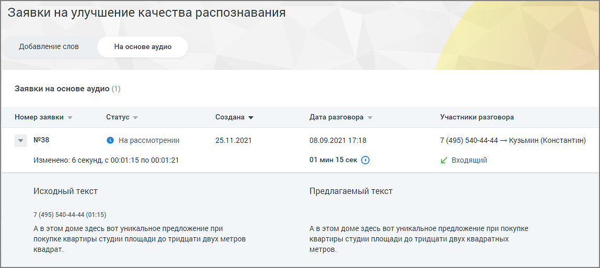

# 16.5. Заявки на улучшение качества распознавания

> Трассировка: PDF §16.5 · сквозные стр. 509-512 · источники: ч.2 `kb/sources/mango-cc-manual/CC_manual_1.26.42-296-590.pdf` с.214-217.

Пользователь, который выбрал для распознавания технологию 3iTech, может отправить заявку на улучшение качества распознавания и отслеживать статус заявки в ЛК ВАТС. Для доступа пользователя к разделу необходимо наличие права «Просматривать и создавать/изменять тематики»

Для доступа пользователя к разделу необходимо наличие права «Просматривать и создавать/изменять тематики».

Подраздел Заявки содержит две вкладки:  Добавление слов  На основе аудио

### 16.5.1. Добавление слов

Чтобы отправить заявку на добавление слова, которое не знакомо «Речевой аналитике», следует в разделе «Тематики» выбрать тематику, в которой имеются незнакомые слова, и открыть карточку тематики.

> **Иллюстрация CC-85-1** · стр. 510 · раздел «16.5.1. Добавление слов» · снимок экрана интерфейса, 797×539 px.
> Иллюстрирует текст руководства: «Чтобы отправить заявку на добавление слова, которое не знакомо «Речевой аналитике», следует в разделе «Тематики» выбрать тематику, в которой имеются незнакомые слова, и открыть карточку тематики.»
> Следующий за иллюстрацией текст: «Внизу карточки тематики будет присутствовать уведомление о незнакомом слове и предложение добавить его в систему. Нажмите кнопку Добавить. Заявка отобразится в окне раздела «Заявки на улучшение …»

Внизу карточки тематики будет присутствовать уведомление о незнакомом слове и предложение добавить его в систему. Нажмите кнопку Добавить. Заявка отобразится в окне раздела «Заявки на улучшение качества распознавания», на вкладке «Добавление слов».

> **Иллюстрация CC-85-2** · стр. 510 · раздел «16.5.1. Добавление слов» · снимок экрана интерфейса, 960×494 px.
> Иллюстрирует текст руководства: «Внизу карточки тематики будет присутствовать уведомление о незнакомом слове и предложение добавить его в систему. Нажмите кнопку Добавить. Заявка отобразится в окне раздела «Заявки на улучшение качества распознавания», на вкладке «Добавление слов».»
> Следующий за иллюстрацией текст: «Окно заявки содержит следующие данные:  Номер заявки  Статус заявки – на рассмотрении, исправления приняты, исправления отклонены.  Дата создания заявки  Дата, до которой будет рассмотрена заявка»

Окно заявки содержит следующие данные:  Номер заявки  Статус заявки – на рассмотрении, исправления приняты, исправления отклонены.  Дата создания заявки  Дата, до которой будет рассмотрена заявка

Также в окне можно ознакомиться с предлагаемым для анализа словом.

### 16.5.2. На основе аудио

Чтобы отправить заявку на улучшение качества распознавания на основе аудиозаписи, в окне расшифровки записи разговора следует нажать кнопку Предложить исправления.

> **Иллюстрация CC-85-3** · стр. 511 · раздел «16.5.2. На основе аудио» · снимок экрана интерфейса, 790×575 px.
> Иллюстрирует текст руководства: «Чтобы отправить заявку на улучшение качества распознавания на основе аудиозаписи, в окне расшифровки записи разговора следует нажать кнопку Предложить исправления.»
> Следующий за иллюстрацией текст: «Далее внесите в текст требуемое исправление и нажмите кнопку Отправить на доработку. На экране отобразится окно системного уведомления:»

Далее внесите в текст требуемое исправление и нажмите кнопку Отправить на доработку. На экране отобразится окно системного уведомления:

> **Иллюстрация CC-85-4** · стр. 511 · раздел «16.5.2. На основе аудио» · снимок экрана интерфейса, 513×210 px.
> Иллюстрирует текст руководства: «Далее внесите в текст требуемое исправление и нажмите кнопку Отправить на доработку. На экране отобразится окно системного уведомления:»
> Следующий за иллюстрацией текст: «Клик по ссылке открывает окно раздела «Заявки на улучшение качества распознавания», на вкладке «На основе аудио».»

Клик по ссылке открывает окно раздела «Заявки на улучшение качества распознавания», на вкладке «На основе аудио».

> **Иллюстрация CC-85-5** · стр. 512 · раздел «16.5.2. На основе аудио» · снимок экрана интерфейса, 1148×514 px.
> Иллюстрирует текст руководства: «Клик по ссылке открывает окно раздела «Заявки на улучшение качества распознавания», на вкладке «На основе аудио».»
> Следующий за иллюстрацией текст: «Окно заявки содержит следующие данные:  Номер заявки  Статус заявки – на рассмотрении, исправления приняты, исправления отклонены.  Дата создания заявки  Дата разговора и его длительность  …»

Окно заявки содержит следующие данные:  Номер заявки  Статус заявки – на рассмотрении, исправления приняты, исправления отклонены.  Дата создания заявки  Дата разговора и его длительность  Участники разговора и информация о звонке (входящий или исходящий) Также в окне можно ознакомиться с исходным и предлагаемым к замене текстом. О времени выполнения заявки пользователь уведомляется системным сообщением.
